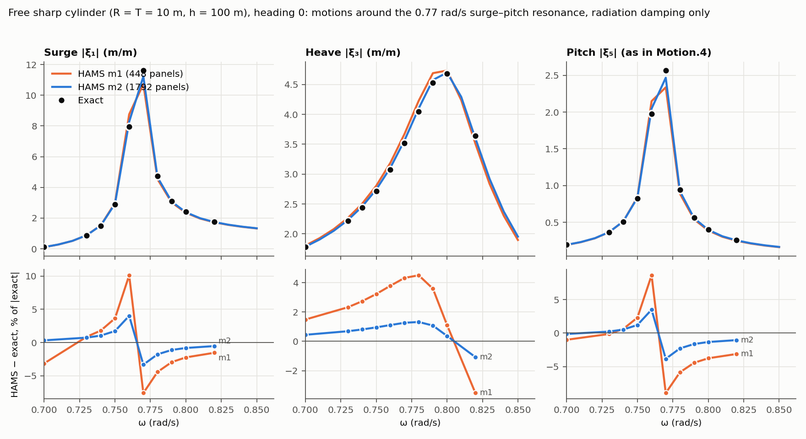

# Second-order wave loads: validation

This page holds the evidence behind the second-order methods, defaults and advice of [SecondOrder.in](input_files.md#secondorderin-optional): the mean drift convergence study, the comparison with Nemoh, the semi-analytical reference for a sharp truncated cylinder, the control-surface study, a study of graded meshes, the quadratic QTFs and the potential part of the difference QTF. The integration fixtures and the limits of their tests are in [test/data/drift_cyl/README.md](../test/data/drift_cyl/README.md). All values are measured unless marked inferred.

## Mean drift convergence study

Run in November 2026 on Snellius (`fat_genoa`, 32 threads, ifx 2024.2) with HAMS built without `-heap-arrays`, because of the crash described in [Developer Documentation](developer_documentation.md#mean-drift-tests), and with `OMP_STACKSIZE=1G` and `ulimit -s unlimited`. Commit dff7a32 makes the documented flag `-heap-arrays 0` work, tested on ifx 2024.2 with the unit and integration tests. The study used [drift_convergence.py](../pre_postprocessing_python/SecondOrder/drift_convergence.py). 80 HAMS runs and 12 Nemoh runs. The per-frequency tables are not in the repository. All values below are measured unless marked inferred.

**Hulls.** Truncated cylinder, radius 10 m, draft 10 m, depth 100 m, with a sharp bilge (graded rows) or a bilge radius of 3 m (cosine rows); 448 to 7168 and 480 to 7680 panels. Bottom-mounted cylinder, radius 5 m, depth 10 m, against MacCamy-Fuchs; 256 to 4096 panels. Box 20 x 10 x 5 m, depth 50 m, sharp, with rounded vertical corners only, and with rounded corners and bilge. Frequencies 0.40 to 1.80 rad/s in steps of 0.2, plus 0.70, 0.95 and 1.10, set before any result. 0.80 rad/s is the heave resonance, and 1.60 is 3% from the first irregular frequency, 1.548 rad/s.

### Near-field against far-field, truncated cylinder

F_x, heading 0, finest mesh, percent of far-field, `differencing` / `source`:

| rad/s | Sharp fixed, 7168 | Sharp free, 7168 | Rounded fixed, 7680 | Rounded free, 7680 |
| ---: | ---: | ---: | ---: | ---: |
| 0.70 | +4.76 / -0.06 | -136 / +10.3 | -0.08 / -0.41 | +0.13 / +1.66 |
| 0.80 | +3.52 / -0.26 | +141 / +5.27 | -0.08 / -0.47 | +0.24 / -1.23 |
| 0.95 | +2.08 / -0.34 | +17.4 / +0.53 | -0.08 / -0.45 | +0.03 / +0.12 |
| 1.00 | +1.74 / -0.34 | +11.3 / +0.05 | -0.07 / -0.45 | +0.04 / -0.33 |
| 1.10 | +1.29 / -0.44 | +5.29 / -0.58 | -0.06 / -0.55 | +0.03 / -0.95 |
| 1.20 | +1.00 / -0.69 | +2.68 / -0.97 | -0.04 / -0.78 | +0.03 / -1.26 |
| 1.40 | +0.53 / -1.59 | +0.89 / -1.84 | -0.02 / -1.45 | +0.03 / -1.86 |
| 1.60 | +0.31 / +2.34 | +0.41 / +3.13 | +0.01 / +1.52 | +0.04 / +2.31 |
| 1.80 | +0.41 / -1.94 | +0.46 / -1.63 | +0.08 / -1.60 | +0.10 / -1.37 |

- The crossing on the sharp hull, `source` closer to 1.20 rad/s and `differencing` from 1.40, also holds at 1792 panels.
- At 0.40 and 0.60 rad/s the free net force is about 3e-6 and 2e-3 of ρg, so percentages there say little. At 0.40 fixed, rounded, the two methods nearly tie (-0.060 / -0.044).
- At 1.60 rad/s `source` is off by 1.5% to 3.1%, with the sign opposite to its neighbours. `differencing` is within 0.5%.

**Sharp free hull at 0.70 rad/s**, F_x / (ρg):

| Panels | Far | Near, `differencing` | Near, `source` |
| ---: | ---: | ---: | ---: |
| 448 | 0.1193 | -0.2829 | 0.1325 |
| 1792 | 0.1127 | -0.1327 | 0.1281 |
| 7168 | 0.1107 | -0.0402 | 0.1222 |

`differencing` keeps falling but has the wrong sign at 7168 panels. `source` is 10% to 14% off on all meshes. Its error, 0.0115 at 7168, is 0.44% of term I. The semi-analytical reference gives 0.10997 (far-field; stated uncertainty 1e-4, and it changes by less than 1.2e-7 over the resolutions), so the far-field column is 8.5%, 2.5% and 0.68% off; see [Semi-analytical reference](#semi-analytical-reference-sharp-truncated-cylinder).

**Rounded hull, `source`.** Its error falls with refinement, but reaching zero is not shown. Fixed at 0.95 rad/s, near minus far is -0.0478, -0.0369, -0.0290, -0.0238 of ρg at 480, 1920, 4320, 7680 panels. The ratio per doubling goes from 0.77 to 0.65, so the local order rises from about 0.4 to 0.6. A constant offset would make it fall instead. At order 0.6, halving the error needs about 10 times the panels (inferred).

**Bottom-mounted cylinder at 4096 panels, against MacCamy-Fuchs:** `differencing` within 0.12% at all 11 frequencies, far-field within 0.17%. `source` within 0.15% up to 1.20 rad/s, then -0.30%, -0.73%, -1.58% at 1.40, 1.60, 1.80.

### Box, heading 30, 1.00 rad/s, fixed

Near-field against far-field, percent:

| Hull | Panels | Method | F_x | F_y | M_z | Force vector |
| :--- | ---: | :--- | ---: | ---: | ---: | ---: |
| Sharp | 7040 | `differencing` | +2.8 | +33.9 | +20.0 | 23.4 |
| Sharp | 7040 | `source` | -0.09 | +12.5 | +9.3 | 8.6 |
| Rounded vertical corners | 1760 | `differencing` | +9.7 | +35.8 | -4.1 | 25.5 |
| Rounded corners and bilge | 8000 | `differencing` | -0.13 | -0.58 | +0.08 | 0.41 |
| Rounded corners and bilge | 8000 | `source` | -0.04 | +2.1 | +1.14 | 1.4 |

- The M_z excess follows the vertical corners and the F_y excess the bilge, on two meshes each.
- On the sharp box, `source` removes about 60% of the residual, which still falls at about 0.7 per doubling.
- Free sharp box at 1760 panels: F_x is -210% with `differencing` and -55% with `source`. Free rounded box at 2000 panels: +6.0% and -9.8%. No free box above 2000 panels was run.

### Irregular frequencies

Free cylinders, F_x error against far-field, percent. `differencing` with `IRSP` 0 / 1, and `source` with `IRSP = 0`:

| Hull, panels | 1.548 rad/s, diff | 1.548, src | 1.939 rad/s, diff | 1.939, src |
| :--- | ---: | ---: | ---: | ---: |
| Rounded, 1920 | +4.0 / +0.50 | -46.6 | +4.7 / +1.2 | -32.4 |
| Sharp, 1792 | +15.5 / +1.6 | -125.9 | +12.6 / +2.7 | -198.5 |

At 1.10 rad/s, away from them, `IRSP = 1` changes the error by at most 0.03 points. On the rounded hull at 1.548 rad/s, `source` goes from -66.1% at 480 panels to -46.6% at 1920.

### Waterline method

Free cylinders at 1920 and 1792 panels, F_x error against far-field. Rounded hull: `extrapolate` is closer at all 11 frequencies, by 0.14 to 1.12 points from 0.70 rad/s up. Sharp hull: `field` is closer by 0.27 to 0.57 points from 0.95 to 1.80 rad/s, where both carry the sharp-edge error (1.3% to 28% with `extrapolate`).

### Settings

- `GRN_KIND = 8`: identical F_x to all printed digits at all 15 entries, at the same time per frequency, and 0.9 GB more memory at 4320 panels.
- `ISOLV = 2`: F_x differs from LU by at most 0.0009 (near) and 0.0003 (far) of ρg on the rounded hull, and 0.003 on the sharp hull at 0.70 rad/s. Run time within 3% at 4320 panels.

### Run time

On Snellius, 32 threads, 11 frequencies, wall time per run:

| Hull, panels | `differencing` | `source` |
| :--- | ---: | ---: |
| Sharp, 7168 | 884 to 885 s | 1750 s |
| Rounded, 7680 | 1031 s | 2042 to 2045 s |

The largest run, the rounded box with `source` at 8000 panels, used 8.40 GB.

## Comparison with Nemoh

Nemoh v3.0.3 ran as a separate program, built outside this repository with ifort and sequential MKL, on Linux (Snellius) and, for the coarsest meshes, on Windows. No Nemoh source or binary, and no Nemoh output file, is in the repository. Only its documented input and output files were used. Nemoh is a code comparison, not a reference truth: it also uses constant panels and shares error sources with the near-field method.

**Inputs.** The nodes and panels of the HAMS case, written by `make_mesh.py --format nemoh`. No lid, `IRSP = 0` in HAMS, no external loads. Fixed bodies through a stiffness of 1e13 in all six modes. 21 frequencies from 0.40 to 1.40 rad/s, below the first irregular frequency. Heading 0, and headings 0 and 30 for the pair. QTF part with the DUOK term only. Drift is read from the diagonal of `results/QTF/OUT_QTFM_N.dat`, times ρg.

**Rule.** The plan set 5% on a converged F_x. Nemoh did not converge on the meshes that worked (below), so the rule for an unconverged mesh applies: HAMS no further from Nemoh than the Nemoh-HydroSTAR spread. That spread is a median of 9.7% in F_x on Nemoh's own `8b_QTF_Cylinder` case at 634 panels, for ω ≥ 0.9 rad/s.

**Nemoh at 4320 panels is unusable.** Its F_x on the rounded fixed cylinder is -3.85 of ρg at 0.95 rad/s, against 5.35 at 1920 panels and 5.31 from HAMS. Nemoh gave no warning and returned 0. On the same mesh its first-order results agree with HAMS (table below), and so do its fixed F_z and M_y, within 1.2%. The cause is unknown. A guess, untested: the top row is 0.0196 m tall at 4320 panels, against 0.044 m at 1920. The comparison therefore rests on 448 to 1920 panels.

**First order**, worst absolute difference over the diagonal terms of A, B, X and the RAOs, plus A15 and B15, at 0.70, 0.80, 0.95, 1.00 and 1.10 rad/s, percent. The 4320-panel runs have only 0.70, 0.95 and 1.10:

| Hull, panels | A | B | X | RAO |
| :--- | ---: | ---: | ---: | ---: |
| Rounded 480 | 3.99 | 5.86 | 1.96 | 9.24 |
| Rounded 1920 | 2.27 | 3.47 | 1.01 | 4.50 |
| Rounded 4320 | 1.54 | 2.15 | 0.79 | 1.44 |
| Sharp 448 | 3.22 | 4.84 | 1.67 | 10.07 |
| Sharp 1792 | 1.84 | 3.46 | 0.84 | 6.25 |

The difference falls with the mesh in all columns. The largest rounded RAO difference is in surge at 0.80 rad/s, the heave resonance: 9.24% at 480 and 4.50% at 1920 panels. Over 0.70, 0.95 and 1.10 only, it is 3.77%, 2.11% and 1.44% at 480, 1920 and 4320 panels, so the 4320 value is not comparable with the two above it. The largest RAO difference on the sharp hull is in surge at 0.70 rad/s.

**Drift**, F_x, heading 0, absolute difference between HAMS near-field and Nemoh, frequencies up to 1.40 rad/s with far-field above 0.5 of ρg:

| Hull, motion | Panels | `differencing` median / worst | `source` median / worst | Spread rule |
| :--- | ---: | ---: | ---: | :--- |
| Rounded, fixed | 1920 | 1.80 / 4.26 | 1.32 / 3.24 | met by both |
| Rounded, free | 1920 | 1.00 / 39 | 0.88 / 30 | median met; worst at 0.80 rad/s |
| Sharp, fixed | 1792 | 3.93 / 7.18 | 1.16 / 1.99 | met by both |
| Sharp, free | 1792 | 14.43 / 176 | 0.80 / 2.48 | missed by `differencing`, met by `source` |

- On the rounded free hull the worst value is at the heave resonance, 0.80 rad/s, where Nemoh itself moves from 0.86 to 1.45 of ρg between 480 and 1920 panels.
- The sharp free hull matches the near-against-far result: `differencing` carries the sharp-edge error, `source` does not.
- Bidirectional pair, rounded free, headings 0 and 30, 1920 panels: HAMS near-field is 6.5% to 6.7% above Nemoh at 0.70 rad/s, 0.85% to 0.90% below at 0.95, and 0.50% to 0.69% above at 1.10, over all four heading pairs, F_x and F_y (F_y of the (0, 0) pair is zero by symmetry and is excluded from these ranges). Informative only. Nemoh's documentation states its QTFs are untested for multi-body problems, and no pair ran at 4320 panels.

## Semi-analytical reference: sharp truncated cylinder

[truncated_cylinder_reference.py](../pre_postprocessing_python/SecondOrder/truncated_cylinder_reference.py) computes the first-order solution and the mean drift of the sharp truncated cylinder of the convergence study (radius 10 m, draft 10 m, depth 100 m) by eigenfunction matching, without panels. It needs no HAMS run. All values in this section were measured with it in November 2026, on a laptop.

**Method.** The potential is a series of vertical eigenfunctions outside the cylinder and in the gap under it, matched at r = a, as in Garrett (1971) for diffraction and Yeung (1981) for radiation. The unknown radial velocity in the gap is expanded in functions that carry the corner singularity of the 270° fluid corner at the bilge, (distance)^(-1/3), and the next terms of the corner expansion. Far-field F_x follows from Maruo's formula (Maruo 1960; Newman 1967) applied to the outgoing wave. Near-field F_x, F_z and M_y follow from the six terms of the pressure integration (WAMIT v7.5 user manual, eqs. 15.54 to 15.57), the terms HAMS-MREL writes to `MeanDriftTerms.txt`, with a quadrature that integrates the corner singularity exactly; the free body uses its own motions, with the mass and stiffness rule of `make_mesh.py` applied to the exact circle.

**Checks.** The script runs 22 checks and exits with 1 if one fails. The main ones, with the measured values:

| Check | Requirement | Measured |
| :--- | :--- | ---: |
| Bottom-mounted limit (gap 0.001 h): X_1 and far-field F_x against MacCamy-Fuchs | 1e-3 | 5.5e-5 and 4.0e-5 |
| Scattered energy against the optical theorem, fixed body | 1e-6 | 2.3e-15 |
| Reciprocity: A15 = A51, B15 = B51, and Haskind X against diffraction X | 1e-8 and 1e-6 | 2.0e-9 and 1.3e-9 |
| B11, B33, B55 against the radiated energy flux | 1e-6 | 1.3e-9 |
| Near-field F_x against far-field F_x, fixed body, 11 frequencies | 5e-4 | 2.3e-6 |
| Near-field F_x against far-field F_x, free body, 11 frequencies | 5e-4 | 4.1e-4 (0.80 rad/s) |
| Velocity at the corner: same limit from the wall and the bottom series | 1e-3 | 1.9e-4 |
| M_y moved to another reference point | 1e-10 | 3.4e-16 |
| Spread of F_x far, F_z, M_y, B11 at 0.70, 0.95, 1.40 rad/s over three resolutions and twice the azimuthal orders | 1e-4 | 1.6e-5, except free F_z at 0.70 rad/s: 2.6e-4 |

The reciprocity and energy values are extrapolated in the number of modes; the bottom-mounted values are extrapolated to zero gap from two gaps. The near-field against far-field residual of the free body is 1.6e-4 to 4.1e-4 at 0.60 to 0.80 rad/s and 1.1e-4 to 1.3e-4 at 1.40 to 1.80 rad/s. The script's docstring states what each check covers and what it does not.

**Uncertainty.** Each value carries a stated relative uncertainty of 1e-4, from the spreads above. The spreads were measured at 0.70, 0.95 and 1.40 rad/s only; at the other frequencies the 1e-4 is carried over, not measured (fixed-body F_z and M_y were measured once at every frequency, within 4.8e-5). Three exceptions:

- free near-field F_x at 0.60 to 0.80 rad/s: 5e-4, from the residual against far-field, which does not fall with the resolution;
- free near-field F_x at 1.40 to 1.80 rad/s: 2e-4, from the residual against far-field, measured 1.1e-4 to 1.3e-4;
- free F_z at 0.70 rad/s: 3e-3, and at 0.80 rad/s: 4e-3. These are estimates, not bounds. They come from a linear fit of F_z against the F_x residual over three gap bases, extrapolated to zero residual. The fit assumes that the F_z error vanishes where the F_x residual does, which is not tested.

Free F_z and M_y at 1.40 to 1.80 rad/s have no separate error estimate: the fit above covers 0.60 to 0.80 rad/s only. Far-field F_x changes by less than 1.2e-7 over the resolutions.

These uncertainties, and the default resolution (64000 modes, three gap families (20, 4, 4), azimuthal orders 0 to 15), hold for this hull only (depth/radius = 10) and the 11 frequencies. The number of modes needed grows with depth/radius: free F_z at 0.90 rad/s changes by 4.9% between 4000 and 16000 modes for radius 10 m, draft 10 m, depth 500 m, and by 0.8% for radius 5 m, draft 8 m, depth 40 m (measured, gap families (20, 4, 4)). For any other cylinder, resolution or frequency the script states no uncertainty (`nan`, an empty field in the CSV: not measured), and `compare` shows `[n/m]`. A new geometry needs the convergence and near-field against far-field F_x measurements repeated before its values carry an uncertainty.

**Reference values.** F/(ρgA²) and M_y/(ρgA²), the normalisation of `MeanDriftPressure.9` (`REFL = 1`), M_y about the origin on the still waterline, heading 0. A13, A35, B13, B35, F_y, M_x and M_z are zero by symmetry.

| Motion | rad/s | F_x far | F_x near | F_z | M_y |
| :--- | ---: | ---: | ---: | ---: | ---: |
| Fixed | 0.70 | 1.75010 | 1.75010 | -4.00842 | 4.70520 |
| Fixed | 0.95 | 5.46404 | 5.46403 | -2.58008 | 13.5153 |
| Fixed | 1.40 | 6.20766 | 6.20766 | -0.330282 | 15.7037 |
| Free | 0.70 | 0.109973 | 0.109929 | -0.6128 | -8.16741 |
| Free | 0.95 | 2.95856 | 2.95854 | 2.17347 | 53.5495 |
| Free | 1.40 | 6.51956 | 6.51884 | 0.735582 | 22.2976 |

`python -I truncated_cylinder_reference.py reference --out CSV` writes all 11 frequencies, fixed and free, with A, B, X, the RAOs, every near-field term and the stated uncertainties.

**HAMS against the reference.** `compare` was run on the results of the convergence study (outside the repository). Finest mesh of each velocity method, 7168 panels, percent (HAMS - reference)/|reference|. An empty cell means the reference is below 1e-4 of the largest value of that quantity. F_x far is the same for both methods. 1.60 rad/s is 3% from the irregular frequency 1.5483 rad/s.

| Motion | rad/s | `source` F_x near | F_x far | `source` F_z | `source` M_y | `differencing` F_x near | `differencing` F_z | `differencing` M_y |
| :--- | ---: | ---: | ---: | ---: | ---: | ---: | ---: | ---: |
| Fixed | 0.40 | +0.86 | -0.07 | +1.34 | +5.75 | +7.79 | +10.5 | +0.40 |
| Fixed | 0.60 | +0.25 | -0.03 | +1.41 | +4.08 | +6.09 | +11.7 | +0.14 |
| Fixed | 0.70 | -0.06 | -0.002 | +1.46 | +3.83 | +4.75 | +12.4 | +0.11 |
| Fixed | 0.80 | -0.24 | +0.03 | +1.69 | +3.62 | +3.55 | +13.4 | +0.05 |
| Fixed | 0.95 | -0.27 | +0.07 | +2.39 | +3.10 | +2.14 | +15.3 | +0.07 |
| Fixed | 1.00 | -0.27 | +0.07 | +2.65 | +2.88 | +1.82 | +16.0 | +0.08 |
| Fixed | 1.10 | -0.36 | +0.08 | +3.10 | +2.44 | +1.37 | +17.4 | +0.08 |
| Fixed | 1.20 | -0.63 | +0.07 | +3.46 | +2.18 | +1.07 | +18.6 | +0.08 |
| Fixed | 1.40 | -1.55 | +0.05 | +4.48 | +2.73 | +0.58 | +21.0 | +0.13 |
| Fixed | 1.60 | +2.42 | +0.08 | +2.86 | -2.43 | +0.39 | +23.0 | +0.09 |
| Fixed | 1.80 | -1.88 | +0.06 | +5.43 | +2.41 | +0.47 | +25.3 | +0.14 |
| Free | 0.40 | | | +0.22 | | | +1.13 | |
| Free | 0.60 | +29.3 | +0.61 | +2.95 | -3.96 | -77.2 | +13.8 | -0.56 |
| Free | 0.70 | +11.1 | +0.68 | +110 | -4.05 | -137 | +506 | -0.77 |
| Free | 0.80 | +5.48 | +0.24 | +319 | +2.62 | +141 | +1215 | +0.03 |
| Free | 0.95 | +0.38 | -0.15 | +20.5 | +1.92 | +17.2 | +68.1 | -0.28 |
| Free | 1.00 | -0.04 | -0.10 | +12.4 | +1.90 | +11.2 | +39.7 | -0.21 |
| Free | 1.10 | -0.63 | -0.06 | +7.56 | +1.91 | +5.23 | +22.9 | -0.14 |
| Free | 1.20 | -0.99 | -0.04 | +6.15 | +2.03 | +2.65 | +17.9 | -0.09 |
| Free | 1.40 | -1.83 | -0.005 | +4.95 | +2.77 | +0.89 | +12.5 | +0.04 |
| Free | 1.60 | +3.27 | +0.12 | +2.87 | -2.28 | +0.54 | +8.27 | +0.08 |
| Free | 1.80 | -1.54 | +0.08 | +2.72 | +2.08 | +0.55 | +4.95 | +0.16 |

What the comparison shows, all measured on these meshes (448, 1792, 7168 panels for both methods, and 4032 for `source` at 0.70, 0.95 and 1.10 rad/s):

- The reference's stated uncertainty is 0.01% for most entries (0.05% for free F_x near at 0.60 to 0.80 rad/s, 0.02% at 1.40 to 1.80 rad/s, 0.3% and 0.4% for free F_z at 0.70 and 0.80 rad/s). Every difference in the table is larger, except far-field F_x at 0.70 rad/s fixed (-0.002%) and 1.40 rad/s free (-0.005%). So the table measures HAMS's error, not the reference's.
- **First order** at 7168 panels, outside 1.60 rad/s: A within 0.29%, B within 1.02% (B33 at 1.80 rad/s), |X| within 0.3%, |RAO| within 0.41%. The worst error falls by 3 to 5 times per doubling of the panels per side (measured ratios 3.1 to 4.6).
- **Far-field F_x** is the closest HAMS result: within 0.08% fixed and 0.68% free at 7168 panels. Free at 0.70 rad/s it is +8.5%, +2.5%, +1.2%, +0.68% at 448, 1792, 4032, 7168 panels.
- **`source`** is the closer method for near-field F_x up to 1.20 rad/s and for F_z at every frequency.
- **`differencing`** is the closer method for M_y wherever it is compared (0.03% to 0.8%, against 1.90% to 5.75% for `source`), and for near-field F_x from 1.40 rad/s. Its F_z is 10% to 25% off fixed at 7168 panels.
- **Cancellation.** The free F_z at 0.70 and 0.80 rad/s is 1.4% and 1.0% of its largest term, and the free near-field F_x at 0.60 and 0.70 rad/s is 2.7% and 4.3%. A few percent of error in a term gives the large percentages there. Free F_z at 0.70 rad/s is +0.059 in HAMS (`source`, 7168 panels) against -0.613. HAMS's terms have the reference's sign and are within 3.4%. The `source` totals at 448, 1792, 4032, 7168 panels are 2.35, 0.81, 0.31, 0.06, and Richardson extrapolation from 448, 1792 and 7168 panels gives -0.65.
- **Signs.** At 7168 panels with `source`, outside 1.60 rad/s, all 210 tested values have the reference's sign: every near-field term of F_x, F_z and M_y, far-field F_x, and the near-field totals that are at least 5% of their largest term. So no sign or conjugation error shows in the drift outputs. Phases are not compared.

**Run time** (laptop, Python 3.7, measured once): `check` (20 checks) 5 min 4 s; `reference --out` (all 22 checks and the rows) 7 min 11 s, of which the rows take 92 s; `compare` 93 s, nearly all of it the reference rows, and under 1 s with `--reference CSV`.

**Sources.**

- Garrett, C.J.R. (1971). Wave forces on a circular dock. J. Fluid Mech. 46(1), 129-139. doi:10.1017/S0022112071000430
- Yeung, R.W. (1981). Added mass and damping of a vertical cylinder in finite-depth waters. Appl. Ocean Res. 3(3), 119-133. doi:10.1016/0141-1187(81)90101-2
- MacCamy, R.C. and Fuchs, R.A. (1954). Wave forces on piles: a diffraction theory. Technical Memorandum 69, Beach Erosion Board.
- Maruo, H. (1960). The drift of a body floating on waves. J. Ship Res. 4, 1-10.
- Newman, J.N. (1967). The drift force and moment on ships in waves. J. Ship Res. 11(1), 51-60. doi:10.5957/jsr.1967.11.1.51
- WAMIT User Manual, Version 7.5, section 15.8, eqs. 15.54 to 15.57.

## Control-surface method

The control-surface (middle-field) method of Chen (2007), on the hulls of the [convergence study](#mean-drift-convergence-study). The fixture-level checks are in [test/data/drift_cyl/README.md](../test/data/drift_cyl/README.md#control-surface-method).

### Far-field components, F_x, F_y and M_z

The control-surface F_x, F_y and M_z (Chen 2007, eqs. 39-41) against far-field, at mesh multiples m1 to m4 of the fixture hulls (panel counts x1, x4, x9, x16), finite depth 100 m, 11 frequencies from 0.4 to 1.8 rad/s; headings 0 and 30 for the cylinders, 30 for the boxes, 0 for the bottom-mounted cylinder [measured, Snellius `fat_genoa`, 32 threads, 2026-11-06 and 2026-11-07]. The error is the worst over frequencies, headings and the three components of |control - far| / max(1% |far|, 1e-3 rho g A^2 a^k), with a = 10 m and k = 1 for forces, 2 for M_z; above 1 fails. The tolerance floor keeps small far-field values, such as F_x at 0.4 rad/s, from setting the result. Cases are run with [drift_convergence.py](../pre_postprocessing_python/SecondOrder/drift_convergence.py).

| Hull, motion | Velocity | m1 | m2 | m3 | m4 |
| :--- | :--- | ---: | ---: | ---: | ---: |
| sharp cylinder, fixed | green | 2.80 | **0.70** | 0.02 | 0.14 |
| sharp cylinder, free | green | 2.80 | **0.55** | 0.11 | 0.17 |
| sharp box, fixed | green | 1.71 | **0.59** | | 0.05 |
| sharp box, free | green | 1.87 | **0.58** | | |
| round cylinder, fixed | green | 2.79 | 0.68 | 0.02 | 0.12 |
| round cylinder, free | green | 2.80 | 0.53 | 0.12 | 0.16 |
| round-corner box, fixed | green | 1.42 | 0.29 | | 0.06 |
| round-corner box, free | green | 1.65 | 0.22 | | |
| bottom-mounted cylinder | green | 1.75 | 0.31 | | 0.16 |
| sharp cylinder, fixed | source | 4.02 | 1.90 | 1.18 | 0.91 |
| sharp cylinder, free | source | 6.53 | 2.64 | 1.02 | 1.21 |
| sharp box, fixed | source | 2.30 | 1.16 | | 0.57 |
| sharp box, free | source | 70.5 | 34.4 | | |

m3 runs 0.70, 0.95 and 1.10 rad/s only, and the m4 boxes 0.8, 1.0 and 1.4 rad/s. The round-cylinder m3 entries come from the default-settings runs that the study's settings and Nemoh groups add (`d_base_round_free_diff_m3`, `n_round_fixed_diff_m3`). Blank: not run.

- The green route is within the tolerance at m2 on every hull, and at worst 0.17 at m4 [measured]. The bold entries are the acceptance gate of the green route: sharp cylinder and sharp box at m2, all frequencies.
- At m1 the green route fails on every hull, at 1.4 to 2.8 times the tolerance, so the m1 meshes (256 to 500 panels, the CI fixtures) are coarser than this tolerance allows [measured]. The CI limits in [the fixture README](../test/data/drift_cyl/README.md#control-surface-method) are set from measured values at those meshes, not from this tolerance.
- The source route converges more slowly, and its M_z on the free sharp box is 34 times the tolerance at m2 [measured]. It stays an option, not the default.
- Before the field-mode fix, the green route failed on the fixed sharp box at m2 (3.8 times the tolerance, F_x at 0.6 rad/s), and the free round cylinder at m4 was 2.7 [measured]. The fix left far-field, near-field and first-order values unchanged in every row [measured].
- The green-route runs took about 30% longer in the second study than in the first on the same partition (882 s against 675 s for the sharp cylinder at m2) [measured]. A laptop run of the box at m1 gave the same field time before and after the fix, so the cause is not isolated [measured].

### Vertical force and roll and pitch moments, F_z, M_x and M_y

The vertical force and the roll and pitch moments of the control-surface method (Chen 2007, eqs. 37-38, with F between the hull waterline and Γc), with the default `cs_*` settings and `cs_velocity = green`, against near-field (F_z of the sharp hull: against a semi-analytical reference). Rounded and sharp cylinder (a = 10 m), fixed and free, 100 m depth, at m1 to m4 (480/1920/4320/7680 panels rounded, 448/1792/4032/7168 sharp), 0.70, 0.95 and 1.10 rad/s, plus the 11 frequencies of the study above at m1 and m2 [measured, Snellius, 2026-11-07].

| Load | Reference | Result |
| :--- | :--- | :--- |
| M_x, M_y | near-field at m4, tolerance max(1% of the reference, 1e-3 rho g A^2 a^2) | within the tolerance on both hulls at m3 and m4; worst 0.44 of it (rounded, m3) and 0.57 (sharp, m3) |
| F_z, rounded | extrapolated near-field limit f0 + C h^p, fitted over m2 to m4 (h = 1/2, 1/3, 1/4) | control at m3 (0.70, 0.95, 1.10 rad/s): fixed 0.4%, 0.9%, 1.9%; free 0.0%, 0.5%, 0.8%. At m4 fixed 1.10 rad/s is 1.2% |
| F_z, sharp, fixed | [semi-analytical reference](#semi-analytical-reference-sharp-truncated-cylinder) | control at m3 / m4 (0.70, 0.95, 1.10 rad/s): 0.40 / 0.31%, 0.89 / 0.63%, 2.26 / 1.44% |
| F_z, sharp, free | [semi-analytical reference](#semi-analytical-reference-sharp-truncated-cylinder) | control at m3 / m4: 0.81 / 0.71%, 0.04 / 0.09%, 0.77 / 0.53% |

- The rounded-hull limits of near-field and control agree within 0.4% at all six (motion, frequency) pairs, so the m3 and m4 differences are mesh error in both methods [measured].
- The sharp hull is the truncated cylinder (radius 10 m, draft 10 m, depth 100 m) of [truncated_cylinder_reference.py](../pre_postprocessing_python/SecondOrder/truncated_cylinder_reference.py), which gives a semi-analytical F_z with an uncertainty of 1e-4 rho g A^2 (3e-3 free at 0.70 rad/s). The errors above are (HAMS - reference)/|reference| at heading 0 [measured]. There is no such reference for the rounded hull, so its F_z is checked against the extrapolated near-field limit.
- Near-field F_z (differencing) on the sharp hull still moves with the mesh: the 3-point fitted order is 0.66 to 0.76 at every frequency, with term 3 (velocity) dominant. At m4 (7168 panels) it is 12% to 17% off the reference on the fixed hull and 23% to 506% off on the free hull. Free at 0.70 rad/s the reference is -0.6128, control -0.6171 and near-field +2.49 [measured]. The cause is the right-angled bottom edge, where the velocity is singular [inferred].
- Advice: on hulls with sharp edges, use the control-surface F_z, and do not take near-field F_z at these meshes as the reference. Near-field F_z needs a much finer mesh there.
- Not covered: at m2 (1920 and 1792 panels), F_z, M_x and M_y at 1.6 to 1.8 rad/s differ from near-field of the same run by up to about 30%, and m3 and m4 were not run at those frequencies [measured].
- Numbers are as measured; no convergence order of the control-surface method is claimed.

## Near-field on meshes graded towards a sharp edge

On the sharp truncated cylinder (radius 10 m, draft 10 m, depth 100 m), near-field F_z converges slowly with the default cosine rows: the fitted order is about 0.7. The velocity at the right-angled bottom edge grows like (distance)^(-1/3), and cosine spacing puts rows of size about (i/n)^2 next to the edge, so the first rows carry an error that falls only like n^(-2/3) [inferred]. Stronger grading at the edge should raise the order. This study measured it [Snellius `fat_genoa`, 32 threads, 2026-11-08, the build of the control-surface study].

**Meshes.** The panel counts of the convergence study (1792, 4032, 7168 panels, m2 to m4), with the same waterline polygon, so the hydrostatics and the waterline term are unchanged. Wall rows at z = -d f(i/n_z) with f(s) = s^2 / (s^2 + (1 - s)^q), quadratic at the waterline and of power q at the bilge; bottom rings at r = a (1 - (i/n_r)^q), fine at the rim. q = 3 (b3) and q = 4 (b4). The finest bilge row is 3e-4 m (b3) and 1e-5 m (b4) at m4. A first run with power q at both ends of the wall put a row of 1e-5 m at z = 0 for q = 4 at m4, which the input check rejects as a lid panel; it is not used here.

**F_z, near-field, heading 0**, percent (HAMS - reference)/|reference|, at m2 / m3 / m4, against the [semi-analytical reference](#semi-analytical-reference-sharp-truncated-cylinder):

| Motion, rad/s | Velocity | Cosine | b3 | b4 |
| :--- | :--- | ---: | ---: | ---: |
| Fixed 0.70 | `differencing` | +20.5 / +15.3 / +12.4 | +10.7 / +6.6 / +4.6 | +6.1 / +3.1 / +2.0 |
| Fixed 0.95 | `differencing` | +25.3 / +18.9 / +15.3 | +13.2 / +8.2 / +5.7 | +7.5 / +3.8 / +2.5 |
| Fixed 1.10 | `differencing` | +28.7 / +21.5 / +17.4 | +15.0 / +9.3 / +6.5 | +8.5 / +4.3 / +2.8 |
| Free 0.70 | `differencing` | +838 / +623 / +506 | +471 / +289 / +199 | +310 / +158 / +103 |
| Free 0.95 | `differencing` | +111 / +83 / +68 | +60 / +38 / +26 | +36 / +19 / +12.6 |
| Free 1.10 | `differencing` | +37 / +28 / +23 | +19.8 / +12.5 / +8.6 | +11.4 / +6.0 / +4.1 |
| Fixed 0.70 | `source` | +3.2 / +2.0 / +1.5 | -1.7 / +1.7 / -3.5 | -2.5 / +1.6 / -2.7 |
| Fixed 1.10 | `source` | +6.4 / +4.2 / +3.1 | -0.6 / +3.6 / -3.8 | -1.5 / +3.4 / -2.8 |
| Free 0.70 | `source` | +232 / +150 / +110 | +64 / +150 / -77 | +57 / +157 / -38 |
| Free 0.95 | `source` | +41 / +27 / +21 | +15.5 / +25.4 / -4.7 | +13.5 / +25.8 / -0.4 |

- With `differencing`, b4 converges steadily: from m2 to m4 the order is about 1.5, against 0.7 on the cosine mesh. Fixed F_z is within 2.8% at m4. M_y moves the other way: 0.07% to 0.8% on the cosine mesh, 0.6% to 2.5% with b4, at m4.
- With `source`, the graded meshes change the sign of the error from m2 to m3 and back at m4, on both gradings and in a first run with fine rows at both ends. The cause is not known.
- The free hull at 0.70 rad/s, near the heave resonance, stays off by 38% or more on every mesh. Its F_z is a small difference of large terms.
- The control-surface F_z on the cosine mesh (4032 and 7168 panels) is within 2.3% and 1.4% of the reference in every case (see [above](#vertical-force-and-roll-and-pitch-moments-f_z-m_x-and-m_y)). It stays the advised value on sharp hulls.

## Quadratic QTFs

The quadratic part of the QTFs (`qtf` in `SecondOrder.in`) uses the near-field terms of the mean drift with two frequencies. Its checks:

- In the tests, the diagonal of `QTF_Quadratic.10d` equals `MeanDriftPressure.9` row for row, `.10d` is Hermitian and `.10s` symmetric over frequencies, headings and two bodies, and the kernel reproduces the product of two bichromatic signals at any time (`test/test_near_field.f90`, `test/test_qtf.f90`, `test/test_integration_drift.f90`).
- The off-diagonal values are compared with the [semi-analytical reference](#semi-analytical-reference-sharp-truncated-cylinder) (`truncated_cylinder_reference.py qtf`, the same near-field terms of the eigenfunction solution, for every pair of the 101 frequencies 0.40 to 1.40 rad/s, step 0.01), and with Nemoh v3.0.3's quadratic part (`DUOK`) on the same meshes and grid, by `qtf_compare.py`. `qtf_plots.py` draws the curves and the mesh convergence.

The reference's first-order solutions take HAMS's stored incident potential `VINP` as the physical one, so their wave has elevation −iA at the origin instead of A (spec convention: the physical potential is i·`VINP`). That factor cancels in the mean drift and in the difference QTF, and gives −1 in the sum QTF, so the sum rows of the reference are negated. Before that was found, HAMS and Nemoh agreed with each other and both had the opposite sign of the reference on every sum value.

Sharp cylinder, `velocity_method = source`, heading 0, meshes m1 to m4 (448, 1792, 4032, 7168 panels). Error per pair |value − exact| / max |exact| over the pairs, median / largest, in percent; difference pairs with ω_j − ω_i ≤ 0.3 rad/s (2666 pairs), sum pairs all (5151). Nemoh ran at m1 and m2:

| Body | QTF | Panels | HAMS F_x | HAMS F_z | HAMS M_y | Nemoh F_x | Nemoh F_z | Nemoh M_y |
| :--- | :--- | ---: | ---: | ---: | ---: | ---: | ---: | ---: |
| fixed | difference | 448 | 0.94 / 5.7 | 5.6 / 7.0 | 5.9 / 7.9 | 1.7 / 4.9 | 5.1 / 6.3 | 5.9 / 8.1 |
| | | 1792 | 0.49 / 3.0 | 2.7 / 3.4 | 2.9 / 3.7 | 0.86 / 4.4 | 2.6 / 3.3 | 2.9 / 3.7 |
| | | 4032 | 0.34 / 2.1 | 1.8 / 2.2 | 1.9 / 2.4 | | | |
| | | 7168 | 0.26 / 1.6 | 1.3 / 1.6 | 1.4 / 1.8 | | | |
| fixed | sum | 448 | 1.1 / 3.8 | 3.3 / 6.7 | 9.0 / 14 | 1.1 / 6.2 | 3.1 / 6.8 | 8.9 / 13 |
| | | 1792 | 0.40 / 1.5 | 1.7 / 3.7 | 4.5 / 7.1 | 0.42 / 2.4 | 1.7 / 3.7 | 4.5 / 7.0 |
| | | 4032 | 0.24 / 0.89 | 1.2 / 2.6 | 3.0 / 4.8 | | | |
| | | 7168 | 0.17 / 0.64 | 0.86 / 2.0 | 2.2 / 3.6 | | | |
| free | difference | 448 | 0.66 / 99 | 0.24 / 112 | 0.04 / 14 | 0.59 / 103 | 0.22 / 95 | 0.05 / 13 |
| | | 1792 | 0.30 / 41 | 0.12 / 59 | 0.02 / 5.9 | 0.38 / 52 | 0.12 / 48 | 0.03 / 7.4 |
| | | 4032 | 0.19 / 24 | 0.08 / 39 | 0.02 / 3.6 | | | |
| | | 7168 | 0.14 / 16 | 0.06 / 28 | 0.01 / 2.5 | | | |
| free | sum | 448 | 0.14 / 37 | 0.01 / 33 | 0.02 / 15 | 0.15 / 31 | 0.01 / 16 | 0.02 / 5.1 |
| | | 1792 | 0.08 / 23 | 0.01 / 17 | 0.01 / 5.3 | 0.09 / 20 | 0.00 / 8.5 | 0.01 / 3.3 |
| | | 4032 | 0.06 / 17 | 0.00 / 11 | 0.01 / 2.8 | | | |
| | | 7168 | 0.05 / 13 | 0.00 / 7.6 | 0.01 / 1.7 | | | |

- Every error falls with the mesh, roughly as the panel size (a factor of about 4 from 448 to 7168 panels), for HAMS and Nemoh alike. HAMS and Nemoh are close at the same mesh, and Nemoh's values need neither a conjugate nor a sign change against this convention.
- Fixed body: the largest errors at 7168 panels are below 4%. They sit at the highest frequency (1.40 rad/s, fewest panels per wavelength) for F_x and the difference M_y, and in the middle of the range for F_z and the sum M_y.
- Free body: the medians are below 0.2%. The largest errors all sit at pairs with a frequency at the coupled surge-pitch resonance, 0.76 to 0.77 rad/s (heave peaks at 0.80 rad/s with a much broader peak; see [the resonance and the motions](#the-resonance-and-the-motions)). There the response is steep, so a small shift of the computed resonance gives a large error at single pairs; the QTF, quadratic in the motion, amplifies it. At 4032 panels only 55 of 2666 difference pairs of F_x, and 15 of F_z, are off by more than 5%, all next to the resonance. Nemoh's largest errors sit at the same pairs.

## QTF potential part

The body forcing of the second-order potential (`qtf_terms = body`, `QTF_Indirect.11d`) against an exact reference, and against Nemoh. Runs on Snellius (`fat_genoa`, 32 threads, ifx from `intel/2024a`) on 2026-11-09 (hull form of B2, m1 to m4, fixed and free, and Nemoh) and 2026-11-10 (control-surface form of B2: the free body, the damped free body, and the OC4 semisubmersible against Nemoh). The per-pair tables are not in the repository.

**Setup.** The sharp truncated cylinder of the [semi-analytical reference](#semi-analytical-reference-sharp-truncated-cylinder) (radius 10 m, draft 10 m, depth 100 m), fixed and free, heading 0, meshes m1 to m4 (448, 1792, 4032, 7168 panels, cosine rows), `velocity_method = source`, `waterline_method = extrapolate`. 101 frequencies, 0.40 to 1.40 rad/s in steps of 0.01, `qtf = 1`, `qtf_max_dw = 0.3`: 2666 difference pairs, and ψ at 30 difference frequencies (0.01 to 0.30 rad/s), all by radiation-only solves. The cases come from `drift_convergence.py --qtf-potential`.

**Reference.** `truncated_cylinder_reference.py qtf-potential` gives the quadratic part and the five terms of every pair on the same grid, by eigenfunction matching, with the free-surface integral left out as in `.11d`. Its signs are derived from the boundary-value problem, not from the HAMS code. From its default resolution to 128000 modes, and over two quadratures, B2 and T_pot change by at most 3.1e-5 at the two pairs measured ([truncated_cylinder_reference.py](../pre_postprocessing_python/SecondOrder/truncated_cylinder_reference.py) docstring). It took 11 min per motion on Snellius.

**Measure.** `qtf_compare.py --potential` gives, per quantity, the largest and the median over the pairs of |HAMS − exact| / max |exact|, in percent. A term is measured against the larger of its own maximum and that of the potential part T_pot. `--exclude LO HI` leaves out the pairs with a frequency in [LO, HI] rad/s and keeps the scale of all pairs.

### Fixed body

Largest / median error, percent. `pot` is the potential part (`.11d` − `.10d`), `.11d` the total:

| Panels | pot F_x | pot F_z | pot M_y | `.11d` F_x | `.11d` F_z | `.11d` M_y |
| ---: | ---: | ---: | ---: | ---: | ---: | ---: |
| 448 | 0.04 / 0.02 | 0.82 / 0.54 | 1.97 / 0.27 | 5.70 / 0.96 | 5.47 / 4.50 | 5.14 / 3.86 |
| 1792 | 0.00 / 0.00 | 0.22 / 0.14 | 0.56 / 0.08 | 3.01 / 0.49 | 2.66 / 2.16 | 2.39 / 1.91 |
| 4032 | 0.00 / 0.00 | 0.10 / 0.06 | 0.26 / 0.04 | 2.05 / 0.34 | 1.71 / 1.38 | 1.55 / 1.26 |
| 7168 | 0.00 / 0.00 | 0.05 / 0.03 | 0.15 / 0.02 | 1.56 / 0.26 | 1.25 / 1.01 | 1.14 / 0.94 |

- On a fixed body B1, B2 and B3 are zero, and the potential part is the Froude-Krylov and diffraction loads of the second-order incident wave. It falls by a factor of about 3.5 to 4 per doubling of the panels per side, and its largest error at 7168 panels is 0.15%. The acceptance limit, 5% of max |T_pot| at the finest mesh, is met.
- The error of `.11d` is that of the quadratic part (compare [Quadratic QTFs](#quadratic-qtfs)). The fixed body does not depend on `qtf_b2` [inferred: B2 is zero].

### Free body: the hull and control-surface forms of B2

Largest error, percent, F_x / F_z / M_y, all 2666 pairs. Hull form: B2 integrated on the hull, the form of `qtf_b2 = body` (runs of 2026-11-09). Control: `qtf_b2 = control` with the default `cs_*` keys; fixed C: C and F of the 448-panel default (`cs_margin = cs_bottom_margin = 7.84`, `cs_panel_size = 1.96`) at 1792 and 4032 panels (runs of 2026-11-10; B1 of the 4032-panel run was not tabulated):

| B2 form, panels | B1 | B2 | pot | `.11d` |
| :--- | ---: | ---: | ---: | ---: |
| hull, 448 | 12.4 / 7.8 / 10.3 | 19.3 / 34.6 / 78.8 | 30.1 / 31.9 / 79.0 | 98.9 / 111.9 / 13.6 |
| hull, 1792 | 4.8 / 3.6 / 3.8 | 15.4 / 17.5 / 61.2 | 25.8 / 21.0 / 61.3 | 41.0 / 59.0 / 5.9 |
| hull, 4032 | 2.7 / 2.3 / 2.1 | 12.5 / 17.2 / 49.4 | 21.3 / 20.7 / 49.4 | 23.8 / 38.6 / 3.6 |
| hull, 7168 | 1.8 / 1.7 / 1.4 | 10.6 / 16.2 / 41.7 | 18.7 / 19.4 / 41.6 | 15.9 / 28.1 / 2.5 |
| control, 448 | 12.4 / 7.8 / 10.3 | 14.0 / 21.9 / 10.0 | 20.7 / 19.3 / 11.0 | 99.0 / 111.9 / 13.6 |
| control, 1792 | 4.8 / 3.6 / 3.8 | 7.3 / 14.2 / 7.1 | 11.8 / 13.0 / 7.9 | 41.1 / 59.0 / 5.9 |
| fixed C, 1792 | 4.8 / 3.6 / 3.8 | 6.9 / 13.8 / 6.9 | 11.1 / 12.5 / 7.7 | 41.1 / 59.0 / 5.9 |
| fixed C, 4032 | | 4.1 / 9.9 / 5.3 | 6.9 / 9.1 / 5.8 | 23.9 / 38.6 / 3.6 |

The medians are below 0.8% in every row. The Froude-Krylov and diffraction terms are within 0.2% on every mesh, and B3 is zero in F_x and M_y and within 12.4%, 5.1%, 2.7%, 1.7% in F_z at m1 to m4.

- With the hull form, B2 M_y falls slowly: 79, 61, 49, 42% at m1 to m4, a ratio of 0.84 from m3 to m4. A split of B2 into its three pieces (a debug build, not in the repository) put the error in the surface piece ∫(n × ∇ψ)·(X × u) dS, whose integrand goes like ρ^(-2/3) at the sharp bottom edge and is integrated with one point per panel and a differenced ∇ψ.
- The control-surface form takes B2 M_y from 79 to 10% at m1 and from 61 to 7.1% at m2, better than the hull form at m4.
- Holding C at its 448-panel size gives the same accuracy at 1792 panels, at less than half the run time (see [cost](#cost-of-the-potential-part)). With C still held there, B2 keeps converging with the hull: 6.9 / 13.8 / 6.9% at 1792 panels and 4.1 / 9.9 / 5.3% at 4032.
- The largest errors left sit at pairs with a frequency in the resonance at 0.75 to 0.79 rad/s. Without these pairs:

| B2 form, panels | B2, without 0.75-0.79 | pot, without 0.75-0.79 | `.11d`, without 0.75-0.79 | B2, without 0.74-0.82 | `.11d`, without 0.74-0.82 |
| :--- | ---: | ---: | ---: | ---: | ---: |
| hull, 448 | 3.5 / 28.7 / 13.3 | | | | |
| hull, 1792 | 3.4 / 17.3 / 12.2 | | | | |
| hull, 7168 | 2.8 / 10.4 / 9.7 | | | | |
| control, 448 | 3.2 / 3.3 / 2.3 | 2.5 / 3.9 / 2.5 | 27.2 / 11.8 / 2.3 | 1.6 / 3.0 / 1.7 | 7.7 / 5.3 / 0.3 |
| control, 1792 | 1.2 / 2.0 / 1.3 | 1.5 / 1.8 / 1.5 | 10.9 / 6.1 / 1.4 | 0.5 / 1.6 / 0.9 | 3.4 / 2.9 / 0.2 |
| fixed C, 1792 | 1.3 / 2.2 / 1.2 | 1.5 / 1.9 / 1.4 | 10.9 / 6.1 / 1.4 | 0.6 / 1.7 / 0.8 | 3.4 / 2.9 / 0.2 |
| fixed C, 4032 | 0.8 / 1.6 / 1.1 | 0.9 / 1.4 / 1.2 | 6.0 / 4.1 / 0.9 | | |

- Away from the resonance, the control-surface B2 is within 1.2% to 2.0% at 1792 panels, against 3.4% to 17.3% for the hull form at 1792 panels and 2.8% to 10.4% at 7168. The gain of the control-surface form is not a resonance effect. With C fixed, B2 is within 0.82 / 1.63 / 1.09% at 4032 panels.
- The `.11d` maximum without 0.75 to 0.79 rad/s, 10.9% in F_x at 1792 panels, is in the quadratic part on the flanks of the resonance (0.74 and 0.80 to 0.82 rad/s). With 0.74 to 0.82 left out, it is 3.4 / 2.9 / 0.2%, close to the fixed body's 3.0 / 2.7 / 2.4% at that mesh.
- Acceptance for the free body: away from the resonance, the potential part is within 1.8% at 1792 panels (1.5 / 1.8 / 1.5%) and within 1.41% at 4032 panels with C fixed (0.94 / 1.41 / 1.16%), well below 5% of max |T_pot|. In the band it is not met (11.8 / 13.0 / 7.9% at 1792 panels with the default C, 6.9 / 9.1 / 5.8% at 4032 with C fixed), and the error there is the first-order motion error (below). With damping it is met over all pairs ([damped free body](#damped-free-body)). The control-surface form was not run at 7168 panels.

### The resonance and the motions

HAMS's `Motion.4` of the free cylinder, heading 0, has a sharp peak in surge and pitch at 0.77 rad/s: the coupled surge-pitch mode, with radiation damping only. |ξ1| is 2.9, 8.8, 10.7 and 4.5 m/m at 0.75, 0.76, 0.77 and 0.78 rad/s at 448 panels. Heave peaks at 0.80 rad/s, and its peak is much broader. The exact motions of the reference (Snellius, 2026-11-10, 12 frequencies) against HAMS, modulus error in percent of |exact| at 448 / 1792 panels:

| rad/s | Surge | Heave | Pitch |
| ---: | ---: | ---: | ---: |
| 0.50 | 0.3 / 0.1 | 0.2 / 0.1 | −1.8 / −0.5 |
| 0.75 | 3.7 / 1.7 | 3.2 / 1.0 | 2.3 / 1.2 |
| 0.76 | 10.1 / 4.0 | 3.8 / 1.1 | 8.6 / 3.5 |
| 0.77 | −7.6 / −3.3 | 4.3 / 1.3 | −8.9 / −3.8 |
| 0.78 | −4.4 / −1.8 | 4.5 / 1.3 | −5.8 / −2.3 |
| 1.00 | −0.5 / −0.1 | −2.8 / −0.9 | −2.1 / −0.6 |

- At 0.77 rad/s the complex error at 1792 panels is 5.2% in surge and 5.5% in pitch. The sign change between 0.76 and 0.77 rad/s shows that HAMS's peak lies slightly below the exact one. The error halves from 448 to 1792 panels, as the first-order solution converges. Off the peak, HAMS is within 1% at 1792 panels.
- B1, B2 and B3 are bilinear in the motions, so a 3% to 5% motion error at 0.76 to 0.77 rad/s gives roughly twice that at the pairs with one of these frequencies: the 7% to 14% in-band B2 error at 1792 panels [inferred]. The in-band error is the first-order motion error, amplified by the lightly damped resonance, not an error of the second-order terms.
- A real hull with a sharp bilge sheds vortices, which damp this mode. With external damping in `Hydrostatic.in` the peak, and with it the in-band error, is smaller: see [damped free body](#damped-free-body). Model tests point the same way. On a semi-submersible floating wind turbine at 1:70 scale, Zhang et al. (2026) found that potential-flow difference-frequency loads alone still underpredicted the measured low-frequency response in energetic sea states. They note that the resonant response is sensitive to motion-dependent viscous damping (citing Li and Bachynski-Polić 2021 and Wang et al. 2022), which they model by empirical quadratic drag. Where viscous damping matters, add it in `Hydrostatic.in`.

### Damped free body

The free sharp cylinder with external linear damping in heave and pitch (`drift_convergence.SHARP_DAMPING`, written to `Hydrostatic.in` of the `q_sharp_free_damp_*` cases): B33 = 3.8306e5 N s/m and B55 = 1.3416e7 N m s, moments about the origin. Each is 0.05 × 2 sqrt((M + A) C), with A33 at the heave peak (0.80 rad/s) and A55 at the coupled surge-pitch peak (0.77 rad/s). So it is 5% of critical by that formula, not the critical damping of an uncoupled mode. At 0.77 rad/s it is 1.4 times (heave) and 2.1 times (pitch) the radiation damping. The reference uses the same values (`truncated_cylinder_reference.py qtf-potential --motion free_damped`). Its check `damped_motions` shows that the damping enters as −iωB, with the sign of the radiation term ([truncated_cylinder_reference.py](../pre_postprocessing_python/SecondOrder/truncated_cylinder_reference.py)). Runs of 2026-11-10: the reference 11 min (24 CPUs); HAMS at 448 panels with the default C (15.5 min), and at 1792 panels with C fixed as above (1 h 19 min), 32 threads.

Largest / median error, percent of max |exact|, F_x, F_z, M_y:

| Panels | What | All pairs | Without 0.75-0.79 |
| ---: | :--- | :--- | :--- |
| 448 | pot | 2.65 / 0.29, 3.86 / 0.50, 3.45 / 0.29 | 2.38 / 0.27, 3.68 / 0.43, 3.45 / 0.22 |
| 448 | B2 | 2.16 / 0.26, 4.87 / 0.34, 4.79 / 0.34 | 1.99 / 0.23, 4.75 / 0.26, 4.79 / 0.26 |
| 1792 | pot | 1.38 / 0.09, 2.22 / 0.23, 3.21 / 0.20 | 1.25 / 0.07, 2.17 / 0.19, 2.79 / 0.16 |
| 1792 | B2 | 1.06 / 0.11, 2.89 / 0.21, 2.71 / 0.25 | 1.06 / 0.08, 2.84 / 0.16, 2.48 / 0.21 |
| 1792 | `.11d` | 7.23 / 0.87, 117 / 11.2, 3.66 / 0.42 | 6.34 / 0.76, 115 / 9.25, 3.30 / 0.42 |

- With damping, the potential part is within about 3% at 1792 panels over all pairs (undamped: 11.8 / 13.0 / 7.9%), and leaving out the resonance band changes little. The in-band error of the undamped body was the motions. The acceptance limit, 5% of max |T_pot|, is met over all pairs at both meshes.
- The large `.11d` F_z error is in the quadratic part, not in the potential part. Damping removes the resonant peak that set the scale: max |exact F_z| is 299 undamped and 3.09 damped, while the median absolute error stays about the same (0.45 and 0.35). What is left is the near-field mean drift F_z at the heave peak. At (0.79, 0.79) rad/s the exact value is 1.83; HAMS gives 8.83 at 448 panels and 5.45 at 1792, so the error about halves with the mesh. This is the known behaviour of near-field F_z on the free sharp hull near heave, a small difference of large terms ([graded meshes](#near-field-on-meshes-graded-towards-a-sharp-edge)). Phase 5 does not change it.

### Comparison with Nemoh

Nemoh v3.0.3, built and run as in [Comparison with Nemoh](#comparison-with-nemoh), with DUOK + HASBO (body forcing, no free-surface integral) on 140 frequencies from 0.01 to 1.40 rad/s, at 448 and 1792 panels, fixed and free. The HAMS runs are those of the hull form of B2. The difference of the `.11d` maps, |HAMS − Nemoh| / max |Nemoh|, with Nemoh read in the convention closest to the exact reference:

- Fixed, 1792 panels: largest 1.5 / 0.5 / 0.3% (F_x / F_z / M_y).
- Free, 1792 panels: medians at most 1.25%; largest 55 / 16.5 / 5.5%, on the lines of the resonance at 0.77 rad/s.

Against the exact reference, HAMS (hull form of B2) and Nemoh at the same mesh, `.11d` total, |value − exact| / max |exact|, largest / median in percent, F_x / F_z / M_y (`qtf_compare.py --potential ... --nemoh`; free body also with the pairs that have a frequency in 0.75 to 0.79 rad/s left out, `--exclude 0.75 0.79`):

| Body | Panels | HAMS | Nemoh |
| :--- | ---: | :--- | :--- |
| fixed | 448 | 5.7 / 0.96, 5.5 / 4.5, 5.1 / 3.9 | 4.9 / 1.7, 4.9 / 4.0, 5.2 / 3.8 |
| fixed | 1792 | 3.0 / 0.49, 2.7 / 2.2, 2.4 / 1.9 | 4.4 / 0.80, 2.5 / 2.0, 2.4 / 1.9 |
| free | 448 | 99 / 0.73, 112 / 0.29, 14 / 0.04 | 103 / 2.4, 95 / 0.20, 13 / 0.09 |
| free | 1792 | 41 / 0.41, 59 / 0.15, 5.9 / 0.03 | 92 / 2.2, 48 / 0.10, 7.2 / 0.06 |
| free, band left out | 448 | 27 / 0.63, 12 / 0.23, 2.3 / 0.04 | 27 / 2.1, 12 / 0.16, 3.9 / 0.08 |
| free, band left out | 1792 | 11 / 0.35, 6.1 / 0.12, 1.4 / 0.03 | 17 / 1.9, 6.2 / 0.08, 2.2 / 0.05 |

On the fixed body the two codes are equally close to the reference at each mesh, as for the quadratic part ([Quadratic QTFs](#quadratic-qtfs)). On the free body, away from the resonance, HAMS is as close or closer: the same F_z, a smaller largest F_x and M_y, and a median F_x of 0.35% against Nemoh's 1.9%, which barely falls with the mesh (2.1% at 448 panels). Within the band both carry the motion error of the resonance. Whether Nemoh's HASBO contains a term like B3 was not checked. The Nemoh outputs are not in the repository.

### OC4 semisubmersible against Nemoh

A second hull, of four columns standing on three wider base columns, for which there is no exact reference: HAMS (`QTF_Indirect.11d`) against Nemoh v3.0.3 (DUOK + HASBO) on the same mesh, mass, centre of gravity and mooring. Cases `q_oc4_fixed_m1`, `q_oc4_free_m1`, `nemoh_oc4_fixed_m1` and `nemoh_oc4_free_m1` of `drift_convergence.py --qtf-potential`; the model is written by `make_mesh.write_oc4` ([make_mesh.py](../pre_postprocessing_python/SecondOrder/make_mesh.py)).

**Model.**

- Geometry of the OC4-DeepCwind semisubmersible (Robertson et al. 2014, Tables 3-1 and 3-2): the main column and the three offset columns with their base columns, draft 20 m, depth 200 m. Only the columns are panelled. The pontoons and cross braces (1.6 m diameter) are left out, as in the OC4 mesh of the Nemoh 3.0.3 test case. So the volume and restoring differ from the report's by the braces (`python make_mesh.py oc4` prints both), and the results are those of this column model, not of the full platform.
- Mesh m1: 1224 panels, full mesh (no symmetry), rows cosine-spaced towards the waterline and the edges. Its volume is 1.50% below that of the exact columns (inscribed polygons).
- Mass, centre of gravity (13.46 m below the still water line) and inertias of the platform alone, without tower and turbine (Robertson et al. 2014, Table 3-3). Linearized mooring (Eq. 5-15) as the external restoring matrix; the signs of its surge-pitch and sway-roll couplings are inferred (`make_mesh.oc4_mooring_signs`). The hydrostatic restoring is computed from the mesh.
- HAMS has ρ = 1000 kg/m³ built in. The mass, the inertias and the mooring are scaled by 1000/1025, which keeps the motions and the loads over ρg of the report's platform [inferred: every term of the equation of motion scales with ρ]. Nemoh gets ρ = 1000 and the same matrices.
- The four waterlines are not star-shaped, so C and F come from files (`cs_shape = file`, `CSMesh_1.pnl` and `FSMesh_1.pnl`): C is a vertical cylinder of radius 48.87 m about the origin with a bottom at z = −28 m (1400 panels), and F is triangulated between the column waterlines and C (750 triangles at m1).
- HAMS: `velocity_method = source`, `qtf = 1`, `qtf_terms = body`, `qtf_b2 = control`, `qtf_max_dw = 0.3`, heading 0, 101 frequencies from 0.40 to 1.40 rad/s. Nemoh: DUOK + HASBO on 140 frequencies from 0.01 to 1.40 rad/s; its fixed body is held by an external stiffness of 1e15.
- Runs of 2026-11-10 on Snellius: HAMS 52 min per case (32 threads), Nemoh 56 min for both cases side by side (24 CPUs).

**Motions.** HAMS's free heave RAO (`Motion.4`) has a near-zero, 0.013 m/m, at 0.41 rad/s, where the heave excitation (`ExcForce.3`) cancels, and a broad peak of 0.283 m/m at 0.51 rad/s. No resonance lies in the grid. Surge, pitch and yaw resonate well below 0.40 rad/s [inferred from the restoring and the mass; see `qtf_potential_cases` in `drift_convergence.py`].

**Measure.** `qtf_compare.py --against-nemoh`: |HAMS − Nemoh| / max |Nemoh| per pair of `.11d`, largest and median over the pairs with ω_j − ω_i ≤ 0.30 rad/s, in percent. Nemoh is read as written (`--reading as-is`), the reading that matched the exact reference on the sharp cylinder ([Quadratic QTFs](#quadratic-qtfs)). The second row of each body leaves out the pairs with a frequency in 0.40 to 0.45 rad/s (`--exclude 0.40 0.45`), around the heave near-zero, and keeps the scale of all pairs.

| Body | Pairs | F_x | F_z | M_y |
| :--- | :--- | ---: | ---: | ---: |
| fixed | all | 5.17 / 1.83 | 5.65 / 0.99 | 1.83 / 0.23 |
| fixed | without 0.40-0.45 | 5.17 / 2.01 | 5.65 / 1.03 | 1.83 / 0.25 |
| free | all | 5.23 / 1.85 | 12.70 / 1.76 | 4.08 / 0.76 |
| free | without 0.40-0.45 | 5.23 / 1.84 | 8.05 / 1.71 | 4.08 / 0.71 |

- The two codes agree to within about 5% of the largest Nemoh value in F_x and F_z on the fixed body and in F_x on the free body, with medians below 2.1%. M_y agrees to within 1.83% (fixed) and 4.08% (free).
- The largest free F_z difference, 12.70%, sits at pairs with a frequency in 0.40 to 0.45 rad/s. Without them it is 8.05%. Around 0.41 rad/s the heave excitation and motion change fast with ω, so a small shift between the codes gives a larger difference there [inferred].
- On the sharp cylinder at 448 panels, the largest `.11d` errors of each code against the exact reference were 4.9% to 5.7% on the fixed body ([Comparison with Nemoh](#comparison-with-nemoh-1)). A difference of about 5% between the codes at one coarse mesh is of the size of their mesh errors there [inferred].

What this does not show:

- Accuracy. There is no exact reference, so the table measures agreement between two codes, not the error of either.
- Convergence. It is one mesh (1224 panels).
- The full OC4 platform: the pontoons and braces are not in the model.

### Cost of the potential part

Wall time per run on Snellius, 32 threads, 101 frequencies and 30 radiation-only solves:

| Panels | Hull form | Control, default C | Control, fixed C |
| ---: | ---: | ---: | ---: |
| 448 | 93 s | 15 min 34 s | |
| 1792 | 23 min | 2 h 49 min | 1 h 18 min |
| 4032 | 1 h 44 min | 11 to 12 h, projected (stopped) | 3 h 58 min |
| 7168 | 5 h 23 min | not run | |

- With the control-surface form, the time goes into the field passes over C and F: 6.5 s per frequency at 448 panels (1416 points), 69 s at 1792 (3212 points) and 288 s at 4032 (5648 points) with the default C, and 25 s at 1792 panels with the fixed C. The default C is refined with the hull, so its pass grows faster than the hull solve.
- The 4032-panel run with the default C was stopped after 31 of 101 frequencies, since it would not have finished within its 7 h limit. With C fixed at its 448-panel size, the 4032-panel run took 3 h 58 min.
- The 7168-panel free run with the hull form took 6.95 GB.

### Tried and not kept

| What | Result | Kept |
| :--- | :--- | :--- |
| `velocity_method = differencing` instead of `source`, free, 1792 panels, hull form | B2 M_y 61 → 81%, `.11d` F_x 41 → 583% | no, keep `source` |
| Product weights at sharp edges (`qtf_edge_weights = on`), 448-panel integration fixture | B2 F_x / F_z / M_y 15.1 / 30.0 / 11.9% → 17.2 / 37.4 / 11.1% ([SharpEdge.f90](../src/SharpEdge.f90)) | no, default `off` |
| Rows graded towards the bottom edge, power 2.5 and 3, 448 panels, control-surface B2 | power 2.5: B2 18.6 / 20.0 / 17.4%, B1 19.0 / 6.2 / 15.9%; power 3: B2 32.0 / 24.4 / 29.3%; cosine rows: B2 14.0 / 21.9 / 10.0%, B1 12.4 / 7.8 / 10.3%. The edge weights changed B2 by at most 3 points there, for the worse | no, keep cosine rows |
| The rot and line pieces of B2 on C ∪ F as well (prototype on the exact reference, Snellius, 2026-11-10) | the line piece moves to C ∪ F by a further identity, which holds on the cylinder to within 2.6%, but gains nothing with exact fields; the rot piece has no closed form on C ∪ F, and trading it for the other hull term is much worse | no |

- The product weights make the rule exact for the singular velocity ρ^p at the panel centres. With exact fields at the panel centres they help (prototype on the reference), but HAMS's constant-panel velocities next to the edge do not carry the exact singular value, so the weight over-corrects ([SharpEdge.f90](../src/SharpEdge.f90)).
- With exact fields at 7 panels per face, the rot piece is within 1.3% to 2.6%; in HAMS at 448 panels it is off by 8% to 22%. That error comes from HAMS's velocity near the sharp edge and falls with the mesh (8.3% → 3.7% and 21.8% → 8.5% from 448 to 1792 panels).

## QTF free-surface integral

The free-surface integral of the second-order potential (`qtf_terms = full`, Phase 6a): the terms FS_inner and FS_outer
of `QTF_PotentialTerms.txt` and their sum in `QTF_Indirect.11d`, against an exact reference. Runs on Snellius
(`fat_genoa`, 24 threads, ifx from `intel/2024a`) on 2026-11-12 and 2026-11-13. Outputs and scripts in
`validation-runs/snellius-qtf-fs` (outside the repository).

**Setup.** The sharp truncated cylinder of the [QTF potential part](#qtf-potential-part), with the same grid (101
frequencies, 0.40 to 1.40 rad/s, `qtf_max_dw = 0.3`, 2666 difference pairs), fixed and free, meshes m1 to m3, the
default inner mesh (`q_sharp_full_{fixed,free}_m{1,2,3}`); at m1, free body, four other inner meshes and two radii
(`q_sharp_full_free_fs{B,C,P20,P30}_m1`, `q_sharp_full_free_R{20,30}_m1`, [Python scripts](python_scripts.md)).

**Reference.** `truncated_cylinder_reference.py qtf-potential --free-surface`: the first-order fields by eigenfunction
matching, and the free-surface integral in zones: a strip at the waterline with a log basis, polar Gauss to 20 m,
Jacobi–Anger outside to about 2 km, and rotated complex contours to infinity. Moving its split radius changes the result
by less than 1e-15. The sign of the term was fixed by solving the second-order problem in the reference (7e-6 with +1,
1.25 with −1). 30 min on Snellius for both motions.

**Measure.** As for the potential part (`qtf_compare.py --potential`): |HAMS − exact| / max |exact| over the pairs,
largest and median, in percent; the FS row is measured against the larger of its own maximum and that of the potential
part with FS. `--exclude 0.75 0.79` leaves out the pairs at the undamped surge–pitch resonance, where the first-order
motions are off ([The resonance and the motions](#the-resonance-and-the-motions)).

### Hull meshes, default inner mesh

FS_inner + FS_outer, without 0.75–0.79 rad/s, largest / median, percent:

| Hull | Inner points | Free F_x | Free F_z | Free M_y | Fixed F_x | Fixed F_z | Fixed M_y |
| --- | ---: | ---: | ---: | ---: | ---: | ---: | ---: |
| m1 (448 panels) | 186 | 12.0 / 2.0 | 4.3 / 0.5 | 2.4 / 0.4 | 22.5 / 3.6 | 29.4 / 7.8 | 20.2 / 3.2 |
| m2 (1792) | 276 | 4.5 / 0.8 | 3.2 / 0.9 | 0.9 / 0.2 | 10.5 / 3.1 | 7.6 / 1.5 | 9.0 / 2.6 |
| m3 (4032) | 360 | 2.2 / 0.4 | 1.3 / 0.4 | 0.4 / 0.1 | 4.0 / 1.2 | 2.9 / 0.6 | 3.5 / 1.0 |

- The term converges with the hull mesh. The free body is within 5% at m2; the whole potential part with FS is within
  4.4 / 3.7 / 0.9% at m2 and 1.6 / 1.5 / 0.6% at m3.
- The fixed body converges by a factor 2.1–2.6 per level and is within 5% at m3. Its FS is a smaller share of its
  potential part, so the same absolute error is a larger percentage; its error grows with ω_i up to 1.1 rad/s.
- The inner mesh refines with the hull: it takes a column at every hull waterline node (62, 92 and 120 columns).

### Inner mesh and radius at m1

Free body, FS largest error without 0.75–0.79 rad/s, percent:

| Inner mesh | Points | R (m) | F_x | F_z | M_y |
| --- | ---: | ---: | ---: | ---: | ---: |
| default: λ/10, 3 rows | 186 | 15.18 | 12.0 | 4.3 | 2.4 |
| `qtf_fs_rows = 6` (fsB) | 372 | 15.18 | 28.2 | 11.6 | 5.5 |
| `qtf_fs_rows = 9` (fsC) | 558 | 15.18 | 30.5 | 12.5 | 5.9 |
| `qtf_fs_panel` ≈ λ/20, 6 rows (fsP20) | 648 | 15.18 | 2.0 | 1.1 | 0.4 |
| `qtf_fs_panel` ≈ λ/30, 9 rows (fsP30) | 1560 | 15.18 | 9.3 | 6.4 | 1.8 |
| `qtf_fs_radius = 20` | 480 | 20 | 3.5 | 2.8 | 0.7 |
| `qtf_fs_radius = 30` | 1248 | 30 | 2.8 | 2.1 | 0.6 |

- A larger circle or smaller panels bring the m1 error to 2–3.5%.
- But the error is not monotone in the inner mesh: more radial rows alone make it worse, and λ/30 is worse than λ/20.
  Neither the panel size nor the panel shape explains it. The cause is not found. At m1 the first ring of inner points
  lies within one hull panel (about 2.6 m) of the hull, where the constant-panel first-order field and the horizontal
  Laplacian (its stencil shrinks next to the waterline, 50–144 points) are least accurate [inferred].
- The default was kept (2026-11-13): it meets the 5% target at m2 and improves with the hull mesh.

### Cost

At m1 a full run took 1 h on 24 CPUs: the fields at the 186 inner points 0.22 h (3.9 s per frequency, with 6840 samples
on the circle), ψ there 0.04 h, the pair loop 0.5 h (0.35 s per pair, serial), peak memory 148 MB. m2 took 2 h 45 min,
m3 7 h 10 min. The 11 runs of the study cost 673 core-hours.

## Partial second-order field

`QTF_FieldPartial.txt` (`qtf_field = 1`) holds the quadratic part and the second-order incident wave at the field points. It omits the second-order diffracted wave and, for a free body, the wave radiated by its second-order motion; near the bodies, where the free-surface forcing drives the second-order scattered wave, the omitted part is not small (see [Partial second-order field](input_files.md#partial-second-order-field-at-the-field-points)). There is no reference for the complete field, so the checks below cover the two parts that are computed. The complete field is a later phase. Tests in `test/test_second_order_incident.f90`, `test/test_qtf_field.f90` and `test/test_integration_drift.f90`; fixtures `test/data/qtf_field*`, written by `make_drift_fixtures.py`.

**Second-order incident wave, sum frequency** (unit tests `incident2_sum_*`). One wave with itself gives the second-order Stokes potential (Dean and Dalrymple 1991), with |K| = 2k and Ω = 2ω, to 1e-10, and zero in deep water (`incident2_sum_stokes`). The free-surface condition holds against the exact nonlinear forcing sampled in time from the two first-order waves, to 1e-10 relative plus 1e-14 for a value that is exactly zero, collinear waves in deep water (`incident2_sum_free_surface`). The potential is unchanged when the two waves swap (`incident2_sum_swap`), satisfies Laplace's equation and the sea-bed condition (`incident2_sum_laplace_bottom`), and tends to the Stokes value as ω_2 → ω_1, to 1e-4 at ω_2 − ω_1 = 1e-5 rad/s (`incident2_sum_continuity`). The difference-frequency tests are unchanged.

**Pressure and elevation of a wave pair at a point** (unit tests `field_*`, the field without a body). Quadratic plus incident part equal the second-order Stokes elevation, in finite and infinite depth, and the second-order Stokes pressure, to 1e-10 (`field_stokes_elevation`, `field_stokes_pressure`). The difference diagonal is the mean pressure of one wave (`field_mean_pressure`). Swapping the two waves conjugates the difference values and keeps the sum values (`field_swap_symmetry`). The time-domain Bernoulli expressions, built from two first-order waves of amplitudes 1 and 0.7, headings 0 and 30 degrees, and the second-order potential, sampled over the common period, match both kernels at z = 0 and z = −2 m to 1e-10 (`field_bichromatic_time`). The sum pair tends to the Stokes value as the frequencies meet, to 1e-4 (`field_sum_continuity`).

**Point rules** (unit tests `points_*`). A point at z = −1e-7 is an elevation point; points above z = 0, on the hull, inside a body and on z = 0 inside the waterplane stop the run; with two bodies a point inside the second names body 2 and a point between them is accepted. On a box with 0.5 m wall panels and a 4 m × 3.3 m bottom, a point 3.5 m below the bottom and 0.3 m inside the plane of a wall is accepted, while points in the box and in its waterplane are still rejected.

**The file** (integration tests `qtf_field_*`). On a free rounded hull of 480 panels, 3 frequencies, 2 headings, `mean_drift = 2`, 6 points (3 elevation, 3 pressure), with `0_inf_frequency_limits = 1`:

| Test | Check | Measured | Limit |
| :--- | :---- | ---: | ---: |
| `qtf_field_rows` | header, points, the pairs of `.10d` and `.10s` at every point and nothing else (384 rows), no limit frequency; total = quadratic + incident | 3.6e-7 | 1e-6 |
| `qtf_field_symmetries` | T⁻ conjugate and T⁺ equal under exchange, over the largest value of the point | 0 (printed digits) | 1e-6 |
| `qtf_field_diagonal` | difference diagonal of the pressure real, negative, with no incident part (18 rows) | passes | |
| `qtf_field_half_matches_full` | half mesh with `ISY = 1` against the whole mesh, one point with y < 0 and two on y = 0, `mean_drift = 2` | 3.8e-7 | 1e-5 |
| `qtf_field_tiny_stokes` | hull of radius and draft 0.05 m, 20 m depth, 0.9 rad/s, against the Stokes wave: difference pressure diagonal, sum elevation (two points), sum pressure | 3.6e-5, 6.2e-5, 1.3e-5 | 2e-3 |
| `qtf_field_inside_stops`, `qtf_field_no_points_stops` | a point inside the hull, and `qtf_field = 1` without field points, stop the run with a message | passes | |
| `qtf_field_off` | without the key the file is not written | passes | |

The tiny hull barely scatters, so there the omitted second-order scattered wave is negligible and the file must give the Stokes wave; this is the one check of the total against an exact value.

**Convergence with the panel count** (`qtf_field_converges`). Rounded hull, radius 5 m, draft 5 m, bilge radius 1.5 m, depth 100 m, free, ω = 0.8 and 1.0 rad/s, heading 0, points (15, 0, 0), (0, 15, 0), (−25, 0, 0), (15, 0, −3), (0, −25, −5). Three meshes with every row count scaled together:

| Case | ntheta, nz, narc, nr | Panels | Run time |
| :--- | :--- | ---: | ---: |
| `qtf_field_m1` | 16, 4, 2, 2 | 128 | about 5 s |
| `qtf_field_m2` | 24, 6, 3, 3 | 288 | about 18 s |
| `qtf_field_m3` | 32, 8, 4, 4 | 512 | about 89 s |

For the quadratic part (the incident part does not depend on the mesh), d12 = |v2 − v1| and d23 = |v3 − v2| of each row, over the largest |v3| at its point, 40 rows per case:

| Point | d12 | d23 | d23 / d12 |
| :--- | ---: | ---: | ---: |
| (15, 0, 0) | 1.375e-3 | 4.85e-4 | 0.35 |
| (0, 15, 0) | 1.225e-3 | 6.56e-4 | 0.54 |
| (−25, 0, 0) | 1.427e-3 | 8.17e-4 | 0.57 |
| (15, 0, −3) | 8.99e-4 | 3.28e-4 | 0.37 |
| (0, −25, −5) | 3.23e-4 | 1.70e-4 | 0.53 |

The largest d12 is 1.427e-3 and the largest d23 8.17e-4, a ratio of 0.573. The panel size goes as 1/ntheta, so an error of first order in the panel size gives (1/24 − 1/32)/(1/16 − 1/24) = 0.5 [derived]; 0.573 is consistent with the first-order convergence of constant panels. The test needs d23 ≤ 0.6 d12 and d23 ≤ 2e-3; the measured ratio is 0.027 below the first bound, a thin margin. The ratio depends on the refinement path: with a finest mesh of 576 panels (narc = nr = 5, not scaled with ntheta) it was 1.07 at (0, 15, 0). The changes are at most 1.4e-3 of the largest value of a point, a level at which a ratio of two changes is easily moved, so this is a weak check of the order.

## Open items

- A free sharp body at low frequency has no good near-field result from HAMS. Far-field is the number to use for F_x, and the control-surface method for F_z. For the sharp cylinder, the [semi-analytical reference](#semi-analytical-reference-sharp-truncated-cylinder) gives near-field F_x, F_z and M_y, with stated uncertainties.
- Free F_z of the sharp cylinder at 0.70 and 0.80 rad/s: the reference's uncertainty there (3e-3 and 4e-3) is an estimate from an extrapolation, not a bound.
- Nemoh at 4320 panels: the cause is unknown, and testing it needs another Nemoh run.
- `velocity_method = source` on graded meshes: the sign of the F_z error alternates with the mesh (above). Not explained.
- The control-surface F_z, M_x and M_y at 1.6 to 1.8 rad/s were run at m2 only.
- QTF potential part, `qtf_b2 = control`: run on the free cylinder at 448 and 1792 panels with the default C, and at 1792 and 4032 panels with C fixed; not at 7168 panels. The damped free body was run at 448 and 1792 panels.
- The sharp cylinder at 4032 panels (m3) with the default control surface: run in progress.
- OC4 semisubmersible: HAMS against Nemoh at 1224 panels only, with no exact reference and without the pontoons and braces.
- OC4 at 4608 panels: run in progress.
- Nemoh's HASBO: whether it contains a term like B3 was not checked, and the sharp-cylinder Nemoh maps were made with the hull form of B2 only.
- The free-surface integral (`qtf_terms = full`) is validated on one hull, single body, heading 0, finite depth; deep water is not supported. At m1 its error is not monotone in the inner mesh, and the cause is not found ([QTF free-surface integral](#qtf-free-surface-integral)). The sum-frequency potential part is not implemented (Phase 6b).
- Two unit tests failed under ifx 2024a on Snellius (job of 2026-11-09, the build of the hull-form runs): `control_surface_mesh/separate_bodies_accepted` and `field_velocity/field_green_is_smooth_in_z`, in modules the potential part does not change. Both are fixed on the `second-order-drift` branch by commit 60a972e, which this branch does not contain yet. With ifort 2022.1 on Windows all tests pass ([Developer Documentation](developer_documentation.md#qtf-potential-part)).
- WAMIT remains an option if a licence becomes available. It is still needed to settle the conjugation and axes of the WAMIT-format output. The semi-analytical reference covers the signs of the mean drift values (210 values agree at 7168 panels), not the phases of the complex outputs.

## Sources

Garrett (1971), Yeung (1981), MacCamy and Fuchs (1954), Maruo (1960), Newman (1967) and the WAMIT v7.5 manual are listed under [the semi-analytical reference](#semi-analytical-reference-sharp-truncated-cylinder).

- Chen, X.-B. (2007). Middle-field formulation for the computation of wave-drift loads. J. Eng. Math. 59, 61-82.
- Molin, B. (1979). Second-order diffraction loads upon three-dimensional bodies. Applied Ocean Research 1(4), 197-202.
- Ogilvie, T. F. (1983). Second-order hydrodynamic effects on ocean platforms. International Workshop on Ship and Platform Motions, Berkeley.
- Cong, P., Teng, B., Chen, L., Gou, Y. (2020). A novel solution to the second-order wave radiation force on an oscillating truncated cylinder based on the application of control surfaces. Ocean Engineering 204, 107278.
- Robertson, A., Jonkman, J., Masciola, M., Song, H., Goupee, A., Coulling, A., Luan, C. (2014). Definition of the Semisubmersible Floating System for Phase II of OC4. NREL/TP-5000-60601, National Renewable Energy Laboratory.
- Zhang, Y., Tosdevin, T., Tang, T., Stansby, P. (2026). Second-order difference-frequency effects on floating wind turbine responses: full-QTF modelling and experimental comparison. arXiv:2610.27940.
- Kurnia, R., Ducrozet, G. (2023). NEMOH: open-source boundary element solver for first- and second-order hydrodynamic loads. Computer Physics Communications 292, 108885.
