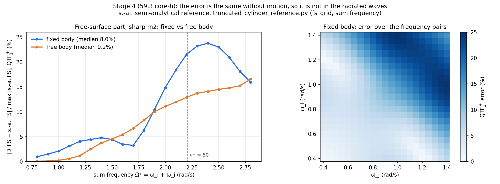

# Second-order wave loads: validation

This page holds the evidence behind the second-order methods, defaults and advice of [SecondOrder.in](input_files.md#secondorderin-optional): the mean drift convergence study, the comparison with Nemoh, the semi-analytical reference for a sharp truncated cylinder, the control-surface study, a study of graded meshes, the quadratic QTFs, the potential part of the difference QTF, the direct method against the indirect method, the direct method at the sum frequency, the indirect method at the sum frequency, the partial second-order field and the second-order motion. The integration fixtures and the limits of their tests are in [test/data/drift_cyl/README.md](../test/data/drift_cyl/README.md). All values are measured unless marked inferred.

## Mean drift convergence study

Run in November 2026 on Snellius (`fat_genoa`, 32 threads, ifx 2024.2) with HAMS built without `-heap-arrays`, because of the crash described in [Developer Documentation](developer_documentation.md#mean-drift-tests), and with `OMP_STACKSIZE=1G` and `ulimit -s unlimited`. Commit dff7a32 makes the documented flag `-heap-arrays 0` work, tested on ifx 2024.2 with the unit and integration tests. The study used [drift_convergence.py](../pre_postprocessing_python/SecondOrder/drift_convergence.py). 80 HAMS runs and 12 Nemoh runs. The per-frequency tables are not in the repository. All values below are measured unless marked inferred.

**Hulls.** Truncated cylinder, radius 10 m, draft 10 m, depth 100 m, with a sharp bilge (graded rows) or a bilge radius of 3 m (cosine rows); 448 to 7168 and 480 to 7680 panels. Bottom-mounted cylinder, radius 5 m, depth 10 m, against MacCamy-Fuchs; 256 to 4096 panels. Box 20 x 10 x 5 m, depth 50 m, sharp, with rounded vertical corners only, and with rounded corners and bilge. Frequencies 0.40 to 1.80 rad/s in steps of 0.2, plus 0.70, 0.95 and 1.10, set before any result. 0.80 rad/s is the heave resonance, and 1.60 is 3% from the first irregular frequency, 1.548 rad/s.

### Near-field against far-field, truncated cylinder

F_x, heading 0, finest mesh, percent of far-field, `differencing` / `source`:

| rad/s | Sharp fixed, 7168 | Sharp free, 7168 | Rounded fixed, 7680 | Rounded free, 7680 |
| ---: | ---: | ---: | ---: | ---: |
| 0.70 | +4.76 / -0.06 | -136 / +10.3 | -0.08 / -0.41 | +0.13 / +1.66 |
| 0.80 | +3.52 / -0.26 | +141 / +5.27 | -0.08 / -0.47 | +0.24 / -1.23 |
| 0.95 | +2.08 / -0.34 | +17.4 / +0.53 | -0.08 / -0.45 | +0.03 / +0.12 |
| 1.00 | +1.74 / -0.34 | +11.3 / +0.05 | -0.07 / -0.45 | +0.04 / -0.33 |
| 1.10 | +1.29 / -0.44 | +5.29 / -0.58 | -0.06 / -0.55 | +0.03 / -0.95 |
| 1.20 | +1.00 / -0.69 | +2.68 / -0.97 | -0.04 / -0.78 | +0.03 / -1.26 |
| 1.40 | +0.53 / -1.59 | +0.89 / -1.84 | -0.02 / -1.45 | +0.03 / -1.86 |
| 1.60 | +0.31 / +2.34 | +0.41 / +3.13 | +0.01 / +1.52 | +0.04 / +2.31 |
| 1.80 | +0.41 / -1.94 | +0.46 / -1.63 | +0.08 / -1.60 | +0.10 / -1.37 |

- The crossing on the sharp hull, `source` closer to 1.20 rad/s and `differencing` from 1.40, also holds at 1792 panels.
- At 0.40 and 0.60 rad/s the free net force is about 3e-6 and 2e-3 of ρg, so percentages there say little. At 0.40 fixed, rounded, the two methods nearly tie (-0.060 / -0.044).
- At 1.60 rad/s `source` is off by 1.5% to 3.1%, with the sign opposite to its neighbours. `differencing` is within 0.5%.

**Sharp free hull at 0.70 rad/s**, F_x / (ρg):

| Panels | Far | Near, `differencing` | Near, `source` |
| ---: | ---: | ---: | ---: |
| 448 | 0.1193 | -0.2829 | 0.1325 |
| 1792 | 0.1127 | -0.1327 | 0.1281 |
| 7168 | 0.1107 | -0.0402 | 0.1222 |

`differencing` keeps falling but has the wrong sign at 7168 panels. `source` is 10% to 14% off on all meshes. Its error, 0.0115 at 7168, is 0.44% of term I. The semi-analytical reference gives 0.10997 (far-field; stated uncertainty 1e-4, and it changes by less than 1.2e-7 over the resolutions), so the far-field column is 8.5%, 2.5% and 0.68% off; see [Semi-analytical reference](#semi-analytical-reference-sharp-truncated-cylinder).

**Rounded hull, `source`.** Its error falls with refinement, but reaching zero is not shown. Fixed at 0.95 rad/s, near minus far is -0.0478, -0.0369, -0.0290, -0.0238 of ρg at 480, 1920, 4320, 7680 panels. The ratio per doubling goes from 0.77 to 0.65, so the local order rises from about 0.4 to 0.6. A constant offset would make it fall instead. At order 0.6, halving the error needs about 10 times the panels (inferred).

**Bottom-mounted cylinder at 4096 panels, against MacCamy-Fuchs:** `differencing` within 0.12% at all 11 frequencies, far-field within 0.17%. `source` within 0.15% up to 1.20 rad/s, then -0.30%, -0.73%, -1.58% at 1.40, 1.60, 1.80.

### Box, heading 30, 1.00 rad/s, fixed

Near-field against far-field, percent:

| Hull | Panels | Method | F_x | F_y | M_z | Force vector |
| :--- | ---: | :--- | ---: | ---: | ---: | ---: |
| Sharp | 7040 | `differencing` | +2.8 | +33.9 | +20.0 | 23.4 |
| Sharp | 7040 | `source` | -0.09 | +12.5 | +9.3 | 8.6 |
| Rounded vertical corners | 1760 | `differencing` | +9.7 | +35.8 | -4.1 | 25.5 |
| Rounded corners and bilge | 8000 | `differencing` | -0.13 | -0.58 | +0.08 | 0.41 |
| Rounded corners and bilge | 8000 | `source` | -0.04 | +2.1 | +1.14 | 1.4 |

- The M_z excess follows the vertical corners and the F_y excess the bilge, on two meshes each.
- On the sharp box, `source` removes about 60% of the residual, which still falls at about 0.7 per doubling.
- Free sharp box at 1760 panels: F_x is -210% with `differencing` and -55% with `source`. Free rounded box at 2000 panels: +6.0% and -9.8%. No free box above 2000 panels was run.

### Irregular frequencies

Free cylinders, F_x error against far-field, percent. `differencing` with `IRSP` 0 / 1, and `source` with `IRSP = 0`:

| Hull, panels | 1.548 rad/s, diff | 1.548, src | 1.939 rad/s, diff | 1.939, src |
| :--- | ---: | ---: | ---: | ---: |
| Rounded, 1920 | +4.0 / +0.50 | -46.6 | +4.7 / +1.2 | -32.4 |
| Sharp, 1792 | +15.5 / +1.6 | -125.9 | +12.6 / +2.7 | -198.5 |

At 1.10 rad/s, away from them, `IRSP = 1` changes the error by at most 0.03 points. On the rounded hull at 1.548 rad/s, `source` goes from -66.1% at 480 panels to -46.6% at 1920.

### Waterline method

Free cylinders at 1920 and 1792 panels, F_x error against far-field. Rounded hull: `extrapolate` is closer at all 11 frequencies, by 0.14 to 1.12 points from 0.70 rad/s up. Sharp hull: `field` is closer by 0.27 to 0.57 points from 0.95 to 1.80 rad/s, where both carry the sharp-edge error (1.3% to 28% with `extrapolate`).

### Settings

- `GRN_KIND = 8`: identical F_x to all printed digits at all 15 entries, at the same time per frequency, and 0.9 GB more memory at 4320 panels.
- `ISOLV = 2`: F_x differs from LU by at most 0.0009 (near) and 0.0003 (far) of ρg on the rounded hull, and 0.003 on the sharp hull at 0.70 rad/s. Run time within 3% at 4320 panels.

### Run time

On Snellius, 32 threads, 11 frequencies, wall time per run:

| Hull, panels | `differencing` | `source` |
| :--- | ---: | ---: |
| Sharp, 7168 | 884 to 885 s | 1750 s |
| Rounded, 7680 | 1031 s | 2042 to 2045 s |

The largest run, the rounded box with `source` at 8000 panels, used 8.40 GB.

## Comparison with Nemoh

Nemoh v3.0.3 ran as a separate program, built outside this repository with ifort and sequential MKL, on Linux (Snellius) and, for the coarsest meshes, on Windows. No Nemoh source or binary, and no Nemoh output file, is in the repository. Only its documented input and output files were used. Nemoh is a code comparison, not a reference truth: it also uses constant panels and shares error sources with the near-field method.

**Inputs.** The nodes and panels of the HAMS case, written by `make_mesh.py --format nemoh`. No lid, `IRSP = 0` in HAMS, no external loads. Fixed bodies through a stiffness of 1e13 in all six modes. 21 frequencies from 0.40 to 1.40 rad/s, below the first irregular frequency. Heading 0, and headings 0 and 30 for the pair. QTF part with the DUOK term only. Drift is read from the diagonal of `results/QTF/OUT_QTFM_N.dat`, times ρg.

**Rule.** The plan set 5% on a converged F_x. Nemoh did not converge on the meshes that worked (below), so the rule for an unconverged mesh applies: HAMS no further from Nemoh than the Nemoh-HydroSTAR spread. That spread is a median of 9.7% in F_x on Nemoh's own `8b_QTF_Cylinder` case at 634 panels, for ω ≥ 0.9 rad/s.

**Nemoh at 4320 panels is unusable.** Its F_x on the rounded fixed cylinder is -3.85 of ρg at 0.95 rad/s, against 5.35 at 1920 panels and 5.31 from HAMS. Nemoh gave no warning and returned 0. On the same mesh its first-order results agree with HAMS (table below), and so do its fixed F_z and M_y, within 1.2%. The cause is unknown. A guess, untested: the top row is 0.0196 m tall at 4320 panels, against 0.044 m at 1920. The comparison therefore rests on 448 to 1920 panels.

**First order**, worst absolute difference over the diagonal terms of A, B, X and the RAOs, plus A15 and B15, at 0.70, 0.80, 0.95, 1.00 and 1.10 rad/s, percent. The 4320-panel runs have only 0.70, 0.95 and 1.10:

| Hull, panels | A | B | X | RAO |
| :--- | ---: | ---: | ---: | ---: |
| Rounded 480 | 3.99 | 5.86 | 1.96 | 9.24 |
| Rounded 1920 | 2.27 | 3.47 | 1.01 | 4.50 |
| Rounded 4320 | 1.54 | 2.15 | 0.79 | 1.44 |
| Sharp 448 | 3.22 | 4.84 | 1.67 | 10.07 |
| Sharp 1792 | 1.84 | 3.46 | 0.84 | 6.25 |

The difference falls with the mesh in all columns. The largest rounded RAO difference is in surge at 0.80 rad/s, the heave resonance: 9.24% at 480 and 4.50% at 1920 panels. Over 0.70, 0.95 and 1.10 only, it is 3.77%, 2.11% and 1.44% at 480, 1920 and 4320 panels, so the 4320 value is not comparable with the two above it. The largest RAO difference on the sharp hull is in surge at 0.70 rad/s.

**Drift**, F_x, heading 0, absolute difference between HAMS near-field and Nemoh, frequencies up to 1.40 rad/s with far-field above 0.5 of ρg:

| Hull, motion | Panels | `differencing` median / worst | `source` median / worst | Spread rule |
| :--- | ---: | ---: | ---: | :--- |
| Rounded, fixed | 1920 | 1.80 / 4.26 | 1.32 / 3.24 | met by both |
| Rounded, free | 1920 | 1.00 / 39 | 0.88 / 30 | median met; worst at 0.80 rad/s |
| Sharp, fixed | 1792 | 3.93 / 7.18 | 1.16 / 1.99 | met by both |
| Sharp, free | 1792 | 14.43 / 176 | 0.80 / 2.48 | missed by `differencing`, met by `source` |

- On the rounded free hull the worst value is at the heave resonance, 0.80 rad/s, where Nemoh itself moves from 0.86 to 1.45 of ρg between 480 and 1920 panels.
- The sharp free hull matches the near-against-far result: `differencing` carries the sharp-edge error, `source` does not.
- Bidirectional pair, rounded free, headings 0 and 30, 1920 panels: HAMS near-field is 6.5% to 6.7% above Nemoh at 0.70 rad/s, 0.85% to 0.90% below at 0.95, and 0.50% to 0.69% above at 1.10, over all four heading pairs, F_x and F_y (F_y of the (0, 0) pair is zero by symmetry and is excluded from these ranges). Informative only. Nemoh's documentation states its QTFs are untested for multi-body problems, and no pair ran at 4320 panels.

## Semi-analytical reference: sharp truncated cylinder

[truncated_cylinder_reference.py](../pre_postprocessing_python/SecondOrder/truncated_cylinder_reference.py) computes the first-order solution and the mean drift of the sharp truncated cylinder of the convergence study (radius 10 m, draft 10 m, depth 100 m) by eigenfunction matching, without panels. It needs no HAMS run. All values in this section were measured with it in November 2026, on a laptop.

**Method.** The potential is a series of vertical eigenfunctions outside the cylinder and in the gap under it, matched at r = a, as in Garrett (1971) for diffraction and Yeung (1981) for radiation. The unknown radial velocity in the gap is expanded in functions that carry the corner singularity of the 270° fluid corner at the bilge, (distance)^(-1/3), and the next terms of the corner expansion. Far-field F_x follows from Maruo's formula (Maruo 1960; Newman 1967) applied to the outgoing wave. Near-field F_x, F_z and M_y follow from the six terms of the pressure integration (WAMIT v7.5 user manual, eqs. 15.54 to 15.57), the terms HAMS-MREL writes to `MeanDriftTerms.txt`, with a quadrature that integrates the corner singularity exactly; the free body uses its own motions, with the mass and stiffness rule of `make_mesh.py` applied to the exact circle.

**Checks.** The script runs 22 checks and exits with 1 if one fails. The main ones, with the measured values:

| Check | Requirement | Measured |
| :--- | :--- | ---: |
| Bottom-mounted limit (gap 0.001 h): X_1 and far-field F_x against MacCamy-Fuchs | 1e-3 | 5.5e-5 and 4.0e-5 |
| Scattered energy against the optical theorem, fixed body | 1e-6 | 2.3e-15 |
| Reciprocity: A15 = A51, B15 = B51, and Haskind X against diffraction X | 1e-8 and 1e-6 | 2.0e-9 and 1.3e-9 |
| B11, B33, B55 against the radiated energy flux | 1e-6 | 1.3e-9 |
| Near-field F_x against far-field F_x, fixed body, 11 frequencies | 5e-4 | 2.3e-6 |
| Near-field F_x against far-field F_x, free body, 11 frequencies | 5e-4 | 4.1e-4 (0.80 rad/s) |
| Velocity at the corner: same limit from the wall and the bottom series | 1e-3 | 1.9e-4 |
| M_y moved to another reference point | 1e-10 | 3.4e-16 |
| Spread of F_x far, F_z, M_y, B11 at 0.70, 0.95, 1.40 rad/s over three resolutions and twice the azimuthal orders | 1e-4 | 1.6e-5, except free F_z at 0.70 rad/s: 2.6e-4 |

The reciprocity and energy values are extrapolated in the number of modes; the bottom-mounted values are extrapolated to zero gap from two gaps. The near-field against far-field residual of the free body is 1.6e-4 to 4.1e-4 at 0.60 to 0.80 rad/s and 1.1e-4 to 1.3e-4 at 1.40 to 1.80 rad/s. The script's docstring states what each check covers and what it does not.

**Uncertainty.** Each value carries a stated relative uncertainty of 1e-4, from the spreads above. The spreads were measured at 0.70, 0.95 and 1.40 rad/s only; at the other frequencies the 1e-4 is carried over, not measured (fixed-body F_z and M_y were measured once at every frequency, within 4.8e-5). Three exceptions:

- free near-field F_x at 0.60 to 0.80 rad/s: 5e-4, from the residual against far-field, which does not fall with the resolution;
- free near-field F_x at 1.40 to 1.80 rad/s: 2e-4, from the residual against far-field, measured 1.1e-4 to 1.3e-4;
- free F_z at 0.70 rad/s: 3e-3, and at 0.80 rad/s: 4e-3. These are estimates, not bounds. They come from a linear fit of F_z against the F_x residual over three gap bases, extrapolated to zero residual. The fit assumes that the F_z error vanishes where the F_x residual does, which is not tested.

Free F_z and M_y at 1.40 to 1.80 rad/s have no separate error estimate: the fit above covers 0.60 to 0.80 rad/s only. Far-field F_x changes by less than 1.2e-7 over the resolutions.

These uncertainties, and the default resolution (64000 modes, three gap families (20, 4, 4), azimuthal orders 0 to 15), hold for this hull only (depth/radius = 10) and the 11 frequencies. The number of modes needed grows with depth/radius: free F_z at 0.90 rad/s changes by 4.9% between 4000 and 16000 modes for radius 10 m, draft 10 m, depth 500 m, and by 0.8% for radius 5 m, draft 8 m, depth 40 m (measured, gap families (20, 4, 4)). For any other cylinder, resolution or frequency the script states no uncertainty (`nan`, an empty field in the CSV: not measured), and `compare` shows `[n/m]`. A new geometry needs the convergence and near-field against far-field F_x measurements repeated before its values carry an uncertainty.

**Reference values.** F/(ρgA²) and M_y/(ρgA²), the normalisation of `MeanDriftPressure.9` (`REFL = 1`), M_y about the origin on the still waterline, heading 0. A13, A35, B13, B35, F_y, M_x and M_z are zero by symmetry.

| Motion | rad/s | F_x far | F_x near | F_z | M_y |
| :--- | ---: | ---: | ---: | ---: | ---: |
| Fixed | 0.70 | 1.75010 | 1.75010 | -4.00842 | 4.70520 |
| Fixed | 0.95 | 5.46404 | 5.46403 | -2.58008 | 13.5153 |
| Fixed | 1.40 | 6.20766 | 6.20766 | -0.330282 | 15.7037 |
| Free | 0.70 | 0.109973 | 0.109929 | -0.6128 | -8.16741 |
| Free | 0.95 | 2.95856 | 2.95854 | 2.17347 | 53.5495 |
| Free | 1.40 | 6.51956 | 6.51884 | 0.735582 | 22.2976 |

`python -I truncated_cylinder_reference.py reference --out CSV` writes all 11 frequencies, fixed and free, with A, B, X, the RAOs, every near-field term and the stated uncertainties.

**HAMS against the reference.** `compare` was run on the results of the convergence study (outside the repository). Finest mesh of each velocity method, 7168 panels, percent (HAMS - reference)/|reference|. An empty cell means the reference is below 1e-4 of the largest value of that quantity. F_x far is the same for both methods. 1.60 rad/s is 3% from the irregular frequency 1.5483 rad/s.

| Motion | rad/s | `source` F_x near | F_x far | `source` F_z | `source` M_y | `differencing` F_x near | `differencing` F_z | `differencing` M_y |
| :--- | ---: | ---: | ---: | ---: | ---: | ---: | ---: | ---: |
| Fixed | 0.40 | +0.86 | -0.07 | +1.34 | +5.75 | +7.79 | +10.5 | +0.40 |
| Fixed | 0.60 | +0.25 | -0.03 | +1.41 | +4.08 | +6.09 | +11.7 | +0.14 |
| Fixed | 0.70 | -0.06 | -0.002 | +1.46 | +3.83 | +4.75 | +12.4 | +0.11 |
| Fixed | 0.80 | -0.24 | +0.03 | +1.69 | +3.62 | +3.55 | +13.4 | +0.05 |
| Fixed | 0.95 | -0.27 | +0.07 | +2.39 | +3.10 | +2.14 | +15.3 | +0.07 |
| Fixed | 1.00 | -0.27 | +0.07 | +2.65 | +2.88 | +1.82 | +16.0 | +0.08 |
| Fixed | 1.10 | -0.36 | +0.08 | +3.10 | +2.44 | +1.37 | +17.4 | +0.08 |
| Fixed | 1.20 | -0.63 | +0.07 | +3.46 | +2.18 | +1.07 | +18.6 | +0.08 |
| Fixed | 1.40 | -1.55 | +0.05 | +4.48 | +2.73 | +0.58 | +21.0 | +0.13 |
| Fixed | 1.60 | +2.42 | +0.08 | +2.86 | -2.43 | +0.39 | +23.0 | +0.09 |
| Fixed | 1.80 | -1.88 | +0.06 | +5.43 | +2.41 | +0.47 | +25.3 | +0.14 |
| Free | 0.40 | | | +0.22 | | | +1.13 | |
| Free | 0.60 | +29.3 | +0.61 | +2.95 | -3.96 | -77.2 | +13.8 | -0.56 |
| Free | 0.70 | +11.1 | +0.68 | +110 | -4.05 | -137 | +506 | -0.77 |
| Free | 0.80 | +5.48 | +0.24 | +319 | +2.62 | +141 | +1215 | +0.03 |
| Free | 0.95 | +0.38 | -0.15 | +20.5 | +1.92 | +17.2 | +68.1 | -0.28 |
| Free | 1.00 | -0.04 | -0.10 | +12.4 | +1.90 | +11.2 | +39.7 | -0.21 |
| Free | 1.10 | -0.63 | -0.06 | +7.56 | +1.91 | +5.23 | +22.9 | -0.14 |
| Free | 1.20 | -0.99 | -0.04 | +6.15 | +2.03 | +2.65 | +17.9 | -0.09 |
| Free | 1.40 | -1.83 | -0.005 | +4.95 | +2.77 | +0.89 | +12.5 | +0.04 |
| Free | 1.60 | +3.27 | +0.12 | +2.87 | -2.28 | +0.54 | +8.27 | +0.08 |
| Free | 1.80 | -1.54 | +0.08 | +2.72 | +2.08 | +0.55 | +4.95 | +0.16 |

What the comparison shows, all measured on these meshes (448, 1792, 7168 panels for both methods, and 4032 for `source` at 0.70, 0.95 and 1.10 rad/s):

- The reference's stated uncertainty is 0.01% for most entries (0.05% for free F_x near at 0.60 to 0.80 rad/s, 0.02% at 1.40 to 1.80 rad/s, 0.3% and 0.4% for free F_z at 0.70 and 0.80 rad/s). Every difference in the table is larger, except far-field F_x at 0.70 rad/s fixed (-0.002%) and 1.40 rad/s free (-0.005%). So the table measures HAMS's error, not the reference's.
- **First order** at 7168 panels, outside 1.60 rad/s: A within 0.29%, B within 1.02% (B33 at 1.80 rad/s), |X| within 0.3%, |RAO| within 0.41%. The worst error falls by 3 to 5 times per doubling of the panels per side (measured ratios 3.1 to 4.6).
- **Far-field F_x** is the closest HAMS result: within 0.08% fixed and 0.68% free at 7168 panels. Free at 0.70 rad/s it is +8.5%, +2.5%, +1.2%, +0.68% at 448, 1792, 4032, 7168 panels.
- **`source`** is the closer method for near-field F_x up to 1.20 rad/s and for F_z at every frequency.
- **`differencing`** is the closer method for M_y wherever it is compared (0.03% to 0.8%, against 1.90% to 5.75% for `source`), and for near-field F_x from 1.40 rad/s. Its F_z is 10% to 25% off fixed at 7168 panels.
- **Cancellation.** The free F_z at 0.70 and 0.80 rad/s is 1.4% and 1.0% of its largest term, and the free near-field F_x at 0.60 and 0.70 rad/s is 2.7% and 4.3%. A few percent of error in a term gives the large percentages there. Free F_z at 0.70 rad/s is +0.059 in HAMS (`source`, 7168 panels) against -0.613. HAMS's terms have the reference's sign and are within 3.4%. The `source` totals at 448, 1792, 4032, 7168 panels are 2.35, 0.81, 0.31, 0.06, and Richardson extrapolation from 448, 1792 and 7168 panels gives -0.65.
- **Signs.** At 7168 panels with `source`, outside 1.60 rad/s, all 210 tested values have the reference's sign: every near-field term of F_x, F_z and M_y, far-field F_x, and the near-field totals that are at least 5% of their largest term. So no sign or conjugation error shows in the drift outputs. Phases are not compared.

**Run time** (laptop, Python 3.7, measured once): `check` (20 checks) 5 min 4 s; `reference --out` (all 22 checks and the rows) 7 min 11 s, of which the rows take 92 s; `compare` 93 s, nearly all of it the reference rows, and under 1 s with `--reference CSV`.

**Sources.**

- Garrett, C.J.R. (1971). Wave forces on a circular dock. J. Fluid Mech. 46(1), 129-139. doi:10.1017/S0022112071000430
- Yeung, R.W. (1981). Added mass and damping of a vertical cylinder in finite-depth waters. Appl. Ocean Res. 3(3), 119-133. doi:10.1016/0141-1187(81)90101-2
- MacCamy, R.C. and Fuchs, R.A. (1954). Wave forces on piles: a diffraction theory. Technical Memorandum 69, Beach Erosion Board.
- Maruo, H. (1960). The drift of a body floating on waves. J. Ship Res. 4, 1-10.
- Newman, J.N. (1967). The drift force and moment on ships in waves. J. Ship Res. 11(1), 51-60. doi:10.5957/jsr.1967.11.1.51
- WAMIT User Manual, Version 7.5, section 15.8, eqs. 15.54 to 15.57.

## Control-surface method

The control-surface (middle-field) method of Chen (2007), on the hulls of the [convergence study](#mean-drift-convergence-study). The fixture-level checks are in [test/data/drift_cyl/README.md](../test/data/drift_cyl/README.md#control-surface-method).

### Far-field components, F_x, F_y and M_z

The control-surface F_x, F_y and M_z (Chen 2007, eqs. 39-41) against far-field, at mesh multiples m1 to m4 of the fixture hulls (panel counts x1, x4, x9, x16), finite depth 100 m, 11 frequencies from 0.4 to 1.8 rad/s; headings 0 and 30 for the cylinders, 30 for the boxes, 0 for the bottom-mounted cylinder [measured, Snellius `fat_genoa`, 32 threads, 2026-11-06 and 2026-11-07]. The error is the worst over frequencies, headings and the three components of |control - far| / max(1% |far|, 1e-3 rho g A^2 a^k), with a = 10 m and k = 1 for forces, 2 for M_z; above 1 fails. The tolerance floor keeps small far-field values, such as F_x at 0.4 rad/s, from setting the result. Cases are run with [drift_convergence.py](../pre_postprocessing_python/SecondOrder/drift_convergence.py).

| Hull, motion | Velocity | m1 | m2 | m3 | m4 |
| :--- | :--- | ---: | ---: | ---: | ---: |
| sharp cylinder, fixed | green | 2.80 | **0.70** | 0.02 | 0.14 |
| sharp cylinder, free | green | 2.80 | **0.55** | 0.11 | 0.17 |
| sharp box, fixed | green | 1.71 | **0.59** | | 0.05 |
| sharp box, free | green | 1.87 | **0.58** | | |
| round cylinder, fixed | green | 2.79 | 0.68 | 0.02 | 0.12 |
| round cylinder, free | green | 2.80 | 0.53 | 0.12 | 0.16 |
| round-corner box, fixed | green | 1.42 | 0.29 | | 0.06 |
| round-corner box, free | green | 1.65 | 0.22 | | |
| bottom-mounted cylinder | green | 1.75 | 0.31 | | 0.16 |
| sharp cylinder, fixed | source | 4.02 | 1.90 | 1.18 | 0.91 |
| sharp cylinder, free | source | 6.53 | 2.64 | 1.02 | 1.21 |
| sharp box, fixed | source | 2.30 | 1.16 | | 0.57 |
| sharp box, free | source | 70.5 | 34.4 | | |

m3 runs 0.70, 0.95 and 1.10 rad/s only, and the m4 boxes 0.8, 1.0 and 1.4 rad/s. The round-cylinder m3 entries come from the default-settings runs that the study's settings and Nemoh groups add (`d_base_round_free_diff_m3`, `n_round_fixed_diff_m3`). Blank: not run.

- The green route is within the tolerance at m2 on every hull, and at worst 0.17 at m4 [measured]. The bold entries are the acceptance gate of the green route: sharp cylinder and sharp box at m2, all frequencies.
- At m1 the green route fails on every hull, at 1.4 to 2.8 times the tolerance, so the m1 meshes (256 to 500 panels, the CI fixtures) are coarser than this tolerance allows [measured]. The CI limits in [the fixture README](../test/data/drift_cyl/README.md#control-surface-method) are set from measured values at those meshes, not from this tolerance.
- The source route converges more slowly, and its M_z on the free sharp box is 34 times the tolerance at m2 [measured]. It stays an option, not the default.
- Before the field-mode fix, the green route failed on the fixed sharp box at m2 (3.8 times the tolerance, F_x at 0.6 rad/s), and the free round cylinder at m4 was 2.7 [measured]. The fix left far-field, near-field and first-order values unchanged in every row [measured].
- The green-route runs took about 30% longer in the second study than in the first on the same partition (882 s against 675 s for the sharp cylinder at m2) [measured]. A laptop run of the box at m1 gave the same field time before and after the fix, so the cause is not isolated [measured].

### Vertical force and roll and pitch moments, F_z, M_x and M_y

The vertical force and the roll and pitch moments of the control-surface method (Chen 2007, eqs. 37-38, with F between the hull waterline and Γc), with the default `cs_*` settings and `cs_velocity = green`, against near-field (F_z of the sharp hull: against a semi-analytical reference). Rounded and sharp cylinder (a = 10 m), fixed and free, 100 m depth, at m1 to m4 (480/1920/4320/7680 panels rounded, 448/1792/4032/7168 sharp), 0.70, 0.95 and 1.10 rad/s, plus the 11 frequencies of the study above at m1 and m2 [measured, Snellius, 2026-11-07].

| Load | Reference | Result |
| :--- | :--- | :--- |
| M_x, M_y | near-field at m4, tolerance max(1% of the reference, 1e-3 rho g A^2 a^2) | within the tolerance on both hulls at m3 and m4; worst 0.44 of it (rounded, m3) and 0.57 (sharp, m3) |
| F_z, rounded | extrapolated near-field limit f0 + C h^p, fitted over m2 to m4 (h = 1/2, 1/3, 1/4) | control at m3 (0.70, 0.95, 1.10 rad/s): fixed 0.4%, 0.9%, 1.9%; free 0.0%, 0.5%, 0.8%. At m4 fixed 1.10 rad/s is 1.2% |
| F_z, sharp, fixed | [semi-analytical reference](#semi-analytical-reference-sharp-truncated-cylinder) | control at m3 / m4 (0.70, 0.95, 1.10 rad/s): 0.40 / 0.31%, 0.89 / 0.63%, 2.26 / 1.44% |
| F_z, sharp, free | [semi-analytical reference](#semi-analytical-reference-sharp-truncated-cylinder) | control at m3 / m4: 0.81 / 0.71%, 0.04 / 0.09%, 0.77 / 0.53% |

- The rounded-hull limits of near-field and control agree within 0.4% at all six (motion, frequency) pairs, so the m3 and m4 differences are mesh error in both methods [measured].
- The sharp hull is the truncated cylinder (radius 10 m, draft 10 m, depth 100 m) of [truncated_cylinder_reference.py](../pre_postprocessing_python/SecondOrder/truncated_cylinder_reference.py), which gives a semi-analytical F_z with an uncertainty of 1e-4 rho g A^2 (3e-3 free at 0.70 rad/s). The errors above are (HAMS - reference)/|reference| at heading 0 [measured]. There is no such reference for the rounded hull, so its F_z is checked against the extrapolated near-field limit.
- Near-field F_z (differencing) on the sharp hull still moves with the mesh: the 3-point fitted order is 0.66 to 0.76 at every frequency, with term 3 (velocity) dominant. At m4 (7168 panels) it is 12% to 17% off the reference on the fixed hull and 23% to 506% off on the free hull. Free at 0.70 rad/s the reference is -0.6128, control -0.6171 and near-field +2.49 [measured]. The cause is the right-angled bottom edge, where the velocity is singular [inferred].
- Advice: on hulls with sharp edges, use the control-surface F_z, and do not take near-field F_z at these meshes as the reference. Near-field F_z needs a much finer mesh there.
- Not covered: at m2 (1920 and 1792 panels), F_z, M_x and M_y at 1.6 to 1.8 rad/s differ from near-field of the same run by up to about 30%, and m3 and m4 were not run at those frequencies [measured].
- Numbers are as measured; no convergence order of the control-surface method is claimed.

## Near-field on meshes graded towards a sharp edge

On the sharp truncated cylinder (radius 10 m, draft 10 m, depth 100 m), near-field F_z converges slowly with the default cosine rows: the fitted order is about 0.7. The velocity at the right-angled bottom edge grows like (distance)^(-1/3), and cosine spacing puts rows of size about (i/n)^2 next to the edge, so the first rows carry an error that falls only like n^(-2/3) [inferred]. Stronger grading at the edge should raise the order. This study measured it [Snellius `fat_genoa`, 32 threads, 2026-11-08, the build of the control-surface study].

**Meshes.** The panel counts of the convergence study (1792, 4032, 7168 panels, m2 to m4), with the same waterline polygon, so the hydrostatics and the waterline term are unchanged. Wall rows at z = -d f(i/n_z) with f(s) = s^2 / (s^2 + (1 - s)^q), quadratic at the waterline and of power q at the bilge; bottom rings at r = a (1 - (i/n_r)^q), fine at the rim. q = 3 (b3) and q = 4 (b4). The finest bilge row is 3e-4 m (b3) and 1e-5 m (b4) at m4. A first run with power q at both ends of the wall put a row of 1e-5 m at z = 0 for q = 4 at m4, which the input check rejects as a lid panel; it is not used here.

**F_z, near-field, heading 0**, percent (HAMS - reference)/|reference|, at m2 / m3 / m4, against the [semi-analytical reference](#semi-analytical-reference-sharp-truncated-cylinder):

| Motion, rad/s | Velocity | Cosine | b3 | b4 |
| :--- | :--- | ---: | ---: | ---: |
| Fixed 0.70 | `differencing` | +20.5 / +15.3 / +12.4 | +10.7 / +6.6 / +4.6 | +6.1 / +3.1 / +2.0 |
| Fixed 0.95 | `differencing` | +25.3 / +18.9 / +15.3 | +13.2 / +8.2 / +5.7 | +7.5 / +3.8 / +2.5 |
| Fixed 1.10 | `differencing` | +28.7 / +21.5 / +17.4 | +15.0 / +9.3 / +6.5 | +8.5 / +4.3 / +2.8 |
| Free 0.70 | `differencing` | +838 / +623 / +506 | +471 / +289 / +199 | +310 / +158 / +103 |
| Free 0.95 | `differencing` | +111 / +83 / +68 | +60 / +38 / +26 | +36 / +19 / +12.6 |
| Free 1.10 | `differencing` | +37 / +28 / +23 | +19.8 / +12.5 / +8.6 | +11.4 / +6.0 / +4.1 |
| Fixed 0.70 | `source` | +3.2 / +2.0 / +1.5 | -1.7 / +1.7 / -3.5 | -2.5 / +1.6 / -2.7 |
| Fixed 1.10 | `source` | +6.4 / +4.2 / +3.1 | -0.6 / +3.6 / -3.8 | -1.5 / +3.4 / -2.8 |
| Free 0.70 | `source` | +232 / +150 / +110 | +64 / +150 / -77 | +57 / +157 / -38 |
| Free 0.95 | `source` | +41 / +27 / +21 | +15.5 / +25.4 / -4.7 | +13.5 / +25.8 / -0.4 |

- With `differencing`, b4 converges steadily: from m2 to m4 the order is about 1.5, against 0.7 on the cosine mesh. Fixed F_z is within 2.8% at m4. M_y moves the other way: 0.07% to 0.8% on the cosine mesh, 0.6% to 2.5% with b4, at m4.
- With `source`, the graded meshes change the sign of the error from m2 to m3 and back at m4, on both gradings and in a first run with fine rows at both ends. The cause is not known.
- The free hull at 0.70 rad/s, near the heave resonance, stays off by 38% or more on every mesh. Its F_z is a small difference of large terms.
- The control-surface F_z on the cosine mesh (4032 and 7168 panels) is within 2.3% and 1.4% of the reference in every case (see [above](#vertical-force-and-roll-and-pitch-moments-f_z-m_x-and-m_y)). It stays the advised value on sharp hulls.

## Quadratic QTFs

The quadratic part of the QTFs (`qtf` in `SecondOrder.in`) uses the near-field terms of the mean drift with two frequencies. Its checks:

- In the tests, the diagonal of `QTF_Quadratic.10d` equals `MeanDriftPressure.9` row for row, `.10d` is Hermitian and `.10s` symmetric over frequencies, headings and two bodies, and the kernel reproduces the product of two bichromatic signals at any time (`test/test_near_field.f90`, `test/test_qtf.f90`, `test/test_integration_drift.f90`).
- The off-diagonal values are compared with the [semi-analytical reference](#semi-analytical-reference-sharp-truncated-cylinder) (`truncated_cylinder_reference.py qtf`, the same near-field terms of the eigenfunction solution, for every pair of the 101 frequencies 0.40 to 1.40 rad/s, step 0.01), and with Nemoh v3.0.3's quadratic part (`DUOK`) on the same meshes and grid, by `qtf_compare.py`. `qtf_plots.py` draws the curves and the mesh convergence.

The reference's first-order solutions take HAMS's stored incident potential `VINP` as the physical one, so their wave has elevation −iA at the origin instead of A (spec convention: the physical potential is i·`VINP`). That factor cancels in the mean drift and in the difference QTF, and gives −1 in the sum QTF, so the sum rows of the reference are negated. Before that was found, HAMS and Nemoh agreed with each other and both had the opposite sign of the reference on every sum value.

Sharp cylinder, `velocity_method = source`, heading 0, meshes m1 to m4 (448, 1792, 4032, 7168 panels). Error per pair |value − exact| / max |exact| over the pairs, median / largest, in percent; difference pairs with ω_j − ω_i ≤ 0.3 rad/s (2666 pairs), sum pairs all (5151). Nemoh ran at m1 and m2:

| Body | QTF | Panels | HAMS F_x | HAMS F_z | HAMS M_y | Nemoh F_x | Nemoh F_z | Nemoh M_y |
| :--- | :--- | ---: | ---: | ---: | ---: | ---: | ---: | ---: |
| fixed | difference | 448 | 0.94 / 5.7 | 5.6 / 7.0 | 5.9 / 7.9 | 1.7 / 4.9 | 5.1 / 6.3 | 5.9 / 8.1 |
| | | 1792 | 0.49 / 3.0 | 2.7 / 3.4 | 2.9 / 3.7 | 0.86 / 4.4 | 2.6 / 3.3 | 2.9 / 3.7 |
| | | 4032 | 0.34 / 2.1 | 1.8 / 2.2 | 1.9 / 2.4 | | | |
| | | 7168 | 0.26 / 1.6 | 1.3 / 1.6 | 1.4 / 1.8 | | | |
| fixed | sum | 448 | 1.1 / 3.8 | 3.3 / 6.7 | 9.0 / 14 | 1.1 / 6.2 | 3.1 / 6.8 | 8.9 / 13 |
| | | 1792 | 0.40 / 1.5 | 1.7 / 3.7 | 4.5 / 7.1 | 0.42 / 2.4 | 1.7 / 3.7 | 4.5 / 7.0 |
| | | 4032 | 0.24 / 0.89 | 1.2 / 2.6 | 3.0 / 4.8 | | | |
| | | 7168 | 0.17 / 0.64 | 0.86 / 2.0 | 2.2 / 3.6 | | | |
| free | difference | 448 | 0.66 / 99 | 0.24 / 112 | 0.04 / 14 | 0.59 / 103 | 0.22 / 95 | 0.05 / 13 |
| | | 1792 | 0.30 / 41 | 0.12 / 59 | 0.02 / 5.9 | 0.38 / 52 | 0.12 / 48 | 0.03 / 7.4 |
| | | 4032 | 0.19 / 24 | 0.08 / 39 | 0.02 / 3.6 | | | |
| | | 7168 | 0.14 / 16 | 0.06 / 28 | 0.01 / 2.5 | | | |
| free | sum | 448 | 0.14 / 37 | 0.01 / 33 | 0.02 / 15 | 0.15 / 31 | 0.01 / 16 | 0.02 / 5.1 |
| | | 1792 | 0.08 / 23 | 0.01 / 17 | 0.01 / 5.3 | 0.09 / 20 | 0.00 / 8.5 | 0.01 / 3.3 |
| | | 4032 | 0.06 / 17 | 0.00 / 11 | 0.01 / 2.8 | | | |
| | | 7168 | 0.05 / 13 | 0.00 / 7.6 | 0.01 / 1.7 | | | |

- Every error falls with the mesh, roughly as the panel size (a factor of about 4 from 448 to 7168 panels), for HAMS and Nemoh alike. HAMS and Nemoh are close at the same mesh, and Nemoh's values need neither a conjugate nor a sign change against this convention.
- Fixed body: the largest errors at 7168 panels are below 4%. They sit at the highest frequency (1.40 rad/s, fewest panels per wavelength) for F_x and the difference M_y, and in the middle of the range for F_z and the sum M_y.
- Free body: the medians are below 0.2%. The largest errors all sit at pairs with a frequency at the coupled surge-pitch resonance, 0.76 to 0.77 rad/s (heave peaks at 0.80 rad/s with a much broader peak; see [the resonance and the motions](#the-resonance-and-the-motions)). There the response is steep, so a small shift of the computed resonance gives a large error at single pairs; the QTF, quadratic in the motion, amplifies it. At 4032 panels only 55 of 2666 difference pairs of F_x, and 15 of F_z, are off by more than 5%, all next to the resonance. Nemoh's largest errors sit at the same pairs.

## QTF potential part

The body forcing of the second-order potential (`qtf_terms = body`, `QTF_Indirect.11d`) against an exact reference, and against Nemoh. Runs on Snellius (`fat_genoa`, 32 threads, ifx from `intel/2024a`) on 2026-11-09 (hull form of B2, m1 to m4, fixed and free, and Nemoh) and 2026-11-10 (control-surface form of B2: the free body, the damped free body, and the OC4 semisubmersible against Nemoh). The per-pair tables are not in the repository.

**Setup.** The sharp truncated cylinder of the [semi-analytical reference](#semi-analytical-reference-sharp-truncated-cylinder) (radius 10 m, draft 10 m, depth 100 m), fixed and free, heading 0, meshes m1 to m4 (448, 1792, 4032, 7168 panels, cosine rows), `velocity_method = source`, `waterline_method = extrapolate`. 101 frequencies, 0.40 to 1.40 rad/s in steps of 0.01, `qtf = 1`, `qtf_max_dw = 0.3`: 2666 difference pairs, and ψ at 30 difference frequencies (0.01 to 0.30 rad/s), all by radiation-only solves. The cases come from `drift_convergence.py --qtf-potential`.

**Reference.** `truncated_cylinder_reference.py qtf-potential` gives the quadratic part and the five terms of every pair on the same grid, by eigenfunction matching, with the free-surface integral left out as in `.11d`. Its signs are derived from the boundary-value problem, not from the HAMS code. From its default resolution to 128000 modes, and over two quadratures, B2 and T_pot change by at most 3.1e-5 at the two pairs measured ([truncated_cylinder_reference.py](../pre_postprocessing_python/SecondOrder/truncated_cylinder_reference.py) docstring). It took 11 min per motion on Snellius.

**Measure.** `qtf_compare.py --potential` gives, per quantity, the largest and the median over the pairs of |HAMS − exact| / max |exact|, in percent. A term is measured against the larger of its own maximum and that of the potential part T_pot. `--exclude LO HI` leaves out the pairs with a frequency in [LO, HI] rad/s and keeps the scale of all pairs.

### Fixed body

Largest / median error, percent. `pot` is the potential part (`.11d` − `.10d`), `.11d` the total:

| Panels | pot F_x | pot F_z | pot M_y | `.11d` F_x | `.11d` F_z | `.11d` M_y |
| ---: | ---: | ---: | ---: | ---: | ---: | ---: |
| 448 | 0.04 / 0.02 | 0.82 / 0.54 | 1.97 / 0.27 | 5.70 / 0.96 | 5.47 / 4.50 | 5.14 / 3.86 |
| 1792 | 0.00 / 0.00 | 0.22 / 0.14 | 0.56 / 0.08 | 3.01 / 0.49 | 2.66 / 2.16 | 2.39 / 1.91 |
| 4032 | 0.00 / 0.00 | 0.10 / 0.06 | 0.26 / 0.04 | 2.05 / 0.34 | 1.71 / 1.38 | 1.55 / 1.26 |
| 7168 | 0.00 / 0.00 | 0.05 / 0.03 | 0.15 / 0.02 | 1.56 / 0.26 | 1.25 / 1.01 | 1.14 / 0.94 |

- On a fixed body B1, B2 and B3 are zero, and the potential part is the Froude-Krylov and diffraction loads of the second-order incident wave. It falls by a factor of about 3.5 to 4 per doubling of the panels per side, and its largest error at 7168 panels is 0.15%. The acceptance limit, 5% of max |T_pot| at the finest mesh, is met.
- The error of `.11d` is that of the quadratic part (compare [Quadratic QTFs](#quadratic-qtfs)). The fixed body does not depend on `qtf_b2` [inferred: B2 is zero].

### Free body: the hull and control-surface forms of B2

Largest error, percent, F_x / F_z / M_y, all 2666 pairs. Hull form: B2 integrated on the hull, the form of `qtf_b2 = body` (runs of 2026-11-09). Control: `qtf_b2 = control` with the default `cs_*` keys; fixed C: C and F of the 448-panel default (`cs_margin = cs_bottom_margin = 7.84`, `cs_panel_size = 1.96`) at 1792 and 4032 panels (runs of 2026-11-10; B1 of the 4032-panel run was not tabulated). The control row at 4032 panels, with the default `cs_*` keys, is the run of 2026-11-11 (11 h 52 min):

| B2 form, panels | B1 | B2 | pot | `.11d` |
| :--- | ---: | ---: | ---: | ---: |
| hull, 448 | 12.4 / 7.8 / 10.3 | 19.3 / 34.6 / 78.8 | 30.1 / 31.9 / 79.0 | 98.9 / 111.9 / 13.6 |
| hull, 1792 | 4.8 / 3.6 / 3.8 | 15.4 / 17.5 / 61.2 | 25.8 / 21.0 / 61.3 | 41.0 / 59.0 / 5.9 |
| hull, 4032 | 2.7 / 2.3 / 2.1 | 12.5 / 17.2 / 49.4 | 21.3 / 20.7 / 49.4 | 23.8 / 38.6 / 3.6 |
| hull, 7168 | 1.8 / 1.7 / 1.4 | 10.6 / 16.2 / 41.7 | 18.7 / 19.4 / 41.6 | 15.9 / 28.1 / 2.5 |
| control, 448 | 12.4 / 7.8 / 10.3 | 14.0 / 21.9 / 10.0 | 20.7 / 19.3 / 11.0 | 99.0 / 111.9 / 13.6 |
| control, 1792 | 4.8 / 3.6 / 3.8 | 7.3 / 14.2 / 7.1 | 11.8 / 13.0 / 7.9 | 41.1 / 59.0 / 5.9 |
| control, 4032 | | 4.75 / 10.42 / 5.40 | 8.17 / 9.65 / 5.86 | 23.89 / 38.57 / 3.60 |
| fixed C, 1792 | 4.8 / 3.6 / 3.8 | 6.9 / 13.8 / 6.9 | 11.1 / 12.5 / 7.7 | 41.1 / 59.0 / 5.9 |
| fixed C, 4032 | | 4.1 / 9.9 / 5.3 | 6.9 / 9.1 / 5.8 | 23.9 / 38.6 / 3.6 |

The medians are below 0.8% in every row. The Froude-Krylov and diffraction terms are within 0.2% on every mesh, and B3 is zero in F_x and M_y and within 12.4%, 5.1%, 2.7%, 1.7% in F_z at m1 to m4.

- With the hull form, B2 M_y falls slowly: 79, 61, 49, 42% at m1 to m4, a ratio of 0.84 from m3 to m4. A split of B2 into its three pieces (a debug build, not in the repository) put the error in the surface piece ∫(n × ∇ψ)·(X × u) dS, whose integrand goes like ρ^(-2/3) at the sharp bottom edge and is integrated with one point per panel and a differenced ∇ψ.
- The control-surface form takes B2 M_y from 79 to 10% at m1 and from 61 to 7.1% at m2, better than the hull form at m4.
- Holding C at its 448-panel size gives the same accuracy at 1792 panels, at less than half the run time (see [cost](#cost-of-the-potential-part)). With C still held there, B2 keeps converging with the hull: 6.9 / 13.8 / 6.9% at 1792 panels and 4.1 / 9.9 / 5.3% at 4032.
- At 4032 panels the default C and C held at its 448-panel size give the same accuracy: B2 4.75 / 10.42 / 5.40% against 4.09 / 9.92 / 5.30%, and the potential part 8.17 / 9.65 / 5.86% against 6.93 / 9.09 / 5.76%. The `.11d` errors are identical to the printed digits (23.89 / 38.57 / 3.60%), since they are those of the quadratic part. The fixed C takes 3 h 58 min against 11 h 52 min ([cost](#cost-of-the-potential-part)). The default C is a little worse in all three, by at most 1.2 points (F_x of the potential part).
- The largest errors left sit at pairs with a frequency in the resonance at 0.75 to 0.79 rad/s. Without these pairs:

| B2 form, panels | B2, without 0.75-0.79 | pot, without 0.75-0.79 | `.11d`, without 0.75-0.79 | B2, without 0.74-0.82 | `.11d`, without 0.74-0.82 |
| :--- | ---: | ---: | ---: | ---: | ---: |
| hull, 448 | 3.5 / 28.7 / 13.3 | | | | |
| hull, 1792 | 3.4 / 17.3 / 12.2 | | | | |
| hull, 7168 | 2.8 / 10.4 / 9.7 | | | | |
| control, 448 | 3.2 / 3.3 / 2.3 | 2.5 / 3.9 / 2.5 | 27.2 / 11.8 / 2.3 | 1.6 / 3.0 / 1.7 | 7.7 / 5.3 / 0.3 |
| control, 1792 | 1.2 / 2.0 / 1.3 | 1.5 / 1.8 / 1.5 | 10.9 / 6.1 / 1.4 | 0.5 / 1.6 / 0.9 | 3.4 / 2.9 / 0.2 |
| control, 4032 | 0.67 / 1.51 / 1.20 | 1.08 / 1.43 / 1.27 | 5.98 / 4.07 / 0.94 | | |
| fixed C, 1792 | 1.3 / 2.2 / 1.2 | 1.5 / 1.9 / 1.4 | 10.9 / 6.1 / 1.4 | 0.6 / 1.7 / 0.8 | 3.4 / 2.9 / 0.2 |
| fixed C, 4032 | 0.8 / 1.6 / 1.1 | 0.9 / 1.4 / 1.2 | 6.0 / 4.1 / 0.9 | | |

- Away from the resonance, the control-surface B2 is within 1.2% to 2.0% at 1792 panels, against 3.4% to 17.3% for the hull form at 1792 panels and 2.8% to 10.4% at 7168. The gain of the control-surface form is not a resonance effect. With C fixed, B2 is within 0.82 / 1.63 / 1.09% at 4032 panels, and with the default C within 0.67 / 1.51 / 1.20%.
- The `.11d` maximum without 0.75 to 0.79 rad/s, 10.9% in F_x at 1792 panels, is in the quadratic part on the flanks of the resonance (0.74 and 0.80 to 0.82 rad/s). With 0.74 to 0.82 left out, it is 3.4 / 2.9 / 0.2%, close to the fixed body's 3.0 / 2.7 / 2.4% at that mesh.
- Acceptance for the free body: away from the resonance, the potential part is within 1.8% at 1792 panels (1.5 / 1.8 / 1.5%) and within 1.41% at 4032 panels with C fixed (0.94 / 1.41 / 1.16%) and within 1.43% with the default C (1.08 / 1.43 / 1.27%), well below 5% of max |T_pot|. In the band it is not met (11.8 / 13.0 / 7.9% at 1792 panels with the default C, 6.9 / 9.1 / 5.8% at 4032 with C fixed, 8.17 / 9.65 / 5.86% at 4032 with the default C), and the error there is the first-order motion error (below). With damping it is met over all pairs ([damped free body](#damped-free-body)). The control-surface form was not run at 7168 panels.

### The resonance and the motions

HAMS's `Motion.4` of the free cylinder, heading 0, has a sharp peak in surge and pitch at 0.77 rad/s: the coupled surge-pitch mode, with radiation damping only. |ξ1| is 2.9, 8.8, 10.7 and 4.5 m/m at 0.75, 0.76, 0.77 and 0.78 rad/s at 448 panels. Heave peaks at 0.80 rad/s, and its peak is much broader. The exact motions of the reference (Snellius, 2026-11-10, 12 frequencies) against HAMS, modulus error in percent of |exact| at 448 / 1792 panels:

| rad/s | Surge | Heave | Pitch |
| ---: | ---: | ---: | ---: |
| 0.50 | 0.3 / 0.1 | 0.2 / 0.1 | −1.8 / −0.5 |
| 0.75 | 3.7 / 1.7 | 3.2 / 1.0 | 2.3 / 1.2 |
| 0.76 | 10.1 / 4.0 | 3.8 / 1.1 | 8.6 / 3.5 |
| 0.77 | −7.6 / −3.3 | 4.3 / 1.3 | −8.9 / −3.8 |
| 0.78 | −4.4 / −1.8 | 4.5 / 1.3 | −5.8 / −2.3 |
| 1.00 | −0.5 / −0.1 | −2.8 / −0.9 | −2.1 / −0.6 |

- At 0.77 rad/s the complex error at 1792 panels is 5.2% in surge and 5.5% in pitch. The sign change between 0.76 and 0.77 rad/s shows that HAMS's peak lies slightly below the exact one. The error halves from 448 to 1792 panels, as the first-order solution converges. Off the peak, HAMS is within 1% at 1792 panels.
- B1, B2 and B3 are bilinear in the motions, so a 3% to 5% motion error at 0.76 to 0.77 rad/s gives roughly twice that at the pairs with one of these frequencies: the 7% to 14% in-band B2 error at 1792 panels [inferred]. The in-band error is the first-order motion error, amplified by the lightly damped resonance, not an error of the second-order terms.
- A real hull with a sharp bilge sheds vortices, which damp this mode. With external damping in `Hydrostatic.in` the peak, and with it the in-band error, is smaller: see [damped free body](#damped-free-body). Model tests point the same way. On a semi-submersible floating wind turbine at 1:70 scale, Zhang et al. (2026) found that potential-flow difference-frequency loads alone still underpredicted the measured low-frequency response in energetic sea states. They note that the resonant response is sensitive to motion-dependent viscous damping (citing Li and Bachynski-Polić 2021 and Wang et al. 2022), which they model by empirical quadratic drag. Where viscous damping matters, add it in `Hydrostatic.in`.

### Damped free body

The free sharp cylinder with external linear damping in heave and pitch (`drift_convergence.SHARP_DAMPING`, written to `Hydrostatic.in` of the `q_sharp_free_damp_*` cases): B33 = 3.8306e5 N s/m and B55 = 1.3416e7 N m s, moments about the origin. Each is 0.05 × 2 sqrt((M + A) C), with A33 at the heave peak (0.80 rad/s) and A55 at the coupled surge-pitch peak (0.77 rad/s). So it is 5% of critical by that formula, not the critical damping of an uncoupled mode. At 0.77 rad/s it is 1.4 times (heave) and 2.1 times (pitch) the radiation damping. The reference uses the same values (`truncated_cylinder_reference.py qtf-potential --motion free_damped`). Its check `damped_motions` shows that the damping enters as −iωB, with the sign of the radiation term ([truncated_cylinder_reference.py](../pre_postprocessing_python/SecondOrder/truncated_cylinder_reference.py)). Runs of 2026-11-10: the reference 11 min (24 CPUs); HAMS at 448 panels with the default C (15.5 min), and at 1792 panels with C fixed as above (1 h 19 min), 32 threads.

Largest / median error, percent of max |exact|, F_x, F_z, M_y:

| Panels | What | All pairs | Without 0.75-0.79 |
| ---: | :--- | :--- | :--- |
| 448 | pot | 2.65 / 0.29, 3.86 / 0.50, 3.45 / 0.29 | 2.38 / 0.27, 3.68 / 0.43, 3.45 / 0.22 |
| 448 | B2 | 2.16 / 0.26, 4.87 / 0.34, 4.79 / 0.34 | 1.99 / 0.23, 4.75 / 0.26, 4.79 / 0.26 |
| 1792 | pot | 1.38 / 0.09, 2.22 / 0.23, 3.21 / 0.20 | 1.25 / 0.07, 2.17 / 0.19, 2.79 / 0.16 |
| 1792 | B2 | 1.06 / 0.11, 2.89 / 0.21, 2.71 / 0.25 | 1.06 / 0.08, 2.84 / 0.16, 2.48 / 0.21 |
| 1792 | `.11d` | 7.23 / 0.87, 117 / 11.2, 3.66 / 0.42 | 6.34 / 0.76, 115 / 9.25, 3.30 / 0.42 |

- With damping, the potential part is within about 3% at 1792 panels over all pairs (undamped: 11.8 / 13.0 / 7.9%), and leaving out the resonance band changes little. The in-band error of the undamped body was the motions. The acceptance limit, 5% of max |T_pot|, is met over all pairs at both meshes.
- The large `.11d` F_z error is in the quadratic part, not in the potential part. Damping removes the resonant peak that set the scale: max |exact F_z| is 299 undamped and 3.09 damped, while the median absolute error stays about the same (0.45 and 0.35). What is left is the near-field mean drift F_z at the heave peak. At (0.79, 0.79) rad/s the exact value is 1.83; HAMS gives 8.83 at 448 panels and 5.45 at 1792, so the error about halves with the mesh. This is the known behaviour of near-field F_z on the free sharp hull near heave, a small difference of large terms ([graded meshes](#near-field-on-meshes-graded-towards-a-sharp-edge)). Phase 5 does not change it.

### Comparison with Nemoh

Nemoh v3.0.3, built and run as in [Comparison with Nemoh](#comparison-with-nemoh), with DUOK + HASBO (body forcing, no free-surface integral) on 140 frequencies from 0.01 to 1.40 rad/s, at 448 and 1792 panels, fixed and free. The HAMS runs are those of the hull form of B2. The difference of the `.11d` maps, |HAMS − Nemoh| / max |Nemoh|, with Nemoh read in the convention closest to the exact reference:

- Fixed, 1792 panels: largest 1.5 / 0.5 / 0.3% (F_x / F_z / M_y).
- Free, 1792 panels: medians at most 1.25%; largest 55 / 16.5 / 5.5%, on the lines of the resonance at 0.77 rad/s.

Against the exact reference, HAMS (hull form of B2) and Nemoh at the same mesh, `.11d` total, |value − exact| / max |exact|, largest / median in percent, F_x / F_z / M_y (`qtf_compare.py --potential ... --nemoh`; free body also with the pairs that have a frequency in 0.75 to 0.79 rad/s left out, `--exclude 0.75 0.79`):

| Body | Panels | HAMS | Nemoh |
| :--- | ---: | :--- | :--- |
| fixed | 448 | 5.7 / 0.96, 5.5 / 4.5, 5.1 / 3.9 | 4.9 / 1.7, 4.9 / 4.0, 5.2 / 3.8 |
| fixed | 1792 | 3.0 / 0.49, 2.7 / 2.2, 2.4 / 1.9 | 4.4 / 0.80, 2.5 / 2.0, 2.4 / 1.9 |
| free | 448 | 99 / 0.73, 112 / 0.29, 14 / 0.04 | 103 / 2.4, 95 / 0.20, 13 / 0.09 |
| free | 1792 | 41 / 0.41, 59 / 0.15, 5.9 / 0.03 | 92 / 2.2, 48 / 0.10, 7.2 / 0.06 |
| free, band left out | 448 | 27 / 0.63, 12 / 0.23, 2.3 / 0.04 | 27 / 2.1, 12 / 0.16, 3.9 / 0.08 |
| free, band left out | 1792 | 11 / 0.35, 6.1 / 0.12, 1.4 / 0.03 | 17 / 1.9, 6.2 / 0.08, 2.2 / 0.05 |

On the fixed body the two codes are equally close to the reference at each mesh, as for the quadratic part ([Quadratic QTFs](#quadratic-qtfs)). On the free body, away from the resonance, HAMS is as close or closer: the same F_z, a smaller largest F_x and M_y, and a median F_x of 0.35% against Nemoh's 1.9%, which barely falls with the mesh (2.1% at 448 panels). Within the band both carry the motion error of the resonance. Whether Nemoh's HASBO contains a term like B3 was not checked. The Nemoh outputs are not in the repository.

### OC4 semisubmersible against Nemoh

A second hull, of four columns standing on three wider base columns, for which there is no exact reference: HAMS (`QTF_Indirect.11d`) against Nemoh v3.0.3 (DUOK + HASBO) on the same mesh, mass, centre of gravity and mooring. Cases `q_oc4_fixed_m1`, `q_oc4_free_m1`, `nemoh_oc4_fixed_m1` and `nemoh_oc4_free_m1`, and the same at m2 (4608 panels), of `drift_convergence.py --qtf-potential`; the model is written by `make_mesh.write_oc4` ([make_mesh.py](../pre_postprocessing_python/SecondOrder/make_mesh.py)).

**Model.**

- Geometry of the OC4-DeepCwind semisubmersible (Robertson et al. 2014, Tables 3-1 and 3-2): the main column and the three offset columns with their base columns, draft 20 m, depth 200 m. Only the columns are panelled. The pontoons and cross braces (1.6 m diameter) are left out, as in the OC4 mesh of the Nemoh 3.0.3 test case. So the volume and restoring differ from the report's by the braces (`python make_mesh.py oc4` prints both), and the results are those of this column model, not of the full platform.
- Mesh m1: 1224 panels, full mesh (no symmetry), rows cosine-spaced towards the waterline and the edges. Its volume is 1.50% below that of the exact columns (inscribed polygons). Mesh m2: 4608 panels, with the same C (1400 panels) and F triangulated finer (1384 triangles).
- Mass, centre of gravity (13.46 m below the still water line) and inertias of the platform alone, without tower and turbine (Robertson et al. 2014, Table 3-3). Linearized mooring (Eq. 5-15) as the external restoring matrix; the signs of its surge-pitch and sway-roll couplings are inferred (`make_mesh.oc4_mooring_signs`). The hydrostatic restoring is computed from the mesh.
- HAMS has ρ = 1000 kg/m³ built in. The mass, the inertias and the mooring are scaled by 1000/1025, which keeps the motions and the loads over ρg of the report's platform [inferred: every term of the equation of motion scales with ρ]. Nemoh gets ρ = 1000 and the same matrices.
- The four waterlines are not star-shaped, so C and F come from files (`cs_shape = file`, `CSMesh_1.pnl` and `FSMesh_1.pnl`): C is a vertical cylinder of radius 48.87 m about the origin with a bottom at z = −28 m (1400 panels), and F is triangulated between the column waterlines and C (750 triangles at m1).
- HAMS: `velocity_method = source`, `qtf = 1`, `qtf_terms = body`, `qtf_b2 = control`, `qtf_max_dw = 0.3`, heading 0, 101 frequencies from 0.40 to 1.40 rad/s. Nemoh: DUOK + HASBO on 140 frequencies from 0.01 to 1.40 rad/s; its fixed body is held by an external stiffness of 1e15.
- Runs on Snellius. m1 (2026-11-10): HAMS 52 min per case (32 threads), Nemoh 56 min for both cases side by side (24 CPUs). m2: HAMS 5 h 29 min per case (32 threads), Nemoh 13 h 17 min for both cases side by side (24 CPUs).

**Motions.** HAMS's free heave RAO (`Motion.4`) has a near-zero, 0.013 m/m, at 0.41 rad/s, where the heave excitation (`ExcForce.3`) cancels, and a broad peak of 0.283 m/m at 0.51 rad/s. No resonance lies in the grid. Surge, pitch and yaw resonate well below 0.40 rad/s [inferred from the restoring and the mass; see `qtf_potential_cases` in `drift_convergence.py`].

**Measure.** `qtf_compare.py --against-nemoh`: |HAMS − Nemoh| / max |Nemoh| per pair of `.11d`, largest and median over the pairs with ω_j − ω_i ≤ 0.30 rad/s, in percent. Nemoh is read as written (`--reading as-is`), the reading that matched the exact reference on the sharp cylinder ([Quadratic QTFs](#quadratic-qtfs)). The second row of each body leaves out the pairs with a frequency in 0.40 to 0.45 rad/s (`--exclude 0.40 0.45`), around the heave near-zero, and keeps the scale of all pairs.

| Body | Panels | Pairs | F_x | F_z | M_y |
| :--- | ---: | :--- | ---: | ---: | ---: |
| fixed | 1224 | all | 5.17 / 1.83 | 5.65 / 0.99 | 1.83 / 0.23 |
| fixed | 1224 | without 0.40-0.45 | 5.17 / 2.01 | 5.65 / 1.03 | 1.83 / 0.25 |
| fixed | 4608 | all | 3.06 / 1.10 | 4.98 / 0.74 | 1.00 / 0.15 |
| fixed | 4608 | without 0.40-0.45 | 3.06 / 1.22 | 4.98 / 0.75 | 1.00 / 0.16 |
| free | 1224 | all | 5.23 / 1.85 | 12.70 / 1.76 | 4.08 / 0.76 |
| free | 1224 | without 0.40-0.45 | 5.23 / 1.84 | 8.05 / 1.71 | 4.08 / 0.71 |
| free | 4608 | all | 3.59 / 1.29 | 10.12 / 1.23 | 4.15 / 0.56 |
| free | 4608 | without 0.40-0.45 | 3.59 / 1.27 | 7.68 / 1.14 | 4.15 / 0.53 |

- At 1224 panels the two codes agree to within about 5% of the largest Nemoh value in F_x and F_z on the fixed body and in F_x on the free body, with medians below 2.1%. M_y agrees to within 1.83% (fixed) and 4.08% (free).
- From 1224 to 4608 panels the difference falls in F_x and F_z: on the fixed body, F_x 5.17 to 3.06%, F_z 5.65 to 4.98% and M_y 1.83 to 1.00%; on the free body, F_x 5.23 to 3.59% and F_z 12.70 to 10.12%. The medians fall too (fixed F_x 1.83 to 1.10%, free F_z 1.76 to 1.23%). The free M_y is about the same, 4.08 and 4.15% largest and 0.76 and 0.56% median. Where the difference falls with the mesh, the two codes converge towards each other; the free M_y shows no such trend [inferred].
- The largest free F_z difference, 10.12% at 4608 panels (12.70% at 1224), sits at pairs with a frequency in 0.40 to 0.45 rad/s. Without them it is 7.68% (8.05%). Around 0.41 rad/s the heave excitation and motion change fast with ω, so a small shift between the codes gives a larger difference there [inferred].
- On the sharp cylinder at 448 panels, the largest `.11d` errors of each code against the exact reference were 4.9% to 5.7% on the fixed body ([Comparison with Nemoh](#comparison-with-nemoh-1)). A difference of about 5% between the codes at one coarse mesh is of the size of their mesh errors there [inferred].

What this does not show:

- Accuracy. There is no exact reference, so the table measures agreement between two codes, not the error of either.
- Convergence of either code. The two meshes show that the difference between the codes changes with the mesh, not which code moves.
- The full OC4 platform: the pontoons and braces are not in the model.

### OC4 against WAMIT

The same columns-only hull, compared with the WAMIT run of the OpenFAST r-test (`glue-codes/openfast/5MW_Baseline/HydroData/marin_semi.12d`, WAMIT output of 10 January 2014), as reproduced by Al-Ghuwaidi (2025). The same file is the reference of Roland et al. (2026), a benchmark of boundary element solvers for second-order loads on floating wind turbines. Cases `q_oc4w_free_m1` and `q_oc4w_free_m2` of `drift_convergence.py --qtf-potential`; the model is `make_mesh.write_oc4(model="wamit")`.

**Model.**

- The meshes, C and F of the Nemoh comparison above (1224 and 4608 panels), free body only, with the mass, the linearized mooring and the hydrostatic restoring of the WAMIT run (`make_mesh.oc4w_matrices`) in place of those of the platform report. The WAMIT mesh has the pontoons and braces (6258 panels, volume 13675.84 m³); ours has the columns only, so the hydrostatic restoring is that of the WAMIT run, not of our mesh.
- 34 frequencies from 0.25 to 1.90 rad/s in steps of 0.05, the grid of the WAMIT file. The grid stops below the first irregular frequency of the OC4 hull, about 1.98 rad/s [derived], and since `velocity_method = source` rejects irregular-frequency removal it cannot go higher. All pairs of the grid (`qtf_max_dw = 0`), heading 0, `qtf = 1`, `qtf_terms = body`, `qtf_b2 = control`.
- Runs on Snellius: m1 (1224 panels) 24 min 30 s; m2 (4608 panels) 2 h 23 min 40 s.

**Measure.** `qtf_compare.py --against-wamit` ([Python scripts](python_scripts.md#mesh-generation-for-second-order-cases)): |HAMS − WAMIT| / max |WAMIT| per pair, largest and median over the pairs, in percent, for `QTF_Indirect.11d` (quadratic part plus body forcing) and `QTF_Quadratic.10d` (quadratic part only). WAMIT's `.12d` is read as written, conjugated back like the HAMS files. Sets: all pairs; the pairs with ω_j − ω_i ≤ 0.30 rad/s; the diagonal, the mean drift. The last three columns give the median ratio Re(HAMS) / Re(WAMIT) on the diagonal, for F_x, F_z and M_y. The mean drift is the same in `.10d` and `.11d`, so the diagonal rows of the two are equal.

Largest / median error, percent, F_x, F_z, M_y:

| Panels | File | Set | F_x | F_z | M_y | Diagonal ratio |
| ---: | :--- | :--- | ---: | ---: | ---: | :--- |
| 1224 | `.11d` | all | 135.50 / 1.06 | 157.75 / 0.95 | 155.89 / 0.59 | |
| 1224 | `.11d` | Δω ≤ 0.30 | 114.24 / 1.82 | 153.34 / 1.24 | 172.26 / 1.10 | |
| 1224 | `.11d` | diagonal | 11.07 / 1.48 | 75.27 / 4.12 | 121.97 / 3.08 | 0.947, 0.823, 1.003 |
| 1224 | `.10d` | all | 126.98 / 19.51 | 116.51 / 6.89 | 127.08 / 13.47 | |
| 1224 | `.10d` | Δω ≤ 0.30 | 114.00 / 22.85 | 142.45 / 17.71 | 179.02 / 22.70 | |
| 4608 | `.11d` | all | 232.70 / 0.50 | 185.83 / 0.61 | 183.53 / 0.53 | |
| 4608 | `.11d` | Δω ≤ 0.30 | 119.03 / 1.14 | 185.20 / 1.35 | 195.95 / 0.97 | |
| 4608 | `.11d` | diagonal | 6.34 / 0.62 | 62.34 / 1.98 | 113.97 / 4.23 | 0.966, 0.990, 1.050 |
| 4608 | `.10d` | all | 129.59 / 19.37 | 127.92 / 6.62 | 141.30 / 13.13 | |
| 4608 | `.10d` | Δω ≤ 0.30 | 118.80 / 22.74 | 164.16 / 14.33 | 203.56 / 20.57 | |

The largest values are far above the medians. They sit at pairs with a frequency in 0.25 to 0.35 rad/s, the pitch and heave natural frequencies, where the motions and the loads change fast with ω (see the heave mean drift in the figure below). Without these pairs (`--exclude 0.25 0.35`, scale from all pairs):

| Panels | File | Set | F_x | F_z | M_y | Diagonal ratio |
| ---: | :--- | :--- | ---: | ---: | ---: | :--- |
| 1224 | `.11d` | all | 15.43 / 0.88 | 8.92 / 0.75 | 4.88 / 0.47 | |
| 1224 | `.11d` | Δω ≤ 0.30 | 10.53 / 1.61 | 8.07 / 1.19 | 6.24 / 0.96 | |
| 1224 | `.11d` | diagonal | 11.07 / 1.50 | 18.16 / 2.88 | 11.38 / 2.86 | 0.947, 0.823, 1.003 |
| 4608 | `.11d` | all | 24.11 / 0.35 | 18.13 / 0.52 | 5.51 / 0.45 | |
| 4608 | `.11d` | Δω ≤ 0.30 | 5.68 / 1.06 | 3.71 / 1.17 | 3.01 / 0.82 | |
| 4608 | `.11d` | diagonal | 6.34 / 0.62 | 10.66 / 1.86 | 15.11 / 3.95 | 0.966, 0.990, 1.050 |
| 4608 | `.10d` | all | 61.58 / 19.03 | 42.31 / 6.05 | 33.20 / 13.30 | |
| 4608 | `.10d` | Δω ≤ 0.30 | 106.26 / 25.24 | 42.10 / 15.07 | 44.60 / 22.27 | |

- WAMIT's `.12d` agrees with the full `.11d`, not with `.10d`. The medians of `.11d` against it are 0.50 to 1.35% at 4608 panels (all pairs and Δω ≤ 0.30); those of `.10d` are 6.62 to 22.74%. So the WAMIT file contains the potential part [inferred from the agreement], and HAMS's potential part agrees with it.
- Away from the natural frequencies, the largest difference for Δω ≤ 0.30 halves from 1224 to 4608 panels: 10.53 / 8.07 / 6.24% to 5.68 / 3.71 / 3.01%. The medians stay at about 1%.
- The mean drift converges to WAMIT's. The median ratio of the heave mean drift goes from 0.823 to 0.990, and those of F_x and M_y from 0.947 to 0.966 and from 1.003 to 1.050. The 18% gap in heave at 1224 panels was mesh error, not a difference of geometry [inferred: the same hull, the finer mesh closes it]. The M_y ratio moves away from 1, by 5%.
- The largest values over all pairs do not fall with the mesh (F_x 15.43% to 24.11%, F_z 8.92% to 18.13% without 0.25 to 0.35 rad/s). They are pairs of 0.35 rad/s, the heave natural frequency, where HAMS's heave RAO is 2.7 m/m, with 1.55 to 1.85 rad/s. A slight shift of the heave resonance between the two models gives a large difference at such pairs [inferred]. They are not in the range of the slow-drift forces, Δω ≤ 0.30 rad/s.

What this does not show:

- Accuracy. WAMIT is a code comparison, not a truth, and its mesh differs from ours: it has the pontoons and braces, ours has the columns only. The effect of the missing pontoons and braces on the loads was not separated from the mesh error.
- A close match at the natural frequencies. The pairs there, which carry the largest differences, are sensitive to the damping and the restoring, which we take from the files of the WAMIT run, and to the viscous damping that neither code has.
- The conjugation and the axes of the WAMIT-format output. The diagonal fixes the sign but, being real, not the conjugation; the off-diagonal reading is fixed in advance and never chosen by agreement ([Open items](#open-items)).

### Cost of the potential part

Wall time per run on Snellius, 32 threads, 101 frequencies and 30 radiation-only solves:

| Panels | Hull form | Control, default C | Control, fixed C |
| ---: | ---: | ---: | ---: |
| 448 | 93 s | 15 min 34 s | |
| 1792 | 23 min | 2 h 49 min | 1 h 18 min |
| 4032 | 1 h 44 min | 11 h 52 min | 3 h 58 min |
| 7168 | 5 h 23 min | not run | |

- With the control-surface form, the time goes into the field passes over C and F: 6.5 s per frequency at 448 panels (1416 points), 69 s at 1792 (3212 points) and 288 s at 4032 (5648 points) with the default C, and 25 s at 1792 panels with the fixed C. The default C is refined with the hull, so its pass grows faster than the hull solve.
- An earlier 4032-panel run with the default C was stopped after 31 of 101 frequencies, since it would not have finished within its 7 h limit. It was rerun with a longer limit (job of 2026-11-11, 32 threads) and took 11 h 52 min. With C fixed at its 448-panel size, the 4032-panel run took 3 h 58 min, about a third of the time.
- The 7168-panel free run with the hull form took 6.95 GB.

### Tried and not kept

| What | Result | Kept |
| :--- | :--- | :--- |
| `velocity_method = differencing` instead of `source`, free, 1792 panels, hull form | B2 M_y 61 → 81%, `.11d` F_x 41 → 583% | no, keep `source` |
| Product weights at sharp edges (`qtf_edge_weights = on`), 448-panel integration fixture | B2 F_x / F_z / M_y 15.1 / 30.0 / 11.9% → 17.2 / 37.4 / 11.1% ([SharpEdge.f90](../src/SharpEdge.f90)) | no, default `off` |
| Rows graded towards the bottom edge, power 2.5 and 3, 448 panels, control-surface B2 | power 2.5: B2 18.6 / 20.0 / 17.4%, B1 19.0 / 6.2 / 15.9%; power 3: B2 32.0 / 24.4 / 29.3%; cosine rows: B2 14.0 / 21.9 / 10.0%, B1 12.4 / 7.8 / 10.3%. The edge weights changed B2 by at most 3 points there, for the worse | no, keep cosine rows |
| The rot and line pieces of B2 on C ∪ F as well (prototype on the exact reference, Snellius, 2026-11-10) | the line piece moves to C ∪ F by a further identity, which holds on the cylinder to within 2.6%, but gains nothing with exact fields; the rot piece has no closed form on C ∪ F, and trading it for the other hull term is much worse | no |

- The product weights make the rule exact for the singular velocity ρ^p at the panel centres. With exact fields at the panel centres they help (prototype on the reference), but HAMS's constant-panel velocities next to the edge do not carry the exact singular value, so the weight over-corrects ([SharpEdge.f90](../src/SharpEdge.f90)).
- With exact fields at 7 panels per face, the rot piece is within 1.3% to 2.6%; in HAMS at 448 panels it is off by 8% to 22%. That error comes from HAMS's velocity near the sharp edge and falls with the mesh (8.3% → 3.7% and 21.8% → 8.5% from 448 to 1792 panels).

## QTF free-surface integral

The free-surface integral of the second-order potential (`qtf_terms = full`, Phase 6a): the terms FS_inner and FS_outer
of `QTF_PotentialTerms.txt` and their sum in `QTF_Indirect.11d`, against an exact reference. Runs on Snellius
(`fat_genoa`, 24 threads, ifx from `intel/2024a`) on 2026-11-12 and 2026-11-13. Outputs and scripts in
`validation-runs/snellius-qtf-fs` (outside the repository).

**Setup.** The sharp truncated cylinder of the [QTF potential part](#qtf-potential-part), with the same grid (101
frequencies, 0.40 to 1.40 rad/s, `qtf_max_dw = 0.3`, 2666 difference pairs), fixed and free, meshes m1 to m3, the
default inner mesh (`q_sharp_full_{fixed,free}_m{1,2,3}`); at m1, free body, four other inner meshes and two radii
(`q_sharp_full_free_fs{B,C,P20,P30}_m1`, `q_sharp_full_free_R{20,30}_m1`, [Python scripts](python_scripts.md)).

**Reference.** `truncated_cylinder_reference.py qtf-potential --free-surface`: the first-order fields by eigenfunction
matching, and the free-surface integral in zones: a strip at the waterline with a log basis, polar Gauss to 20 m,
Jacobi–Anger outside to about 2 km, and rotated complex contours to infinity. Moving its split radius changes the result
by less than 1e-15. The sign of the term was fixed by solving the second-order problem in the reference (7e-6 with +1,
1.25 with −1). 30 min on Snellius for both motions.

**Measure.** As for the potential part (`qtf_compare.py --potential`): |HAMS − exact| / max |exact| over the pairs,
largest and median, in percent; the FS row is measured against the larger of its own maximum and that of the potential
part with FS. `--exclude 0.75 0.79` leaves out the pairs at the undamped surge–pitch resonance, where the first-order
motions are off ([The resonance and the motions](#the-resonance-and-the-motions)).

### Hull meshes, default inner mesh

FS_inner + FS_outer, without 0.75–0.79 rad/s, largest / median, percent:

| Hull | Inner points | Free F_x | Free F_z | Free M_y | Fixed F_x | Fixed F_z | Fixed M_y |
| --- | ---: | ---: | ---: | ---: | ---: | ---: | ---: |
| m1 (448 panels) | 186 | 12.0 / 2.0 | 4.3 / 0.5 | 2.4 / 0.4 | 22.5 / 3.6 | 29.4 / 7.8 | 20.2 / 3.2 |
| m2 (1792) | 276 | 4.5 / 0.8 | 3.2 / 0.9 | 0.9 / 0.2 | 10.5 / 3.1 | 7.6 / 1.5 | 9.0 / 2.6 |
| m3 (4032) | 360 | 2.2 / 0.4 | 1.3 / 0.4 | 0.4 / 0.1 | 4.0 / 1.2 | 2.9 / 0.6 | 3.5 / 1.0 |

- The term converges with the hull mesh. The free body is within 5% at m2; the whole potential part with FS is within
  4.4 / 3.7 / 0.9% at m2 and 1.6 / 1.5 / 0.6% at m3.
- The fixed body converges by a factor 2.1–2.6 per level and is within 5% at m3. Its FS is a smaller share of its
  potential part, so the same absolute error is a larger percentage; its error grows with ω_i up to 1.1 rad/s.
- The inner mesh refines with the hull: it takes a column at every hull waterline node (62, 92 and 120 columns).

### Inner mesh and radius at m1

Free body, FS largest error without 0.75–0.79 rad/s, percent:

| Inner mesh | Points | R (m) | F_x | F_z | M_y |
| --- | ---: | ---: | ---: | ---: | ---: |
| default: λ/10, 3 rows | 186 | 15.18 | 12.0 | 4.3 | 2.4 |
| `qtf_fs_rows = 6` (fsB) | 372 | 15.18 | 28.2 | 11.6 | 5.5 |
| `qtf_fs_rows = 9` (fsC) | 558 | 15.18 | 30.5 | 12.5 | 5.9 |
| `qtf_fs_panel` ≈ λ/20, 6 rows (fsP20) | 648 | 15.18 | 2.0 | 1.1 | 0.4 |
| `qtf_fs_panel` ≈ λ/30, 9 rows (fsP30) | 1560 | 15.18 | 9.3 | 6.4 | 1.8 |
| `qtf_fs_radius = 20` | 480 | 20 | 3.5 | 2.8 | 0.7 |
| `qtf_fs_radius = 30` | 1248 | 30 | 2.8 | 2.1 | 0.6 |

- A larger circle or smaller panels bring the m1 error to 2–3.5%.
- But the error is not monotone in the inner mesh: more radial rows alone make it worse, and λ/30 is worse than λ/20.
  Neither the panel size nor the panel shape explains it. The cause is not found. At m1 the first ring of inner points
  lies within one hull panel (about 2.6 m) of the hull, where the constant-panel first-order field and the horizontal
  Laplacian (its stencil shrinks next to the waterline, 50–144 points) are least accurate [inferred]. Phase 7c-2 found this to be the cause: with exact panel data the inner integral (a < r < a + 5 m) at the difference pair (1.4, 1.0) was 24.0% off the exact one, and it is 2.28% with the near-waterline fit of 47d5911 ([sum frequency](#snellius-validation-task-8)). The numbers of this section are from before the fit and were not re-run.
- The default was kept (2026-11-13): it meets the 5% target at m2 and improves with the hull mesh.

### Cost

At m1 a full run took 1 h on 24 CPUs: the fields at the 186 inner points 0.22 h (3.9 s per frequency, with 6840 samples
on the circle), ψ there 0.04 h, the pair loop 0.5 h (0.35 s per pair, serial), peak memory 148 MB. m2 took 2 h 45 min,
m3 7 h 10 min. The 11 runs of the study cost 673 core-hours.

## Direct method against indirect method

The direct method (`qtf_direct = 1`, `QTF_Direct.12d`) solves the second-order boundary-value problem for φ_D at each difference frequency Ω and integrates φ_I2 + φ_D over the hull. The indirect method (`qtf_terms = body`, `QTF_Indirect.11d`) integrates the radiation potentials ψ_k against the same body forcing. With the same forcing and no free-surface forcing, Green's theorem makes the two loads equal, so `.12d` and `.11d` (with `qtf_b2 = body`, the form of B2 that the direct method uses) must agree to the mesh error. This is the check. Both methods share the incident-wave terms, B1, B3 and the Stokes form of B2, so it tests the direct solve (the matrix, the right side, the block solve, the symmetry images) and not those terms. The formulation is in [Developer Documentation](developer_documentation.md#direct-method-qtfdirectf90).

Runs on Snellius (`fat_genoa`, 24 CPUs per job, ifx from `intel/2024a`) on 2026-11-12: one build and nine runs of the cases of `drift_convergence.py` (group D, `--qtf-potential`), about 76 core-hours against an estimate of 84. The job scripts and the cluster-side steps are in `validation-runs/snellius-qtfdirect/jobs`. All cases have `qtf = 1`, `qtf_terms = body`, `qtf_b2 = body`, `qtf_direct = 1` and a free body; the per-pair tables are not in the repository.

| Case | Hull | Panels | Frequencies (rad/s) | Headings | Difference frequencies Ω (rad/s) | Pairs solved |
| :--- | :--- | ---: | :--- | :--- | :--- | ---: |
| `q_round_direct_free_m1`, `_m2`, `_m3` | rounded cylinder, radius 10 m | 480, 1920, 4320 | 0.70, 0.95, 1.10 | 0 and 30 | 0.15, 0.25 | 8 |
| `q_sharp_direct_free_m1`, `_m2`, `_m3` | sharp cylinder, radius 10 m, draft 10 m | 448, 1792, 4032 | 0.40 to 1.40 by 0.01 | 0 | 0.01 to 0.30 by 0.01 | 5130 |
| `q_sharp_direct_irsp_m1` | sharp cylinder, `If_remove_irr_freq = 1` | 448 and 192 lid | 0.20 and 1.700 to 1.800 by 0.005 | 0 | 0.005 to 0.100 and 1.500 to 1.600 by 0.005 | 462 |
| `q_sharp_direct_irsp0_m1` | the same without the lid (control) | 448 | the same | 0 | the same | 462 |

The sharp meshes and frequencies are those of the [QTF potential part](#qtf-potential-part) (`q_sharp_free_src_m1` to `_m3`), with `velocity_method = source`. The IRSP cases use `differencing`, since `source` does not allow the lid. Their pairs have Ω = 1.500 to 1.600 rad/s, across the first irregular frequency of the sharp hull, 1.548 rad/s (`IRREGULAR_FREQUENCIES`).

**Measure.** `qtf_compare.py --direct` gives |T_dir − T_pot| / max |T_pot|, with T_dir = `.12d` − `.10d` and T_pot = `.11d` − `.10d`, over the rows of the forces (modes 1 to 3) and of the moments (modes 4 to 6), all pairs and heading pairs, as the largest and the median, in percent. `--by-omega` gives the largest per Ω. With the CSV of the exact sharp-cylinder reference (`truncated_cylinder_reference.py qtf-potential`), it also gives the error of each method against the exact potential part, |HAMS − exact| / max |exact|.

### Rounded hull: second-order convergence

Largest error over the rows (median in brackets), percent:

| Panels | Forces | Moments |
| ---: | :--- | :--- |
| 480 | 1.88 (0.05) | 3.97 (0.04) |
| 1920 | 0.48 (0.01) | 0.81 (0.01) |
| 4320 | 0.23 (0.01) | 0.35 (0.00) |

- The largest error falls by factors of 3.9 and 2.1 for the forces and 4.9 and 2.3 for the moments from 480 to 1920 to 4320 panels. A second-order rate gives 4 and 2.25 for the panel-size ratios 2 and 1.5 [derived]. So the two methods converge to each other at the mesh rate, and at 4320 panels they agree to 0.23% (forces) and 0.35% (moments), inside the 1% aimed for.
- The largest values are at Ω = 0.25 rad/s. At Ω = 0.15 rad/s the forces differ by 0.05, 0.02 and 0.01% at the three meshes.

### Irregular frequency removal

At Ω ≤ 0.1 rad/s (the 20 of 41 difference frequencies that `--max-dw 0.3` keeps) the direct and indirect results of the IRSP case and of its no-lid control differ by 0.02% in the forces and 0.2% in the moments. The informative range is Ω = 1.500 to 1.600 rad/s, where the irregular frequency lies (`--by-omega --max-dw 2`):

| Case | Forces at Ω = 1.500 / 1.530 / 1.550 / 1.600 rad/s | Moments, range over 1.500 to 1.600 rad/s |
| :--- | :--- | :--- |
| with lid | 2.95 / 2.82 / 2.73 / 2.53% | 7.35 to 8.07% |
| no lid | 2.97 / 3.39 / 53.01 / 4.91% | 8.14 to 8.94% |

- Without the lid the force difference has a spike at Ω = 1.550 rad/s, next to the irregular frequency 1.548 rad/s. With the lid the difference is smooth and falls from 2.95 to 2.51% across the band. So the lid removes the spike of the direct-indirect difference, and the spike in the control shows that the check can see it. Without the lid both ψ and φ_D are polluted, so the spike is not the direct result alone; in the unit test on a rounded hull, the direct result alone changed by 15.1% between the runs with and without the lid.
- The moments differ by 7 to 9% with and without the lid, so that part is not an irregular-frequency effect. The gap appears only at Ω = 1.5 to 1.6 rad/s, the pairs of 0.20 rad/s with 1.7 to 1.8 rad/s. Among the same 1.7 to 1.8 rad/s frequencies, at Ω ≤ 0.1 rad/s, the moments agree to 0.03% (`compare_by_omega.txt`), so it is not a high-frequency mesh error. The 0.20 rad/s frequency is the low frequency where the free body moves most. The IRSP cases are the sharp cylinder at 448 panels with `qtf_b2 = body`, and the free sharp case at 448 panels already differs by 25 to 43% in the moments over Ω ≤ 0.30 rad/s (largest at Ω = 0.06, 25% at 0.30; that run does not reach Ω = 1.5; next section). So the 2.5 to 3% force and 7 to 9% moment levels most likely are the sharp-hull B2 gap of the next section, not an effect of the lid [inferred; the B1 and B2 columns of `QTF_PotentialTerms.txt` at Ω = 1.5 to 1.6 rad/s were not examined]. The rounded-hull IRSP fixture (`qtf_direct_irsp`, 0.64%) shows that the lid path agrees on a smooth hull.

### Sharp cylinder, free body

Direct against indirect, largest over the rows (median in brackets), percent:

| Panels | Forces | Moments |
| ---: | :--- | :--- |
| 448 | 28.5 (0.04) | 43.3 (0.00) |
| 1792 | 8.15 (0.02) | 49.9 (0.00) |
| 4032 | 8.75 (0.01) | 41.6 (0.00) |

These differences do not fall with the mesh. Both methods integrate B2 on the hull here: the indirect side with `qtf_b2 = body` (the hull form, one-point rule and differenced ∇ψ), the direct side as the Stokes form with the Green function G(x_i, ·) on the hull panels (analytic ∇G panel integrals, near-panel linear density). The integrand is singular at the sharp bottom edge, and neither discretisation converges quickly there ([the two forms of B2](#free-body-the-hull-and-control-surface-forms-of-b2)). The gap is the difference between two discretisations of the same edge-singular hull integral. The differences grow with Ω (forces at 1792 panels: 0.30% at Ω = 0.01, 3.2% at 0.10, 8.15% at 0.30 rad/s). So the useful check on a sharp hull is against the exact potential part. Error against it (`truncated_cylinder_reference.py qtf-potential`, heading 0, pairs with ω_j − ω_i ≤ 0.3 rad/s, the same grid), largest over the pairs, percent of max |exact|, F_x / F_z / M_y:

| Panels | Direct (`.12d` − `.10d`) | Indirect (`.11d` − `.10d`, `qtf_b2 = body`) |
| ---: | :--- | :--- |
| 448 | 36 / 27 / 72 | 30 / 32 / 79 |
| 1792 | 19 / 18 / 40 | 26 / 21 / 61 |
| 4032 | 13 / 13 / 28 | 21 / 21 / 49 |

- The direct method is closer to the exact values than the indirect one with `qtf_b2 = body` at 1792 and 4032 panels in all three components; the gap is largest in M_y (40 against 61% and 28 against 49%). At 448 panels it is closer in F_z and M_y and farther in F_x.
- **The largest errors are at the resonance.** They sit at the pairs with a frequency at the 0.77 rad/s coupled surge-pitch resonance (radiation damping only), where the first-order motions are 3.3 to 4.0% off in modulus in surge and pitch at 1792 panels ([the exact-motion check](#the-resonance-and-the-motions)). The terms are bilinear in the motions, so the pair error is about twice the motion error, for both methods [inferred, as in that section]. Leaving out the pairs with a frequency in 0.75 to 0.79 rad/s, the largest errors at 1792 panels are 4.7 / 8.8 / 9.7% for the direct method and 5.9 / 19.4 / 12.1% for the indirect method (`qtf_compare.py --direct <csv> --exclude 0.75 0.79`, output in `validation-runs/snellius-qtfdirect/compare_direct_excl.txt`; at 448 and 4032 panels the same option gives 8.1 / 16.6 / 17.3% and 3.3 / 6.1 / 6.9% for the direct method).
- Both methods integrate B2 on the hull here: the indirect one in the hull form (`qtf_b2 = body`), the direct one in the Stokes form with the Green function in its right side. So the F_z difference (19.4% against 8.8% away from the resonance) is between two discretisations of the same integral, which is singular at the bottom edge; neither is the reference. The default `qtf_b2 = control` moves B2 off the hull and is the most accurate of the three ([the free body](#free-body-the-hull-and-control-surface-forms-of-b2)). Why the Stokes form has the smaller F_z error was not tested; a possible cause is that the right side integrates the near-panel part of the density to first order in the panel size, which the hull-form integral of ψ does not.
- The direct errors fall by 1.3 to 1.5 from 1792 to 4032 panels (F_x 19 → 13, F_z 18 → 13, M_y 40 → 28%), close to the panel-size ratio of 1.5. That is a first-order rate, as the resonant pairs are set by the first-order motion error, which falls with the panel size ([the resonance](#the-resonance-and-the-motions)).

The figure is `validation-runs/snellius-qtfdirect/sharp_direct_vs_indirect.png`, kept with the Snellius results and not copied into the repository.

### Cost of the direct solves

The direct solves add the right sides and one block solve per Ω. The matrix is that of the radiation-only solve at Ω, which the potential part already makes. Measured on a laptop (8 threads) for the 448-panel sharp case: 36.8 s of 746 s in the direct solves for 30 Ω and 5130 pairs, which is 7.2 ms per pair. The B2 right side took 32.9 s of it, the pair forcing 3.3 s and the block solve 0.4 s. The cost per pair grows with the square of the number of panels. The 4032-panel sharp case took 2 h 26 min on Snellius (24 CPUs, about 58 core-hours).

### Limits of this check

- On a sharp hull `.12d` and `.11d` (`qtf_b2 = body`) do not agree to a few percent, because both integrate B2 on the hull with different discretisations of an edge-singular integral; the check there is against the exact potential part.
- **The default indirect method is more accurate than the direct one on this sharp hull.** With `qtf_b2 = control` (fixed C and F, 4032 panels, the same 2666 pairs) the indirect potential part is 6.9 / 9.1 / 5.8% off the exact one in F_x / F_z / M_y ([the table above](#free-body-the-hull-and-control-surface-forms-of-b2), row "fixed C, 4032"), against 13 / 13 / 28% for the direct method. For accuracy on a sharp hull use `.11d` with the default `qtf_b2 = control`, and `.12d` as an independent check.
- Validated in finite depth only (depth 100 in every direct case). The 0.46% inconsistency between G and ∇G in deep water (developer documentation) enters the B2 right side there and was not checked end-to-end.
- This section covers the direct method with the body forcing only (`qtf_terms = body`). With `qtf_terms = full` it also has the free-surface forcing, checked in [Direct method with the free-surface forcing](#direct-method-with-the-free-surface-forcing).
- One IRSP mesh (448 panels with the lid) was run, with heading 0 and a free body.

## Direct method with the free-surface forcing

The direct method with `qtf_terms = full` (Phase 7b) adds the free-surface forcing of φ_D to the right side of the solve of [the previous section](#direct-method-against-indirect-method), so that `.12d` has the same content as `.11d` with `qtf_terms = full`. By Green's theorem the two loads are equal to the mesh error ([Developer Documentation](developer_documentation.md#free-surface-forcing-of-the-direct-solve-phase-7b)). The checks below test the pieces (the Green function matrix, the Graf partial waves, the outer moments), the sign, and the whole path against the indirect free-surface terms. Unit and integration tests run on the laptop (ifort 2022.1, Windows); the large cases are on Snellius ([below](#snellius-validation)). The limits are measured values with a margin (mostly 1.3 times the measured value); the printed values are in the test output. Tests in `test/test_partial_waves.f90`, `test/test_qtf_free_surface.f90`, `test/test_qtf_direct_fs.f90` and `test/test_integration_drift.f90`; fixtures `test/data/qtf_directfs_*`, written by `make_drift_fixtures.py`. The unit tester has 334 tests (plus 1 expected failure) and the integration tester 209, all passing [measured at 8a3b1c8].

### Unit tests

| Test | What it compares | Measured | Limit |
| :--- | :--- | :--- | :--- |
| `green_modes_match_fingreen` (partial_waves) | Partial waves of G (`pw_green_modes`, 17 orders, 40 evanescent modes) against the direct eigenfunction sum, and against `FINGREEN3D` | 6.6e-10 and 4.3e-7 | 1e-7 and 1e-6 |
| `green_modes_near_circle` | The same at 0.9 R (219 orders, 200 modes) | 7.8e-9 and 9.8e-6 | 1e-6 and 3e-5 |
| `green_modes_cut_reported` | The overflow cut of the orders (Ω = 0.2 rad/s, h = 200 m, R = 30 m, source at 0.97 R): `mcut` 109 against 756 asked, dropped tail about 3e-4 | position of the cut against `bessel_yn` and `pw_bessel_k` | exact |
| `outer_moments_contract_psi` (qtf_free_surface) | Σ a mom against the ψ integral of the indirect method, synthetic fields, with and without incident waves | 2.0e-15 and 6.6e-16 | 1e-10 |
| `outer_moments_contract_green` | Σ a mom with the amplitudes of G (`pw_green_modes`, 34 orders, 10 modes) against the same | 3.3e-15 | 1e-10 |
| `fs_green_matrix_matches` (qtf_direct_fs) | The Green matrix to the inner panels against a 20 × 20 Gauss rule of `FINGREEN3D`; the far branch | 2e-14 to 1.0e-7; far 0 | 1e-6; 1e-12 |
| `fs_green_near_waterline` | The waterline rows against the nearest inner panel; one point instead of the rule | 8.0e-7; one point at least 0.127 | 1e-3; above 1e-2 |
| `fs_rhs_inner_only` | The inner right side against a 10 × 10 Gauss brute force (448-panel cylinder) | 6.5e-8 (waterline rows), 2.9e-7 (others) | 1e-3; 1e-6 |
| `fs_rhs_symmetry` | Half mesh against whole mesh, random q and mom | 1.1e-8 | 1e-7 |
| `fs_amplitudes_match_green` | Σ a B_mn against `FINGREEN3D` at R and 1.4 R (waterline row, bottom row, a lid point) | 1.5e-7 | 1e-5 |
| `fs_rhs_order_cut_finite` | mcut = 93 < M = 161 at Ω = 0.05 rad/s, R = 11 m about r = 10 m; moments Inf or NaN above mcut; the bound of the dropped tail against the explicit tail sum | the right side stays finite; bound 2.04e-6 against the sum 1.89e-6 | |
| `fs_rhs_outer_contraction` | Outer right side with evanescent partial waves only against a direct quadrature of G Q_D at three hull rows; and an explicit loop | 5.5e-8, 7.1e-7, 2.2e-8; loop 4.6e-15 | 1e-5; 1e-12 |
| `fs_rfar_evanescent` | k₁ (r_far − R) | 40 | 1e-12 |
| `outer_moments_cost` | Moments against the ψ integral of the same pair, one thread, fastest of three | 3.3 times (2.88 s against 0.87 s) | 5 times |
| `direct_fs_equals_indirect_full` | Whole path: the D_FS slice against FS_inner + FS_outer of the indirect method, 480-panel rounded hull, depth 100 m, 0.70, 0.95, 1.10 rad/s, heading 30°, rigid motions in every mode, both orders of each pair | 2.3e-3 (Ω = 0.25) and 2.8e-3 (Ω = 0.15) of max abs T_pot | 3.7e-3 |
| `direct_fs_pair_order` | 448-panel cylinder, depth 15 m, Ω = ±0.3: the pair with Ω < 0 against the conjugate of the swapped pair; the load with and without the 3-slice `parts` | 0; 2.8e-16 and 9.9e-16 | 1e-12 |
| `qtf_direct_full_accepted` (second_order_input) | `qtf_direct = 1` with `qtf_terms = full` is accepted | passes | |

- The limits against `FINGREEN3D` are looser than those against the exact eigenfunction sum, because `FINGREEN3D` is itself 4.3e-7 off the sum in this region (`EIGENE` with `Limes`, rated 1e-5 in its header) and 9.8e-6 near the circle (`LINTON` or `PIDCOCK`).
- **The sign s_D is pinned by `direct_fs_equals_indirect_full`.** With s_D = +1 the difference is 2.3e-3 and 2.8e-3 of max abs T_pot; with s_D = −1 it is 0.67 and 0.78, over 10 times the limit. The free-surface part is 0.34 and 0.39 of max abs T_pot, so the test is not vacuous.
- The near rule of the inner Green matrix was changed from one point to the Gauss rule after one point missed the 1e-6 aim by three orders (1.7e-3, see the developer documentation).
- Run time: `direct_fs_equals_indirect_full` takes about 220 to 320 s on 8 threads, since it solves the first-order fields at the inner points of three states, ψ at two Ω, the radiation solves and two set-ups in 100 m of water (N_ev 129).

### Integration tests

Four fixtures, all with `qtf_direct = 1`, `qtf_terms = full`, `qtf = 1`, `qtf_max_dw = 0.3`, `qtf_b2 = body`, differencing velocity, 8 threads, and a depth of 20 m: `qtf_directfs_round` (the 480-panel rounded hull of `qtf_round_body`, 0.70, 0.95 and 1.10 rad/s, headings 0 and 30°, so Ω = 0.25 and 0.15 rad/s; the generated inner mesh), `qtf_directfs_half` (its half mesh), `qtf_directfs_irsp` (the hull with a waterplane lid, `If_remove_irr_freq = 1`, 0.95 and 1.10 rad/s) and `qtf_directfs_two` (two hulls at y = ±10 m, `FSInnerMesh.pnl`, R = 25 m, heading 0). The depth is 20 m and not 100 m because 100 m took 333 s for the round case on 8 threads, over the run-time limit set for the tests. In 100 m of water `direct_fs_equals_indirect_full` above is the check.

**Measure.** The gap is the largest |T_dir − T_pot| over the largest |T_pot|, over the rows of the forces or of the moments (T_dir = `.12d` − `.10d` and T_pot = `.11d` − `.10d`, from the 16-digit terms files; the same from the printed files agrees to 4 digits).

| Test | Measured | Limit |
| :--- | :--- | :--- |
| `direct_fs_vs_indirect_full` (round): T_dir against T_pot | 3.9e-2 (1.1e-1 without D_FS) | 5.1e-2 |
| the same from the files, (`.12d` − `.10d`) against (`.11d` − `.10d`) | 3.9e-2 | 5.1e-2 |
| D_FS against FS_inner + FS_outer, over max \|FS\|: round / irsp / two bodies | 8.2e-3 / 8.7e-3 / 5.0e-3 | 1.2e-2 |
| `direct_fs_half_matches_full`: half mesh against whole mesh | 2.8e-8 | 1e-6 |
| the half mesh, T_dir against T_pot | 3.9e-2 | 5.1e-2 |
| `direct_fs_irsp_lid`: T_dir against T_pot (1.3e-1 without D_FS) | 1.4e-3 | 1.9e-3 |
| `direct_fs_two_bodies_file`: body 2 against body 1 mirrored | 1.4e-8 | 1e-5 |
| the two bodies, T_dir against T_pot (1.8 without D_FS) | 4.4e-1 | 5.7e-1 |
| `direct_fs_off_unchanged`: `.12d` and `QTF_DirectTerms.txt` of three cases of the body-forcing direct solve | byte for byte | exact |

- **The round gap is the body-forcing gap, not the free-surface part.** The 3.9e-2 is close to the gate of the direct solve without free-surface forcing on this hull (`direct_round_limit`, 5.2e-2): the mesh error of the B1 and B2 parts at the pairs (0.70, 0.95), where they nearly cancel in M_y. The free-surface part alone agrees with the indirect one to 8.2e-3 of its own maximum, so the free-surface wiring adds no visible error.
- **Two bodies.** The 4.4e-1 is the body-forcing mesh error of the coarse 220-panel hulls (M_y: error 6.3e-2 against a T_pot of 0.144), the effect seen in `qtf_direct_two` of the body-forcing case. The gate of 5.7e-1 is a regression gate. The free-surface wiring is gated by the D_FS check (5.0e-3 measured; the free-surface part of M_y is 0.20 and agrees to 3e-4) and by the mirror check (1.4e-8).
- **Not vacuous.** The gap without D_FS is larger than 2 times that with it in each of round (2.85 times), irsp (89) and two bodies (4.2). The factor is 2 and not 10, since the round gap is itself the body-forcing error. The D_FS check is the sharper one.
- **Lid.** The IRSP hull has a gap of 1.4e-3, smaller than the round one, with the lid rows carrying the same r_FS.
- **Without `full` nothing changes.** `direct_fs_off_unchanged` compares the outputs of three cases of `qtf_direct` with `qtf_terms = body` (`qtf_direct_round`, `_irsp`, `_two`) with the 7a files stored in their `expected_output` (taken from a build that leaves the direct path as merged in 7a, and checked byte for byte equal to this branch for all 11 `qtf_direct_*` fixtures), and checks that their logs have no free-surface line.
- Run time of the four cases at 20 m, 8 threads: 71, 71, 35 and 38 s on a quiet laptop (121, 134, 82 and 83 s while other runs were going), about 215 s in all. The round case at 20 m: fields 3.4, 3.6 and 2.9 s, ψ 3.2 and 3.0 s, the set-up of the free-surface forcing 4.9 s, the outer moments 8.6 s (Ω = 0.15) and 6.5 s (Ω = 0.25).

### Snellius validation

Six cases ran on Snellius at 97dd419 (fat_genoa, 24 CPUs, free body):
- the rounded hull of the 7a direct cases at m1, m2 and m3 (480, 1920 and 4320 panels; `q_round_directfs_free_*`);
- the sharp cylinder of the 6a free-surface cases at m1, m2 and m3 (448, 1792 and 4032 panels; `q_sharp_directfs_free_*`).

The rounded-hull cases set `qtf_b2 = body`, as in 7a. The sharp cases keep the default `qtf_b2 = control` for the indirect side, as in 6a. The cases come from `drift_convergence.py` (`qtf_directfs_cases`). They are compared with `qtf_compare.py --direct` and `--potential` against the 6a reference with the free-surface columns. The 0.75–0.79 rad/s band is left out, as in 6a: the free sharp cylinder has its undamped surge-pitch resonance there.

The gap below is |T_dir − T_pot| / max |T_pot| over all modes and heading pairs, with 0 < Δω ≤ 0.30 rad/s. Each cell gives the max / median of the forces, in percent. The body part compares D_I2 + D_D with the five body terms. The free-surface part compares D_FS with FS_inner + FS_outer.

| Case | Total gap | Body part | Free-surface part |
| --- | --- | --- | --- |
| rounded hull m1 / m2 / m3 | 1.72 / 0.44 / 0.20 (max) | 1.75 / 0.47 / 0.22 | 0.08 / 0.03 / 0.03 |
| sharp cylinder m1 / m2 / m3 | 20.0 / 11.0 / 7.8 (max) | 20.0 / 11.0 / 7.8 | 0.15 / 0.02 / 0.01 |
| sharp cylinder, median | 0.04 / 0.01 / 0.01 | 0.03 / 0.01 / 0.01 | 0.003 / 0.000 / 0.000 |

- **The free-surface forcing is right on large hulls.** D_FS equals the indirect free-surface terms to 0.01 % of max |T_pot| at m3, and the difference falls with the mesh.
- **The rounded hull converges as in Phase 7a.** The factor is 3.9, then 2.2 (7a: 1.88 → 0.48 → 0.23 %).
- **On the sharp cylinder the gap is the body forcing.** The body part of `.12d` is the same as in the 7a runs to 1e-14. The gap is larger than in 7a (14 → 8 → 6.2 %) because the indirect B2 is now `qtf_b2 = control`. B2 is the only term that differs between the runs. The direct solve keeps the hull form of B2, which converges slowly at the sharp edge ([direct against indirect](#direct-method-against-indirect-method)).
- **Against the exact answer (F_x, heading 0, max), `.12d` and `.11d` are equal:** 27.2, 10.9 and 6.0 % at m1, m2 and m3. That max is the first-order motion error, as in 6a. The potential part shows the difference between the methods. The direct one gives 18.8 → 9.8 → 6.8 % (F_z 22 → 13 → 7.9 %, M_y 15 → 8.5 → 6.1 %). The indirect one with `qtf_b2 = control` gives 11.8 → 4.4 → 1.6 %. Both converge, and the indirect method stays the more accurate one on sharp edges.
- **With the resonance band included,** the totals are 99, 41 and 24 % from the exact answer for both files (the 6a values of `.11d`).

**Cost (measured, sharp cylinder):**

| Mesh | Wall time | Peak memory | Indirect full run (6a) |
| --- | --- | --- | --- |
| m1 | 1.54 h | 0.38 GB | 0.99 h, 0.15 GB |
| m2 | 3.36 h | 1.25 GB | 2.74 h, 0.64 GB |
| m3 | 7.95 h | 3.54 GB | 7.17 h, 2.37 GB |

The direct free-surface forcing adds 2000–2800 s to the indirect full run: 56 % at m1, 23 % at m2 and 11 % at m3. The free-surface set-up that both methods share dominates the cost. The rounded hull took 32 s, 150 s and 553 s. All six cases took about 313 core-hours.

**Cost per Ω (measured, 24 threads).** The lines `QTF direct free surface:` of the HAMS logs give, per difference frequency Ω, the set-up (the inner Green matrix and the Graf amplitudes of every row) and the pair work (Q_D with the outer moments, then the contraction):

| Case | Rows | Inner panels | Set-up per Ω | Memory per Ω | Pairs per Ω | Q_D and outer moments per Ω | Contraction per Ω |
| --- | --- | --- | --- | --- | --- | --- | --- |
| sharp m1 | 448 | 186 | 1.3–1.4 s | 82 MB | 142–200 | 50–220 s | 0.03–0.04 s |
| sharp m2 | 1792 | 276 | 6.0–6.4 s | 357 MB | 142–200 | 51–219 s | 0.06–0.10 s |
| sharp m3 | 4032 | 360 | 16.7–17.9 s | 809 MB | 142–200 | 51–219 s | 0.15–0.20 s |
| rounded m1 | 480 | 100 | 1.0 s | 92 MB | 4 | 1.0–1.1 s | 0.00 s |
| rounded m2 | 1920 | 164 | 5.3 s | 379 MB | 4 | 1.0–1.1 s | 0.01 s |
| rounded m3 | 4320 | 228 | 15.5 s | 858 MB | 4 | 1.0–1.1 s | 0.02 s |

The set-up grows with the rows (4 to 5 s per 1000 rows at 360 inner panels) and takes under 20 s even at 4032 rows; the memory is 16 bytes times rows times (inner panels + (2M + 1)(N_ev + 1)), with M = 44–46 and N_ev = 125–130 here. The pair work does not depend on the hull mesh: the outer moments of Q_D are 0.44 s per pair on average (50–220 s for the 142–200 pairs of one Ω, 24 threads), and the contraction with the rows adds under 0.2 s. So at 4032 rows the set-up is about 10 % of the cost of one Ω, and the moments are the rest. The earlier estimate of minutes per Ω for the set-up (near-panel rule, ledger F12) was too high by an order of magnitude.

**Warnings.** None of the six logs has a `QTF direct FS: warning` line (neither the cut of the evanescent modes nor the cut of the Graf orders: every Ω ran with the orders and mode counts of the rule, `orders M (cut at M)`). The only warning-class line is the note about the generated inner mesh (2 or 3 radial rows), which asks for a finer hull mesh.

The results, the scripts and a figure are in `validation-runs/snellius-qtf-directfs` (`findings.md`, `split_gap.py`) of the working folder, which is outside the repository.

### Limits of this check

- The unit tests of the pieces are exact references (the eigenfunction sum, quadrature); the whole path is checked against the indirect free-surface terms, which have their own error against the exact reference ([QTF free-surface integral](#qtf-free-surface-integral)). Equality with them shows the direct path is consistent, not that it is the exact answer.
- Finite depth only (`qtf_terms = full` stops in deep water). The integration fixtures are at 20 m; 100 m is covered by `direct_fs_equals_indirect_full` only, on one hull.
- The two-body case is checked through the mirror symmetry and the free-surface part alone; its total gap is the coarse-hull body-forcing error.
- The depth-20 fixtures change the first-order physics of the long waves (Ω = 0.15 rad/s is shallow-water-like in 20 m) relative to `qtf_round_body`.
- The stored 7a files of `direct_fs_off_unchanged` have to be regenerated if the body-forcing direct output is ever changed on purpose.
- Not compared with a WAMIT run: `.12d` with `qtf_terms = full` has the content of a WAMIT `.12d` [derived], but this was not tested.
- The runs above are from before the near-waterline fit (47d5911). The fit changes the inner fields of both methods alike, so the direct-against-indirect gaps stand; the stored `.12d` fixtures moved by up to 4.9e-3 of their largest value and were re-pinned. The distance to the exact answer was not re-run.

## Direct method at the sum frequency

The direct method at the sum frequency (Phase 7c-2, `qtf = 2` or `3` with `qtf_direct = 1`) solves φ_D at Ω⁺ = ω_i + ω_j with the sum form of the forcing and writes `QTF_Direct.12s`. By Green's second identity at Ω⁺ > 0 its load equals the indirect sum-frequency potential part ([Developer Documentation](developer_documentation.md#sum-frequency-of-the-direct-method-phase-7c-2)). There is no indirect sum file yet (Phase 6b), so each run computes the indirect sum load of the same pairs from the same ψ and writes it beside the direct parts in `QTF_DirectTermsSum.txt` (D_I2 + D_D + D_FS against P_BODY + P_FS). The checks below test the kernel in each piece (body forcing, free-surface forcing, partial waves), the whole path against that in-run indirect sum, the file layout and the field. The absolute check is the exact sum-frequency reference of the sharp cylinder (`truncated_cylinder_reference.py qtf-potential --kernel sum`), with the Snellius cases ([below](#snellius-validation-task-8)). Unit and integration tests run on the laptop (ifort 2022.1, Windows); the limits are measured values with a margin (mostly 1.3 times the measured value, rounded up), and the printed values are in the test output. The unit tester has 396 tests (plus 1 expected failure) and the integration tester 222, all passing [measured at fb4e255, 2026-11-16; the later commits change Python only]; the Python reference checks are 34.

### Unit tests of the sum frequency

| Test | What it compares | Measured | Limit |
| :--- | :--- | :--- | :--- |
| `omega_list_union`, `omega_list_sum_top`, `omega_list_diff_unchanged` | The union list of difference and sum frequencies, the cutoff by `sum_top`; the difference list without the sum against the old one on three grids and two `qtf_max_dw` | exact; bit for bit | exact |
| `irregular_estimate_cylinder`, `irregular_estimate_two_loops` | The estimate of the lowest irregular frequency against the polygon formula, and against 1.536 rad/s; two loops (6 m loop: 1.983 rad/s); an open chain is skipped | 1e-12; within 0.5% | 1e-12; 0.5% |
| `irregular_cutoff_applies` | The cutoff with IRSP 0 and 1 and with `qtf_max_sw` | as designed | exact |
| `qtf_direct_sum_accepted`, `qtf_sum_indirect_stops`, `qtf_max_sw_negative`, `qtf_sum_full_deep_stops` (second_order_input) | The input rules: `qtf_direct = 1` with the sum accepted; `qtf = 2` with `qtf_direct = 0` and a negative `qtf_max_sw` stop; `full` in deep water stops, accepted at 20 m | pass | |
| `pot_kernel_default`, `direct_kernels_default`, `fs_kernel_default`, `direct_fs_kernel_default` | Without the kernel argument, and with `KERNEL_DIFF`, the results of the code before the change | bit for bit | exact |
| `pot_sum_symmetric` | T⁺(1, 2) against T⁺(2, 1), FK, diffraction, B1, B2, B3, two headings, 480-panel rounded hull; a conjugation branch would give 2.0 | 0 (bitwise) | 1e-12 |
| `pot_sum_b1_direct`, `pot_sum_b3_direct` | B1 and B3 of the sum against the time series of the product of two two-component signals (ω = 0.8, 0.7; Ω⁺ = 1.5) | 5.0e-15, 6.9e-15 | 1e-12 |
| `direct_sum_matches_indirect_pair` | Direct sum load against the indirect one on a sphere: pairs at Ω⁺ = 1.5 and the diagonal at 1.6 rad/s; (2, 1) against (1, 2) | 2.1e-3, 8.4e-3; 0 | 2.8e-3, 1.1e-2; 1e-12 |
| `direct_sum_mixed_block` | One block with the sum pair (0.4, 0.4) and both orders of a difference pair, against each solved alone: tdir, parts, phi_field | 1.0e-16, 9.7e-17, 1.8e-16 | 1e-13 |
| `fs_sum_ring_sampled` | The ring integral of the sum (modes of field 2 reversed, −ω₂) against the trapezoid rule on 720 angles of ψ Q_S, synthetic fields with both incident waves, at 1.2 R and 3 R | 4.6e-16, 2.2e-15 | 1e-11 |
| `fs_sum_tail_contour` | The tail of the sum (three phase classes, rotated contours) against the real axis: tail(r_far) = annulus(r_far, 2 r_far) + tail(2 r_far); pair (1.0, 0.8) and diagonal (0.8, 0.8); the share of that annulus in the total | 5.9e-17, 3.9e-16; share 2.9e-3, 1.4e-2 | 1e-8; above 1e-4 |
| `fs_sum_classes_positive` | The classes κ_a, κ_b, κ_c are positive; sum r_far against difference r_far (class part); the evanescent ratio | no class ≤ 0 (least 3.67e-2 1/m); ratio ≤ 0.85; evanescent 1.065 | 0 failures; 1.39 |
| `fs_sum_swap` | The pair (1, 2) against (2, 1) with no conjugate (against the conjugate: 1.74) | 0 | 1e-12 |
| `fs_sum_diagonal` | The diagonal against (ω, ω + 1e-5), inner and outer | 1.35e-5, 2.4e-5 | 1e-4 |
| `fs_sum_moments_contract_psi` | The moments of the sum contracted with the amplitudes of ψ against `fs_outer_pair` + sliver, with and without incident waves; `fs_forcing_points` weighted by the panel areas and ψ against `fs_inner_pair` | 8.1e-16, 7.8e-16; inner 2.0e-16 | 1e-10; 1e-14 |
| `fs_green_matrix_large_kh` | The inner Green matrix at K h = 49 against 20 × 20 Gauss of the eigenfunction series; against `INFGREEN3D`; the panel rule on the exact series | 1.40e-4; 3.8e-3; 1.2e-7 | 2e-4; 1e-2; 1.6e-7 |
| `direct_fs_mixed_block` | Four columns (sum pairs and a difference pair with its swap) against each solved alone; (1, 2) against (2, 1); the free-surface share | 0; 4.1e-16; free-surface share 6.2e-2 | 1e-13, 1e-12; above 1e-3 |
| `direct_fs_sum_equals_indirect` | Whole path: the D_FS slice against FS_inner + FS_outer of the indirect sum, 448-panel cylinder, diagonal (0.70, 0.70), inner mesh built for Ω⁺ = 1.40, as a share of max abs T⁺_pot; with the sign of s_D reversed | 6.0e-3; 1.55 | 7.9e-3; above 10 times the limit |
| `qtf_sum_pairs_cover` | The sum pairs of `qtf = 2` and `3`: 21 for 6 states, each unordered pair once | exact | exact |
| `qtf_stored_mb_sum` | The store estimate with the sum stores | formula | 1e-12 relative |
| `qtf_sum_store_symmetric` | 112-panel cylinder, 2 frequencies, 2 headings: both slots of T⁺_dir equal | to the bit; smallest max abs T⁺_dir 2.24e5 | bits; above 0 |
| `direct12s_rows` | `.12s` with `qtf_max_sw = 0.9`: 72 of 96 rows, in `.10s` order, the pair (0.5, 0.5) cut; the diagonal (0.4, 0.4) differs from `.10s` | exact; by up to 38.5 | exact |
| `direct_sum_terms_waterline`, `direct_sum_terms_header` | The terms file through the driver, the writers and the radiation solves at every sum Ω; the parts add to `.12s` − `.10s`; 15 columns (full) and 11 (body) | 6.8e-6 (printed digits) | the gates below |
| `fs_inner_steps_scale` | The stencil offsets on a mesh refined for the sum: 288 finer points, offset step × λ(1.1)/10 exactly; the residual of the finite-difference φ_zz at fixed points | 1.21e-3, 2.32e-3, 1.10e-3 | 3.1e-3 |
| `fs_sum_exact_inner`, `fs_sum_exact_outer` | The sum assembly (`fs_inner_pair`; `fs_outer_pair` with the tail) with the exact fields and ψ of the sharp cylinder against the reference formula, pairs (1.2, 1.2) and (1.4, 1.0) | 9.4e-16; 4.3e-8 | 1e-8; 1e-4 |
| `fs_fields_exact_inner` | HAMS's φ, ∇φ and φ_zz on rings 0.1 to 3.5 m from the waterline of the sharp m1 hull, from the exact panel data, with the near-waterline fit, against the exact series (1.0 and 1.4 rad/s); without the fit 1.05 (∇φ) and 4.51 (φ_zz) | worst 4.9e-2 (∇φ at 0.1 m) | 6.5e-2 |
| `fs_fields_exact_circle` | The partial waves fitted on the circle from the exact panel data, at r = 15.5 and 20 m | 2.6e-2 (φ_zz) | 3e-2 |
| `fs_fields_exact_integral`, `fs_fields_exact_integral_diff` | The inner free-surface integral over a < r < a + 5 m (408 points graded to the waterline) from HAMS's fields with exact panel data and exact ψ, sum pair (1.4, 1.0) and the difference at Ω⁻ = 0.4; without the fit 42.7% and 24.0% | 2.05e-2; 2.28e-2 | 2.7e-2; 3.0e-2 |
| `qtf3_diff_unchanged` | The difference results of a `qtf = 3` run (tdir, tdir_i2, tdir_d) against `qtf = 1`, with 8 difference and 3 sum columns in one Ω, IRSP 0 and 1 | 0; max abs T_dir 2.79e5 | bit for bit |
| `direct_field_sum_hook_matches` | φ_D of the field hook at the sum Ω against the direct solve at the points | 0 (bitwise) | bits |
| `field_direct_sum_rows`, `field_direct_sum_symmetric`, `field_direct_sum_cutoff`, `field_direct_sum_only`, `field_direct_both_kernels` | The sum rows of `QTF_Field.txt` (file digits), both slots, no direct part beyond the cutoff, `qtf = 2` alone, `qtf = 3` with both kernels | pass | 1e-5 on file rows |

- **The sharp-edge gap of `direct_sum_terms_waterline`.** On the sharp-edged 112 / 448 / 1008-panel cylinders the part D_I2 + D_D against P_BODY, as a share of max |P_BODY|, is below.

| Panels | All pairs (the diagonal dominates) | Pair (0.4, 0.5) | Difference kernel, same runs (`.12d` against `.11d`) |
| :--- | :--- | :--- | :--- |
| 112 | 8.8e-2 | 2.4e-2 | 7.8e-3 |
| 448 | 5.9e-2 | 1.6e-2 | 4.9e-3 |
| 1008 | 4.5e-2 | 1.2e-2 | 3.7e-3 |

  The gap falls at order about 0.6 in the panel size for both kernels (the difference kernel was measured in a temporary `qtf = 3` variant, and the 1008-panel run was temporary, neither committed). A sum-path error would not fall with the mesh, so this is read as the shared waterline and sharp-edge mesh error of the sharp cylinder. The sum constant is 3 to 10 times the difference one: Ω is higher, and the diagonal B terms are large (the sphere of `direct_sum_matches_indirect_pair` also has a diagonal about 4 times the pairs). The gates are, at 448 panels, all pairs at most 7.7e-2 and the pair (0.4, 0.5) at most 2.1e-2 (1.3 times measured), and a 112 to 448 ratio of at least 1.3 (measured 1.49).
- **The sum at the inner mesh for Ω⁺.** With an inner mesh built for 1.1 rad/s (100 points) `direct_fs_sum_equals_indirect` gave 1.54e-2, with the mesh for 1.40 rad/s (180 points) 6.0e-3 and for 2.0 rad/s (648 points) 4.5e-3. The body-part gap is 2.6e-3 to 2.9e-3, so the free-surface mesh is the larger part of the difference, and the driver builds the inner mesh for the largest sum frequency.
- **The sign.** With s_D = +1 the free-surface part agrees with the indirect one to 6.0e-3; with −1 the gap is 1.55 (order 1), so the sign carries over from the difference, and the free-surface part is not vacuous.
- **Known limit.** `fs_green_matrix_large_kh` finds `FINGREEN3D` about 2e-4 off the exact eigenfunction series at ν h ≈ 50 with small R/h (1.40e-4 at the worst panel, growing with ν h); the panel rule is not the cause (1.2e-7 on the exact series). It is small next to the 6e-3 mesh error, and is listed in the [open items](#open-items).

### Integration tests of the sum frequency

Seven fixtures, written by `make_drift_fixtures.py` into `test/data/qtf_directsum_*`: `qtf_directsum_round` (the inputs of `qtf_direct_round`, `qtf = 3`, `qtf_terms = body`, IRSP 0, depth 100 m), `qtf_directsum_irsp` (the 480-panel rounded hull with a 192-panel lid, depth 20 m, 0.95 and 1.10 rad/s, `qtf = 2`, `qtf_terms = full`), `qtf_directsum_half` and `_halfref` (the rounded hull on a half mesh and the whole mesh, IRSP 0, depth 20 m, 0.50, 0.60 and 0.70 rad/s, `qtf = 2`, `full`), `qtf_directsum_d1` and `_d3` (`irsp` with `qtf` 1 and 3, `qtf_fs_panel = 3.0`, `qtf_fs_modes = 24`) and `qtf_directsum_field` (`qtf_direct_field_six` with `qtf = 3`). The depth of 20 m for the free-surface cases is as for Phase 7b. The measure is that of the previous section: the largest |T_dir − T_pot| over the largest |T_pot|, over the forces or the moments, with T⁺_dir = `.12s` − `.10s`.

| Test | Measured | Limit |
| :--- | :--- | :--- |
| `direct_sum_cutoff_rows` (round, IRSP 0): `.12s` has 12 rows (only the pair (0.70, 0.70), Ω = 1.40 rad/s, 2 headings × 6), `.10s` 108; the log warns "5 of 6 pairs"; the estimate is 1.5382 rad/s | exact | exact |
| `direct_sum_vs_indirect_body` (round): `.12s` − `.10s` against P_BODY (moments; forces 1.6e-2) | 1.27e-1 | 1.7e-1 |
| the same against D_I2 + D_D of the terms file (printed digits) | 2.4e-7 | 1e-5 |
| `direct_sum_irsp_full` (lid hull, 48 rows, no cut, no warning): T⁺_dir against T⁺_pot (forces 3.8e-2), and `.12s` − `.10s` against it | 1.375e-1 for both; 7.755e-1 without D_FS | 1.8e-1; above 2 times |
| `direct_sum_half_matches_full`: half mesh against whole mesh, T⁺_dir and T⁺_pot (108 rows each) | 4.4e-8 and 3.3e-8 | 1e-6 |
| `direct_sum_field_rows`: the sum rows against `expected_sum.txt` (24 rows, modulus); the K = 1 rows of the `qtf = 3` run against the `qtf = 1` run | within the limit | 1e-6 of the modulus |
| `direct_sum_off_unchanged`: `.12d` and `QTF_DirectTerms.txt` of `qtf_direct_irsp`, `qtf_direct_two` (7a) and `qtf_directfs_round`, `_irsp`, `_two` (7b); no sum solve in their logs | byte for byte | exact |
| `direct_sum_qtf3_diff_unchanged`: `.11d`, `.12d`, `.10d` and `QTF_DirectTerms.txt` of `_d3` against `_d1` | byte for byte | exact |

- **The gap of the rounded hull.** The direct sum is 12.7% from the in-run indirect sum on the rounded hull, and 13.8% on the lid hull, whose gap without D_FS is 77.5%. The gap is in the moments; the forces are 1.6% and 3.8%. It is the same on the half and the whole mesh (13.4%), so it is not a half-mesh effect. The cause is taken to be the coarse hull bottom, as for the difference at the same hull (3.9e-2 there), larger at Ω = 1.4 to 2.2 rad/s, where the waves are short on a 480-panel hull. The rounded-hull meshes m1 to m3 on Snellius settled it: the gap falls to 2.7% and 1.2% (moments) at m2 and m3, so it is mesh error ([Snellius validation](#snellius-validation-task-8)).
- **Not vacuous.** The lid hull gap without D_FS is 5.6 times the one with it, so the free-surface forcing of the sum is tested by the whole path as well as by `direct_fs_sum_equals_indirect`.
- **The 7a and 7b outputs do not change.** `direct_sum_off_unchanged` and `direct_sum_qtf3_diff_unchanged` compare the whole files. The 7b stored files were made with the merge binary of the second-order-drift branch (c716ed7), after reproducing the stored `qtf_direct_irsp` output byte for byte; the `qtf = 1` runs of this build match them to the byte.
- **The pins are of this build.** `expected_sum.txt` is written from this build by `extract_direct_field_expected.py` (7 digits): it pins the rows against later changes and is not an independent reference. The `.12s` file holds both orders of an unequal pair (48 rows for 2 frequencies and 2 headings, not 36), as `.10s` does.
- Run time: the integration suite takes about 65 minutes on the laptop (the runs contend for threads); the sum fixtures add about 10 minutes, and `qtf_directsum_round` takes 43 s alone.

### Reference checks of the sum frequency (Python)

`truncated_cylinder_reference.py` has the sum kernel (`qtf-potential --kernel sum`), whose default `--kernel diff` output is byte for byte the old one, and `qtf_compare.py --direct-sum REF` compares `.12s`, `.12s` − `.10s`, D_FS and P_BODY + P_FS of a run with the reference rows ([Python Scripts](python_scripts.md)). Five of the 34 checks of `check` are new with the sum:

| Check | What it tests | Measured | Limit |
| :--- | :--- | :--- | :--- |
| `incident2_sum` | The second-order incident potential of the sum against Stokes' second-order wave (h = 20 m, 1.2 rad/s; in deep water the forcing cancels to rounding) | 1.8e-11 | |
| `potential_sum_symmetry` | T⁺(1, 2) against T⁺(2, 1) | 0 | 1e-12 |
| `fs_sum_forcing_vs_incident` | The sum free-surface forcing against the second-order incident wave, Cartesian and polar | 2.3e-13, 7.0e-14 | |
| `fs_sum_bvp` | The direct free-surface force at Ω⁺ against ID + FS of the reference (the load of φ_D; N = 4000, default strip of 36 decay lengths) at (0.70, 0.95) and (0.70, 0.70) | 4.3e-7, 2.5e-7 | 1e-5 |
| `fs_sum_radius_invariance` | The free-surface integral at R = 15 and 20 m | 4.3e-14 | 1e-6 |

The strip step δ = decay · h/(N π) matters for the yardstick: with the default 36 decay lengths and a coarser N, `fs_sum_bvp` read 2.9e-4 to 2e-3, and between 36 and 12 decay lengths both sides moved by about 1%, so the strip fit and not the sum forcing was the limit. The checks now use the default width with N = 4000, and the sum table keeps the default width, which at N = 64000 converged to about 1e-7 (a measurement of the review of Task 7). Do not use `--light` for the yardstick: it is up to 6% off with the sum and the free-surface term. The comparison reads the pair-by-pair gap, and `compare_direct_sum` was tested on a synthetic fixture (exact D = P reads 0.00, D_FS × 1.01 is seen), since the Task 6 fixtures hold inputs only. The fixed-body direct force at Ω⁺ is not a column of the sum rows: it is a direct solve per pair (5 to 10 s at N = 2000), and the identity direct = ID + FS is tested at two pairs by `fs_sum_bvp`.

### Snellius validation (Task 8)

The Snellius runs (fat_genoa, 24 CPUs billed per job, the code at ed27bd3) are in `validation-runs/snellius-qtf-directsum` of the working folder, which is outside the repository (findings_stage1.md, findings.md, the job logs and the compare files). The exact reference is `truncated_cylinder_reference.py qtf-potential --kernel sum --free-surface`, fixed and free, on the 21-frequency grid 0.40 to 1.40 rad/s (231 pairs). The cases are free bodies with IRSP = 1, `qtf = 3`, `qtf_terms = full`: the sharp cylinder at m1 to m3 (448, 1792 and 4032 panels plus the lid, heading 0) and the rounded hull of 7b at m1 to m3 (480, 1920 and 4320 panels, headings 0 and 30°).

| Job | Wall | Core-h |
| :--- | :--- | :--- |
| build, reference | 1 min 33 s, 7 min 21 s | 3.5 |
| sharp m1 / m2 / m3 | 54 min / 2 h 28 min / 6 h 9 min | 21.5 / 59.4 / 147.4 |
| rounded m1 / m2 / m3 | 3.6 / 13 / 35 min | 1.4 / 5.2 / 14.0 |
| **Total, stages 1 and 2** | | **252.5** (planned about 210) |
| finer inner mesh, sharp m2 (stage 3, job 29354362) | 3 h 16 min | 78.5 |
| **Total, stages 1 to 3** | | **331.0** |
| fixed body, sharp m2 (stage 4, job 29362813) | 2 h 28 min | 59.3 |
| near-waterline fit, sharp m2 fixed and free (stage 5, job 29405797, code at 47d5911) | 3 h 12 min each | 153.4 |
| **Total, stages 1 to 5** | | **543.7** |

Peak memory 3.7 GB (sharp m3). `qtf_compare.py results --direct-sum qtfdirectsum_reference.csv` gives the tables below [measured, 2026-11-17].

**Rounded hull: direct against indirect.** The in-run gap |T⁺_dir − T⁺_pot| / max |T⁺_pot|, all modes and pairs, falls with the mesh at the rate of 7b (1.72, 0.44, 0.20% there for the difference):

| Mesh | Forces, max / median | Moments, max / median |
| :--- | :--- | :--- |
| m1 | 2.39 / 0.90% | 9.83 / 0.87% |
| m2 | 0.60 / 0.11% | 2.70 / 0.10% |
| m3 | 0.19 / 0.06% | 1.17 / 0.02% |

So the 12.7% gap of the integration test (one pair on the same 480-panel hull) is mesh error: the direct and the indirect sum converge to the same QTF.

**Sharp cylinder against the exact sum QTF.** |HAMS − exact| / max |exact|, max / median, with the pairs that have a frequency in 0.75–0.80 rad/s left out (the undamped surge–pitch resonance, as for the difference QTF; on the 0.05 grid the 0.80 point is still on the peak):

| Mesh | `.12s` F_x | F_z | M_y | indirect P F_x | F_z | M_y |
| :--- | :--- | :--- | :--- | :--- | :--- | :--- |
| m1 | 10.0 / 0.9% | 10.4 / 0.6% | 26.2 / 1.6% | 8.7 / 1.7% | 2.5 / 0.1% | 5.1 / 0.4% |
| m2 | 6.3 / 1.4% | 6.6 / 0.4% | 18.8 / 1.5% | 6.4 / 1.8% | 0.7 / 0.1% | 2.1 / 0.4% |
| m3 | 5.4 / 1.0% | 5.0 / 0.3% | 15.3 / 1.1% | 5.8 / 1.5% | 0.3 / 0.1% | 1.3 / 0.3% |

With every pair, the `.12s` maxima are 33 → 28 → 24% (F_x), 61 → 37 → 27% (F_z) and 117 → 84 → 67% (M_y), all at the resonance, where the motions amplify any error of the forcing. The direct-minus-indirect gap, without the resonance, falls 8.3 → 5.5 → 4.2% (forces) and 14.6 → 9.5 → 7.2% (moments), medians ≤ 0.2%. It is all in the body forcing (D_I2 + D_D against P_BODY, M_y 14.2 → 9.2 → 7.1%), as for the difference QTF in 7b (20 → 11 → 7.8%): the hull-form B2 term of the direct method converges slowly at the sharp edge.

**The free-surface part.** The direct D_FS equals the indirect P_FS to 2.5 / 1.8 / 1.2% max and ≤ 0.3% median (F_x, m1 to m3), so the sum kernel of the direct free-surface solve agrees with the indirect integral. Both are off the exact free-surface part by the same amount, and that error does not fall with the hull mesh: F_x median 4.4 → 9.1 → 5.7%, max 12.5 → 27.2 → 16.7%. It sets in with the first-order frequency (see below) and, once on, grows with Ω⁺ along the top rows of the map (m2: median 0.4% at Ω⁺ = 0.8–1.2 rad/s, 15% at 2.4–2.8 rad/s).

A check with a finer inner mesh (job 29354362, 78.5 core-h) rules out the inner mesh. The run is sharp m2 with `qtf_fs_panel` = 0.55 m: 5168 inner points against 2496 at the default 0.786 m. The φ_zz offsets are also 5.7 times smaller (step × 0.55 m against step × 3.14 m). The F_x median stays at 9.2 → 8.8% and the M_y median at 8.7 → 8.8%, so neither the inner mesh nor the offsets cause the error. The error is set by the first-order frequency, not by Ω⁺ alone: pairs with both ω below 0.75 rad/s are within 2%, and once one ω is above the surge-pitch resonance the error appears and grows with it (and then with Ω⁺ as above), with a phase error whose sign changes with the hull mesh. At Ω⁺ = 2.8 rad/s the median is 11, 17 and 11% at m1, m2 and m3, and the largest error over all pairs is 27% (m2, F_x). The free-body complex motions match the exact ones to 2% (surge, heave, pitch, all three meshes; the complex ratio, not only the modulus). So the shared input in question is the first-order field of the free body on z = 0 above about 0.8 rad/s (kh > 6.5 at h = 100 m). Which part of it is at fault is open. A fixed-body m2 run against the fixed reference (job 29362813, 59.3 core-h) rules out the radiated waves: the fixed body is off by a median of 8.0% in F_x (24.5% max), against 9.2% for the free body, while direct and indirect again agree to 0.09%. By Ω⁺ the fixed error is 1–5% up to 1.7 rad/s, then rises steeply to 24% at 2.4 rad/s and falls to 16% at 2.8 rad/s; on the (ω_i, ω_j) map it grows smoothly with both frequencies, with no resonance stripe. The rise starts at Ω⁺ ≈ 1.8 rad/s, below νh = 50 (2.21 rad/s at h = 100 m), so the regime of the finite-depth Green function there does not explain the onset [inferred]. What is left is shared by the fixed and free bodies: the scattered first-order field on z = 0, ψ at Ω⁺, or the reference's sum free-surface term.

**The cause and the fix.** Laptop checks then cleared the reference, ψ and the assembly. The sum assembly with exact fields matches the reference formula to 1e-15 (inner) and 4e-8 (outer) (`fs_sum_exact_inner`, `fs_sum_exact_outer`). HAMS's φ on z = 0 and ψ at Ω⁺ match the exact series away from the hull (a Snellius field check, 0.6 core-h), and the partial waves on the circle are within 2.6% (`fs_fields_exact_circle`). The error was in the inner fields next to the waterline. `fs_inner_steps` shrinks the stencil offsets to millimetres there, so that the stencil stays out of the waterplane, and on that scale the field of constant panels is not smooth. With exact panel data on the sharp m1 hull, ∇φ is 3–105% and φ_zz 20–450% off within 1 m of the waterline, while φ is within 2.5% [measured, `fs_fields_exact_inner` without the fit]. At Ω⁺ = 2.4 rad/s that metre carries 37% of the exact F_x free-surface term [reference quadrature], which is why the error grew with Ω⁺. The fix (commit 47d5911) takes the horizontal gradient and φ_zz of the points within one waterline segment of a waterline from a fit to samples further out ([Developer Documentation](developer_documentation.md#the-near-waterline-fit-of-the-inner-fields)). With exact panel data the inner integral over a < r < a + 5 m goes from 42.7% to 2.05% off the exact one at the sum pair (1.4, 1.0), and from 24.0% to 2.28% at the difference pair (`fs_fields_exact_integral`, `fs_fields_exact_integral_diff`).

The full solve with the fit (job 29405797, sharp m2, fixed and free, 153.4 core-h; 832 inner points fitted from 4992 samples, none left on the stencil) gives the max / median below. D_FS is in % of max |exact FS|, `.12s` in % of max |exact sum QTF|. The free body leaves out 0.75–0.80 rad/s in both; the fixed body has all 231 pairs for D_FS and the same cut for `.12s`.

| Case | D_FS F_x | F_z | M_y | `.12s` F_x | F_z | M_y |
| :--- | :--- | :--- | :--- | :--- | :--- | :--- |
| fixed m2, before | 24.5 / 7.8% | 6.5 / 4.1% | 20.6 / 7.3% | 68.2 / 21.6% | 10.2 / 5.5% | 25.9 / 9.3% |
| fixed m2, with the fit | 1.7 / 0.3% | 1.0 / 0.3% | 1.5 / 0.4% | 4.4 / 2.4% | 3.5 / 1.2% | 1.7 / 0.3% |
| free m2, before | 17.2 / 9.2% | 4.4 / 2.0% | 13.9 / 8.7% | 6.3 / 1.4% | 6.6 / 0.4% | 18.8 / 1.5% |
| free m2, with the fit | 2.0 / 0.5% | 1.0 / 0.2% | 1.8 / 0.5% | 7.5 / 0.4% | 6.6 / 0.4% | 19.5 / 1.1% |

- The free-surface error falls 8 to 30 times and no longer grows with Ω⁺: the median per Ω⁺ stays below 1.7% up to 2.8 rad/s.
- For the fixed body the whole sum QTF is now within 4.4% of the exact one.
- For the free body the medians fall, but the maxima stay. They are in the direct body forcing at the sharp edge next to the resonance (the table of the sharp cylinder above), which the fit does not change.

### Limits of the checks of the sum frequency

- **The in-run indirect sum shares code with the direct one.** Both use `incident2_pair`, `pair_cross` and the same ψ, so a fault in the sum form of those would not show in the gap between them. The absolute check is the exact reference of the sharp cylinder ([Snellius validation](#snellius-validation-task-8)): both methods approach it with the mesh, away from the resonance. The free-surface part shows why: before the near-waterline fit D_FS and P_FS agreed while both were 4–9% (median) off the exact part, a fault in the fields that both share. The reference's own free-body sum free-surface term is checked only by `fs_sum_radius_invariance` (R = 15 against 20 m) and, for the fixed body, by `fs_sum_bvp` at the pairs up to 0.95 rad/s; no independent check covers the free body or ω above 0.95 rad/s, which is where the error lies. Nemoh at the sum frequency is compared in [the indirect method at the sum frequency](#indirect-method-at-the-sum-frequency): on the sharp cylinder against the exact sum QTF, on OC4 against HAMS (open).
- **The rounded-hull gap of 12.7% is mesh error** (1.2% at m3 on Snellius). The sharp-cylinder gap is in the body forcing at the sharp edge and falls with the mesh (M_y 14.2 → 7.1% at m1 to m3, without the resonance), as for the difference kernel.
- **The sum free-surface part** is within 2.0 / 0.5% (max / median, F_x) of the exact part on the sharp m2 cylinder with the near-waterline fit (47d5911), fixed and free; before the fit it was 8–9% off (median, up to 27%). The fit was run on Snellius at one mesh (m2) and one hull; m1, m3 and the rounded hull were not re-run. It assumes the field is smooth along the line from the waterline over three segment lengths. A point whose samples come within one segment of another waterplane, or lie inside one, keeps the stencil (counted in the log); no test has met that case. The reference's free-body sum free-surface term has no independent identity check above 0.95 rad/s; the agreement after the fix makes a shared fault unlikely but does not replace that check.
- Finite depth only for `qtf_terms = full`; the integration fixtures are at 20 m, and 100 m is covered by `direct_fs_sum_equals_indirect` and `direct_sum_cutoff_rows` (body forcing only) on one hull each.
- `FINGREEN3D` is about 2e-4 off the exact series at ν h ≈ 50 with small R/h (measured up to ν h = 59): the gate of `fs_green_matrix_large_kh` is 2e-4, not 1e-6. The sharp runs reach ν h ≈ 80 at Ω⁺ = 2.8 rad/s, above the switch of the field series at ν h = 50 (Limes), where no bound was measured; the log warns once.
- The lid hull was run at one mesh (480 panels with 192 lid points), half and lid together were not tried, and no damped or multi-body sum case was run; the fixed body was run once (sharp m2, the free-surface check above).
- `qtf_terms = body` with the sum has no free-surface integral and is not usable as a sum QTF; the checks of `body` use the in-run indirect body terms only.
- The cutoff estimate of the irregular frequency is a lower bound for a wall-sided hull only (`direct_sum_cutoff_rows`: 1.5382 rad/s for the rounded hull; the sharp cylinder's exact value is 1.548).

## Indirect method at the sum frequency

The indirect method at the sum frequency (Phase 6b, `qtf = 2` or `3` with `qtf_direct = 0`) writes `QTF_Indirect.11s` without the direct solve. The run solves the radiation problems at Ω⁺ = ω_i + ω_j that the free-surface forcing needs (ψ), and builds the potential part T⁺_pot of the sum QTF from them ([Developer Documentation](developer_documentation.md); files: [Output Files](output_files.md)). The file holds `.10s` + T⁺_pot, as `.11d` holds `.10d` + T_pot. With `qtf_direct = 1` the same file is written, and `.12s` as well ([direct method at the sum frequency](#direct-method-at-the-sum-frequency)). The checks below test the route and its files on the laptop, then the numbers on Snellius: against the exact sum QTF of the sharp cylinder, and against Nemoh on the OC4 semisubmersible, which has no exact reference. Unit and integration tests run on the laptop (ifort 2022.1, Windows). The Snellius runs are in `validation-runs/snellius-qtf-indirectsum` of the working folder, which is outside the repository (findings.md, the job logs, the compare files and the figures). The code of the runs is a0b974c (`feature/qtf-indirect-sum`, not pushed); the later change of the B2 form for `qtf = 2` (257662b) does not touch the `qtf = 3` cases that were run.

### What is checked

- **The route.** `.11s` = `.10s` + T⁺_pot, with `qtf_direct = 0`: no direct solve, no `.12s`. `QTF_PotentialTermsSum.txt` holds the parts of T⁺_pot, 16 digits (the body terms and, with `qtf_terms = full`, FS_inner and FS_outer). The parts must add up to `.11s` − `.10s`.
- **The same numbers as the direct route.** The radiation problems solved are the same with and without the direct solve, so `.11s` and `QTF_PotentialTermsSum.txt` must be the same files with `qtf_direct = 0` and `1`, to the byte.
- **Nothing else changes.** The `qtf_direct = 1` files of 7c-2 and the difference files of `qtf = 3` must be the same as before, to the byte.
- **The numbers.** Against the exact sum QTF of the sharp cylinder (`truncated_cylinder_reference.py qtf-potential --kernel sum --free-surface`), and against Nemoh v3.0.3 (`qtf_compare.py --against-nemoh --kernel sum`).

### Unit and integration tests

The unit tester has 412 tests and the integration tester 234, all passing, 0 failed [measured at 22086da source; 43c75ad to 14cb8bc change docs only; ifort, Windows, 2026-11-19]. After the merge into `second-order-drift` with the v2.3.4 fixes (c44cee8 plus the regenerated `qtf_directsum_irsp` expected files): 431 and 240, all passing, 0 failed [measured, ifort, Windows, 2026-11-19]. Sources: `git log --oneline 4ba2ddb..HEAD` and the task reports of the 6b work. The fixtures are `test/data/qtf_indsum_*`, written by `make_drift_fixtures.py`: the 7c-2 fixtures with `qtf_direct = 0`, a half-mesh pair, a two-hull case with `qtf_fs_panel` and `qtf_fs_modes` given (and its `qtf_direct = 1` and `qtf = 1` twins), and a GMRES case.

| Test | What it pins | Measured | Limit |
| :--- | :--- | :--- | :--- |
| `radiation_list_sum_indirect`, `radiation_list_diff_unchanged` (unit) | The list of the radiation problems at the sum frequencies with `qtf_direct = 0` is the same as with it; the difference lists are not changed | exact | exact |
| `qtf_sum_indirect_list_body`, `qtf_stored_mb_indirect_sum` (unit) | The sum frequencies are flagged as sums and no difference frequency is in the list; the memory of the stored T⁺_pot is 1 × the heading pairs | exact | exact |
| `indirect11s_rows` (unit) | `.11s` has the rows of `.10s` whose sum is kept (72 of 96 with `qtf_max_sw` = 0.9), the diagonal included, and there is no `.12s` | exact | exact |
| `indirect11s_equals_tpot` (unit) | `.11s` − `.10s` is T⁺_pot as the driver holds it, to the 7 digits of the file; the terms of the terms file add up to it | 5.75e-16 (terms sum, per row) | 1e-14 |
| `indirect11s_routes_agree` (unit) | `.10s`, `.11s` and the terms file with `qtf_direct = 0` and `1`: the same to the byte | exact | exact |
| `psi_bad_files_text` (unit) | The message of a non-finite ψ names the terms files only when they are written | exact | exact |
| `qtf_sum_indirect_accepted`, `qtf_sum_body_warns` (input unit) | `qtf = 2` and `3` with `qtf_terms` = `body` or `full` and `qtf_direct = 0` are read; `full` needs a finite depth; `body` is accepted (the warning that the free-surface integral is left out is pinned by `indirect_sum_cutoff_rows`) | exact | exact |
| `potential_sum_terms_header` (output unit) | Header and column count of `QTF_PotentialTermsSum.txt`: 19 columns with `full`, 15 with `body` | exact | exact |
| `indirect_sum_cutoff_rows` (integration, round hull, `body`) | `.11s` has 12 rows (only the pair (0.70, 0.70), below the cutoff), the terms file has the same rows, the log warns "5 of 6 pairs" once and the free-surface warning once | exact | exact |
| `indirect_sum_matches_direct_run` (integration, lid hull) | `.11s` and the terms file are those of the `qtf_direct = 1` run, to the byte; `.11s` − `.10s` against P_BODY + P_FS of `QTF_DirectTermsSum.txt` | 7.3e-7 | 1e-5 |
| `indirect_sum_vs_direct` (integration, lid hull) | `.11s` against `.12s` of the direct run, over max `.12s`: 1.3 times the gap of 7c-2 (1.375e-1 for `direct_sum_irsp_full`) | 5.4e-2 | 1.79e-1 |
| `indirect_sum_half_matches_full` (integration) | Half mesh against whole mesh, T⁺_pot, 108 rows | 3.3e-8 | 1e-6 |
| `indirect_sum_two_bodies` (integration) | Two hulls: `.11s` and the terms file are those of the `qtf_direct = 1` twin, to the byte; the index I covers the 12 modes | exact | exact |
| `indirect_sum_isolv_factored` (integration, GMRES) | With ISOLV = 2, `.11s` and the terms file are those of the `qtf_direct = 1` twin, to the byte; T⁺_pot against the LU solve | 6.9e-4 | 1e-3 (GMRES stops at 1e-4) |
| `indirect_sum_qtf3_diff_unchanged` (integration) | `.10d` and `.11d` of the `qtf = 3` two-hull run are those of the `qtf = 1` run, to the byte | exact | exact |
| `indirect_sum_off_unchanged` (integration) | `QTF_Direct.12s` and `QTF_DirectTermsSum.txt` of `qtf_directsum_round` and `_irsp` are those of the base without 6b, to the byte: `_round` from the 7c-2 merge 4ba2ddb, `_irsp` from the v2.3.4 merge 5792fb9, whose lid fixes move it by at most 1.3e-3 of the column maximum | exact | exact |
| `indirect_sum_log_lines` (integration) | The set-up log lines of `SecondOrderDriver.f90` (not the end message of `ReportCompletion`) name `.11s` (and `.11d` for `qtf = 3` only) and say whether the free-surface integral is in it | exact | exact |
| `indirect_sum_b2_qtf2_matches_qtf3` (integration) | `qtf = 2` takes the control-surface B2 as `qtf = 3` does (user ruling, 2026-11-19): same input, same `.11s` and terms file, to the byte, and the log has the line of the points of C and F | exact | exact |
| `direct_sum_qtf2_default_b2` (integration) | `qtf = 2`, `qtf_direct = 1` and the default `qtf_b2` = `control`: `QTF_Direct.12s` and the D columns are those of the `qtf_b2 = body` run, to the byte; P_BODY changes; the log has the line of C and F | exact | exact |

- **The `qtf = 2` change of B2 is a change of output.** A `qtf = 2`, `qtf_direct = 1` run without a `qtf_b2` line now builds C and F and gives a different P_BODY in `QTF_DirectTermsSum.txt` (`.12s` is unchanged). The user accepted it (option a, 2026-11-19) and it is documented in [Input Files](input_files.md).
- **The pins are of this build.** The byte-for-byte checks compare two routes of the same code, so they test that the routes agree and that nothing else moved. They do not test the value of T⁺_pot; the values are tested in the next sections.
- The limits are measured values with a margin, as in the sections above; `indirect_sum_vs_direct` keeps the plan's 1.3 times the 7c-2 gap, so it is loose against its own measurement (5.4e-2).

### Sharp cylinder against the exact reference

Sharp truncated cylinder (radius 10 m, draft 10 m), depth 100 m, free body, heading 0, 21 frequencies 0.40 to 1.40 rad/s, `qtf = 3`, `qtf_terms = full`, `qtf_direct = 0`, meshes m1 (448 panels) and m2 (1792 panels). The error is |X − exact| / max |exact total|, in percent, max / median. Pairs with a frequency in 0.75 to 0.80 rad/s are left out (the surge-pitch resonance, as in the sections above). Sources: `findings.md` (sections Results and Stage 2), `stage1_summary.json`, `stage2_summary.json`, `stage2_summary.txt`, `compare_indsum_m1.txt`, `compare_indsum_stage2.txt` [measured, 2026-11-19].

| Total | F_x | F_z | M_y |
| :--- | :--- | :--- | :--- |
| HAMS `.11s` m1 | 7.8 / 1.4 | 6.0 / 0.14 | 3.0 / 0.56 |
| HAMS `.11s` m2 | 6.1 / 1.1 | 4.1 / 0.10 | 2.1 / 0.39 |
| Nemoh default free-surface mesh, m1 | 10.4 / 1.7 | 18.3 / 1.4 | 20.7 / 1.8 |
| Nemoh matched free-surface mesh, m1 | 10.4 / 1.7 | 18.3 / 1.4 | 20.8 / 1.8 |
| Nemoh default free-surface mesh, m2 | 7.2 / 1.4 | 17.1 / 1.3 | 11.9 / 1.2 |
| Nemoh matched free-surface mesh, m2 | 7.2 / 1.4 | 17.1 / 1.3 | 11.9 / 1.2 |

The same, split into the body part and the free-surface part, with the same scale:

| | Body F_x | F_z | M_y | Free-surface F_x | F_z | M_y |
| :--- | :--- | :--- | :--- | :--- | :--- | :--- |
| HAMS m1 | 6.9 / 1.3 | 4.6 / 0.16 | 11.0 / 0.79 | 0.94 / 0.26 | 0.15 / 0.03 | 0.41 / 0.11 |
| HAMS m2 | 5.5 / 1.0 | 1.4 / 0.05 | 5.1 / 0.52 | 0.37 / 0.09 | 0.04 / 0.01 | 0.17 / 0.04 |
| Nemoh default m1 | 10.4 / 1.7 | 17.5 / 1.5 | 21.2 / 1.7 | 3.5 / 0.70 | 3.3 / 0.34 | 2.1 / 0.47 |
| Nemoh default m2 | 6.2 / 1.4 | 16.8 / 1.4 | 10.9 / 1.1 | 3.5 / 0.80 | 3.4 / 0.33 | 2.1 / 0.62 |

HAMS body part: FK + ID + B1 + B2 + B3 of `QTF_PotentialTermsSum.txt`; free-surface part: FS_inner + FS_outer. Nemoh body part: HASBO; free-surface part: HASFS + ASYMP. The exact parts are the matching terms of the reference.

- **The two codes use different free-surface meshes.** Both integrate over the ring from the waterline (r = 10 m) to about r = 15 m. HAMS uses 2600 inner points of about 0.16 m² at m1 (a waterline fit for the points next to the waterline, and partial waves fitted on a circle outside the ring). Nemoh uses 896 panels of about 0.44 m², about 3 times coarser, with no waterline treatment and an analytic far part (ASYMP).
- **The mesh is not the cause of Nemoh's peak error.** Two further Nemoh runs gave it the HAMS inner mesh (m1 2600 panels, m2 2496; `fsmatch/`). Its total moves from the default-mesh value by at most 0.26% of max |exact| at m1 and 0.08% at m2. So the mesh share of Nemoh's peak error from m1 to m2 is about 0, and all of it is the method (HASBO), at a given hull mesh.
- **Nemoh's peak error is in HASBO.** From m1 to m2 its body error falls for F_x (10.4 to 6.2%) and M_y (21.2 to 10.9%) but not for F_z (17.5 to 16.8%). Its free-surface part stays at about 3.5% on both meshes. Why that part does not fall was not checked.
- **`.11s` converges with the mesh.** The maxima fall from 7.8 / 6.0 / 3.0% to 6.1 / 4.1 / 2.1% and the medians from 1.4 / 0.14 / 0.56% to 1.1 / 0.10 / 0.39% (F_x, F_z, M_y). The free-surface part is within 0.4% at m2. The body part keeps the larger error (M_y 5.1% at m2).
- **The body part equals the 7c-2 one.** The body terms of `QTF_PotentialTermsSum.txt` equal P_BODY of the 7c-2 `QTF_DirectTermsSum.txt` to 5e-16 of the maximum, on all 441 rows per mode (`scripts/route_check.py`). The free-surface part is 3% (median, F_x) from the 7c-2 one, because the waterline fit (47d5911) came after that run. The maximum of the potential part for F_x falls from 18% to 8%.
- **`.11s` against Nemoh directly** (`compare_nemoh_m1.txt`, `compare_nemoh_sharp_stage2.txt`): F_x 10.3 / 2.3% at m1 and 7.0 / 1.95% at m2. The gap shrinks as Nemoh's body part converges.
- Nemoh switches its Green function from finite to infinite depth at the higher frequencies by itself; its log gives no warning. In HAMS the log warns once that νh > 50 from Ω⁺ = 2.25 rad/s (νh = 51.6; log.txt:316), as in 7c-2 at the same frequency; it comes from the radiation-only solve at Ω⁺.

Figures: `validation-runs/snellius-qtf-indirectsum/indirectsum_stage2.png` (m1 and m2, script `scripts/stage2_summary.py`) and `indirectsum_summary.png` (m1, `scripts/stage1_summary.py`), kept with the Snellius results and not copied into the repository.

### OC4 against Nemoh

The OC4 semisubmersible, 1224 panels (m1), free body, the Nemoh test-case model, `qtf = 3`, `full`. There is no exact reference. The table gives HAMS `.11s` against Nemoh, max / median of |HAMS − Nemoh| / max |Nemoh| over the 150 pairs that HAMS writes (`compare_nemoh_oc4.txt`) [measured]:

| | F_x | F_z | M_y |
| :--- | :--- | :--- | :--- |
| `.11s` against Nemoh (150 pairs) | 82 / 26% | 33 / 10% | 27 / 12% |
| difference QTF of the same two runs (pairs with 0.40 to 0.45 rad/s left out) | 8.8 / 1.8% | | |
| Phase 5 OC4 runs, difference QTF (`snellius-qtfpot/oc4/compare_m1.txt`) | 5.2 / 1.9% | | |

HAMS leaves out the 81 pairs with Ω⁺ ≥ 1.995 rad/s, its estimate of the lowest irregular frequency (log.txt:46). The gap is much larger than that of the difference QTF. What was checked (`scripts/oc4_parts.py`, `scripts/oc4_bands.py`):

- The quadratic parts agree: `.10s` against Nemoh's DUOK, 3.0 / 0.9% (F_x).
- The first-order motions agree within 1 to 4% from 0.60 rad/s up. Near the heave resonance they differ: heave 0.12 against 0.26 m/m at 0.40 rad/s, 0.23 against 0.19 m/m at 0.45 rad/s.
- The gap is in the potential part: the body terms differ by 76 / 13% (F_x) and the free-surface terms by 50 / 19%.
- It is not the heave resonance: without the pairs with 0.40 to 0.45 rad/s, F_x is still 67 / 26%.
- It is not the νh > 50 band: HAMS warns from Ω⁺ = 1.6 rad/s (log.txt:278), but below 1.6 the medians are similar.
- The two codes differ in the free-surface mesh and in the circle. HAMS uses the given `FSInnerMesh.pnl` (1724 points) and a circle of R = 48.87 m about (−7.22, 0) (log.txt:39 to 41). Nemoh uses 1732 panels inside r = 48.87 m about the origin. The effect of this was not tested.

**This is open.** It is not known which code is closer to the truth for the OC4 hull at the sum frequency. Possible next checks: a direct-solve run (`qtf_direct = 1`, `.12s`) as an independent HAMS route, and Nemoh with the HAMS circle and inner mesh. Figure: `validation-runs/snellius-qtf-indirectsum/indirectsum_oc4.png`, not copied into the repository.

### OC4 sum QTF against WAMIT

`validation-runs/snellius-qtf-indirectsum/wamit_check/findings_wamit.md` compares both OC4 runs with the OpenFAST WAMIT sum file `marin_semi.12s` (heading 0, the 150 pairs HAMS writes). It is a different OC4 model (braces, centre of gravity at z = −9.9 m, mass 1.37e7 kg; the runs have z = −13.5 m and 1.31e7 kg). The first-order excitation differs by about 5%, except heave at 0.40 rad/s (11 against 22), and the difference QTF `.11d` of HAMS against WAMIT's `.12d` has a median of 2.6 / 7.2 / 3.0% (F_x / F_z / M_y), which is the level of the model difference. Median errors against `marin_semi.12s`, F_x / F_z / M_y [measured]:

| Assembly | HAMS | Nemoh |
| :--- | :--- | :--- |
| quadratic + body terms | 5.0 / 8.9 / 16% | 7.4 / 7.3 / 16% |
| total, with the free-surface part | 32 / 108 / 81% | 36 / 96 / 89% |

The WAMIT file matches the quadratic and body terms without the free-surface part, and is 3 to 10 times further off with it. So it appears to hold no free-surface forcing [inferred from the numbers, not from the WAMIT run settings, which are not available]. It cannot settle the HAMS-Nemoh gap, which is in both the body terms (F_x 76 / 13%) and the free-surface terms (50 / 19%), with the larger maximum in the body terms; the file has no free-surface part to test the second. On the body part the two codes are about equally close to WAMIT. A run of the WAMIT model itself (the full hull, with braces) in both codes is being prepared; it has not been run.

### Cost of the indirect sum

Fat_genoa, 24 CPUs billed per job (`findings.md`, cost tables).

| Job | Wall | Core-h |
| :--- | :--- | ---: |
| build | 1 min 34 s | 0.63 |
| HAMS sharp m1 | 50 min 7 s | 20.05 |
| Nemoh sharp m1, default mesh | 5 min 59 s | 2.39 |
| Nemoh sharp m1, first try (failed on a path) | 19 s | 0.13 |
| **Stage 1** | | **23.2** |
| HAMS sharp m2 | 2 h 29 min | 59.76 |
| HAMS OC4 m1 | 1 h 23 min | 33.37 |
| Nemoh sharp m2, default mesh | 57 min 33 s | 23.02 |
| Nemoh OC4 m1 | 23 min 5 s | 9.23 |
| Nemoh sharp m1, matched mesh | 9 min 46 s | 3.91 |
| Nemoh sharp m2, matched mesh | 1 h 3 min | 25.21 |
| **Stage 2** | | **154.5** |
| **Stages 1 and 2** | | **177.7** |

HAMS without the direct solve took 50 minutes at m1, against 54 minutes for the 7c-2 run with it: most of the time is the free-surface fields (63 s per frequency, 21 frequencies). Nemoh took 6 minutes at m1, not the 2 h that was estimated. The two matched-mesh runs added 29.1 core-h to the planned stage 2.

### Limits of the checks

- **The exact reference is one hull.** The absolute check is the sharp cylinder at two meshes (m1, m2), free body, one heading, one depth (100 m). The rounded hull, other headings, fixed and damped bodies and several bodies have no sum-frequency reference run. Two hulls are tested by the byte-for-byte check against the direct route only.
- **The maxima stay.** `.11s` is within 8% at m1 and 6% at m2 (max, F_x), away from the resonance. The largest errors are in the body part, not in the free-surface part (table of the body and free-surface parts above); that the body error comes from the sharp edge is derived from the direct sum, where the body forcing at the sharp edge dominates the gap ([Snellius validation](#snellius-validation-task-8)), and was not tested here. Only m1 and m2 were run (`findings.md`, stages 1 and 2).
- **The pairs at 0.75 to 0.80 rad/s are left out**, as in the other sections.
- **The Nemoh mesh test is at the sharp cylinder only.** Nemoh's body error in F_z (17%) does not fall with the mesh, and its cause is not found.
- **OC4 is open.** There is no exact reference, the WAMIT file appears not to hold the free-surface part (inferred from the numbers) and is another model, the free-surface meshes and circles differ, and the first-order motions differ at the heave resonance (0.40 to 0.45 rad/s). It is one mesh (m1, 1224 panels).
- **The OC4 cut** at Ω⁺ ≥ 1.995 rad/s (81 of 231 pairs) is HAMS's estimate of the lowest irregular frequency; it is not a measured value for this hull.
- **The unit and integration tests pin the route** (files, lists, byte equality with the direct route), not the physics. 
- The code of the Snellius runs is a0b974c; the later commits change the B2 form for `qtf = 2`, the docs and one test, not the `qtf = 3` route that was run.

## Partial second-order field

`QTF_FieldPartial.txt` (`qtf_field = 1`) holds the quadratic part and the second-order incident wave at the field points. It omits the second-order diffracted wave and, for a free body, the wave radiated by its second-order motion; near the bodies, where the free-surface forcing drives the second-order scattered wave, the omitted part is not small (see [Partial second-order field](input_files.md#partial-second-order-field-at-the-field-points)). There is no reference for the complete field, so the checks below cover the two parts that are computed. The complete field is a later phase. Tests in `test/test_second_order_incident.f90`, `test/test_qtf_field.f90` and `test/test_integration_drift.f90`; fixtures `test/data/qtf_field*`, written by `make_drift_fixtures.py`.

**Second-order incident wave, sum frequency** (unit tests `incident2_sum_*`). One wave with itself gives the second-order Stokes potential (Dean and Dalrymple 1991), with |K| = 2k and Ω = 2ω, to 1e-10, and zero in deep water (`incident2_sum_stokes`). The free-surface condition holds against the exact nonlinear forcing sampled in time from the two first-order waves, to 1e-10 relative plus 1e-14 for a value that is exactly zero, collinear waves in deep water (`incident2_sum_free_surface`). The potential is unchanged when the two waves swap (`incident2_sum_swap`), satisfies Laplace's equation and the sea-bed condition (`incident2_sum_laplace_bottom`), and tends to the Stokes value as ω_2 → ω_1, to 1e-4 at ω_2 − ω_1 = 1e-5 rad/s (`incident2_sum_continuity`). The difference-frequency tests are unchanged.

**Pressure and elevation of a wave pair at a point** (unit tests `field_*`, the field without a body). Quadratic plus incident part equal the second-order Stokes elevation, in finite and infinite depth, and the second-order Stokes pressure, to 1e-10 (`field_stokes_elevation`, `field_stokes_pressure`). The difference diagonal is the mean pressure of one wave (`field_mean_pressure`). Swapping the two waves conjugates the difference values and keeps the sum values (`field_swap_symmetry`). The time-domain Bernoulli expressions, built from two first-order waves of amplitudes 1 and 0.7, headings 0 and 30 degrees, and the second-order potential, sampled over the common period, match both kernels at z = 0 and z = −2 m to 1e-10 (`field_bichromatic_time`). The sum pair tends to the Stokes value as the frequencies meet, to 1e-4 (`field_sum_continuity`).

**Point rules** (unit tests `points_*`). A point at z = −1e-7 is an elevation point; points above z = 0, on the hull, inside a body and on z = 0 inside the waterplane stop the run; with two bodies a point inside the second names body 2 and a point between them is accepted. On a box with 0.5 m wall panels and a 4 m × 3.3 m bottom, a point 3.5 m below the bottom and 0.3 m inside the plane of a wall is accepted, while points in the box and in its waterplane are still rejected.

**The file** (integration tests `qtf_field_*`). On a free rounded hull of 480 panels, 3 frequencies, 2 headings, `mean_drift = 2`, 6 points (3 elevation, 3 pressure), with `0_inf_frequency_limits = 1`:

| Test | Check | Measured | Limit |
| :--- | :---- | ---: | ---: |
| `qtf_field_rows` | header, points, the pairs of `.10d` and `.10s` at every point and nothing else (384 rows), no limit frequency; total = quadratic + incident | 3.6e-7 | 1e-6 |
| `qtf_field_symmetries` | T⁻ conjugate and T⁺ equal under exchange, over the largest value of the point | 0 (printed digits) | 1e-6 |
| `qtf_field_diagonal` | difference diagonal of the pressure real, negative, with no incident part (18 rows) | passes | |
| `qtf_field_half_matches_full` | half mesh with `ISY = 1` against the whole mesh, one point with y < 0 and two on y = 0, `mean_drift = 2` | 3.8e-7 | 1e-5 |
| `qtf_field_tiny_stokes` | hull of radius and draft 0.05 m, 20 m depth, 0.9 rad/s, against the Stokes wave: difference pressure diagonal, sum elevation (two points), sum pressure | 3.6e-5, 6.2e-5, 1.3e-5 | 2e-3 |
| `qtf_field_inside_stops`, `qtf_field_no_points_stops` | a point inside the hull, and `qtf_field = 1` without field points, stop the run with a message | passes | |
| `qtf_field_off` | without the key the file is not written | passes | |

The tiny hull barely scatters, so there the omitted second-order scattered wave is negligible and the file must give the Stokes wave; this is the one check of the total against an exact value.

**Convergence with the panel count** (`qtf_field_converges`). Rounded hull, radius 5 m, draft 5 m, bilge radius 1.5 m, depth 100 m, free, ω = 0.8 and 1.0 rad/s, heading 0, points (15, 0, 0), (0, 15, 0), (−25, 0, 0), (15, 0, −3), (0, −25, −5). Three meshes with every row count scaled together:

| Case | ntheta, nz, narc, nr | Panels | Run time |
| :--- | :--- | ---: | ---: |
| `qtf_field_m1` | 16, 4, 2, 2 | 128 | about 5 s |
| `qtf_field_m2` | 24, 6, 3, 3 | 288 | about 18 s |
| `qtf_field_m3` | 32, 8, 4, 4 | 512 | about 89 s |

For the quadratic part (the incident part does not depend on the mesh), d12 = |v2 − v1| and d23 = |v3 − v2| of each row, over the largest |v3| at its point, 40 rows per case:

| Point | d12 | d23 | d23 / d12 |
| :--- | ---: | ---: | ---: |
| (15, 0, 0) | 1.375e-3 | 4.85e-4 | 0.35 |
| (0, 15, 0) | 1.225e-3 | 6.56e-4 | 0.54 |
| (−25, 0, 0) | 1.427e-3 | 8.17e-4 | 0.57 |
| (15, 0, −3) | 8.99e-4 | 3.28e-4 | 0.37 |
| (0, −25, −5) | 3.23e-4 | 1.70e-4 | 0.53 |

The largest d12 is 1.427e-3 and the largest d23 8.17e-4, a ratio of 0.573. The panel size goes as 1/ntheta, so an error of first order in the panel size gives (1/24 − 1/32)/(1/16 − 1/24) = 0.5 [derived]; 0.573 is consistent with the first-order convergence of constant panels. The test needs d23 ≤ 0.6 d12 and d23 ≤ 2e-3; the measured ratio is 0.027 below the first bound, a thin margin. The ratio depends on the refinement path: with a finest mesh of 576 panels (narc = nr = 5, not scaled with ntheta) it was 1.07 at (0, 15, 0). The changes are at most 1.4e-3 of the largest value of a point, a level at which a ratio of two changes is easily moved, so this is a weak check of the order.

### Direct part of the field

`QTF_Field.txt` (`qtf_field = 1` with `qtf_direct = 1`) adds to the partial field the second-order potential φ_D of the direct solve at the field points, by Green's second identity over the hull: 4π φ_D(x) = ∫_S [G ∂φ_D/∂n − φ_D ∂G/∂n] dS, with the B2 part of ∂φ_D/∂n in the Stokes form ([usage](input_files.md#partial-second-order-field-at-the-field-points)). The direct part has the body forcing only. Its free-surface forcing (Phase 7b) is not in it, so the physical check that the complete field satisfies the second-order free-surface condition on z = 0 is not possible yet. It moves to the plan after Phase 7b. The checks below test the formula, the sign and the conjugation, and the chain from the solve to the file, against exact identities and against the first-order field. None of them compares φ_D with an independent value of the second-order field.

**The formula** (unit tests `direct_field_*`, `test_qtf_direct_field.f90`). Truncated cylinder, radius 5 m, draft 5 m, 112 panels, depth 10 m, unless stated. The limits are set in the test file, and the measured values are those it records.

| Test | Check | Measured | Limit |
| :--- | :---- | ---: | ---: |
| `direct_field_radiation_identity` | with the forcing of a heave radiation solve and its solution as φ_D, the formula equals `fields_green`, the first-order field of the same rows, at 6 points (two below z = 0, two on z = 0, two half a panel size off the hull); this fixes the 4π and the sign of the ∂G/∂n term. Depth 10 m and deep water | 1.8e-16 | 1e-10 |
| `direct_field_b2_identity` | the B2 part (forcing 0, φ_D = 0) against the plain form −(1/4π) ∫ G n·[(X·∇)u] dS by 8 × 8 sub-panels, at 3 points off a submerged closed box, with fields that both forms integrate exactly on flat panels, in deep water at 0.005 rad/s. With the sign of B2 flipped the difference is 2 | 9.8e-8 | 1e-6 |
| `direct_field_b2_field_route` | the B2 part takes the field-mode route of the Green function, as the rows do: it equals `b2_stokes_at_point` in field mode, and differs from the default route by more than 2e-8, so the test sees the route (the default route differs by 2.1e-7 at depth 10 m) | rounding | 1e-12 |
| `direct_field_approaches_panel` | the field at 2, 1, 0.5 and 0.25 panel sizes from a side-panel centroid, along the normal into the fluid, tends to the panel value of the direct solution: the difference decreases and is below the limit at 0.25 | 1.5e-3 | 2e-2 |
| `direct_field_symmetry` | half meshes (`ISY = 1`, then `ISX = 1`) against the whole mesh, at 4 points off the symmetry planes, one on z = 0 | 1.7e-14 | 1e-9 |
| `direct_field_hook_matches` | the field points of `direct_at_omega` equal the same columns built step by step (forcing, B2 densities, one block solve, the formula, the conjugation of the column with Ω < 0), for Ω > 0 and Ω < 0 | equal to the bit | |
| `direct_field_negative_omega` | the pair (2, 1) is the complex conjugate of the pair (1, 2) | rounding | 1e-12 |
| `direct_field_hook_absent` | without the field points the direct solve returns the same loads as with them, to the bit | equal to the bit | |

The relative differences are over the largest value at the points. The radiation identity is an identity of the code against the first-order field, so it checks the signs, the factor and the indexing of the images, but not that the second-order forcing is the right one: that rests on the direct-method checks above ([direct against indirect](#direct-method-against-indirect-method)).

**Pressure and elevation** (unit tests `field_direct_*`). The direct part enters as the second-order incident part does: i ρ Ω φ_D for the pressure and (i Ω/g) φ_D for the elevation. With φ_D replaced by the second-order incident potential, the form equals the incident part of `field_pair` to 1e-12 (relative), for the difference kernel at (0.5, 0.7) rad/s in both orders and for i = j, at a pressure point and an elevation point; the values by hand, the conjugate of the pair (j, i) and zero at Ω = 0 pass. `field_direct_columns` (`test_second_order_output.f90`) checks the columns Re_dir, Im_dir and has_direct of a row: the first 15 columns are those of the row without them, to the byte, the direct part is conjugated and scaled as the other parts (pressure by L/(ρ g), elevation by L), to 1e-5, and a row marked `has_direct = .false.` has 0 0 0. `field_direct_file` and `field_direct_off` check that without `qtf_direct` `QTF_Field.txt` is not written and `QTF_FieldPartial.txt` has the same 16 rows as the run with the direct part, to the byte, with no mention of a direct part in its header.

**The file** (integration tests `run_qtf_direct_field*`, `qtf_direct_field_rows`, `qtf_direct_field_six_values`). Two small cases on rounded hulls of the `qtf_direct` tests, two frequencies, one heading, difference QTF only:

| Test | Check | Limit |
| :--- | :---- | ---: |
| `qtf_direct_field_rows` | 2 points, 8 rows in each file; the first 15 columns of `QTF_Field.txt` are the row of `QTF_FieldPartial.txt` to the byte; the mean rows have `has_direct` 0 and a zero direct part; the pairs (1, 2) and (2, 1) are solved, finite and not zero, with the same Re_dir and opposite Im_dir | 1e-5 relative |
| `qtf_direct_field_six_values` | 6 points (3 on z = 0), 24 rows per file; the columns are named in the `# Columns:` line (18, Re_dir 16, Im_dir 17, has_direct 18); the first 15 columns are the text of an independent run without `qtf_direct`; `has_direct` is 1 for the pairs with ω_i ≠ ω_j alone (12 rows) and a solved row is not zero; at each point the (2, 1) part is the conjugate of the (1, 2) part | 1e-6 of the modulus |
| `qtf_direct_field_six_values`, stored values | the direct parts of the 12 solved rows against `test/data/qtf_direct_field_six/expected_direct.txt` | 1e-5 of the modulus |

`expected_direct.txt` holds the values of this build, written by `extract_direct_field_expected.py` (7 digits). It pins the file against later changes. It is not an independent reference.

**Not checked.** φ_D at the field points against an independent second-order field (the WAMIT or Nemoh field, or the free-surface condition on z = 0, which needs Phase 7b); the sum-frequency rows, whose direct part is checked against the direct solve only ([direct method at the sum frequency](#direct-method-at-the-sum-frequency)); the points close to the waterline of a sharp hull; multi-body runs; and no Snellius run was made for this part.

## Second-order motion

The second-order motion (Phase 6c, `qtf_motion = 1`) solves [−Ω²(M + A(Ω)) − iΩ(B(Ω) + B_ext) + C + K_ext] ξ⁽²⁾ = F⁽²⁾ per second-order frequency Ω, with A and B from the stored ψ, for every row of `.11d`, `.11s`, `.12d` and `.12s`, and writes `QTF_Motion.*` ([usage](input_files.md#second-order-motion), [formulation](developer_documentation.md#second-order-motion-phase-6c)). The checks below test each piece on the laptop: A and B against the first-order routine and the exact reference, the solve against `SolveMotion`, the files, and the radiated wave in the field. Then the whole chain on Snellius against the exact second-order motion of the sharp cylinder. Unit and integration tests run on the laptop (ifort 2022.1, Windows). The limits are measured values with a margin (mostly 1.3 times the measured value), unless a test is an identity. The unit tester has 461 tests (plus 1 expected failure) and the integration tester 245, all passing, and the Python reference checks are 36, 0 failed [measured at 5816c95, 2026-11-19; the later commits change Python and docs only]. The Snellius runs are in `validation-runs/snellius-qtf-motion` of the working folder, which is outside the repository (findings.md, the job logs, the compare files and the figure). The code of the runs is f7e45da.

### Unit tests of the motion

| Test | What it compares | Measured | Limit |
| :--- | :--- | :--- | :--- |
| `radiation_coefficients_match_first_order` | A and B from ψ against `RFORCE` of the same solve, round body (480 panels, depth 100 m), 0.70 and 0.95 rad/s | 7.9e-16 | 1e-12 |
| `radiation_coefficients_half` | Half mesh (`ISY = 1`): the half-mesh ψ put on the whole mesh; against `RFORCE` on the half mesh; against a separate whole-mesh solve | 1.1e-15; 9.9e-16; 3.8e-7 | 1e-10; 1e-12; 1e-6 |
| `radiation_coefficients_two_bodies` | Two cylinders against the blocks of `RFORCE_MULTI`, the off-diagonal blocks included (4.3e-2 of the largest A) | 8.9e-16 | 1e-12 |
| `radiation_coefficients_symmetric` | Reciprocity, A = Aᵀ and B = Bᵀ: round body; two coarse cylinders (48 panels each) | 6.0e-4; 4.2e-2 | 7.8e-4; 5.5e-2 |
| `radiation_coefficients_sum_frequency` | Sharp cylinder (448 panels) at Ω = 1.8 and 2.8 rad/s, off the main grid, against the semi-analytical A and B | A 4.0e-2, B 1.3e-1 | 5.24e-2, 1.68e-1 |
| `motion_damping_includes_blnr` | The matrix with and without B_ext differs by −iΩ B_ext; the matrix against the formula | 1.8e-16 | 1e-14 |
| `motion_first_order_limit` | At Ω = ω with the first-order force F = i EXFC and the first-order matrices, ξ against conj(DSPL) of `SolveMotion`, in the same process, with springs and a linear damper | 4.2e-16 | 1e-10 |
| `motion_one_dof`, `motion_static_diagonal` | One mode against the closed form; Ω = 0 against (C + K_ext)⁻¹ F | 0.0; 1.95e-16 | 1e-14 |
| `motion_singular_flagged` | C_11 = 0 gives rcond 0, C_11 = 1e-8 gives rcond 1.67e-15: both flagged, ξ = 0 | exact | exact |
| `motion_columns_independent` | Several force columns in one solve against one solve per column; the columns do not mix, and the matrix is not changed | 2.3e-15 | 1e-14 |
| `motion_rows_follow_force` | Free cylinder, both routes: the rows of the force file, less the diagonal (48 of 96 rows, modes 1 2 6 named) | exact | exact |
| `motion_equals_h_times_f` | Backward error of ξ at Ω = 0.1, −0.1 and 0 and at the sums 0.9 and 1.0: unscaled; on the 7-digit file rows (`REFL` = 2) | 5.7e-17; 6.1e-8 | 1e-13; 1e-5 |
| `motion_scaling`, `motion_sum_symmetric` | A row scaled by hand (L and L²), on the 7-digit file row; the sum rows against their mirrors | passes; 0 | 1e-6; 1e-6 |
| `motion_sum_cutoff_rows` | With `If_remove_irr_freq = 0` the motion leaves out the sums of `.11s` (cut at 2.1859 rad/s, 72 rows in both) | exact | exact |
| `motion_two_bodies_coupled` | Two bodies: the driver's ξ solves the coupled 12 × 12 system; doubling the force of body 2 moves body 1 by 4.5e-3 with A and B, and by 0 without | 1.9e-17 | 1e-13 |
| `motion_off_unchanged`, `motion_fixed_no_file`, `qtf_stored_mb_motion` | The force files are the same to the byte with `qtf_motion` 0 and 1, and 0 writes no motion file; a fixed body gets no file; the store estimate | exact | exact |
| `psi_at_points_near_panel` | ψ_j at 1e-3 L from a panel centroid against ψ_j − d n_j of the panel, whole and half mesh | 9.8e-5 (surge to pitch), 1.8e-4 (yaw), 1.9e-6 (heave) | 2.4e-4 |
| `psi_at_points_far_kochin` | ψ_j at r = 20 L against the far field of the Kochin function (`far_amplitude`, Fourier-Hankel form) | 6.8e-6 | 1e-3 |
| `field_radiated_rows`, `field_radiated_off` | The forms iρΩφ_R and (iΩ/g)φ_R, and the file rows; `qtf_motion = 0` gives the earlier `QTF_Field.txt` to the byte | 1.1e-16, 1.5e-7; exact | 1e-14, 1e-5; exact |
| `field_radiated_pipeline` | Driver end to end, moored cylinder, 2 points: the change of `Re_dir` against `field_direct(Ω, φ_R)` | 1.7e-7 | 1e-5 |
| `qtf_motion_default_off`, `_needs_body`, `_needs_qtf`, `_bad_value`, `_fixed_skips` | The input key and its stops | exact | exact |

The errors are relative to the largest value of the compared quantity. Source: the test files `test/test_qtf_motion.f90`, `test/test_qtf.f90`, `test/test_qtf_field.f90` and `test/test_second_order_input.f90`.

- **A and B are those of the first-order code.** At main-grid frequencies they match `RFORCE` and `RFORCE_MULTI` to rounding. The separate whole-mesh solve of the half-mesh test differs by 3.8e-7, which is the single-precision storage of the Green function (about 6e-8 per value), not an error of the sum.
- **Reciprocity holds only to the mesh error.** `RFORCE`'s own A and B, which these equal to rounding, are asymmetric by the same amounts. So this test cannot catch a transposition; the `RFORCE` comparisons do.
- **Off the grid A and B carry the mesh error.** The same 3–5% gap is found at 0.7 rad/s on the main grid, so the gap at Ω = 1.8 and 2.8 rad/s is the error of the 448-panel mesh. The largest gap is the pitch damping B_55 at 2.8 rad/s (13%), where B_55 is small (152 against 5352 at 0.7 rad/s). Both Ω are above the lowest irregular frequencies of this cylinder (about 1.55 rad/s), and the fixture has `If_remove_irr_freq = 0`, so part of that gap may come from them.
- **The sign of the damping is pinned.** With the imaginary part of the matrix flipped, `motion_first_order_limit` fails with 4.3e-1.

### Integration tests of the motion

Two runs of 128 panels, about 3.4 s each: `qtf_motion_round`, the free rounded hull of `qtf_direct_round` (radius 10 m, draft 10 m, bilge radius 3 m, depth 100 m) at 0.70 and 0.95 rad/s, heading 0, `qtf = 3`, `qtf_direct = 1`, `qtf_terms = body`, with a surge spring K_11 = 1.8854e4 N/m and damper B_11 = 3.0008e4 N s/m; and `qtf_motion_round_free`, the same without them.

| Test | What it checks | Measured | Limit |
| :--- | :--- | :--- | :--- |
| `motion_integration_rows` (moored) | `.11d`, `.12d`, `.11s` and `.12s` have the rows of their force files in order, less Ω = 0 for the difference, and are finite; the header has `Left out` naming modes 2 6 (difference) and `Left out: none` (sum); the log has the set-up lines once, the line that leaves out Ω = 0 (rcond < 1e-12, modes 2 6) once, and one `QTF motion: Omega =` line per Ω | exact | exact |
| `motion_routes_agree` (moored) | The gap \|.11d − .12d\| / max \|.12d\| of the motion against the same gap of the force on the same rows | 4.93e-2 (force 7.39e-2) | 9.61e-2 (1.3 × force) |
| `motion_unmoored_diagonal_absent` | Without the spring the header and log name modes 1 2 6; the surge rows differ from those of the moored run | 5.48e-2 | above 1e-3 |

The motion gap between the routes is smaller than the force gap, so the solve does not amplify the route difference. The fixture has one Ω > 0 (0.25 rad/s) and one sum (1.40 rad/s), so it does not pass through a slow-drift peak.

**Python reference checks.** `truncated_cylinder_reference.py check` has two new checks: `motion_ref_one_dof_limit` (one mode against the closed form, with the conjugate matrix at Ω < 0; 2.1e-16 against 1e-12) and `motion_ref_ab_match` (A and B from the ψ of T against those of the first-order solve; 0.0, the same solve by construction, so it guards the path only). `qtf_compare.py check` has the self-check `motion_compare` ([Python Scripts](python_scripts.md)).

### Sharp cylinder on Snellius

The free sharp truncated cylinder (radius 10 m, draft 10 m), depth 100 m, heading 0, `qtf = 3`, `qtf_terms = full`, `qtf_direct = 1`, `qtf_motion = 1`, IRSP = 1, meshes m1 (448 panels) and m2 (1792 panels). Springs for a natural period of 100 s and dampers of 5% of critical in surge, sway and yaw (K_11 = K_22 = 1.96063e4 N/m, B_11 = B_22 = 3.12044e4 N s/m, K_66 = 6.20126e5 N m, B_66 = 9.86960e5 N m s; [usage](input_files.md#second-order-motion)). m1 has 22 frequencies, the grid 0.40–1.40 rad/s plus 1.013 rad/s, so that the pair (0.95, 1.013) has Ω = 0.063 rad/s, the slow-drift peak. m2 has the 21-point grid, to keep the cost down. The reference is `truncated_cylinder_reference.py qtf-motion` (difference and sum, `--free-surface`, 22 frequencies, default resolution): surge, heave and pitch from its own T, A and B with the same springs. The error is |HAMS − exact| / max |exact| over the reference pairs ω_i ≤ ω_j, max / median in percent. Jobs 29503226_1 (m1), 29503228_1 (m2) and 29503232 (reference). Source: `findings.md`, `compare_motion.txt`, `compare_motion_excl.txt`, `force_baseline.txt` and `motion_summary.json` (from `scripts/analyse_motion.py`) [measured, 2026-11-20].

Without the pairs with a frequency in 0.75–0.80 rad/s:

| Case | File | Surge | Heave | Pitch |
| :--- | :--- | :--- | :--- | :--- |
| m1 | `.12d` | 39.5 / 0.38 | 39.7 / 2.26 | 3.3 / 0.22 |
| m1 | `.11d` | 39.6 / 0.33 | 39.7 / 2.14 | 3.3 / 0.20 |
| m1 | `.11d` − `.12d` | 0.38 / 0.00 | 1.75 / 0.01 | 0.51 / 0.01 |
| m1 | `.12s` | 3.6 / 0.33 | 9.6 / 0.38 | 10.8 / 0.77 |
| m1 | `.11s` | 6.5 / 0.72 | 4.8 / 0.13 | 4.9 / 0.44 |
| m2 | `.12d` | 27.5 / 0.20 | 25.9 / 1.35 | 2.1 / 0.12 |
| m2 | `.11d` | 27.6 / 0.19 | 25.9 / 1.29 | 2.1 / 0.11 |
| m2 | `.11d` − `.12d` | 0.40 / 0.00 | 1.60 / 0.01 | 0.43 / 0.01 |
| m2 | `.12s` | 1.8 / 0.17 | 5.9 / 0.26 | 7.9 / 0.49 |
| m2 | `.11s` | 4.4 / 0.60 | 3.6 / 0.10 | 3.0 / 0.40 |

**The motion error is the force error.** Split the error of ξ into a force part, H_R ρg (F_HAMS − T_ref), and a transfer part, ξ_HAMS − H_R ρg F_HAMS, with H_R the inverse of the reference matrix (it reproduces every reference ξ to 1.7e-8). The transfer part holds A(Ω), B(Ω) and the polygon's M and C. Out of band, `.12d`, max / median in percent of the ξ scale:

| Case | Mode | Total | Force part | Transfer part | Force error (% of max \|T\|) |
| :--- | :--- | :--- | :--- | :--- | :--- |
| m1 | surge | 39.5 / 0.38 | 39.7 / 0.37 | 1.74 / 0.00 | 48.9 / 3.1 |
| m1 | heave | 39.7 / 2.26 | 39.4 / 2.24 | 0.24 / 0.03 | 39.4 / 2.1 |
| m1 | pitch | 3.3 / 0.22 | 3.4 / 0.16 | 0.27 / 0.06 | 2.0 / 0.08 |
| m2 | surge | 27.5 / 0.20 | 27.6 / 0.20 | 0.03 / 0.00 | 34.0 / 1.8 |
| m2 | heave | 25.9 / 1.35 | 25.9 / 1.34 | 0.04 / 0.01 | 25.9 / 1.3 |
| m2 | pitch | 2.1 / 0.12 | 2.2 / 0.11 | 0.06 / 0.01 | 0.9 / 0.05 |

- The transfer part is at most 1.7% at m1 and 0.03% at m2. That fits the polygon's M and C, 0.6% below the circle at m1 and closer at m2; A(Ω) and B(Ω), small Ω included, are right.
- The force error is that of the earlier direct-method runs of the same meshes without springs (`force_baseline.txt`: `.12d` F_x 48.9 / 2.7% now against 50.1 / 2.4% at m1). It is the difference-force error of the sharp hull, which falls with the mesh, as found on the 101-point grid of 7b ([Snellius validation](#snellius-validation)).
- The worst out-of-band pair is (0.85, 0.90) for surge: 0.85 rad/s is on the shoulder of the undamped heave and surge-pitch resonances, where the force error is largest, and Ω = 0.05 rad/s is close to the slow-drift peak, so |H| magnifies that error.

**The slow-drift peak pair (0.95, 1.013), m1:**

| Mode | \|ξ\| HAMS / ref | Phase HAMS − ref | \|F\| HAMS / ref | Phase of F | Error: total / force / transfer (% of scale) |
| :--- | :--- | :--- | :--- | :--- | :--- |
| surge `.12d` | 1.337 | 0.0° | 1.329 | −0.7° | 33.7 / 33.6 / 1.7 |
| heave `.12d` | 3.17 | −0.6° | 3.15 | −0.6° | 5.2 / 5.2 / 0.05 |
| pitch `.12d` | 1.326 | 5.5° | 0.941 | −0.1° | 3.3 / 3.1 / 0.27 |
| surge `.11d` | 1.337 | −0.1° | 1.329 | −0.8° | 33.7 / 33.6 / 1.7 |

The transfer at Ω = 0.063 rad/s matches to 0.6% in modulus and under 1° in phase. The surge peak is about 10 times the static surge, as 1/(2ζ) = 10 predicts. Its 34% excess is the excess of the surge difference force of the m1 hull at that pair. Pitch follows the surge force through the surge-pitch coupling.

**The static diagonal (Ω = 0), `.12d`, HAMS / reference:**

| ω (rad/s) | Surge m1 | Surge m2 | Heave m1 | Heave m2 | Pitch m1 | Pitch m2 |
| :--- | :--- | :--- | :--- | :--- | :--- | :--- |
| 0.85 | 2.17 | 1.81 | −22.1 | −14.1 | 0.90 | 0.95 |
| 0.90 | 1.65 | 1.45 | 5.95 | 4.21 | 0.92 | 0.95 |
| 0.95 | 1.41 | 1.28 | 2.73 | 2.12 | 0.94 | 0.96 |
| 1.00 | 1.28 | 1.19 | 2.01 | 1.65 | 0.96 | 0.97 |
| 1.20 | 1.08 | 1.05 | 1.44 | 1.29 | 1.00 | 0.99 |
| 1.40 | 1.04 | 1.02 | 1.30 | 1.20 | 1.01 | 1.00 |

All four files of both cases have `Left out: none`, and the logs have no line that leaves an Ω out; the smallest rcond is 2.6e-5 (m1) and 9.6e-5 (m2). At Ω = 0 the equation is (C + K_ext) ξ = ρg F, so these ratios are the ratios of the mean drift force, apart from the polygon's C. In percent of the ξ scale the static errors are small for ω ≥ 0.95 rad/s (m1: surge ≤ 4.2%, heave ≤ 7.0%, pitch ≤ 0.2%). The large heave ratios are of small values: the mean vertical drift next to the heave resonance at 0.80 rad/s, and heave within 7.0% of its scale for ω ≥ 0.95 (m1).

**Other results.**
- **The routes agree in the difference:** `.11d` and `.12d` differ by 0.4 / 1.8 / 0.5% (surge / heave / pitch, max). In the sum the gap (5–11%) is the known direct-indirect gap of the sum force ([direct method at the sum frequency](#direct-method-at-the-sum-frequency)).
- **m1 to m2 the errors fall by about a third:** `.12d` surge 39.5 → 27.5%, heave 39.7 → 25.9%, pitch 3.3 → 2.1%; `.12s` 3.6 → 1.8, 9.6 → 5.9 and 10.8 → 7.9%.
- **Above Ω⁺ = 1.8 rad/s** the sum force keeps the free-surface error of 7c-2 (pitch up to 13% at m1 and 10% at m2 of max |T|). In the motion it falls to 4.3% and 3.1%, because |H| ~ 1/(Ω⁺²(M + A)) is small there.
- **The band 0.75–0.80 rad/s dominates when it is kept:** surge `.12d` 465% (m1) and 295% (m2) at (0.75, 0.80). The external dampers act on surge, sway and yaw only, so the first-order heave and surge-pitch resonances there stay undamped.

Figure: `validation-runs/snellius-qtf-motion/motion_summary.png` (|ξ| of surge, heave and pitch along the sum diagonal and along ω_j = 0.95 + Δω for the difference), kept with the Snellius results and not copied into the repository.

**Cost.** Fat_genoa, 24 CPUs billed per job (`findings.md`, wall times from sacct):

| Job | Wall | Core-h |
| :--- | :--- | ---: |
| build | 1 min 29 s | 0.6 |
| m1 (22 frequencies) | 1 h 28 min 30 s | 35.4 |
| m2 (21 frequencies) | 3 h 9 min 59 s | 76.0 |
| reference, difference and sum | 9 min 34 s | 3.8 |
| **Total** | | **115.8** |

The estimate was 96.3 core-h. It came from runs made before the near-waterline fit (47d5911), which doubles the free-surface fields at every frequency (m2: 2291 s then, 4769 s now). The motion itself adds one small solve per Ω; the ψ solves, the direct solve and the pair loops took the same time as before.

### Limits of the checks of the motion

- **One hull.** The absolute check is the sharp cylinder at two meshes, heading 0, depth 100 m, with springs in surge, sway and yaw. Several bodies, half meshes and an unmoored body are tested on the laptop only.
- **The slow-drift peak is checked at m1 only.** m2 has no 1.013 rad/s pair. The error scale includes those pairs, so m2's difference-surge percentages read about 8% lower than on its own grid (`findings.md`, caveat 1).
- **The reference has no first-order springs.** Its T uses the first-order motion of the free body without them, while HAMS's first-order solve has them. By the impedance ratio they move the first-order surge by under 1% for ω ≥ 0.85 rad/s and 2.5% at 0.40 rad/s, so they do not explain the 30–40% excess of the drift force; they add to the error near the undamped band.
- **The reference keeps the exact circle's M and C**, about 0.6% above those of the m1 polygon. This shifts the response near the 100 s resonance by about 0.3% [derived: ω_n = √(K/(M + A)), so a 0.6% change of M moves ω_n by about half of it].
- **The radiated wave in the field** is checked through ψ at the points (near-panel and Kochin far field) and through the driver chain (`field_radiated_pipeline`), not against an independent second-order field, and not on Snellius.
- **Not checked:** `BQDR` in the second-order motion (by design: it has no second-order form, see [usage](input_files.md#second-order-motion)); WAMIT's names and scaling of the second-order motion files (option 16 of WAMIT; not compared with its manual); the end message of `ReportCompletion` does not name the `QTF_Motion` files when a force has NaN or Inf.

## Open items

- A free sharp body at low frequency has no good near-field result from HAMS. Far-field is the number to use for F_x, and the control-surface method for F_z. For the sharp cylinder, the [semi-analytical reference](#semi-analytical-reference-sharp-truncated-cylinder) gives near-field F_x, F_z and M_y, with stated uncertainties.
- Free F_z of the sharp cylinder at 0.70 and 0.80 rad/s: the reference's uncertainty there (3e-3 and 4e-3) is an estimate from an extrapolation, not a bound.
- Nemoh at 4320 panels: the cause is unknown, and testing it needs another Nemoh run.
- `velocity_method = source` on graded meshes: the sign of the F_z error alternates with the mesh (above). Not explained.
- The control-surface F_z, M_x and M_y at 1.6 to 1.8 rad/s were run at m2 only.
- QTF potential part, `qtf_b2 = control`: run on the free cylinder at 448, 1792 and 4032 panels with the default C, and at 1792 and 4032 panels with C fixed; not at 7168 panels. The damped free body was run at 448 and 1792 panels.
- OC4 semisubmersible: HAMS against Nemoh at 1224 and 4608 panels, with no exact reference and without the pontoons and braces. The free M_y difference (4.08% and 4.15%) does not fall with the mesh, and the free F_z difference is still 10.12% at 4608 panels; neither was traced to a cause.
- OC4 against WAMIT: the pairs with a frequency in 0.25 to 0.35 rad/s differ by over 100% in the largest value at both meshes, and the largest values away from them (15.43 / 8.92 / 4.88% at 1224 panels, 24.11 / 18.13 / 5.51% at 4608) do not fall with the mesh. Whether this is the hull model (pontoons and braces), the restoring and damping, or the resonance was not separated.
- Nemoh's HASBO: whether it contains a term like B3 was not checked, and the sharp-cylinder Nemoh maps were made with the hull form of B2 only.
- The free-surface integral (`qtf_terms = full`) is validated on one hull, single body, heading 0, finite depth; deep water is not supported. At m1 its error is not monotone in the inner mesh, and the cause is not found ([QTF free-surface integral](#qtf-free-surface-integral)). The indirect sum-frequency potential part (`.11s`, Phase 6b) is [validated here](#indirect-method-at-the-sum-frequency) on the sharp cylinder and against Nemoh on OC4; the direct sum is [validated here](#direct-method-at-the-sum-frequency).
- Direct method (`QTF_Direct.12d`): validated on a smooth hull to 0.23% / 0.35% (forces / moments) against the indirect method at 4320 panels, and on the sharp cylinder only against the exact potential part (13 / 13 / 28% at 4032 panels, resonance pairs included). The cause of its smaller F_z error than the hull-form indirect result is not tested, and the IRSP case ran at one mesh (448 panels).
- Direct method with the free-surface forcing (`qtf_terms = full`): checked on the laptop against the indirect free-surface terms (unit and integration tests, depth 20 m and 100 m), finite depth only. On Snellius it was checked on one rounded hull and one sharp cylinder, free body only ([Snellius validation](#snellius-validation)). No fixed, damped or multi-body case was run there.
- Direct method at the sum frequency (`QTF_Direct.12s`): checked against the in-run indirect sum (unit and integration tests, rounded hull on Snellius to 1.2% at m3) and against the exact sum QTF of the sharp cylinder on Snellius (`.12s` within 5–15% max and 0.3–1.1% median at m3, away from the resonance); the free-surface part is within 2.0 / 0.5% (max / median, F_x, sharp m2) with the near-waterline fit (47d5911), 8–9% (median) before it; and `FINGREEN3D` is about 2e-4 off the exact series at ν h ≈ 50 with small R/h ([direct method at the sum frequency](#direct-method-at-the-sum-frequency)).
- Two unit tests failed under ifx 2024a on Snellius (job of 2026-11-09, the build of the hull-form runs): `control_surface_mesh/separate_bodies_accepted` and `field_velocity/field_green_is_smooth_in_z`, in modules the potential part does not change. Both are fixed on the `second-order-drift` branch by commit 60a972e, which this branch does not contain yet. With ifort 2022.1 on Windows all tests pass ([Developer Documentation](developer_documentation.md#qtf-potential-part)).
- Indirect method at the sum frequency (`QTF_Indirect.11s`): the sharp cylinder is checked against the exact sum QTF at two meshes (7.8 / 6.0 / 3.0% at m1 and 6.1 / 4.1 / 2.1% at m2, max, F_x / F_z / M_y). For the OC4 semisubmersible HAMS and Nemoh differ by 82 / 33 / 27% (max) and the cause is open; the WAMIT sum file appears to hold no free-surface part ([indirect method at the sum frequency](#indirect-method-at-the-sum-frequency)).
- Second-order motion (`QTF_Motion.*`): checked against the exact motion of one hull, the sharp cylinder with springs in surge, sway and yaw, at two meshes, with the slow-drift peak at m1 only. The motion error there is the force error of the sharp hull (`.12d` surge 39.5% at m1 and 27.5% at m2, max, out of band), so the motion converges as the difference force does. The radiated wave in `QTF_Field.txt` has no independent reference ([second-order motion](#second-order-motion)).
- WAMIT: the OC4 comparison with the public WAMIT run of OpenFAST now exists ([OC4 against WAMIT](#oc4-against-wamit)). A WAMIT licence would still be needed to settle the conjugation and axes of the WAMIT-format output on a hull with a known answer, since the diagonal of that comparison is real. The semi-analytical reference covers the signs of the mean drift values (210 values agree at 7168 panels), not the phases of the complex outputs.

## Sources

Garrett (1971), Yeung (1981), MacCamy and Fuchs (1954), Maruo (1960), Newman (1967) and the WAMIT v7.5 manual are listed under [the semi-analytical reference](#semi-analytical-reference-sharp-truncated-cylinder).

- Chen, X.-B. (2007). Middle-field formulation for the computation of wave-drift loads. J. Eng. Math. 59, 61-82.
- Molin, B. (1979). Second-order diffraction loads upon three-dimensional bodies. Applied Ocean Research 1(4), 197-202.
- Ogilvie, T. F. (1983). Second-order hydrodynamic effects on ocean platforms. International Workshop on Ship and Platform Motions, Berkeley.
- Cong, P., Teng, B., Chen, L., Gou, Y. (2020). A novel solution to the second-order wave radiation force on an oscillating truncated cylinder based on the application of control surfaces. Ocean Engineering 204, 107278.
- Robertson, A., Jonkman, J., Masciola, M., Song, H., Goupee, A., Coulling, A., Luan, C. (2014). Definition of the Semisubmersible Floating System for Phase II of OC4. NREL/TP-5000-60601, National Renewable Energy Laboratory.
- Al-Ghuwaidi (2025). Reproduction of the WAMIT run of the OpenFAST r-test for the OC4-DeepCwind semisubmersible (`marin_semi.12d`). Zenodo, doi:10.5281/zenodo.16940342, CC BY 4.0.
- Roland, S. et al. (2026). A benchmark of boundary element method solvers for predicting second-order hydrodynamic loads on floating offshore wind turbines. J. Phys.: Conf. Ser. 3346, 012006.
- Zhang, Y., Tosdevin, T., Tang, T., Stansby, P. (2026). Second-order difference-frequency effects on floating wind turbine responses: full-QTF modelling and experimental comparison. arXiv:2610.27940.
- Kurnia, R., Ducrozet, G. (2023). NEMOH: open-source boundary element solver for first- and second-order hydrodynamic loads. Computer Physics Communications 292, 108885.
