# Second-order wave loads: validation

This page shows how far each second-order output of HAMS-MREL has been checked, against what, and how well. Each case below names its reference and gives one headline accuracy. The run logs (wall times, core-hours, job lists) are in [Run details](#run-details), and the measured values of the unit and integration tests are in [the fixture README](../test/data/drift_cyl/README.md#second-order-qtf-tests). All values are measured unless marked [inferred] or [derived].

## Notation and references

**Modes.** i = 1 surge, 2 sway, 3 heave, 4 roll, 5 pitch, 6 yaw.

| Symbol | Meaning |
| :--- | :--- |
| X_i | first-order wave excitation of mode i |
| ξ_i | motion of mode i: first order, or second order where stated (`QTF_Motion.*`) |
| A_ij, B_ij | added mass and radiation damping (A_15: surge-pitch coupling) |
| F̄_i | mean drift load of mode i (F̄_4, F̄_5, F̄_6 are moments; F̄_5 is the pitch moment) |
| QTF⁻_i, QTF⁺_i | difference- and sum-frequency QTF of mode i (T⁻, T⁺ or T in equations). QTF±_i marks a table that holds both; its caption says which rows are which |
| (k) | body k, as a superscript: F̄_1^(k) |
| m1, m2, m3, m4 | mesh levels of one hull (the panel counts are given in each case) |

**Errors.** "max / median" is the largest and the median over the stated pairs or frequencies, in percent of the largest |reference| of that mode, unless the case says otherwise. "ref" in a formula is the reference named in the case.

**References.** Each case says which one it uses.

| Name used below | Source |
| :--- | :--- |
| semi-analytical | eigenfunction matching of the sharp truncated cylinder, [truncated_cylinder_reference.py](../pre_postprocessing_python/SecondOrder/truncated_cylinder_reference.py) (Garrett 1971; Yeung 1981); see [below](#semi-analytical-reference-sharp-truncated-cylinder) |
| semi-analytical motion | the same script, `qtf-motion`: the second-order motion from its own QTF, A_ij and B_ij |
| MacCamy-Fuchs | bottom-mounted cylinder (MacCamy and Fuchs 1954), the bottom limit of the same script |
| far-field | HAMS's own far-field drift, `drift_methods = far` (Maruo 1960; Newman 1967) |
| Stokes | the second-order Stokes wave (Dean and Dalrymple 1991), for the field without a body |
| Nemoh v3.0.3 | open-source panel code (Kurnia and Ducrozet 2023) on the same mesh; DUOK, + HASBO, + HASFS + ASYMP where stated; see [below](#comparison-with-nemoh) |
| WAMIT | WAMIT run of the OpenFAST r-test, `marin_semi.12d` and `.12s` (Robertson et al. 2014; Al-Ghuwaidi 2025); a different OC4 model, see [below](#wamit-oc4-openfast-r-test) |
| HydroStar | the HydroStar result files that ship with the Nemoh v3.0.3 test cases (`TestCases/<case>/reference/hydrostar/`), on the same meshes; a code comparison, see [below](#nemoh-test-cases-against-hydrostar) |
| in-run indirect | the indirect method in the same run, for the direct method: equal by Green's theorem, so a consistency check, not a truth |
| Linton & Evans | exact array solution (Linton and Evans 1990), section [7](#multi-body-arrays) |

## Overview

| Case | What is checked | Reference | Headline (max unless stated) |
| :--- | :--- | :--- | :--- |
| [1.1](#mean-drift-convergence-study) Near-field against far-field | near-field F̄_1, F̄_2, F̄_6 | far-field; MacCamy-Fuchs | rounded hull: within 0.24 % (`differencing`); sharp free hull: `differencing` has the wrong sign at 7168 panels, `source` 10–14 % off at 0.70 rad/s |
| [1.2](#near-field-against-the-semi-analytical-reference) Near-field, sharp cylinder | F̄_1, F̄_3, F̄_5 | semi-analytical | far-field F̄_1 within 0.08 % fixed and 0.68 % free at 7168 panels |
| [1.3](#irregular-frequencies-waterline-method-and-settings) Irregular frequencies, settings | F̄_1 with IRSP, `waterline_method`, `GRN_KIND`, `ISOLV` | far-field | IRSP = 1 takes the sharp hull at 1.548 rad/s from +15.5 to +1.6 % |
| [1.4](#near-field-on-meshes-graded-towards-a-sharp-edge) Graded meshes | near-field F̄_3 | semi-analytical | fixed F̄_3 within 2.8 % at m4 with b4 grading |
| [1.5](#control-surface-method) Control surface, horizontal | F̄_1, F̄_2, F̄_6 | far-field | within the tolerance at m2 on every hull (worst 0.70 of it) |
| [1.6](#vertical-force-and-roll-and-pitch-moments-f_z-m_x-and-m_y) Control surface, vertical | F̄_3, F̄_4, F̄_5 | semi-analytical; near-field | sharp F̄_3 within 2.26 % at m3 |
| [1.7](#mean-drift-against-nemoh) Against Nemoh | A_ij, B_ij, X_i, F̄_1 | Nemoh v3.0.3 | `source` within the Nemoh-HydroSTAR spread on all four hulls (median 0.80–1.32 %) |
| [2.1](#quadratic-qtfs) Quadratic part | QTF±_1, QTF±_3, QTF±_5, `.10d`, `.10s` | semi-analytical; Nemoh v3.0.3 | fixed: below 4 % at 7168 panels; free: median below 0.2 % |
| [2.2](#qtf-potential-part) Potential part, fixed | QTF⁻_i, `.11d` | semi-analytical | potential part within 0.15 % at 7168 panels |
| [2.3](#free-body-the-hull-and-control-surface-forms-of-b2) Potential part, free | QTF⁻_i, `qtf_b2` | semi-analytical | `control`, away from the resonance: 1.5 / 1.8 / 1.5 % at 1792 panels; damped: within about 3 % over all pairs |
| [2.4](#comparison-with-nemoh-1) Against Nemoh | QTF⁻_i, `.11d` | Nemoh v3.0.3 | cylinder, fixed, 1792 panels: 1.5 / 0.5 / 0.3 %; OC4 fixed, 4608 panels: 3.06 / 4.98 / 1.00 % |
| [2.5](#oc4-against-wamit) OC4 | QTF⁻_i, `.11d` | WAMIT | m2, Δω ≤ 0.30 rad/s, away from the natural frequencies: 5.68 / 3.71 / 3.01 %, medians about 1 % |
| [2.6](#qtf-free-surface-integral) Free-surface integral | QTF⁻_i, `qtf_terms = full` | semi-analytical | free, m3: 2.2 / 1.3 / 0.4 % |
| [2.7](#direct-method-against-indirect-method) Direct method, body forcing | `.12d` | in-run indirect; semi-analytical | rounded hull, 4320 panels: 0.23 % (forces) and 0.35 % (moments) |
| [2.8](#direct-method-with-the-free-surface-forcing) Direct method, free-surface forcing | `.12d`, `qtf_terms = full` | in-run indirect; semi-analytical | free-surface part within 0.03 % (rounded) and 0.01 % (sharp) at m3 |
| [3.1](#direct-method-at-the-sum-frequency) Direct sum | `.12s` | semi-analytical; in-run indirect | sharp m3, away from the resonance: 5.4 / 5.0 / 15.3 %; rounded m3 against indirect 0.19 % (forces) |
| [3.2](#the-free-surface-part-and-the-near-waterline-fit) Sum free-surface part | QTF⁺_i free-surface part | semi-analytical | with the near-waterline fit, free m2: 2.0 / 1.0 / 1.8 %; fixed m2 whole `.12s` within 4.4 % |
| [3.3](#indirect-method-at-the-sum-frequency) Indirect sum | `.11s` | semi-analytical; Nemoh v3.0.3 | sharp m2: 6.1 / 4.1 / 2.1 % (Nemoh 7.2 / 17.1 / 11.9 %) |
| [3.4](#oc4-sum-qtf) OC4 sum | `.11s` | Nemoh v3.0.3; WAMIT | open: HAMS and Nemoh differ by 82 / 33 / 27 % |
| [4](#partial-second-order-field) Field at points | pressure and elevation | Stokes | tiny hull: 3.6e-5 to 6.2e-5 of the Stokes value; no reference for the complete field |
| [5](#second-order-motion) Second-order motion | ξ_1, ξ_3, ξ_5 | semi-analytical motion | the motion error is the force error; the transfer part is at most 1.7 % (m1) and 0.03 % (m2) |
| [6](#field-pass-speed-ups) Field-pass speed-ups | defaults `field_deep_kh`, `qtf_fs_circle` | semi-analytical | 126 gate rows, 0 fail; OC4 sum run 3.5 times faster; deep-water rows off below 10 drafts (QTF⁺_3 error 0.74 to 2.96 % at 5 drafts) |
| [7](#multi-body-arrays) Multi-body arrays | X_i^(k), F̄_i^(k), η | exact array solution | four cylinders: largest error 1.4e-2 (X, F̄) and 3.9e-2 (η) at 9216 panels, second-order convergence |
| [8](#benchmark-against-other-codes) Benchmark | QTF⁻_1 (OC4) | WAMIT and four solvers, Roland et al. (2026) | OC4 at 9208 panels: F̄_1 diagonal 7.9 % max / 0.73 % median of the largest WAMIT value |
| [8](#nemoh-test-cases-against-hydrostar) Cases of Kurnia and Ducrozet (2023) | first order; QTF⁻ of SOFTWIND, OC4, OC3 and a cylinder; QTF± of SOFTWIND with the free-surface integral | HydroStar; WAMIT (heave plate) | SOFTWIND QTF⁻ medians 0.53 / 0.71 / 0.59 %; heave plate within 1–2 % of WAMIT below 3.2 rad/s on a mesh of the paper's coarseness; OC3 rows ω_1 ≤ 0.188 rad/s (up to 103 %): pitch is the moment origin, surge and heave most likely Nemoh's potential part (HAMS-MREL within 1–2 % of the semi-analytical reference at that k_1 h); open: OC3's deep draft and taper, and the lidded heave plate above 3.3 rad/s |

Three numbers in a cell are QTF_1 / QTF_3 / QTF_5 (surge, heave, pitch) of the case's kernel. Tests: [9](#unit-and-integration-tests). Limits and open items: [10](#open-items).

**How each case is laid out.** *Checks*: the output and settings. *Set-up*: hull, meshes, frequencies, body, code version. *Reference*: a name from the table above. *Result*: tables and figures. *Conclusion*: one or two sentences. *Details* points to the run logs.

## References in detail

### Semi-analytical reference: sharp truncated cylinder

[truncated_cylinder_reference.py](../pre_postprocessing_python/SecondOrder/truncated_cylinder_reference.py) computes the first-order solution and the mean drift of the sharp truncated cylinder of the convergence study (radius 10 m, draft 10 m, depth 100 m) by eigenfunction matching, without panels. It needs no HAMS run. All values in this section were measured with it in November 2026, on a laptop.

**Method.** The potential is a series of vertical eigenfunctions outside the cylinder and in the gap under it, matched at r = a, as in Garrett (1971) for diffraction and Yeung (1981) for radiation. The unknown radial velocity in the gap is expanded in functions that carry the corner singularity of the 270° fluid corner at the bilge, (distance)^(-1/3), and the next terms of the corner expansion. Far-field F̄_1 follows from Maruo's formula (Maruo 1960; Newman 1967) applied to the outgoing wave. Near-field F̄_1, F̄_3 and F̄_5 follow from the six terms of the pressure integration (WAMIT v7.5 user manual, eqs. 15.54 to 15.57), the terms HAMS-MREL writes to `MeanDriftTerms.txt`, with a quadrature that integrates the corner singularity exactly; the free body uses its own motions, with the mass and stiffness rule of `make_mesh.py` applied to the exact circle.

**Checks.** The script runs 22 checks and exits with 1 if one fails. The main ones, with the measured values:

| Check | Requirement | Measured |
| :--- | :--- | ---: |
| Bottom-mounted limit (gap 0.001 h): X_1 and far-field F̄_1 against MacCamy-Fuchs | 1e-3 | 5.5e-5 and 4.0e-5 |
| Scattered energy against the optical theorem, fixed body | 1e-6 | 2.3e-15 |
| Reciprocity: A_15 = A_51, B_15 = B_51, and Haskind X against diffraction X | 1e-8 and 1e-6 | 2.0e-9 and 1.3e-9 |
| B_11, B_33, B_55 against the radiated energy flux | 1e-6 | 1.3e-9 |
| Near-field F̄_1 against far-field F̄_1, fixed body, 11 frequencies | 5e-4 | 2.3e-6 |
| Near-field F̄_1 against far-field F̄_1, free body, 11 frequencies | 5e-4 | 4.1e-4 (0.80 rad/s) |
| Velocity at the corner: same limit from the wall and the bottom series | 1e-3 | 1.9e-4 |
| F̄_5 moved to another reference point | 1e-10 | 3.4e-16 |
| Spread of F̄_1 far, F̄_3, F̄_5, B_11 at 0.70, 0.95, 1.40 rad/s over three resolutions and twice the azimuthal orders | 1e-4 | 1.6e-5, except free F̄_3 at 0.70 rad/s: 2.6e-4 |

The reciprocity and energy values are extrapolated in the number of modes; the bottom-mounted values are extrapolated to zero gap from two gaps. The near-field against far-field residual of the free body is 1.6e-4 to 4.1e-4 at 0.60 to 0.80 rad/s and 1.1e-4 to 1.3e-4 at 1.40 to 1.80 rad/s. The script's docstring states what each check covers and what it does not.

**Uncertainty.** Each value carries a stated relative uncertainty of 1e-4, from the spreads above. The spreads were measured at 0.70, 0.95 and 1.40 rad/s only; at the other frequencies the 1e-4 is carried over, not measured (fixed-body F̄_3 and F̄_5 were measured once at every frequency, within 4.8e-5). Three exceptions:

- free near-field F̄_1 at 0.60 to 0.80 rad/s: 5e-4, from the residual against far-field, which does not fall with the resolution;
- free near-field F̄_1 at 1.40 to 1.80 rad/s: 2e-4, from the residual against far-field, measured 1.1e-4 to 1.3e-4;
- free F̄_3 at 0.70 rad/s: 3e-3, and at 0.80 rad/s: 4e-3. These are estimates, not bounds. They come from a linear fit of F̄_3 against the F̄_1 residual over three gap bases, extrapolated to zero residual. The fit assumes that the F̄_3 error vanishes where the F̄_1 residual does, which is not tested.

Free F̄_3 and F̄_5 at 1.40 to 1.80 rad/s have no separate error estimate: the fit above covers 0.60 to 0.80 rad/s only. Far-field F̄_1 changes by less than 1.2e-7 over the resolutions.

These uncertainties, and the default resolution (64000 modes, three gap families (20, 4, 4), azimuthal orders 0 to 15), hold for this hull only (depth/radius = 10) and the 11 frequencies. The number of modes needed grows with depth/radius: free F̄_3 at 0.90 rad/s changes by 4.9% between 4000 and 16000 modes for radius 10 m, draft 10 m, depth 500 m, and by 0.8% for radius 5 m, draft 8 m, depth 40 m (measured, gap families (20, 4, 4)). For any other cylinder, resolution or frequency the script states no uncertainty (`nan`, an empty field in the CSV: not measured), and `compare` shows `[n/m]`. A new geometry needs the convergence and near-field against far-field F̄_1 measurements repeated before its values carry an uncertainty.

**Reference values.** F/(ρgA²) and F̄_5/(ρgA²), the normalisation of `MeanDriftPressure.9` (`REFL = 1`), F̄_5 about the origin on the still waterline, heading 0. A_13, A_35, B_13, B_35, F̄_2, F̄_4 and F̄_6 are zero by symmetry.

| Motion | rad/s | F̄_1 far | F̄_1 near | F̄_3 | F̄_5 |
| :--- | ---: | ---: | ---: | ---: | ---: |
| Fixed | 0.70 | 1.75010 | 1.75010 | -4.00842 | 4.70520 |
| Fixed | 0.95 | 5.46404 | 5.46403 | -2.58008 | 13.5153 |
| Fixed | 1.40 | 6.20766 | 6.20766 | -0.330282 | 15.7037 |
| Free | 0.70 | 0.109973 | 0.109929 | -0.6128 | -8.16741 |
| Free | 0.95 | 2.95856 | 2.95854 | 2.17347 | 53.5495 |
| Free | 1.40 | 6.51956 | 6.51884 | 0.735582 | 22.2976 |

`python -I truncated_cylinder_reference.py reference --out CSV` writes all 11 frequencies, fixed and free, with A, B, X, the RAOs, every near-field term and the stated uncertainties.

**Run time** (laptop, Python 3.7, measured once): `check` (20 checks) 5 min 4 s; `reference --out` (all 22 checks and the rows) 7 min 11 s, of which the rows take 92 s; `compare` 93 s, nearly all of it the reference rows, and under 1 s with `--reference CSV`.

### Nemoh v3.0.3 set-up

Nemoh v3.0.3 ran as a separate program, built outside this repository with ifort and sequential MKL, on Linux (Snellius) and, for the coarsest meshes, on Windows. No Nemoh source or binary, and no Nemoh output file, is in the repository. Only its documented input and output files were used. Nemoh is a code comparison, not a reference truth: it also uses constant panels and shares error sources with the near-field method.

**Inputs.** The nodes and panels of the HAMS case, written by `make_mesh.py --format nemoh`. No lid, `IRSP = 0` in HAMS, no external loads. Fixed bodies through a stiffness of 1e13 in all six modes. 21 frequencies from 0.40 to 1.40 rad/s, below the first irregular frequency. Heading 0, and headings 0 and 30 for the pair. QTF part with the DUOK term only. Drift is read from the diagonal of `results/QTF/OUT_QTFM_N.dat`, times ρg.

### WAMIT OC4 (OpenFAST r-test)

The WAMIT run of the OpenFAST r-test (`glue-codes/openfast/5MW_Baseline/HydroData/marin_semi.12d` and `.12s`) as reproduced by Al-Ghuwaidi (2025); the same file is the reference of Roland et al. (2026). It is a different OC4 model from ours: the WAMIT mesh has the pontoons and braces, ours the columns only. So WAMIT is a code comparison, not a truth. The differences of the two models are listed in [2.5](#oc4-against-wamit) and [3.4](#oc4-sum-qtf).

## 1. Mean drift

### 1.1 Near-field against far-field: cylinder and box

**Checks.** The near-field mean drift F̄_1, F̄_2, F̄_6 (`drift_methods = near`), with both `velocity_method` options (`differencing`, `source`).

**Set-up.** Truncated cylinder, radius 10 m, draft 10 m, depth 100 m, with a sharp bilge (graded rows) or a bilge radius of 3 m (cosine rows); 448 to 7168 and 480 to 7680 panels. Bottom-mounted cylinder, radius 5 m, depth 10 m, against MacCamy-Fuchs; 256 to 4096 panels. Box 20 x 10 x 5 m, depth 50 m, sharp, with rounded vertical corners only, and with rounded corners and bilge. Frequencies 0.40 to 1.80 rad/s in steps of 0.2, plus 0.70, 0.95 and 1.10, set before any result. 0.80 rad/s is the heave resonance, and 1.60 is 3% from the first irregular frequency, 1.548 rad/s.

Cases from [drift_convergence.py](../pre_postprocessing_python/SecondOrder/drift_convergence.py). Build, runs and run times: [Run details](#runs-mean-drift-study).

**Reference.** far-field, which converges fast and has no sharp-edge problem; for the bottom-mounted cylinder, MacCamy-Fuchs.

**Result.** F̄_1, heading 0, finest mesh, percent of far-field, `differencing` / `source`:

| rad/s | Sharp fixed, 7168 | Sharp free, 7168 | Rounded fixed, 7680 | Rounded free, 7680 |
| ---: | ---: | ---: | ---: | ---: |
| 0.70 | +4.76 / -0.06 | -136 / +10.3 | -0.08 / -0.41 | +0.13 / +1.66 |
| 0.80 | +3.52 / -0.26 | +141 / +5.27 | -0.08 / -0.47 | +0.24 / -1.23 |
| 0.95 | +2.08 / -0.34 | +17.4 / +0.53 | -0.08 / -0.45 | +0.03 / +0.12 |
| 1.00 | +1.74 / -0.34 | +11.3 / +0.05 | -0.07 / -0.45 | +0.04 / -0.33 |
| 1.10 | +1.29 / -0.44 | +5.29 / -0.58 | -0.06 / -0.55 | +0.03 / -0.95 |
| 1.20 | +1.00 / -0.69 | +2.68 / -0.97 | -0.04 / -0.78 | +0.03 / -1.26 |
| 1.40 | +0.53 / -1.59 | +0.89 / -1.84 | -0.02 / -1.45 | +0.03 / -1.86 |
| 1.60 | +0.31 / +2.34 | +0.41 / +3.13 | +0.01 / +1.52 | +0.04 / +2.31 |
| 1.80 | +0.41 / -1.94 | +0.46 / -1.63 | +0.08 / -1.60 | +0.10 / -1.37 |

- The crossing on the sharp hull, `source` closer to 1.20 rad/s and `differencing` from 1.40, also holds at 1792 panels.
- At 0.40 and 0.60 rad/s the free net force is about 3e-6 and 2e-3 of ρg, so percentages there say little. At 0.40 fixed, rounded, the two methods nearly tie (-0.060 / -0.044).
- At 1.60 rad/s `source` is off by 1.5% to 3.1%, with the sign opposite to its neighbours. `differencing` is within 0.5%.

**Sharp free hull at 0.70 rad/s**, F̄_1 / (ρg):

| Panels | Far | Near, `differencing` | Near, `source` |
| ---: | ---: | ---: | ---: |
| 448 | 0.1193 | -0.2829 | 0.1325 |
| 1792 | 0.1127 | -0.1327 | 0.1281 |
| 7168 | 0.1107 | -0.0402 | 0.1222 |

`differencing` keeps falling but has the wrong sign at 7168 panels. `source` is 10% to 14% off on all meshes. Its error, 0.0115 at 7168, is 0.44% of term I. The semi-analytical reference gives 0.10997 (far-field; stated uncertainty 1e-4, and it changes by less than 1.2e-7 over the resolutions), so the far-field column is 8.5%, 2.5% and 0.68% off; see [Semi-analytical reference](#semi-analytical-reference-sharp-truncated-cylinder).

**Rounded hull, `source`.** Its error falls with refinement, but reaching zero is not shown. Fixed at 0.95 rad/s, near minus far is -0.0478, -0.0369, -0.0290, -0.0238 of ρg at 480, 1920, 4320, 7680 panels. The ratio per doubling goes from 0.77 to 0.65, so the local order rises from about 0.4 to 0.6. A constant offset would make it fall instead. At order 0.6, halving the error needs about 10 times the panels (inferred).

**Bottom-mounted cylinder at 4096 panels, against MacCamy-Fuchs:** `differencing` within 0.12% at all 11 frequencies, far-field within 0.17%. `source` within 0.15% up to 1.20 rad/s, then -0.30%, -0.73%, -1.58% at 1.40, 1.60, 1.80.

**Box, heading 30, 1.00 rad/s, fixed.** Near-field against far-field, percent:

| Hull | Panels | Method | F̄_1 | F̄_2 | F̄_6 | Force vector |
| :--- | ---: | :--- | ---: | ---: | ---: | ---: |
| Sharp | 7040 | `differencing` | +2.8 | +33.9 | +20.0 | 23.4 |
| Sharp | 7040 | `source` | -0.09 | +12.5 | +9.3 | 8.6 |
| Rounded vertical corners | 1760 | `differencing` | +9.7 | +35.8 | -4.1 | 25.5 |
| Rounded corners and bilge | 8000 | `differencing` | -0.13 | -0.58 | +0.08 | 0.41 |
| Rounded corners and bilge | 8000 | `source` | -0.04 | +2.1 | +1.14 | 1.4 |

- The F̄_6 excess follows the vertical corners and the F̄_2 excess the bilge, on two meshes each.
- On the sharp box, `source` removes about 60% of the residual, which still falls at about 0.7 per doubling.
- Free sharp box at 1760 panels: F̄_1 is -210% with `differencing` and -55% with `source`. Free rounded box at 2000 panels: +6.0% and -9.8%. No free box above 2000 panels was run.

**Conclusion.** On rounded hulls the near-field drift is within 0.24 % of far-field with `differencing`. On a sharp free hull `differencing` does not converge (wrong sign at 7168 panels) and `source` stays 10–14 % off. Use far-field for F̄_1, F̄_2, F̄_6, and the control surface for F̄_3, F̄_4, F̄_5.

### 1.2 Near-field against the semi-analytical reference

**Checks.** Near-field F̄_1, F̄_3, F̄_5 and far-field F̄_1, and the first-order A_ij, B_ij, X_i and RAOs, of the sharp cylinder.

**Set-up.** The sharp cylinder of 1.1, finest mesh of each velocity method (7168 panels), heading 0, the 11 frequencies.

**Reference.** semi-analytical ([above](#semi-analytical-reference-sharp-truncated-cylinder)).

**Result.** `compare` was run on the results of the convergence study (outside the repository). Finest mesh of each velocity method, 7168 panels, percent (HAMS - reference)/|reference|. An empty cell means the reference is below 1e-4 of the largest value of that quantity. F̄_1 far is the same for both methods. 1.60 rad/s is 3% from the irregular frequency 1.5483 rad/s.

| Motion | rad/s | `source` F̄_1 near | F̄_1 far | `source` F̄_3 | `source` F̄_5 | `differencing` F̄_1 near | `differencing` F̄_3 | `differencing` F̄_5 |
| :--- | ---: | ---: | ---: | ---: | ---: | ---: | ---: | ---: |
| Fixed | 0.40 | +0.86 | -0.07 | +1.34 | +5.75 | +7.79 | +10.5 | +0.40 |
| Fixed | 0.60 | +0.25 | -0.03 | +1.41 | +4.08 | +6.09 | +11.7 | +0.14 |
| Fixed | 0.70 | -0.06 | -0.002 | +1.46 | +3.83 | +4.75 | +12.4 | +0.11 |
| Fixed | 0.80 | -0.24 | +0.03 | +1.69 | +3.62 | +3.55 | +13.4 | +0.05 |
| Fixed | 0.95 | -0.27 | +0.07 | +2.39 | +3.10 | +2.14 | +15.3 | +0.07 |
| Fixed | 1.00 | -0.27 | +0.07 | +2.65 | +2.88 | +1.82 | +16.0 | +0.08 |
| Fixed | 1.10 | -0.36 | +0.08 | +3.10 | +2.44 | +1.37 | +17.4 | +0.08 |
| Fixed | 1.20 | -0.63 | +0.07 | +3.46 | +2.18 | +1.07 | +18.6 | +0.08 |
| Fixed | 1.40 | -1.55 | +0.05 | +4.48 | +2.73 | +0.58 | +21.0 | +0.13 |
| Fixed | 1.60 | +2.42 | +0.08 | +2.86 | -2.43 | +0.39 | +23.0 | +0.09 |
| Fixed | 1.80 | -1.88 | +0.06 | +5.43 | +2.41 | +0.47 | +25.3 | +0.14 |
| Free | 0.40 | | | +0.22 | | | +1.13 | |
| Free | 0.60 | +29.3 | +0.61 | +2.95 | -3.96 | -77.2 | +13.8 | -0.56 |
| Free | 0.70 | +11.1 | +0.68 | +110 | -4.05 | -137 | +506 | -0.77 |
| Free | 0.80 | +5.48 | +0.24 | +319 | +2.62 | +141 | +1215 | +0.03 |
| Free | 0.95 | +0.38 | -0.15 | +20.5 | +1.92 | +17.2 | +68.1 | -0.28 |
| Free | 1.00 | -0.04 | -0.10 | +12.4 | +1.90 | +11.2 | +39.7 | -0.21 |
| Free | 1.10 | -0.63 | -0.06 | +7.56 | +1.91 | +5.23 | +22.9 | -0.14 |
| Free | 1.20 | -0.99 | -0.04 | +6.15 | +2.03 | +2.65 | +17.9 | -0.09 |
| Free | 1.40 | -1.83 | -0.005 | +4.95 | +2.77 | +0.89 | +12.5 | +0.04 |
| Free | 1.60 | +3.27 | +0.12 | +2.87 | -2.28 | +0.54 | +8.27 | +0.08 |
| Free | 1.80 | -1.54 | +0.08 | +2.72 | +2.08 | +0.55 | +4.95 | +0.16 |

What the comparison shows, all measured on these meshes (448, 1792, 7168 panels for both methods, and 4032 for `source` at 0.70, 0.95 and 1.10 rad/s):

- The reference's stated uncertainty is 0.01% for most entries (0.05% for free F̄_1 near at 0.60 to 0.80 rad/s, 0.02% at 1.40 to 1.80 rad/s, 0.3% and 0.4% for free F̄_3 at 0.70 and 0.80 rad/s). Every difference in the table is larger, except far-field F̄_1 at 0.70 rad/s fixed (-0.002%) and 1.40 rad/s free (-0.005%). So the table measures HAMS's error, not the reference's.
- **First order** at 7168 panels, outside 1.60 rad/s: A within 0.29%, B within 1.02% (B_33 at 1.80 rad/s), |X| within 0.3%, |RAO| within 0.41%. The worst error falls by 3 to 5 times per doubling of the panels per side (measured ratios 3.1 to 4.6).
- **Far-field F̄_1** is the closest HAMS result: within 0.08% fixed and 0.68% free at 7168 panels. Free at 0.70 rad/s it is +8.5%, +2.5%, +1.2%, +0.68% at 448, 1792, 4032, 7168 panels.
- **`source`** is the closer method for near-field F̄_1 up to 1.20 rad/s and for F̄_3 at every frequency.
- **`differencing`** is the closer method for F̄_5 wherever it is compared (0.03% to 0.8%, against 1.90% to 5.75% for `source`), and for near-field F̄_1 from 1.40 rad/s. Its F̄_3 is 10% to 25% off fixed at 7168 panels.
- **Cancellation.** The free F̄_3 at 0.70 and 0.80 rad/s is 1.4% and 1.0% of its largest term, and the free near-field F̄_1 at 0.60 and 0.70 rad/s is 2.7% and 4.3%. A few percent of error in a term gives the large percentages there. Free F̄_3 at 0.70 rad/s is +0.059 in HAMS (`source`, 7168 panels) against -0.613. HAMS's terms have the reference's sign and are within 3.4%. The `source` totals at 448, 1792, 4032, 7168 panels are 2.35, 0.81, 0.31, 0.06, and Richardson extrapolation from 448, 1792 and 7168 panels gives -0.65.
- **Signs.** At 7168 panels with `source`, outside 1.60 rad/s, all 210 tested values have the reference's sign: every near-field term of F̄_1, F̄_3 and F̄_5, far-field F̄_1, and the near-field totals that are at least 5% of their largest term. So no sign or conjugation error shows in the drift outputs. Phases are not compared.

**Conclusion.** Far-field F̄_1 is the closest HAMS result (within 0.08 % fixed and 0.68 % free at 7168 panels). `source` is the better near-field method for F̄_1 up to 1.20 rad/s and for F̄_3; `differencing` for F̄_5. No sign error shows in 210 values.

### 1.3 Irregular frequencies, waterline method and settings

**Checks.** F̄_1 with irregular-frequency removal (`IRSP`), the two `waterline_method` options, `GRN_KIND = 8` and `ISOLV = 2`.

**Set-up.** The cylinders of 1.1, free.

**Reference.** far-field; the LU solve and the default Green function for the settings.

**Result.** *Irregular frequencies.* Free cylinders, F̄_1 error against far-field, percent. `differencing` with `IRSP` 0 / 1, and `source` with `IRSP = 0`:

| Hull, panels | 1.548 rad/s, diff | 1.548, src | 1.939 rad/s, diff | 1.939, src |
| :--- | ---: | ---: | ---: | ---: |
| Rounded, 1920 | +4.0 / +0.50 | -46.6 | +4.7 / +1.2 | -32.4 |
| Sharp, 1792 | +15.5 / +1.6 | -125.9 | +12.6 / +2.7 | -198.5 |

At 1.10 rad/s, away from them, `IRSP = 1` changes the error by at most 0.03 points. On the rounded hull at 1.548 rad/s, `source` goes from -66.1% at 480 panels to -46.6% at 1920.

*Waterline method.* Free cylinders at 1920 and 1792 panels, F̄_1 error against far-field. Rounded hull: `extrapolate` is closer at all 11 frequencies, by 0.14 to 1.12 points from 0.70 rad/s up. Sharp hull: `field` is closer by 0.27 to 0.57 points from 0.95 to 1.80 rad/s, where both carry the sharp-edge error (1.3% to 28% with `extrapolate`).

*Settings.*

- `GRN_KIND = 8`: identical F̄_1 to all printed digits at all 15 entries, at the same time per frequency, and 0.9 GB more memory at 4320 panels.
- `ISOLV = 2`: F̄_1 differs from LU by at most 0.0009 (near) and 0.0003 (far) of ρg on the rounded hull, and 0.003 on the sharp hull at 0.70 rad/s. Run time within 3% at 4320 panels.

**Conclusion.** `IRSP = 1` removes the irregular-frequency error of `differencing` (sharp hull at 1.548 rad/s: +15.5 to +1.6 %); `source` cannot use it. `GRN_KIND = 8` and `ISOLV = 2` do not change F̄_1 beyond 0.003 of ρg.

### 1.4 Graded meshes at a sharp edge

**Checks.** Near-field F̄_3 on wall rows graded towards the bottom edge.

**Set-up.** On the sharp truncated cylinder (radius 10 m, draft 10 m, depth 100 m), near-field F̄_3 converges slowly with the default cosine rows: the fitted order is about 0.7. The velocity at the right-angled bottom edge grows like (distance)^(-1/3), and cosine spacing puts rows of size about (i/n)^2 next to the edge, so the first rows carry an error that falls only like n^(-2/3) [inferred]. Stronger grading at the edge should raise the order. This study measured it [Snellius `fat_genoa`, 32 threads, 2026-11-08, the build of the control-surface study].

**Meshes.** The panel counts of the convergence study (1792, 4032, 7168 panels, m2 to m4), with the same waterline polygon, so the hydrostatics and the waterline term are unchanged. Wall rows at z = -d f(i/n_z) with f(s) = s^2 / (s^2 + (1 - s)^q), quadratic at the waterline and of power q at the bilge; bottom rings at r = a (1 - (i/n_r)^q), fine at the rim. q = 3 (b3) and q = 4 (b4). The finest bilge row is 3e-4 m (b3) and 1e-5 m (b4) at m4. A first run with power q at both ends of the wall put a row of 1e-5 m at z = 0 for q = 4 at m4, which the input check rejects as a lid panel; it is not used here.

**Reference.** semi-analytical.

**Result.** **F̄_3, near-field, heading 0**, percent (HAMS - reference)/|reference|, at m2 / m3 / m4, against the [semi-analytical reference](#semi-analytical-reference-sharp-truncated-cylinder):

| Motion, rad/s | Velocity | Cosine | b3 | b4 |
| :--- | :--- | ---: | ---: | ---: |
| Fixed 0.70 | `differencing` | +20.5 / +15.3 / +12.4 | +10.7 / +6.6 / +4.6 | +6.1 / +3.1 / +2.0 |
| Fixed 0.95 | `differencing` | +25.3 / +18.9 / +15.3 | +13.2 / +8.2 / +5.7 | +7.5 / +3.8 / +2.5 |
| Fixed 1.10 | `differencing` | +28.7 / +21.5 / +17.4 | +15.0 / +9.3 / +6.5 | +8.5 / +4.3 / +2.8 |
| Free 0.70 | `differencing` | +838 / +623 / +506 | +471 / +289 / +199 | +310 / +158 / +103 |
| Free 0.95 | `differencing` | +111 / +83 / +68 | +60 / +38 / +26 | +36 / +19 / +12.6 |
| Free 1.10 | `differencing` | +37 / +28 / +23 | +19.8 / +12.5 / +8.6 | +11.4 / +6.0 / +4.1 |
| Fixed 0.70 | `source` | +3.2 / +2.0 / +1.5 | -1.7 / +1.7 / -3.5 | -2.5 / +1.6 / -2.7 |
| Fixed 1.10 | `source` | +6.4 / +4.2 / +3.1 | -0.6 / +3.6 / -3.8 | -1.5 / +3.4 / -2.8 |
| Free 0.70 | `source` | +232 / +150 / +110 | +64 / +150 / -77 | +57 / +157 / -38 |
| Free 0.95 | `source` | +41 / +27 / +21 | +15.5 / +25.4 / -4.7 | +13.5 / +25.8 / -0.4 |

- With `differencing`, b4 converges steadily: from m2 to m4 the order is about 1.5, against 0.7 on the cosine mesh. Fixed F̄_3 is within 2.8% at m4. F̄_5 moves the other way: 0.07% to 0.8% on the cosine mesh, 0.6% to 2.5% with b4, at m4.
- With `source`, the graded meshes change the sign of the error from m2 to m3 and back at m4, on both gradings and in a first run with fine rows at both ends. The cause is not known.
- The free hull at 0.70 rad/s, near the heave resonance, stays off by 38% or more on every mesh. Its F̄_3 is a small difference of large terms.
- The control-surface F̄_3 on the cosine mesh (4032 and 7168 panels) is within 2.3% and 1.4% of the reference in every case (see [above](#vertical-force-and-roll-and-pitch-moments-f_z-m_x-and-m_y)). It stays the advised value on sharp hulls.

**Conclusion.** Strong grading (b4) raises the order of `differencing` F̄_3 from about 0.7 to 1.5; fixed F̄_3 is within 2.8 % at m4. The control-surface F̄_3 stays the advised value on sharp hulls.

### 1.5 Control surface: F̄_1, F̄_2 and F̄_6

**Checks.** The control-surface (middle-field) method of Chen (2007), F̄_1, F̄_2 and F̄_6 (Chen 2007, eqs. 39-41), `cs_velocity = green` and `source`. The fixture-level checks are in [the fixture README](../test/data/drift_cyl/README.md#control-surface-method).

**Set-up and measure.** The control-surface F̄_1, F̄_2 and F̄_6 (Chen 2007, eqs. 39-41) against far-field, at mesh multiples m1 to m4 of the fixture hulls (panel counts x1, x4, x9, x16), finite depth 100 m, 11 frequencies from 0.4 to 1.8 rad/s; headings 0 and 30 for the cylinders, 30 for the boxes, 0 for the bottom-mounted cylinder [measured, Snellius `fat_genoa`, 32 threads, 2026-11-06 and 2026-11-07]. The error is the worst over frequencies, headings and the three components of |control - far| / max(1% |far|, 1e-3 rho g A^2 a^k), with a = 10 m and k = 1 for forces, 2 for F̄_6; above 1 fails. The tolerance floor keeps small far-field values, such as F̄_1 at 0.4 rad/s, from setting the result. Cases are run with [drift_convergence.py](../pre_postprocessing_python/SecondOrder/drift_convergence.py).

**Reference.** far-field.

**Result.** Worst error over frequencies, headings and the three loads, in units of the tolerance (above 1 fails):

| Hull, motion | Velocity | m1 | m2 | m3 | m4 |
| :--- | :--- | ---: | ---: | ---: | ---: |
| sharp cylinder, fixed | green | 2.80 | **0.70** | 0.02 | 0.14 |
| sharp cylinder, free | green | 2.80 | **0.55** | 0.11 | 0.17 |
| sharp box, fixed | green | 1.71 | **0.59** | | 0.05 |
| sharp box, free | green | 1.87 | **0.58** | | |
| round cylinder, fixed | green | 2.79 | 0.68 | 0.02 | 0.12 |
| round cylinder, free | green | 2.80 | 0.53 | 0.12 | 0.16 |
| round-corner box, fixed | green | 1.42 | 0.29 | | 0.06 |
| round-corner box, free | green | 1.65 | 0.22 | | |
| bottom-mounted cylinder | green | 1.75 | 0.31 | | 0.16 |
| sharp cylinder, fixed | source | 4.02 | 1.90 | 1.18 | 0.91 |
| sharp cylinder, free | source | 6.53 | 2.64 | 1.02 | 1.21 |
| sharp box, fixed | source | 2.30 | 1.16 | | 0.57 |
| sharp box, free | source | 70.5 | 34.4 | | |

m3 runs 0.70, 0.95 and 1.10 rad/s only, and the m4 boxes 0.8, 1.0 and 1.4 rad/s. The round-cylinder m3 entries come from the default-settings runs that the study's settings and Nemoh groups add (`d_base_round_free_diff_m3`, `n_round_fixed_diff_m3`). Blank: not run.

- The green route is within the tolerance at m2 on every hull, and at worst 0.17 at m4 [measured]. The bold entries are the acceptance gate of the green route: sharp cylinder and sharp box at m2, all frequencies.
- At m1 the green route fails on every hull, at 1.4 to 2.8 times the tolerance, so the m1 meshes (256 to 500 panels, the CI fixtures) are coarser than this tolerance allows [measured]. The CI limits in [the fixture README](../test/data/drift_cyl/README.md#control-surface-method) are set from measured values at those meshes, not from this tolerance.
- The source route converges more slowly, and its F̄_6 on the free sharp box is 34 times the tolerance at m2 [measured]. It stays an option, not the default.
- Before the field-mode fix, the green route failed on the fixed sharp box at m2 (3.8 times the tolerance, F̄_1 at 0.6 rad/s), and the free round cylinder at m4 was 2.7 [measured]. The fix left far-field, near-field and first-order values unchanged in every row [measured].
- The green-route runs took about 30% longer in the second study than in the first on the same partition (882 s against 675 s for the sharp cylinder at m2) [measured]. A laptop run of the box at m1 gave the same field time before and after the fix, so the cause is not isolated [measured].

**Conclusion.** With `cs_velocity = green` the control-surface F̄_1, F̄_2, F̄_6 are within the tolerance at m2 on every hull (worst 0.70 of it), and within 0.17 at m4. The m1 meshes of the CI fixtures are too coarse for this tolerance.

### 1.6 Control surface: F̄_3, F̄_4 and F̄_5

**Checks.** The control-surface F̄_3, F̄_4 and F̄_5 (Chen 2007, eqs. 37-38), default `cs_*` settings, `cs_velocity = green`.

**Set-up.** The vertical force and the roll and pitch moments of the control-surface method (Chen 2007, eqs. 37-38, with F between the hull waterline and Γc), with the default `cs_*` settings and `cs_velocity = green`, against near-field (F̄_3 of the sharp hull: against a semi-analytical reference). Rounded and sharp cylinder (a = 10 m), fixed and free, 100 m depth, at m1 to m4 (480/1920/4320/7680 panels rounded, 448/1792/4032/7168 sharp), 0.70, 0.95 and 1.10 rad/s, plus the 11 frequencies of the study above at m1 and m2 [measured, Snellius, 2026-11-07].

**Reference.** semi-analytical for F̄_3 of the sharp hull; near-field (extrapolated for F̄_3 of the rounded hull) otherwise.

**Result.**

| Load | Reference | Result |
| :--- | :--- | :--- |
| F̄_4, F̄_5 | near-field at m4, tolerance max(1% of the reference, 1e-3 rho g A^2 a^2) | within the tolerance on both hulls at m3 and m4; worst 0.44 of it (rounded, m3) and 0.57 (sharp, m3) |
| F̄_3, rounded | extrapolated near-field limit f0 + C h^p, fitted over m2 to m4 (h = 1/2, 1/3, 1/4) | control at m3 (0.70, 0.95, 1.10 rad/s): fixed 0.4%, 0.9%, 1.9%; free 0.0%, 0.5%, 0.8%. At m4 fixed 1.10 rad/s is 1.2% |
| F̄_3, sharp, fixed | [semi-analytical reference](#semi-analytical-reference-sharp-truncated-cylinder) | control at m3 / m4 (0.70, 0.95, 1.10 rad/s): 0.40 / 0.31%, 0.89 / 0.63%, 2.26 / 1.44% |
| F̄_3, sharp, free | [semi-analytical reference](#semi-analytical-reference-sharp-truncated-cylinder) | control at m3 / m4: 0.81 / 0.71%, 0.04 / 0.09%, 0.77 / 0.53% |

- The rounded-hull limits of near-field and control agree within 0.4% at all six (motion, frequency) pairs, so the m3 and m4 differences are mesh error in both methods [measured].
- The sharp hull is the truncated cylinder (radius 10 m, draft 10 m, depth 100 m) of [truncated_cylinder_reference.py](../pre_postprocessing_python/SecondOrder/truncated_cylinder_reference.py), which gives a semi-analytical F̄_3 with an uncertainty of 1e-4 rho g A^2 (3e-3 free at 0.70 rad/s). The errors above are (HAMS - reference)/|reference| at heading 0 [measured]. There is no such reference for the rounded hull, so its F̄_3 is checked against the extrapolated near-field limit.
- Near-field F̄_3 (differencing) on the sharp hull still moves with the mesh: the 3-point fitted order is 0.66 to 0.76 at every frequency, with term 3 (velocity) dominant. At m4 (7168 panels) it is 12% to 17% off the reference on the fixed hull and 23% to 506% off on the free hull. Free at 0.70 rad/s the reference is -0.6128, control -0.6171 and near-field +2.49 [measured]. The cause is the right-angled bottom edge, where the velocity is singular [inferred].
- Advice: on hulls with sharp edges, use the control-surface F̄_3, and do not take near-field F̄_3 at these meshes as the reference. Near-field F̄_3 needs a much finer mesh there.
- Not covered: at m2 (1920 and 1792 panels), F̄_3, F̄_4 and F̄_5 at 1.6 to 1.8 rad/s differ from near-field of the same run by up to about 30%, and m3 and m4 were not run at those frequencies [measured].
- Numbers are as measured; no convergence order of the control-surface method is claimed.

**Conclusion.** The control-surface F̄_3 of the sharp hull is within 2.26 % (fixed) and 0.81 % (free) of the semi-analytical value at m3, where near-field F̄_3 is still 12 % to 506 % off at m4. Use the control surface for F̄_3 on sharp hulls.

### 1.7 Against Nemoh: first order and drift

**Checks.** First-order A_ij, B_ij, X_i and RAOs, and near-field F̄_1.

**Set-up.** The cylinders of 1.1, rounded and sharp, fixed and free, 448 to 4320 panels, heading 0 (and 0 and 30 for the pair).

**Reference.** Nemoh v3.0.3 ([set-up](#comparison-with-nemoh)): a code comparison, not a truth.

**Rule.** The acceptance rule was 5% on a converged F̄_1. Nemoh did not converge on the meshes that worked (below), so the rule for an unconverged mesh applies: HAMS no further from Nemoh than the Nemoh-HydroSTAR spread. That spread is a median of 9.7% in F̄_1 on Nemoh's own `8b_QTF_Cylinder` case at 634 panels, for ω ≥ 0.9 rad/s.

**Nemoh at 4320 panels is unusable.** Its F̄_1 on the rounded fixed cylinder is -3.85 of ρg at 0.95 rad/s, against 5.35 at 1920 panels and 5.31 from HAMS. Nemoh gave no warning and returned 0. On the same mesh its first-order results agree with HAMS (table below), and so do its fixed F̄_3 and F̄_5, within 1.2%. The cause is unknown. A guess, untested: the top row is 0.0196 m tall at 4320 panels, against 0.044 m at 1920. The comparison therefore rests on 448 to 1920 panels.

**First order**, worst absolute difference over the diagonal terms of A, B, X and the RAOs, plus A_15 and B_15, at 0.70, 0.80, 0.95, 1.00 and 1.10 rad/s, percent. The 4320-panel runs have only 0.70, 0.95 and 1.10:

| Hull, panels | A | B | X | RAO |
| :--- | ---: | ---: | ---: | ---: |
| Rounded 480 | 3.99 | 5.86 | 1.96 | 9.24 |
| Rounded 1920 | 2.27 | 3.47 | 1.01 | 4.50 |
| Rounded 4320 | 1.54 | 2.15 | 0.79 | 1.44 |
| Sharp 448 | 3.22 | 4.84 | 1.67 | 10.07 |
| Sharp 1792 | 1.84 | 3.46 | 0.84 | 6.25 |

The difference falls with the mesh in all columns. The largest rounded RAO difference is in surge at 0.80 rad/s, the heave resonance: 9.24% at 480 and 4.50% at 1920 panels. Over 0.70, 0.95 and 1.10 only, it is 3.77%, 2.11% and 1.44% at 480, 1920 and 4320 panels, so the 4320 value is not comparable with the two above it. The largest RAO difference on the sharp hull is in surge at 0.70 rad/s.

**Drift**, F̄_1, heading 0, absolute difference between HAMS near-field and Nemoh, frequencies up to 1.40 rad/s with far-field above 0.5 of ρg:

| Hull, motion | Panels | `differencing` median / worst | `source` median / worst | Spread rule |
| :--- | ---: | ---: | ---: | :--- |
| Rounded, fixed | 1920 | 1.80 / 4.26 | 1.32 / 3.24 | met by both |
| Rounded, free | 1920 | 1.00 / 39 | 0.88 / 30 | median met; worst at 0.80 rad/s |
| Sharp, fixed | 1792 | 3.93 / 7.18 | 1.16 / 1.99 | met by both |
| Sharp, free | 1792 | 14.43 / 176 | 0.80 / 2.48 | missed by `differencing`, met by `source` |

- On the rounded free hull the worst value is at the heave resonance, 0.80 rad/s, where Nemoh itself moves from 0.86 to 1.45 of ρg between 480 and 1920 panels.
- The sharp free hull matches the near-against-far result: `differencing` carries the sharp-edge error, `source` does not.
- Bidirectional pair, rounded free, headings 0 and 30, 1920 panels: HAMS near-field is 6.5% to 6.7% above Nemoh at 0.70 rad/s, 0.85% to 0.90% below at 0.95, and 0.50% to 0.69% above at 1.10, over all four heading pairs, F̄_1 and F̄_2 (F̄_2 of the (0, 0) pair is zero by symmetry and is excluded from these ranges). Informative only. Nemoh's documentation states its QTFs are untested for multi-body problems, and no pair ran at 4320 panels.

**Conclusion.** The first-order results converge towards Nemoh's. With `source`, the near-field F̄_1 meets the rule (HAMS no further from Nemoh than the Nemoh-HydroSTAR spread) on all four hulls; `differencing` misses it on the sharp free hull.

### 1.8 Run time

The wall times of the mean drift study are in [Run details](#runs-mean-drift-study).

## 2. Difference-frequency QTF

### 2.1 Quadratic part (`.10d` and `.10s`)

**Checks.** The quadratic part of the QTFs (`qtf` in `SecondOrder.in`), difference and sum, built from the near-field terms of the mean drift with two frequencies.

**Set-up and reference.**

- In the tests, the diagonal of `QTF_Quadratic.10d` equals `MeanDriftPressure.9` row for row, `.10d` is Hermitian and `.10s` symmetric over frequencies, headings and two bodies, and the kernel reproduces the product of two bichromatic signals at any time (`test/test_near_field.f90`, `test/test_qtf.f90`, `test/test_integration_drift.f90`).
- The off-diagonal values are compared with the [semi-analytical reference](#semi-analytical-reference-sharp-truncated-cylinder) (`truncated_cylinder_reference.py qtf`, the same near-field terms of the eigenfunction solution, for every pair of the 101 frequencies 0.40 to 1.40 rad/s, step 0.01), and with Nemoh v3.0.3's quadratic part (`DUOK`) on the same meshes and grid, by `qtf_compare.py`. `qtf_plots.py` draws the curves and the mesh convergence.

The reference's first-order solutions take HAMS's stored incident potential `VINP` as the physical one, so their wave has elevation −iA at the origin instead of A (the convention of this work: the physical potential is i·`VINP`). That factor cancels in the mean drift and in the difference QTF, and gives −1 in the sum QTF, so the sum rows of the reference are negated. Before that was found, HAMS and Nemoh agreed with each other and both had the opposite sign of the reference on every sum value.

**Result.** Sharp cylinder, `velocity_method = source`, heading 0, meshes m1 to m4 (448, 1792, 4032, 7168 panels). Error per pair |value − ref| / max |ref| over the pairs, median / largest, in percent; difference pairs with ω_j − ω_i ≤ 0.3 rad/s (2666 pairs), sum pairs all (5151). Nemoh ran at m1 and m2:

| Body | QTF | Panels | HAMS QTF±_1 | HAMS QTF±_3 | HAMS QTF±_5 | Nemoh QTF±_1 | Nemoh QTF±_3 | Nemoh QTF±_5 |
| :--- | :--- | ---: | ---: | ---: | ---: | ---: | ---: | ---: |
| fixed | difference | 448 | 0.94 / 5.7 | 5.6 / 7.0 | 5.9 / 7.9 | 1.7 / 4.9 | 5.1 / 6.3 | 5.9 / 8.1 |
| | | 1792 | 0.49 / 3.0 | 2.7 / 3.4 | 2.9 / 3.7 | 0.86 / 4.4 | 2.6 / 3.3 | 2.9 / 3.7 |
| | | 4032 | 0.34 / 2.1 | 1.8 / 2.2 | 1.9 / 2.4 | | | |
| | | 7168 | 0.26 / 1.6 | 1.3 / 1.6 | 1.4 / 1.8 | | | |
| fixed | sum | 448 | 1.1 / 3.8 | 3.3 / 6.7 | 9.0 / 14 | 1.1 / 6.2 | 3.1 / 6.8 | 8.9 / 13 |
| | | 1792 | 0.40 / 1.5 | 1.7 / 3.7 | 4.5 / 7.1 | 0.42 / 2.4 | 1.7 / 3.7 | 4.5 / 7.0 |
| | | 4032 | 0.24 / 0.89 | 1.2 / 2.6 | 3.0 / 4.8 | | | |
| | | 7168 | 0.17 / 0.64 | 0.86 / 2.0 | 2.2 / 3.6 | | | |
| free | difference | 448 | 0.66 / 99 | 0.24 / 112 | 0.04 / 14 | 0.59 / 103 | 0.22 / 95 | 0.05 / 13 |
| | | 1792 | 0.30 / 41 | 0.12 / 59 | 0.02 / 5.9 | 0.38 / 52 | 0.12 / 48 | 0.03 / 7.4 |
| | | 4032 | 0.19 / 24 | 0.08 / 39 | 0.02 / 3.6 | | | |
| | | 7168 | 0.14 / 16 | 0.06 / 28 | 0.01 / 2.5 | | | |
| free | sum | 448 | 0.14 / 37 | 0.01 / 33 | 0.02 / 15 | 0.15 / 31 | 0.01 / 16 | 0.02 / 5.1 |
| | | 1792 | 0.08 / 23 | 0.01 / 17 | 0.01 / 5.3 | 0.09 / 20 | 0.00 / 8.5 | 0.01 / 3.3 |
| | | 4032 | 0.06 / 17 | 0.00 / 11 | 0.01 / 2.8 | | | |
| | | 7168 | 0.05 / 13 | 0.00 / 7.6 | 0.01 / 1.7 | | | |

- Every error falls with the mesh, roughly as the panel size (a factor of about 4 from 448 to 7168 panels), for HAMS and Nemoh alike. HAMS and Nemoh are close at the same mesh, and Nemoh's values need neither a conjugate nor a sign change against this convention.
- Fixed body: the largest errors at 7168 panels are below 4%. They sit at the highest frequency (1.40 rad/s, fewest panels per wavelength) for QTF±_1 and the difference QTF±_5, and in the middle of the range for QTF±_3 and the sum QTF±_5.
- Free body: the medians are below 0.2%. The largest errors all sit at pairs with a frequency at the coupled surge-pitch resonance, 0.76 to 0.77 rad/s (heave peaks at 0.80 rad/s with a much broader peak; see [the resonance and the motions](#the-resonance-and-the-motions)). There the response is steep, so a small shift of the computed resonance gives a large error at single pairs; the QTF, quadratic in the motion, amplifies it. At 4032 panels only 55 of 2666 difference pairs of QTF±_1, and 15 of QTF±_3, are off by more than 5%, all next to the resonance. Nemoh's largest errors sit at the same pairs.

**Conclusion.** The quadratic part converges at about the rate of the panel size for HAMS and Nemoh alike. Fixed body: below 4 % at 7168 panels; free body: medians below 0.2 %, with the largest errors at the surge-pitch resonance.

### 2.2 Potential part, fixed body

**Checks.** The body forcing of the second-order potential (`qtf_terms = body`), `QTF_Indirect.11d`.

**Set-up.** Runs on Snellius (`fat_genoa`, 32 threads, ifx from `intel/2024a`) on 2026-11-09 (hull form of B2, m1 to m4, fixed and free, and Nemoh) and 2026-11-10 (control-surface form of B2: the free body, the damped free body, and the OC4 semisubmersible against Nemoh). The per-pair tables are not in the repository.

The sharp truncated cylinder of the [semi-analytical reference](#semi-analytical-reference-sharp-truncated-cylinder) (radius 10 m, draft 10 m, depth 100 m), fixed and free, heading 0, meshes m1 to m4 (448, 1792, 4032, 7168 panels, cosine rows), `velocity_method = source`, `waterline_method = extrapolate`. 101 frequencies, 0.40 to 1.40 rad/s in steps of 0.01, `qtf = 1`, `qtf_max_dw = 0.3`: 2666 difference pairs, and ψ at 30 difference frequencies (0.01 to 0.30 rad/s), all by radiation-only solves. The cases come from `drift_convergence.py --qtf-potential`.

**Reference.** `truncated_cylinder_reference.py qtf-potential` gives the quadratic part and the five terms of every pair on the same grid, by eigenfunction matching, with the free-surface integral left out as in `.11d`. Its signs are derived from the boundary-value problem, not from the HAMS code. From its default resolution to 128000 modes, and over two quadratures, B2 and T_pot change by at most 3.1e-5 at the two pairs measured ([truncated_cylinder_reference.py](../pre_postprocessing_python/SecondOrder/truncated_cylinder_reference.py) docstring). It took 11 min per motion on Snellius.

**Measure.** `qtf_compare.py --potential` gives, per quantity, the largest and the median over the pairs of |HAMS − ref| / max |ref|, in percent. A term is measured against the larger of its own maximum and that of the potential part T_pot. `--exclude LO HI` leaves out the pairs with a frequency in [LO, HI] rad/s and keeps the scale of all pairs.

**Result.** Largest / median error, percent. `pot` is the potential part (`.11d` − `.10d`), `.11d` the total:

| Panels | pot QTF⁻_1 | pot QTF⁻_3 | pot QTF⁻_5 | `.11d` QTF⁻_1 | `.11d` QTF⁻_3 | `.11d` QTF⁻_5 |
| ---: | ---: | ---: | ---: | ---: | ---: | ---: |
| 448 | 0.04 / 0.02 | 0.82 / 0.54 | 1.97 / 0.27 | 5.70 / 0.96 | 5.47 / 4.50 | 5.14 / 3.86 |
| 1792 | 0.00 / 0.00 | 0.22 / 0.14 | 0.56 / 0.08 | 3.01 / 0.49 | 2.66 / 2.16 | 2.39 / 1.91 |
| 4032 | 0.00 / 0.00 | 0.10 / 0.06 | 0.26 / 0.04 | 2.05 / 0.34 | 1.71 / 1.38 | 1.55 / 1.26 |
| 7168 | 0.00 / 0.00 | 0.05 / 0.03 | 0.15 / 0.02 | 1.56 / 0.26 | 1.25 / 1.01 | 1.14 / 0.94 |

- On a fixed body B1, B2 and B3 are zero, and the potential part is the Froude-Krylov and diffraction loads of the second-order incident wave. It falls by a factor of about 3.5 to 4 per doubling of the panels per side, and its largest error at 7168 panels is 0.15%. The acceptance limit, 5% of max |T_pot| at the finest mesh, is met.
- The error of `.11d` is that of the quadratic part (compare [Quadratic QTFs](#quadratic-qtfs)). The fixed body does not depend on `qtf_b2` [inferred: B2 is zero].

**Conclusion.** On the fixed body the potential part is within 0.15 % at 7168 panels and converges with the mesh; the `.11d` error is that of the quadratic part.

### 2.3 Potential part, free body

**Checks.** The terms B1, B2, B3 of the free body, the two forms of B2 (`qtf_b2 = body` and `control`), and the effect of the resonance and of damping.

**Set-up.** As 2.2, free body. **Reference.** semi-analytical; semi-analytical motions for the first-order check.

**Result.** *The hull and control-surface forms of B2.* Largest error, percent, QTF⁻_1 / QTF⁻_3 / QTF⁻_5, all 2666 pairs. Hull form: B2 integrated on the hull, the form of `qtf_b2 = body` (runs of 2026-11-09). Control: `qtf_b2 = control` with the default `cs_*` keys; fixed C: C and F of the 448-panel default (`cs_margin = cs_bottom_margin = 7.84`, `cs_panel_size = 1.96`) at 1792 and 4032 panels (runs of 2026-11-10; B1 of the 4032-panel run was not tabulated). The control row at 4032 panels, with the default `cs_*` keys, is the run of 2026-11-11 (11 h 52 min):

| B2 form, panels | B1 | B2 | pot | `.11d` |
| :--- | ---: | ---: | ---: | ---: |
| hull, 448 | 12.4 / 7.8 / 10.3 | 19.3 / 34.6 / 78.8 | 30.1 / 31.9 / 79.0 | 98.9 / 111.9 / 13.6 |
| hull, 1792 | 4.8 / 3.6 / 3.8 | 15.4 / 17.5 / 61.2 | 25.8 / 21.0 / 61.3 | 41.0 / 59.0 / 5.9 |
| hull, 4032 | 2.7 / 2.3 / 2.1 | 12.5 / 17.2 / 49.4 | 21.3 / 20.7 / 49.4 | 23.8 / 38.6 / 3.6 |
| hull, 7168 | 1.8 / 1.7 / 1.4 | 10.6 / 16.2 / 41.7 | 18.7 / 19.4 / 41.6 | 15.9 / 28.1 / 2.5 |
| control, 448 | 12.4 / 7.8 / 10.3 | 14.0 / 21.9 / 10.0 | 20.7 / 19.3 / 11.0 | 99.0 / 111.9 / 13.6 |
| control, 1792 | 4.8 / 3.6 / 3.8 | 7.3 / 14.2 / 7.1 | 11.8 / 13.0 / 7.9 | 41.1 / 59.0 / 5.9 |
| control, 4032 | | 4.75 / 10.42 / 5.40 | 8.17 / 9.65 / 5.86 | 23.89 / 38.57 / 3.60 |
| fixed C, 1792 | 4.8 / 3.6 / 3.8 | 6.9 / 13.8 / 6.9 | 11.1 / 12.5 / 7.7 | 41.1 / 59.0 / 5.9 |
| fixed C, 4032 | | 4.1 / 9.9 / 5.3 | 6.9 / 9.1 / 5.8 | 23.9 / 38.6 / 3.6 |

The medians are below 0.8% in every row. The Froude-Krylov and diffraction terms are within 0.2% on every mesh, and B3 is zero in QTF⁻_1 and QTF⁻_5 and within 12.4%, 5.1%, 2.7%, 1.7% in QTF⁻_3 at m1 to m4.

- With the hull form, B2 QTF⁻_5 falls slowly: 79, 61, 49, 42% at m1 to m4, a ratio of 0.84 from m3 to m4. A split of B2 into its three pieces (a debug build, not in the repository) put the error in the surface piece ∫(n × ∇ψ)·(X × u) dS, whose integrand goes like ρ^(-2/3) at the sharp bottom edge and is integrated with one point per panel and a differenced ∇ψ.
- The control-surface form takes B2 QTF⁻_5 from 79 to 10% at m1 and from 61 to 7.1% at m2, better than the hull form at m4.
- Holding C at its 448-panel size gives the same accuracy at 1792 panels, at less than half the run time (see [cost](#cost-of-the-potential-part)). With C still held there, B2 keeps converging with the hull: 6.9 / 13.8 / 6.9% at 1792 panels and 4.1 / 9.9 / 5.3% at 4032.
- At 4032 panels the default C and C held at its 448-panel size give the same accuracy: B2 4.75 / 10.42 / 5.40% against 4.09 / 9.92 / 5.30%, and the potential part 8.17 / 9.65 / 5.86% against 6.93 / 9.09 / 5.76%. The `.11d` errors are identical to the printed digits (23.89 / 38.57 / 3.60%), since they are those of the quadratic part. The fixed C takes 3 h 58 min against 11 h 52 min ([cost](#cost-of-the-potential-part)). The default C is a little worse in all three, by at most 1.2 points (QTF⁻_1 of the potential part).
- The largest errors left sit at pairs with a frequency in the resonance at 0.75 to 0.79 rad/s. Without these pairs:

| B2 form, panels | B2, without 0.75-0.79 | pot, without 0.75-0.79 | `.11d`, without 0.75-0.79 | B2, without 0.74-0.82 | `.11d`, without 0.74-0.82 |
| :--- | ---: | ---: | ---: | ---: | ---: |
| hull, 448 | 3.5 / 28.7 / 13.3 | | | | |
| hull, 1792 | 3.4 / 17.3 / 12.2 | | | | |
| hull, 7168 | 2.8 / 10.4 / 9.7 | | | | |
| control, 448 | 3.2 / 3.3 / 2.3 | 2.5 / 3.9 / 2.5 | 27.2 / 11.8 / 2.3 | 1.6 / 3.0 / 1.7 | 7.7 / 5.3 / 0.3 |
| control, 1792 | 1.2 / 2.0 / 1.3 | 1.5 / 1.8 / 1.5 | 10.9 / 6.1 / 1.4 | 0.5 / 1.6 / 0.9 | 3.4 / 2.9 / 0.2 |
| control, 4032 | 0.67 / 1.51 / 1.20 | 1.08 / 1.43 / 1.27 | 5.98 / 4.07 / 0.94 | | |
| fixed C, 1792 | 1.3 / 2.2 / 1.2 | 1.5 / 1.9 / 1.4 | 10.9 / 6.1 / 1.4 | 0.6 / 1.7 / 0.8 | 3.4 / 2.9 / 0.2 |
| fixed C, 4032 | 0.8 / 1.6 / 1.1 | 0.9 / 1.4 / 1.2 | 6.0 / 4.1 / 0.9 | | |

- Away from the resonance, the control-surface B2 is within 1.2% to 2.0% at 1792 panels, against 3.4% to 17.3% for the hull form at 1792 panels and 2.8% to 10.4% at 7168. The gain of the control-surface form is not a resonance effect. With C fixed, B2 is within 0.82 / 1.63 / 1.09% at 4032 panels, and with the default C within 0.67 / 1.51 / 1.20%.
- The `.11d` maximum without 0.75 to 0.79 rad/s, 10.9% in QTF⁻_1 at 1792 panels, is in the quadratic part on the flanks of the resonance (0.74 and 0.80 to 0.82 rad/s). With 0.74 to 0.82 left out, it is 3.4 / 2.9 / 0.2%, close to the fixed body's 3.0 / 2.7 / 2.4% at that mesh.
- Acceptance for the free body: away from the resonance, the potential part is within 1.8% at 1792 panels (1.5 / 1.8 / 1.5%) and within 1.41% at 4032 panels with C fixed (0.94 / 1.41 / 1.16%) and within 1.43% with the default C (1.08 / 1.43 / 1.27%), well below 5% of max |T_pot|. In the band it is not met (11.8 / 13.0 / 7.9% at 1792 panels with the default C, 6.9 / 9.1 / 5.8% at 4032 with C fixed, 8.17 / 9.65 / 5.86% at 4032 with the default C), and the error there is the first-order motion error (below). With damping it is met over all pairs ([damped free body](#damped-free-body)). The control-surface form was not run at 7168 panels.

*The resonance and the motions.* HAMS's `Motion.4` of the free cylinder, heading 0, has a sharp peak in surge and pitch at 0.77 rad/s: the coupled surge-pitch mode, with radiation damping only. |ξ_1| is 2.9, 8.8, 10.7 and 4.5 m/m at 0.75, 0.76, 0.77 and 0.78 rad/s at 448 panels. Heave peaks at 0.80 rad/s, and its peak is much broader. The semi-analytical motions of the reference (Snellius, 2026-11-10, 12 frequencies) against HAMS, modulus error in percent of |exact| at 448 / 1792 panels:

| rad/s | Surge | Heave | Pitch |
| ---: | ---: | ---: | ---: |
| 0.50 | 0.3 / 0.1 | 0.2 / 0.1 | −1.8 / −0.5 |
| 0.75 | 3.7 / 1.7 | 3.2 / 1.0 | 2.3 / 1.2 |
| 0.76 | 10.1 / 4.0 | 3.8 / 1.1 | 8.6 / 3.5 |
| 0.77 | −7.6 / −3.3 | 4.3 / 1.3 | −8.9 / −3.8 |
| 0.78 | −4.4 / −1.8 | 4.5 / 1.3 | −5.8 / −2.3 |
| 1.00 | −0.5 / −0.1 | −2.8 / −0.9 | −2.1 / −0.6 |

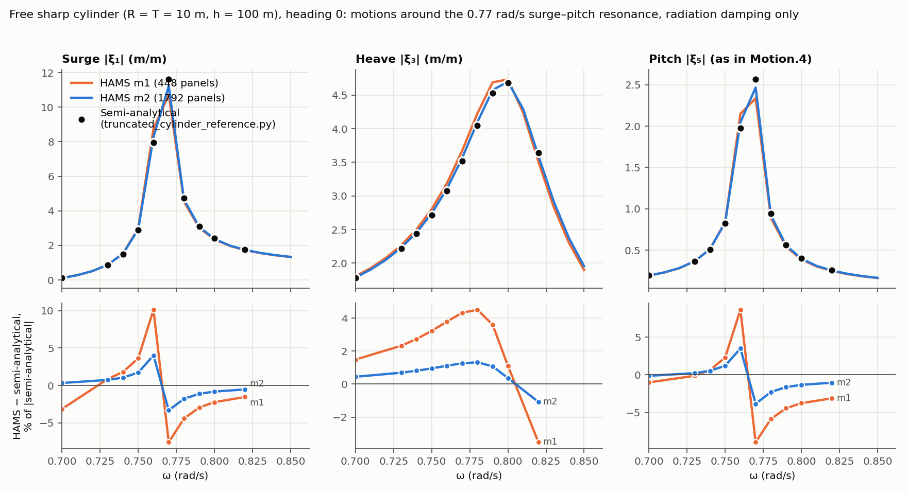

- At 0.77 rad/s the complex error at 1792 panels is 5.2% in surge and 5.5% in pitch. The sign change between 0.76 and 0.77 rad/s shows that HAMS's peak lies slightly below the semi-analytical one. The error halves from 448 to 1792 panels, as the first-order solution converges. Off the peak, HAMS is within 1% at 1792 panels.
- B1, B2 and B3 are bilinear in the motions, so a 3% to 5% motion error at 0.76 to 0.77 rad/s gives roughly twice that at the pairs with one of these frequencies: the 7% to 14% in-band B2 error at 1792 panels [inferred]. The in-band error is the first-order motion error, amplified by the lightly damped resonance, not an error of the second-order terms.
- A real hull with a sharp bilge sheds vortices, which damp this mode. With external damping in `Hydrostatic.in` the peak, and with it the in-band error, is smaller: see [damped free body](#damped-free-body). Model tests point the same way. On a semi-submersible floating wind turbine at 1:70 scale, Zhang et al. (2026) found that potential-flow difference-frequency loads alone still underpredicted the measured low-frequency response in energetic sea states. They note that the resonant response is sensitive to motion-dependent viscous damping (citing Li and Bachynski-Polić 2021 and Wang et al. 2022), which they model by empirical quadratic drag. Where viscous damping matters, add it in `Hydrostatic.in`.

*Damped free body.* The free sharp cylinder with external linear damping in heave and pitch (`drift_convergence.SHARP_DAMPING`, written to `Hydrostatic.in` of the `q_sharp_free_damp_*` cases): B_33 = 3.8306e5 N s/m and B_55 = 1.3416e7 N m s, moments about the origin. Each is 0.05 × 2 sqrt((M + A) C), with A_33 at the heave peak (0.80 rad/s) and A_55 at the coupled surge-pitch peak (0.77 rad/s). So it is 5% of critical by that formula, not the critical damping of an uncoupled mode. At 0.77 rad/s it is 1.4 times (heave) and 2.1 times (pitch) the radiation damping. The reference uses the same values (`truncated_cylinder_reference.py qtf-potential --motion free_damped`). Its check `damped_motions` shows that the damping enters as −iωB, with the sign of the radiation term ([truncated_cylinder_reference.py](../pre_postprocessing_python/SecondOrder/truncated_cylinder_reference.py)). Runs of 2026-11-10: the reference 11 min (24 CPUs); HAMS at 448 panels with the default C (15.5 min), and at 1792 panels with C fixed as above (1 h 19 min), 32 threads.

Largest / median error, percent of max |ref|, QTF⁻_1, QTF⁻_3, QTF⁻_5:

| Panels | What | All pairs | Without 0.75-0.79 |
| ---: | :--- | :--- | :--- |
| 448 | pot | 2.65 / 0.29, 3.86 / 0.50, 3.45 / 0.29 | 2.38 / 0.27, 3.68 / 0.43, 3.45 / 0.22 |
| 448 | B2 | 2.16 / 0.26, 4.87 / 0.34, 4.79 / 0.34 | 1.99 / 0.23, 4.75 / 0.26, 4.79 / 0.26 |
| 1792 | pot | 1.38 / 0.09, 2.22 / 0.23, 3.21 / 0.20 | 1.25 / 0.07, 2.17 / 0.19, 2.79 / 0.16 |
| 1792 | B2 | 1.06 / 0.11, 2.89 / 0.21, 2.71 / 0.25 | 1.06 / 0.08, 2.84 / 0.16, 2.48 / 0.21 |
| 1792 | `.11d` | 7.23 / 0.87, 117 / 11.2, 3.66 / 0.42 | 6.34 / 0.76, 115 / 9.25, 3.30 / 0.42 |

- With damping, the potential part is within about 3% at 1792 panels over all pairs (undamped: 11.8 / 13.0 / 7.9%), and leaving out the resonance band changes little. The in-band error of the undamped body was the motions. The acceptance limit, 5% of max |T_pot|, is met over all pairs at both meshes.
- The large `.11d` QTF⁻_3 error is in the quadratic part, not in the potential part. Damping removes the resonant peak that set the scale: max |ref QTF⁻_3| is 299 undamped and 3.09 damped, while the median absolute error stays about the same (0.45 and 0.35). What is left is the near-field mean drift QTF⁻_3 at the heave peak. At (0.79, 0.79) rad/s the semi-analytical value is 1.83; HAMS gives 8.83 at 448 panels and 5.45 at 1792, so the error about halves with the mesh. This is the known behaviour of near-field QTF⁻_3 on the free sharp hull near heave, a small difference of large terms ([graded meshes](#near-field-on-meshes-graded-towards-a-sharp-edge)). The potential part does not change it.

**Conclusion.** Use the default `qtf_b2 = control`: away from the resonance the potential part is within 1.8 % at 1792 panels, against up to 17.3 % for the hull form. In the undamped resonance band the error is the first-order motion error; with 5 % damping the potential part is within about 3 % over all pairs.

### 2.4 Against Nemoh: cylinder and OC4

**Checks.** `.11d` of the cylinder and of the OC4 semisubmersible. **Reference.** Nemoh v3.0.3 (DUOK + HASBO, [set-up](#comparison-with-nemoh)); for the cylinder also semi-analytical.

**Result.** *Sharp cylinder.* Nemoh v3.0.3, built and run as in [Comparison with Nemoh](#comparison-with-nemoh), with DUOK + HASBO (body forcing, no free-surface integral) on 140 frequencies from 0.01 to 1.40 rad/s, at 448 and 1792 panels, fixed and free. The HAMS runs are those of the hull form of B2. The difference of the `.11d` maps, |HAMS − Nemoh| / max |Nemoh|, with Nemoh read in the convention closest to the semi-analytical reference:

- Fixed, 1792 panels: largest 1.5 / 0.5 / 0.3% (QTF⁻_1 / QTF⁻_3 / QTF⁻_5).
- Free, 1792 panels: medians at most 1.25%; largest 55 / 16.5 / 5.5%, on the lines of the resonance at 0.77 rad/s.

Against the semi-analytical reference, HAMS (hull form of B2) and Nemoh at the same mesh, `.11d` total, |value − ref| / max |ref|, largest / median in percent, QTF⁻_1 / QTF⁻_3 / QTF⁻_5 (`qtf_compare.py --potential ... --nemoh`; free body also with the pairs that have a frequency in 0.75 to 0.79 rad/s left out, `--exclude 0.75 0.79`):

| Body | Panels | HAMS | Nemoh |
| :--- | ---: | :--- | :--- |
| fixed | 448 | 5.7 / 0.96, 5.5 / 4.5, 5.1 / 3.9 | 4.9 / 1.7, 4.9 / 4.0, 5.2 / 3.8 |
| fixed | 1792 | 3.0 / 0.49, 2.7 / 2.2, 2.4 / 1.9 | 4.4 / 0.80, 2.5 / 2.0, 2.4 / 1.9 |
| free | 448 | 99 / 0.73, 112 / 0.29, 14 / 0.04 | 103 / 2.4, 95 / 0.20, 13 / 0.09 |
| free | 1792 | 41 / 0.41, 59 / 0.15, 5.9 / 0.03 | 92 / 2.2, 48 / 0.10, 7.2 / 0.06 |
| free, band left out | 448 | 27 / 0.63, 12 / 0.23, 2.3 / 0.04 | 27 / 2.1, 12 / 0.16, 3.9 / 0.08 |
| free, band left out | 1792 | 11 / 0.35, 6.1 / 0.12, 1.4 / 0.03 | 17 / 1.9, 6.2 / 0.08, 2.2 / 0.05 |

On the fixed body the two codes are equally close to the reference at each mesh, as for the quadratic part ([Quadratic QTFs](#quadratic-qtfs)). On the free body, away from the resonance, HAMS is as close or closer: the same QTF⁻_3, a smaller largest QTF⁻_1 and QTF⁻_5, and a median QTF⁻_1 of 0.35% against Nemoh's 1.9%, which barely falls with the mesh (2.1% at 448 panels). Within the band both carry the motion error of the resonance. Whether Nemoh's HASBO contains a term like B3 was not checked. The Nemoh outputs are not in the repository.

*OC4 semisubmersible.* A second hull, of four columns standing on three wider base columns, for which there is no reference solution: HAMS (`QTF_Indirect.11d`) against Nemoh v3.0.3 (DUOK + HASBO) on the same mesh, mass, centre of gravity and mooring. Cases `q_oc4_fixed_m1`, `q_oc4_free_m1`, `nemoh_oc4_fixed_m1` and `nemoh_oc4_free_m1`, and the same at m2 (4608 panels), of `drift_convergence.py --qtf-potential`; the model is written by `make_mesh.write_oc4` ([make_mesh.py](../pre_postprocessing_python/SecondOrder/make_mesh.py)).

**Model.**

- Geometry of the OC4-DeepCwind semisubmersible (Robertson et al. 2014, Tables 3-1 and 3-2): the main column and the three offset columns with their base columns, draft 20 m, depth 200 m. Only the columns are panelled. The pontoons and cross braces (1.6 m diameter) are left out, as in the OC4 mesh of the Nemoh 3.0.3 test case. So the volume and restoring differ from the report's by the braces (`python make_mesh.py oc4` prints both), and the results are those of this column model, not of the full platform.
- Mesh m1: 1224 panels, full mesh (no symmetry), rows cosine-spaced towards the waterline and the edges. Its volume is 1.50% below that of the exact columns (inscribed polygons). Mesh m2: 4608 panels, with the same C (1400 panels) and F triangulated finer (1384 triangles).
- Mass, centre of gravity (13.46 m below the still water line) and inertias of the platform alone, without tower and turbine (Robertson et al. 2014, Table 3-3). Linearized mooring (Eq. 5-15) as the external restoring matrix; the signs of its surge-pitch and sway-roll couplings are inferred (`make_mesh.oc4_mooring_signs`). The hydrostatic restoring is computed from the mesh.
- HAMS has ρ = 1000 kg/m³ built in. The mass, the inertias and the mooring are scaled by 1000/1025, which keeps the motions and the loads over ρg of the report's platform [inferred: every term of the equation of motion scales with ρ]. Nemoh gets ρ = 1000 and the same matrices.
- The four waterlines are not star-shaped, so C and F come from files (`cs_shape = file`, `CSMesh_1.pnl` and `FSMesh_1.pnl`): C is a vertical cylinder of radius 48.87 m about the origin with a bottom at z = −28 m (1400 panels), and F is triangulated between the column waterlines and C (750 triangles at m1).
- HAMS: `velocity_method = source`, `qtf = 1`, `qtf_terms = body`, `qtf_b2 = control`, `qtf_max_dw = 0.3`, heading 0, 101 frequencies from 0.40 to 1.40 rad/s. Nemoh: DUOK + HASBO on 140 frequencies from 0.01 to 1.40 rad/s; its fixed body is held by an external stiffness of 1e15.
- Runs on Snellius. m1 (2026-11-10): HAMS 52 min per case (32 threads), Nemoh 56 min for both cases side by side (24 CPUs). m2: HAMS 5 h 29 min per case (32 threads), Nemoh 13 h 17 min for both cases side by side (24 CPUs).

**Motions.** HAMS's free heave RAO (`Motion.4`) has a near-zero, 0.013 m/m, at 0.41 rad/s, where the heave excitation (`ExcForce.3`) cancels, and a broad peak of 0.283 m/m at 0.51 rad/s. No resonance lies in the grid. Surge, pitch and yaw resonate well below 0.40 rad/s [inferred from the restoring and the mass; see `qtf_potential_cases` in `drift_convergence.py`].

**Measure.** `qtf_compare.py --against-nemoh`: |HAMS − Nemoh| / max |Nemoh| per pair of `.11d`, largest and median over the pairs with ω_j − ω_i ≤ 0.30 rad/s, in percent. Nemoh is read as written (`--reading as-is`), the reading that matched the semi-analytical reference on the sharp cylinder ([Quadratic QTFs](#quadratic-qtfs)). The second row of each body leaves out the pairs with a frequency in 0.40 to 0.45 rad/s (`--exclude 0.40 0.45`), around the heave near-zero, and keeps the scale of all pairs.

| Body | Panels | Pairs | QTF⁻_1 | QTF⁻_3 | QTF⁻_5 |
| :--- | ---: | :--- | ---: | ---: | ---: |
| fixed | 1224 | all | 5.17 / 1.83 | 5.65 / 0.99 | 1.83 / 0.23 |
| fixed | 1224 | without 0.40-0.45 | 5.17 / 2.01 | 5.65 / 1.03 | 1.83 / 0.25 |
| fixed | 4608 | all | 3.06 / 1.10 | 4.98 / 0.74 | 1.00 / 0.15 |
| fixed | 4608 | without 0.40-0.45 | 3.06 / 1.22 | 4.98 / 0.75 | 1.00 / 0.16 |
| free | 1224 | all | 5.23 / 1.85 | 12.70 / 1.76 | 4.08 / 0.76 |
| free | 1224 | without 0.40-0.45 | 5.23 / 1.84 | 8.05 / 1.71 | 4.08 / 0.71 |
| free | 4608 | all | 3.59 / 1.29 | 10.12 / 1.23 | 4.15 / 0.56 |
| free | 4608 | without 0.40-0.45 | 3.59 / 1.27 | 7.68 / 1.14 | 4.15 / 0.53 |

- At 1224 panels the two codes agree to within about 5% of the largest Nemoh value in QTF⁻_1 and QTF⁻_3 on the fixed body and in QTF⁻_1 on the free body, with medians below 2.1%. QTF⁻_5 agrees to within 1.83% (fixed) and 4.08% (free).
- From 1224 to 4608 panels the difference falls in QTF⁻_1 and QTF⁻_3: on the fixed body, QTF⁻_1 5.17 to 3.06%, QTF⁻_3 5.65 to 4.98% and QTF⁻_5 1.83 to 1.00%; on the free body, QTF⁻_1 5.23 to 3.59% and QTF⁻_3 12.70 to 10.12%. The medians fall too (fixed QTF⁻_1 1.83 to 1.10%, free QTF⁻_3 1.76 to 1.23%). The free QTF⁻_5 is about the same, 4.08 and 4.15% largest and 0.76 and 0.56% median. Where the difference falls with the mesh, the two codes converge towards each other; the free QTF⁻_5 shows no such trend [inferred].
- The largest free QTF⁻_3 difference, 10.12% at 4608 panels (12.70% at 1224), sits at pairs with a frequency in 0.40 to 0.45 rad/s. Without them it is 7.68% (8.05%). Around 0.41 rad/s the heave excitation and motion change fast with ω, so a small shift between the codes gives a larger difference there [inferred].
- On the sharp cylinder at 448 panels, the largest `.11d` errors of each code against the semi-analytical reference were 4.9% to 5.7% on the fixed body ([Comparison with Nemoh](#comparison-with-nemoh-1)). A difference of about 5% between the codes at one coarse mesh is of the size of their mesh errors there [inferred].

What this does not show:

- Accuracy. There is no reference solution, so the table measures agreement between two codes, not the error of either.
- Convergence of either code. The two meshes show that the difference between the codes changes with the mesh, not which code moves.
- The full OC4 platform: the pontoons and braces are not in the model.

**Conclusion.** On the cylinder HAMS is as close to the semi-analytical reference as Nemoh or closer. On OC4 the two codes agree to about 5 % at 1224 panels and closer at 4608 (fixed: 3.06 / 4.98 / 1.00 %); with no reference this is agreement, not accuracy.

### 2.5 OC4 against WAMIT

The same columns-only hull, compared with the WAMIT run of the OpenFAST r-test (`glue-codes/openfast/5MW_Baseline/HydroData/marin_semi.12d`, WAMIT output of 10 January 2014), as reproduced by Al-Ghuwaidi (2025). The same file is the reference of Roland et al. (2026), a benchmark of boundary element solvers for second-order loads on floating wind turbines. Cases `q_oc4w_free_m1` and `q_oc4w_free_m2` of `drift_convergence.py --qtf-potential`; the model is `make_mesh.write_oc4(model="wamit")`.

**Model.**

- The meshes, C and F of the Nemoh comparison above (1224 and 4608 panels), free body only, with the mass, the linearized mooring and the hydrostatic restoring of the WAMIT run (`make_mesh.oc4w_matrices`) in place of those of the platform report. The WAMIT mesh has the pontoons and braces (6258 panels, volume 13675.84 m³); ours has the columns only, so the hydrostatic restoring is that of the WAMIT run, not of our mesh.
- 34 frequencies from 0.25 to 1.90 rad/s in steps of 0.05, the grid of the WAMIT file. The grid stops below the first irregular frequency of the OC4 hull, about 1.98 rad/s [derived], and since `velocity_method = source` rejects irregular-frequency removal it cannot go higher. All pairs of the grid (`qtf_max_dw = 0`), heading 0, `qtf = 1`, `qtf_terms = body`, `qtf_b2 = control`.
- Runs on Snellius: m1 (1224 panels) 24 min 30 s; m2 (4608 panels) 2 h 23 min 40 s.

**Measure.** `qtf_compare.py --against-wamit` ([Python scripts](python_scripts.md#mesh-generation-for-second-order-cases)): |HAMS − WAMIT| / max |WAMIT| per pair, largest and median over the pairs, in percent, for `QTF_Indirect.11d` (quadratic part plus body forcing) and `QTF_Quadratic.10d` (quadratic part only). WAMIT's `.12d` is read as written, conjugated back like the HAMS files. Sets: all pairs; the pairs with ω_j − ω_i ≤ 0.30 rad/s; the diagonal, the mean drift. The last three columns give the median ratio Re(HAMS) / Re(WAMIT) on the diagonal, for QTF⁻_1, QTF⁻_3 and QTF⁻_5. The mean drift is the same in `.10d` and `.11d`, so the diagonal rows of the two are equal.

Largest / median error, percent, QTF⁻_1, QTF⁻_3, QTF⁻_5:

| Panels | File | Set | QTF⁻_1 | QTF⁻_3 | QTF⁻_5 | Diagonal ratio |
| ---: | :--- | :--- | ---: | ---: | ---: | :--- |
| 1224 | `.11d` | all | 135.50 / 1.06 | 157.75 / 0.95 | 155.89 / 0.59 | |
| 1224 | `.11d` | Δω ≤ 0.30 | 114.24 / 1.82 | 153.34 / 1.24 | 172.26 / 1.10 | |
| 1224 | `.11d` | diagonal | 11.07 / 1.48 | 75.27 / 4.12 | 121.97 / 3.08 | 0.947, 0.823, 1.003 |
| 1224 | `.10d` | all | 126.98 / 19.51 | 116.51 / 6.89 | 127.08 / 13.47 | |
| 1224 | `.10d` | Δω ≤ 0.30 | 114.00 / 22.85 | 142.45 / 17.71 | 179.02 / 22.70 | |
| 4608 | `.11d` | all | 232.70 / 0.50 | 185.83 / 0.61 | 183.53 / 0.53 | |
| 4608 | `.11d` | Δω ≤ 0.30 | 119.03 / 1.14 | 185.20 / 1.35 | 195.95 / 0.97 | |
| 4608 | `.11d` | diagonal | 6.34 / 0.62 | 62.34 / 1.98 | 113.97 / 4.23 | 0.966, 0.990, 1.050 |
| 4608 | `.10d` | all | 129.59 / 19.37 | 127.92 / 6.62 | 141.30 / 13.13 | |
| 4608 | `.10d` | Δω ≤ 0.30 | 118.80 / 22.74 | 164.16 / 14.33 | 203.56 / 20.57 | |

The largest values are far above the medians. They sit at pairs with a frequency in 0.25 to 0.35 rad/s, the pitch and heave natural frequencies, where the motions and the loads change fast with ω (see the heave mean drift in the figure below). Without these pairs (`--exclude 0.25 0.35`, scale from all pairs):

| Panels | File | Set | QTF⁻_1 | QTF⁻_3 | QTF⁻_5 | Diagonal ratio |
| ---: | :--- | :--- | ---: | ---: | ---: | :--- |
| 1224 | `.11d` | all | 15.43 / 0.88 | 8.92 / 0.75 | 4.88 / 0.47 | |
| 1224 | `.11d` | Δω ≤ 0.30 | 10.53 / 1.61 | 8.07 / 1.19 | 6.24 / 0.96 | |
| 1224 | `.11d` | diagonal | 11.07 / 1.50 | 18.16 / 2.88 | 11.38 / 2.86 | 0.947, 0.823, 1.003 |
| 4608 | `.11d` | all | 24.11 / 0.35 | 18.13 / 0.52 | 5.51 / 0.45 | |
| 4608 | `.11d` | Δω ≤ 0.30 | 5.68 / 1.06 | 3.71 / 1.17 | 3.01 / 0.82 | |
| 4608 | `.11d` | diagonal | 6.34 / 0.62 | 10.66 / 1.86 | 15.11 / 3.95 | 0.966, 0.990, 1.050 |
| 4608 | `.10d` | all | 61.58 / 19.03 | 42.31 / 6.05 | 33.20 / 13.30 | |
| 4608 | `.10d` | Δω ≤ 0.30 | 106.26 / 25.24 | 42.10 / 15.07 | 44.60 / 22.27 | |

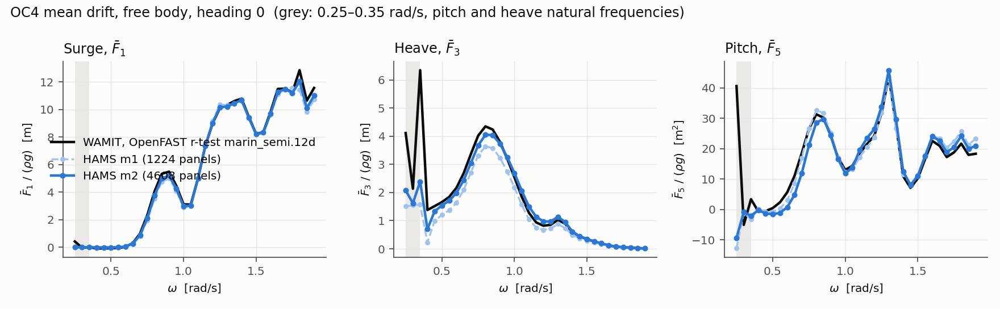

- WAMIT's `.12d` agrees with the full `.11d`, not with `.10d`. The medians of `.11d` against it are 0.50 to 1.35% at 4608 panels (all pairs and Δω ≤ 0.30); those of `.10d` are 6.62 to 22.74%. So the WAMIT file contains the potential part [inferred from the agreement], and HAMS's potential part agrees with it.
- Away from the natural frequencies, the largest difference for Δω ≤ 0.30 halves from 1224 to 4608 panels: 10.53 / 8.07 / 6.24% to 5.68 / 3.71 / 3.01%. The medians stay at about 1%.
- The mean drift converges to WAMIT's. The median ratio of the heave mean drift goes from 0.823 to 0.990, and those of QTF⁻_1 and QTF⁻_5 from 0.947 to 0.966 and from 1.003 to 1.050. The 18% gap in heave at 1224 panels was mesh error, not a difference of geometry [inferred: the same hull, the finer mesh closes it]. The QTF⁻_5 ratio moves away from 1, by 5%.
- The largest values over all pairs do not fall with the mesh (QTF⁻_1 15.43% to 24.11%, QTF⁻_3 8.92% to 18.13% without 0.25 to 0.35 rad/s). They are pairs of 0.35 rad/s, the heave natural frequency, where HAMS's heave RAO is 2.7 m/m, with 1.55 to 1.85 rad/s. A slight shift of the heave resonance between the two models gives a large difference at such pairs [inferred]. They are not in the range of the slow-drift forces, Δω ≤ 0.30 rad/s.

What this does not show:

- Accuracy. WAMIT is a code comparison, not a truth, and its mesh differs from ours: it has the pontoons and braces, ours has the columns only. The effect of the missing pontoons and braces on the loads was not separated from the mesh error.
- A close match at the natural frequencies. The pairs there, which carry the largest differences, are sensitive to the damping and the restoring, which we take from the files of the WAMIT run, and to the viscous damping that neither code has.
- The conjugation and the axes of the WAMIT-format output. The diagonal fixes the sign but, being real, not the conjugation; the off-diagonal reading is fixed in advance and never chosen by agreement ([Open items](#open-items)).

**Conclusion.** WAMIT's `.12d` matches the full `.11d`, not `.10d`, so HAMS's potential part agrees with WAMIT's: within 5.68 / 3.71 / 3.01 % at 4608 panels for Δω ≤ 0.30 rad/s, away from the natural frequencies. The mean drift converges to WAMIT's.

### 2.6 Free-surface integral (`qtf_terms = full`)

**Checks.** The free-surface integral of the second-order potential: FS_inner and FS_outer of `QTF_PotentialTerms.txt` and their sum in `QTF_Indirect.11d`.

**Set-up.** Runs on Snellius (`fat_genoa`, 24 threads, ifx from `intel/2024a`) on 2026-11-12 and 2026-11-13; outputs and scripts in `validation-runs/snellius-qtf-fs` (outside the repository).

The sharp truncated cylinder of the [QTF potential part](#qtf-potential-part), with the same grid (101
frequencies, 0.40 to 1.40 rad/s, `qtf_max_dw = 0.3`, 2666 difference pairs), fixed and free, meshes m1 to m3, the
default inner mesh (`q_sharp_full_{fixed,free}_m{1,2,3}`); at m1, free body, four other inner meshes and two radii
(`q_sharp_full_free_fs{B,C,P20,P30}_m1`, `q_sharp_full_free_R{20,30}_m1`, [Python scripts](python_scripts.md)).

**Reference.** `truncated_cylinder_reference.py qtf-potential --free-surface`: the first-order fields by eigenfunction
matching, and the free-surface integral in zones: a strip at the waterline with a log basis, polar Gauss to 20 m,
Jacobi–Anger outside to about 2 km, and rotated complex contours to infinity. Moving its split radius changes the result
by less than 1e-15. The sign of the term was fixed by solving the second-order problem in the reference (7e-6 with +1,
1.25 with −1). 30 min on Snellius for both motions.

**Measure.** As for the potential part (`qtf_compare.py --potential`): |HAMS − ref| / max |ref| over the pairs,
largest and median, in percent; the FS row is measured against the larger of its own maximum and that of the potential
part with FS. `--exclude 0.75 0.79` leaves out the pairs at the undamped surge–pitch resonance, where the first-order
motions are off ([The resonance and the motions](#the-resonance-and-the-motions)).

**Result.** *Hull meshes, default inner mesh.* FS_inner + FS_outer, without 0.75–0.79 rad/s, largest / median, percent:

| Hull | Inner points | Free QTF⁻_1 | Free QTF⁻_3 | Free QTF⁻_5 | Fixed QTF⁻_1 | Fixed QTF⁻_3 | Fixed QTF⁻_5 |
| --- | ---: | ---: | ---: | ---: | ---: | ---: | ---: |
| m1 (448 panels) | 186 | 12.0 / 2.0 | 4.3 / 0.5 | 2.4 / 0.4 | 22.5 / 3.6 | 29.4 / 7.8 | 20.2 / 3.2 |
| m2 (1792) | 276 | 4.5 / 0.8 | 3.2 / 0.9 | 0.9 / 0.2 | 10.5 / 3.1 | 7.6 / 1.5 | 9.0 / 2.6 |
| m3 (4032) | 360 | 2.2 / 0.4 | 1.3 / 0.4 | 0.4 / 0.1 | 4.0 / 1.2 | 2.9 / 0.6 | 3.5 / 1.0 |

- The term converges with the hull mesh. The free body is within 5% at m2; the whole potential part with FS is within
  4.4 / 3.7 / 0.9% at m2 and 1.6 / 1.5 / 0.6% at m3.
- The fixed body converges by a factor 2.1–2.6 per level and is within 5% at m3. Its FS is a smaller share of its
  potential part, so the same absolute error is a larger percentage; its error grows with ω_i up to 1.1 rad/s.
- The inner mesh refines with the hull: it takes a column at every hull waterline node (62, 92 and 120 columns).

*Inner mesh and radius at m1.* Free body, FS largest error without 0.75–0.79 rad/s, percent:

| Inner mesh | Points | R (m) | QTF⁻_1 | QTF⁻_3 | QTF⁻_5 |
| --- | ---: | ---: | ---: | ---: | ---: |
| default: λ/10, 3 rows | 186 | 15.18 | 12.0 | 4.3 | 2.4 |
| `qtf_fs_rows = 6` (fsB) | 372 | 15.18 | 28.2 | 11.6 | 5.5 |
| `qtf_fs_rows = 9` (fsC) | 558 | 15.18 | 30.5 | 12.5 | 5.9 |
| `qtf_fs_panel` ≈ λ/20, 6 rows (fsP20) | 648 | 15.18 | 2.0 | 1.1 | 0.4 |
| `qtf_fs_panel` ≈ λ/30, 9 rows (fsP30) | 1560 | 15.18 | 9.3 | 6.4 | 1.8 |
| `qtf_fs_radius = 20` | 480 | 20 | 3.5 | 2.8 | 0.7 |
| `qtf_fs_radius = 30` | 1248 | 30 | 2.8 | 2.1 | 0.6 |

- A larger circle or smaller panels bring the m1 error to 2–3.5%.
- But the error is not monotone in the inner mesh: more radial rows alone make it worse, and λ/30 is worse than λ/20.
  Neither the panel size nor the panel shape explains it. The cause is not found. At m1 the first ring of inner points
  lies within one hull panel (about 2.6 m) of the hull, where the constant-panel first-order field and the horizontal
  Laplacian (its stencil shrinks next to the waterline, 50–144 points) are least accurate [inferred]. The sum-frequency runs later found this to be the cause: with semi-analytical panel data the inner integral (a < r < a + 5 m) at the difference pair (1.4, 1.0) was 24.0% off the semi-analytical one, and it is 2.28% with the near-waterline fit of 47d5911 ([sum frequency](#snellius-validation-of-the-sum-frequency)). The numbers of this section are from before the fit and were not re-run.
- The default was kept (2026-11-13): it meets the 5% target at m2 and improves with the hull mesh.

**Conclusion.** The free-surface integral converges with the hull mesh: within 2.2 / 1.3 / 0.4 % (free) and 4.0 / 2.9 / 3.5 % (fixed) at m3. *Details:* cost in [Run details](#runs-difference-qtf-free-surface-integral).

### 2.7 Direct method (`qtf_direct = 1`), body forcing

**Checks.** The direct method (`qtf_direct = 1`, `QTF_Direct.12d`) solves the second-order boundary-value problem for φ_D at each difference frequency Ω and integrates φ_I2 + φ_D over the hull. The indirect method (`qtf_terms = body`, `QTF_Indirect.11d`) integrates the radiation potentials ψ_k against the same body forcing. With the same forcing and no free-surface forcing, Green's theorem makes the two loads equal, so `.12d` and `.11d` (with `qtf_b2 = body`, the form of B2 that the direct method uses) must agree to the mesh error. This is the check. Both methods share the incident-wave terms, B1, B3 and the Stokes form of B2, so it tests the direct solve (the matrix, the right side, the block solve, the symmetry images) and not those terms. The formulation is in [Developer Documentation](developer_documentation.md#direct-method).

**Set-up.** Runs on Snellius (`fat_genoa`, 24 CPUs per job, ifx from `intel/2024a`) on 2026-11-12: one build and nine runs of the cases of `drift_convergence.py` (group D, `--qtf-potential`), about 76 core-hours against an estimate of 84. The job scripts and the cluster-side steps are in `validation-runs/snellius-qtfdirect/jobs`. All cases have `qtf = 1`, `qtf_terms = body`, `qtf_b2 = body`, `qtf_direct = 1` and a free body; the per-pair tables are not in the repository.

| Case | Hull | Panels | Frequencies (rad/s) | Headings | Difference frequencies Ω (rad/s) | Pairs solved |
| :--- | :--- | ---: | :--- | :--- | :--- | ---: |
| `q_round_direct_free_m1`, `_m2`, `_m3` | rounded cylinder, radius 10 m | 480, 1920, 4320 | 0.70, 0.95, 1.10 | 0 and 30 | 0.15, 0.25 | 8 |
| `q_sharp_direct_free_m1`, `_m2`, `_m3` | sharp cylinder, radius 10 m, draft 10 m | 448, 1792, 4032 | 0.40 to 1.40 by 0.01 | 0 | 0.01 to 0.30 by 0.01 | 5130 |
| `q_sharp_direct_irsp_m1` | sharp cylinder, `If_remove_irr_freq = 1` | 448 and 192 lid | 0.20 and 1.700 to 1.800 by 0.005 | 0 | 0.005 to 0.100 and 1.500 to 1.600 by 0.005 | 462 |
| `q_sharp_direct_irsp0_m1` | the same without the lid (control) | 448 | the same | 0 | the same | 462 |

The sharp meshes and frequencies are those of the [QTF potential part](#qtf-potential-part) (`q_sharp_free_src_m1` to `_m3`), with `velocity_method = source`. The IRSP cases use `differencing`, since `source` does not allow the lid. Their pairs have Ω = 1.500 to 1.600 rad/s, across the first irregular frequency of the sharp hull, 1.548 rad/s (`IRREGULAR_FREQUENCIES`).

**Measure.** `qtf_compare.py --direct` gives |T_dir − T_pot| / max |T_pot|, with T_dir = `.12d` − `.10d` and T_pot = `.11d` − `.10d`, over the rows of the forces (modes 1 to 3) and of the moments (modes 4 to 6), all pairs and heading pairs, as the largest and the median, in percent. `--by-omega` gives the largest per Ω. With the CSV of the semi-analytical sharp-cylinder reference (`truncated_cylinder_reference.py qtf-potential`), it also gives the error of each method against the semi-analytical potential part, |HAMS − ref| / max |ref|.

**Result.** *Rounded hull: second-order convergence.* Largest error over the rows (median in brackets), percent:

| Panels | Forces | Moments |
| ---: | :--- | :--- |
| 480 | 1.88 (0.05) | 3.97 (0.04) |
| 1920 | 0.48 (0.01) | 0.81 (0.01) |
| 4320 | 0.23 (0.01) | 0.35 (0.00) |

- The largest error falls by factors of 3.9 and 2.1 for the forces and 4.9 and 2.3 for the moments from 480 to 1920 to 4320 panels. A second-order rate gives 4 and 2.25 for the panel-size ratios 2 and 1.5 [derived]. So the two methods converge to each other at the mesh rate, and at 4320 panels they agree to 0.23% (forces) and 0.35% (moments), inside the 1% aimed for.
- The largest values are at Ω = 0.25 rad/s. At Ω = 0.15 rad/s the forces differ by 0.05, 0.02 and 0.01% at the three meshes.

*Irregular frequency removal.* At Ω ≤ 0.1 rad/s (the 20 of 41 difference frequencies that `--max-dw 0.3` keeps) the direct and indirect results of the IRSP case and of its no-lid control differ by 0.02% in the forces and 0.2% in the moments. The informative range is Ω = 1.500 to 1.600 rad/s, where the irregular frequency lies (`--by-omega --max-dw 2`):

| Case | Forces at Ω = 1.500 / 1.530 / 1.550 / 1.600 rad/s | Moments, range over 1.500 to 1.600 rad/s |
| :--- | :--- | :--- |
| with lid | 2.95 / 2.82 / 2.73 / 2.53% | 7.35 to 8.07% |
| no lid | 2.97 / 3.39 / 53.01 / 4.91% | 8.14 to 8.94% |

- Without the lid the force difference has a spike at Ω = 1.550 rad/s, next to the irregular frequency 1.548 rad/s. With the lid the difference is smooth and falls from 2.95 to 2.51% across the band. So the lid removes the spike of the direct-indirect difference, and the spike in the control shows that the check can see it. Without the lid both ψ and φ_D are polluted, so the spike is not the direct result alone; in the unit test on a rounded hull, the direct result alone changed by 15.1% between the runs with and without the lid.
- The moments differ by 7 to 9% with and without the lid, so that part is not an irregular-frequency effect. The gap appears only at Ω = 1.5 to 1.6 rad/s, the pairs of 0.20 rad/s with 1.7 to 1.8 rad/s. Among the same 1.7 to 1.8 rad/s frequencies, at Ω ≤ 0.1 rad/s, the moments agree to 0.03% (`compare_by_omega.txt`), so it is not a high-frequency mesh error. The 0.20 rad/s frequency is the low frequency where the free body moves most. The IRSP cases are the sharp cylinder at 448 panels with `qtf_b2 = body`, and the free sharp case at 448 panels already differs by 25 to 43% in the moments over Ω ≤ 0.30 rad/s (largest at Ω = 0.06, 25% at 0.30; that run does not reach Ω = 1.5; next section). So the 2.5 to 3% force and 7 to 9% moment levels most likely are the sharp-hull B2 gap of the next section, not an effect of the lid [inferred; the B1 and B2 columns of `QTF_PotentialTerms.txt` at Ω = 1.5 to 1.6 rad/s were not examined]. The rounded-hull IRSP fixture (`qtf_direct_irsp`, 0.64%) shows that the lid path agrees on a smooth hull.

*Sharp cylinder, free body.* Direct against indirect, largest over the rows (median in brackets), percent:

| Panels | Forces | Moments |
| ---: | :--- | :--- |
| 448 | 28.5 (0.04) | 43.3 (0.00) |
| 1792 | 8.15 (0.02) | 49.9 (0.00) |
| 4032 | 8.75 (0.01) | 41.6 (0.00) |

These differences do not fall with the mesh. Both methods integrate B2 on the hull here: the indirect side with `qtf_b2 = body` (the hull form, one-point rule and differenced ∇ψ), the direct side as the Stokes form with the Green function G(x_i, ·) on the hull panels (analytic ∇G panel integrals, near-panel linear density). The integrand is singular at the sharp bottom edge, and neither discretisation converges quickly there ([the two forms of B2](#free-body-the-hull-and-control-surface-forms-of-b2)). The gap is the difference between two discretisations of the same edge-singular hull integral. The differences grow with Ω (forces at 1792 panels: 0.30% at Ω = 0.01, 3.2% at 0.10, 8.15% at 0.30 rad/s). So the useful check on a sharp hull is against the semi-analytical potential part. Error against it (`truncated_cylinder_reference.py qtf-potential`, heading 0, pairs with ω_j − ω_i ≤ 0.3 rad/s, the same grid), largest over the pairs, percent of max |ref|, QTF⁻_1 / QTF⁻_3 / QTF⁻_5:

| Panels | Direct (`.12d` − `.10d`) | Indirect (`.11d` − `.10d`, `qtf_b2 = body`) |
| ---: | :--- | :--- |
| 448 | 36 / 27 / 72 | 30 / 32 / 79 |
| 1792 | 19 / 18 / 40 | 26 / 21 / 61 |
| 4032 | 13 / 13 / 28 | 21 / 21 / 49 |

- The direct method is closer to the semi-analytical values than the indirect one with `qtf_b2 = body` at 1792 and 4032 panels in all three components; the gap is largest in QTF⁻_5 (40 against 61% and 28 against 49%). At 448 panels it is closer in QTF⁻_3 and QTF⁻_5 and farther in QTF⁻_1.
- **The largest errors are at the resonance.** They sit at the pairs with a frequency at the 0.77 rad/s coupled surge-pitch resonance (radiation damping only), where the first-order motions are 3.3 to 4.0% off in modulus in surge and pitch at 1792 panels ([the semi-analytical motion check](#the-resonance-and-the-motions)). The terms are bilinear in the motions, so the pair error is about twice the motion error, for both methods [inferred, as in that section]. Leaving out the pairs with a frequency in 0.75 to 0.79 rad/s, the largest errors at 1792 panels are 4.7 / 8.8 / 9.7% for the direct method and 5.9 / 19.4 / 12.1% for the indirect method (`qtf_compare.py --direct <csv> --exclude 0.75 0.79`, output in `validation-runs/snellius-qtfdirect/compare_direct_excl.txt`; at 448 and 4032 panels the same option gives 8.1 / 16.6 / 17.3% and 3.3 / 6.1 / 6.9% for the direct method).
- Both methods integrate B2 on the hull here: the indirect one in the hull form (`qtf_b2 = body`), the direct one in the Stokes form with the Green function in its right side. So the QTF⁻_3 difference (19.4% against 8.8% away from the resonance) is between two discretisations of the same integral, which is singular at the bottom edge; neither is the reference. The default `qtf_b2 = control` moves B2 off the hull and is the most accurate of the three ([the free body](#free-body-the-hull-and-control-surface-forms-of-b2)). Why the Stokes form has the smaller QTF⁻_3 error was not tested; a possible cause is that the right side integrates the near-panel part of the density to first order in the panel size, which the hull-form integral of ψ does not.
- The direct errors fall by 1.3 to 1.5 from 1792 to 4032 panels (QTF⁻_1 19 → 13, QTF⁻_3 18 → 13, QTF⁻_5 40 → 28%), close to the panel-size ratio of 1.5. That is a first-order rate, as the resonant pairs are set by the first-order motion error, which falls with the panel size ([the resonance](#the-resonance-and-the-motions)).

The figure of the free sharp cylinder (direct and indirect potential part against the semi-analytical reference at 448, 1792 and 4032 panels) is `validation-runs/snellius-qtfdirect/sharp_direct_vs_indirect.png`, kept with the Snellius results and not copied into the repository.

**Conclusion.** On a smooth hull the direct and indirect methods agree to 0.23 % (forces) and 0.35 % (moments) at 4320 panels, at the second-order mesh rate. On the sharp hull the default indirect method (`qtf_b2 = control`) is the more accurate one; use `.12d` there as an independent check. *Details:* cost in [Run details](#runs-difference-qtf-direct-method-body-forcing).

### 2.8 Direct method with the free-surface forcing

**Checks.** The direct method with `qtf_terms = full` adds the free-surface forcing of φ_D to the right side of the solve of [2.7](#direct-method-against-indirect-method) and writes it to `QTF_Direct.12d` and the D_FS column of `QTF_DirectTerms.txt` ([formulation](developer_documentation.md#free-surface-forcing-of-the-direct-solve)). The unit and integration tests are listed in [9](#unit-and-integration-tests).

**Set-up.** Six free-body cases, code at 97dd419: the rounded hull of the body-forcing direct cases at m1, m2 and m3 (480, 1920 and 4320 panels; `q_round_directfs_free_*`), with `qtf_b2 = body`; and the sharp cylinder of the free-surface-integral cases at m1, m2 and m3 (448, 1792 and 4032 panels; `q_sharp_directfs_free_*`), with the default `qtf_b2 = control` on the indirect side. Cases from `drift_convergence.py` (`qtf_directfs_cases`), compared with `qtf_compare.py --direct` and `--potential`. The 0.75–0.79 rad/s band is left out, as in 2.6: the free sharp cylinder has its undamped surge-pitch resonance there.

**Reference.** in-run indirect (the free-surface terms FS_inner + FS_outer); semi-analytical with the free-surface columns.

**Result.** The gap below is |T_dir − T_pot| / max |T_pot| over all modes and heading pairs, with 0 < Δω ≤ 0.30 rad/s. Each cell gives the max / median of the forces, in percent. The body part compares D_I2 + D_D with the five body terms. The free-surface part compares D_FS with FS_inner + FS_outer.

| Case | Total gap | Body part | Free-surface part |
| --- | --- | --- | --- |
| rounded hull m1 / m2 / m3 | 1.72 / 0.44 / 0.20 (max) | 1.75 / 0.47 / 0.22 | 0.08 / 0.03 / 0.03 |
| sharp cylinder m1 / m2 / m3 | 20.0 / 11.0 / 7.8 (max) | 20.0 / 11.0 / 7.8 | 0.15 / 0.02 / 0.01 |
| sharp cylinder, median | 0.04 / 0.01 / 0.01 | 0.03 / 0.01 / 0.01 | 0.003 / 0.000 / 0.000 |

- **The free-surface forcing is right on large hulls.** D_FS equals the indirect free-surface terms to 0.01 % of max |T_pot| at m3, and the difference falls with the mesh.

- **The rounded hull converges as with the body forcing alone.** The factor is 3.9, then 2.2 (body forcing alone: 1.88 → 0.48 → 0.23 %).
- **On the sharp cylinder the gap is the body forcing.** The body part of `.12d` is the same as in the body-forcing runs to 1e-14. The gap is larger than there (14 → 8 → 6.2 %) because the indirect B2 is now `qtf_b2 = control`. B2 is the only term that differs between the runs. The direct solve keeps the hull form of B2, which converges slowly at the sharp edge ([2.7](#direct-method-against-indirect-method)).
- **Against the semi-analytical answer (QTF⁻_1, heading 0, max), `.12d` and `.11d` are equal:** 27.2, 10.9 and 6.0 % at m1, m2 and m3. That max is the first-order motion error, as in 2.6. The potential part shows the difference between the methods. The direct one gives 18.8 → 9.8 → 6.8 % (QTF⁻_3 22 → 13 → 7.9 %, QTF⁻_5 15 → 8.5 → 6.1 %). The indirect one with `qtf_b2 = control` gives 11.8 → 4.4 → 1.6 %. Both converge, and the indirect method stays the more accurate one on sharp edges.
- **With the resonance band included,** the totals are 99, 41 and 24 % from the semi-analytical answer for both files (the `.11d` values of 2.6).

**Conclusion.** The free-surface forcing of the direct solve equals the indirect free-surface terms to 0.01 % of max |T_pot| at m3, and the difference falls with the mesh. *Details:* cost, cost per Ω and the log checks in [Run details](#runs-difference-qtf-direct-method-with-the-free-surface-forcing).

### 2.9 Cost

The wall times, memory and core-hours of the difference-QTF runs are in [Run details](#run-details): [potential part](#runs-difference-qtf-potential-part), [free-surface integral](#runs-difference-qtf-free-surface-integral), [direct method](#runs-difference-qtf-direct-method-body-forcing) and [with the free-surface forcing](#runs-difference-qtf-direct-method-with-the-free-surface-forcing).

### 2.10 Tried and not kept

| What | Result | Kept |
| :--- | :--- | :--- |
| `velocity_method = differencing` instead of `source`, free, 1792 panels, hull form | B2 QTF⁻_5 61 → 81%, `.11d` QTF⁻_1 41 → 583% | no, keep `source` |
| Product weights at sharp edges (`qtf_edge_weights = on`), 448-panel integration fixture | B2 QTF⁻_1 / QTF⁻_3 / QTF⁻_5 15.1 / 30.0 / 11.9% → 17.2 / 37.4 / 11.1% ([SharpEdge.f90](../src/SharpEdge.f90)) | no, default `off` |
| Rows graded towards the bottom edge, power 2.5 and 3, 448 panels, control-surface B2 | power 2.5: B2 18.6 / 20.0 / 17.4%, B1 19.0 / 6.2 / 15.9%; power 3: B2 32.0 / 24.4 / 29.3%; cosine rows: B2 14.0 / 21.9 / 10.0%, B1 12.4 / 7.8 / 10.3%. The edge weights changed B2 by at most 3 points there, for the worse | no, keep cosine rows |
| The rot and line pieces of B2 on C ∪ F as well (prototype on the semi-analytical reference, Snellius, 2026-11-10) | the line piece moves to C ∪ F by a further identity, which holds on the cylinder to within 2.6%, but gains nothing with semi-analytical fields; the rot piece has no closed form on C ∪ F, and trading it for the other hull term is much worse | no |

- The product weights make the rule exact for the singular velocity ρ^p at the panel centres. With semi-analytical fields at the panel centres they help (prototype on the reference), but HAMS's constant-panel velocities next to the edge do not carry the exact singular value, so the weight over-corrects ([SharpEdge.f90](../src/SharpEdge.f90)).
- With semi-analytical fields at 7 panels per face, the rot piece is within 1.3% to 2.6%; in HAMS at 448 panels it is off by 8% to 22%. That error comes from HAMS's velocity near the sharp edge and falls with the mesh (8.3% → 3.7% and 21.8% → 8.5% from 448 to 1792 panels).

## 3. Sum-frequency QTF

The quadratic part of the sum QTF (`.10s`) is in [2.1](#quadratic-qtfs).

### 3.1 Direct method (`.12s`)

**Checks.** The direct method at the sum frequency (`qtf = 2` or `3` with `qtf_direct = 1`) solves φ_D at Ω⁺ = ω_i + ω_j with the sum form of the forcing and writes `QTF_Direct.12s`. By Green's second identity at Ω⁺ > 0 its load equals the indirect sum-frequency potential part ([Developer documentation](developer_documentation.md#sum-frequency-of-the-direct-method)). Each run also computes the indirect sum load of the same pairs from the same ψ and writes it beside the direct parts in `QTF_DirectTermsSum.txt` (D_I2 + D_D + D_FS against P_BODY + P_FS). The tests of each piece are listed in [9](#unit-and-integration-tests).

**Set-up.** Free bodies with IRSP = 1, `qtf = 3`, `qtf_terms = full`: the sharp cylinder at m1 to m3 (448, 1792 and 4032 panels plus the lid, heading 0) and the rounded hull of 2.8 at m1 to m3 (480, 1920 and 4320 panels, headings 0 and 30°). 21 frequencies, 0.40 to 1.40 rad/s (231 pairs). Code version: ed27bd3.

**Reference.** semi-analytical (`truncated_cylinder_reference.py qtf-potential --kernel sum --free-surface`), fixed and free, on the same grid; in-run indirect for the rounded hull.

**Result.** `qtf_compare.py results --direct-sum qtfdirectsum_reference.csv` gives the tables below [measured, 2026-11-17].

**Rounded hull: direct against indirect.** The in-run gap |T⁺_dir − T⁺_pot| / max |T⁺_pot|, all modes and pairs, falls with the mesh at the rate of the free-surface-forcing runs (1.72, 0.44, 0.20% there for the difference):

| Mesh | Forces, max / median | Moments, max / median |
| :--- | :--- | :--- |
| m1 | 2.39 / 0.90% | 9.83 / 0.87% |
| m2 | 0.60 / 0.11% | 2.70 / 0.10% |
| m3 | 0.19 / 0.06% | 1.17 / 0.02% |

So the 12.7% gap of the integration test (one pair on the same 480-panel hull) is mesh error: the direct and the indirect sum converge to the same QTF.

**Sharp cylinder against the semi-analytical sum QTF.** |HAMS − ref| / max |ref|, max / median, with the pairs that have a frequency in 0.75–0.80 rad/s left out (the undamped surge–pitch resonance, as for the difference QTF; on the 0.05 grid the 0.80 point is still on the peak):

| Mesh | `.12s` QTF⁺_1 | QTF⁺_3 | QTF⁺_5 | indirect P QTF⁺_1 | QTF⁺_3 | QTF⁺_5 |
| :--- | :--- | :--- | :--- | :--- | :--- | :--- |
| m1 | 10.0 / 0.9% | 10.4 / 0.6% | 26.2 / 1.6% | 8.7 / 1.7% | 2.5 / 0.1% | 5.1 / 0.4% |
| m2 | 6.3 / 1.4% | 6.6 / 0.4% | 18.8 / 1.5% | 6.4 / 1.8% | 0.7 / 0.1% | 2.1 / 0.4% |
| m3 | 5.4 / 1.0% | 5.0 / 0.3% | 15.3 / 1.1% | 5.8 / 1.5% | 0.3 / 0.1% | 1.3 / 0.3% |

With every pair, the `.12s` maxima are 33 → 28 → 24% (QTF⁺_1), 61 → 37 → 27% (QTF⁺_3) and 117 → 84 → 67% (QTF⁺_5), all at the resonance, where the motions amplify any error of the forcing. The direct-minus-indirect gap, without the resonance, falls 8.3 → 5.5 → 4.2% (forces) and 14.6 → 9.5 → 7.2% (moments), medians ≤ 0.2%. It is all in the body forcing (D_I2 + D_D against P_BODY, QTF⁺_5 14.2 → 9.2 → 7.1%), as for the difference QTF with the free-surface forcing (20 → 11 → 7.8%): the hull-form B2 term of the direct method converges slowly at the sharp edge.

**Conclusion.** The direct and indirect sums converge to the same QTF on the rounded hull (0.19 % forces, 1.17 % moments at m3). On the sharp cylinder `.12s` is within 5.4 / 5.0 / 15.3 % of the semi-analytical sum QTF at m3, away from the resonance; the gap is in the hull-form body forcing at the sharp edge. *Details:* runs and cost in [Run details](#runs-sum-qtf-direct-method).

### 3.2 The free-surface part and the near-waterline fit

**Checks.** The free-surface part of QTF⁺_i (`qtf_terms = full`): D_FS of `.12s` and P_FS of the indirect sum.

**Set-up.** As 3.1; the fit run is sharp m2, fixed and free, code at 47d5911.

**Reference.** semi-analytical sum free-surface term.

**Result.** The direct D_FS equals the indirect P_FS to 2.5 / 1.8 / 1.2% max and ≤ 0.3% median (QTF⁺_1, m1 to m3), so the sum kernel of the direct free-surface solve agrees with the indirect integral. Both are off the semi-analytical free-surface part by the same amount, and that error does not fall with the hull mesh: QTF⁺_1 median 4.4 → 9.1 → 5.7%, max 12.5 → 27.2 → 16.7%. It sets in with the first-order frequency (see below) and, once on, grows with Ω⁺ along the top rows of the map (m2: median 0.4% at Ω⁺ = 0.8–1.2 rad/s, 15% at 2.4–2.8 rad/s).

A run with a finer inner mesh (5168 inner points against 2496) did not change the error, and a fixed body showed the same error (median 8.0 % in QTF⁺_1, against 9.2 % free), so neither the inner mesh nor the radiated waves cause it. The cause was the inner fields next to the waterline: there `fs_inner_steps` shrinks the stencil offsets to millimetres, below the scale on which the field of constant panels is smooth. The fix (commit 47d5911) takes the horizontal gradient and φ_zz of the points within one waterline segment of a waterline from a fit to samples further out. With semi-analytical panel data the inner integral over a < r < a + 5 m goes from 42.7 % to 2.05 % off at the sum pair (1.4, 1.0), and from 24.0 % to 2.28 % at the difference pair (`fs_fields_exact_integral`, `fs_fields_exact_integral_diff`).

The full solve with the fit (sharp m2, fixed and free; 832 inner points fitted from 4992 samples, none left on the stencil) gives the max / median below. D_FS is in % of max |ref FS|, `.12s` in % of max |ref sum QTF|. The free body leaves out 0.75–0.80 rad/s in both; the fixed body has all 231 pairs for D_FS and the same cut for `.12s`.

| Case | D_FS QTF⁺_1 | QTF⁺_3 | QTF⁺_5 | `.12s` QTF⁺_1 | QTF⁺_3 | QTF⁺_5 |
| :--- | :--- | :--- | :--- | :--- | :--- | :--- |
| fixed m2, before | 24.5 / 7.8% | 6.5 / 4.1% | 20.6 / 7.3% | 68.2 / 21.6% | 10.2 / 5.5% | 25.9 / 9.3% |
| fixed m2, with the fit | 1.7 / 0.3% | 1.0 / 0.3% | 1.5 / 0.4% | 4.4 / 2.4% | 3.5 / 1.2% | 1.7 / 0.3% |
| free m2, before | 17.2 / 9.2% | 4.4 / 2.0% | 13.9 / 8.7% | 6.3 / 1.4% | 6.6 / 0.4% | 18.8 / 1.5% |
| free m2, with the fit | 2.0 / 0.5% | 1.0 / 0.2% | 1.8 / 0.5% | 7.5 / 0.4% | 6.6 / 0.4% | 19.5 / 1.1% |

- The free-surface error falls 8 to 30 times and no longer grows with Ω⁺: the median per Ω⁺ stays below 1.7% up to 2.8 rad/s.
- For the fixed body the whole sum QTF is now within 4.4% of the semi-analytical one.
- For the free body the medians fall, but the maxima stay. They are in the direct body forcing at the sharp edge next to the resonance (the table of the sharp cylinder above), which the fit does not change.

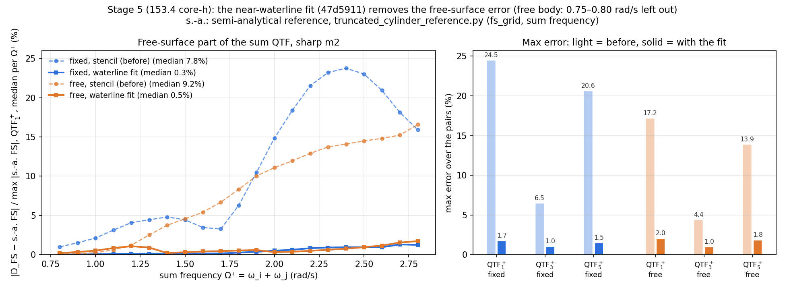

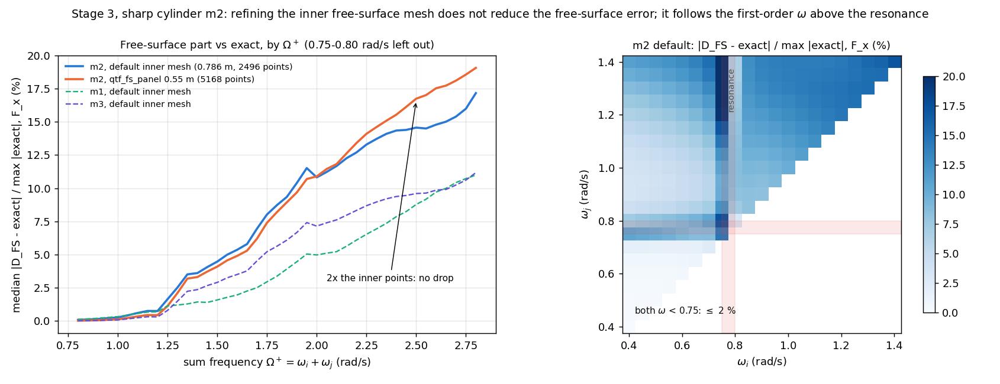

**Conclusion.** With the near-waterline fit the free-surface part is within 2.0 / 1.0 / 1.8 % (max) of the semi-analytical one at m2, fixed and free, and no longer grows with Ω⁺. Only m2 of the sharp cylinder was re-run. *Details:* the four checks that found the cause are in [Run details](#how-the-cause-was-found).

### 3.3 Indirect method (`.11s`)

**Checks.** The indirect method at the sum frequency (`qtf = 2` or `3` with `qtf_direct = 0`) writes `QTF_Indirect.11s` without the direct solve: `.10s` + T⁺_pot, as `.11d` holds `.10d` + T_pot ([Developer documentation](developer_documentation.md#indirect-sum-frequency); files: [Output Files](output_files.md)). With `qtf_direct = 1` the same file is written, and `.12s` as well.

- **The route.** `.11s` = `.10s` + T⁺_pot, with `qtf_direct = 0`: no direct solve, no `.12s`. `QTF_PotentialTermsSum.txt` holds the parts of T⁺_pot, 16 digits (the body terms and, with `qtf_terms = full`, FS_inner and FS_outer). The parts must add up to `.11s` − `.10s`.
- **The same numbers as the direct route.** The radiation problems solved are the same with and without the direct solve, so `.11s` and `QTF_PotentialTermsSum.txt` must be the same files with `qtf_direct = 0` and `1`, to the byte.
- **Nothing else changes.** The `qtf_direct = 1` files of the direct sum and the difference files of `qtf = 3` must be the same as before, to the byte.
- **The numbers.** Against the semi-analytical sum QTF of the sharp cylinder (`truncated_cylinder_reference.py qtf-potential --kernel sum --free-surface`), and against Nemoh v3.0.3 (`qtf_compare.py --against-nemoh --kernel sum`).

**Set-up.** Code version a0b974c (`feature/qtf-indirect-sum`, not pushed); the later change of the B2 form for `qtf = 2` (257662b) does not touch the `qtf = 3` cases that were run. Runs and cost: [Run details](#runs-sum-qtf-indirect-method); results, logs and figures in `validation-runs/snellius-qtf-indirectsum` (outside the repository).

**Result.** *Sharp cylinder against the semi-analytical reference.* Sharp truncated cylinder (radius 10 m, draft 10 m), depth 100 m, free body, heading 0, 21 frequencies 0.40 to 1.40 rad/s, `qtf = 3`, `qtf_terms = full`, `qtf_direct = 0`, meshes m1 (448 panels) and m2 (1792 panels). The error is |X − ref| / max |ref total|, in percent, max / median. Pairs with a frequency in 0.75 to 0.80 rad/s are left out (the surge-pitch resonance, as in the sections above). Sources: `findings.md` (its results sections), `stage1_summary.json`, `stage2_summary.json`, `stage2_summary.txt`, `compare_indsum_m1.txt`, `compare_indsum_stage2.txt` [measured, 2026-11-19].

| Total | QTF⁺_1 | QTF⁺_3 | QTF⁺_5 |
| :--- | :--- | :--- | :--- |
| HAMS `.11s` m1 | 7.8 / 1.4 | 6.0 / 0.14 | 3.0 / 0.56 |
| HAMS `.11s` m2 | 6.1 / 1.1 | 4.1 / 0.10 | 2.1 / 0.39 |
| Nemoh default free-surface mesh, m1 | 10.4 / 1.7 | 18.3 / 1.4 | 20.7 / 1.8 |
| Nemoh matched free-surface mesh, m1 | 10.4 / 1.7 | 18.3 / 1.4 | 20.8 / 1.8 |
| Nemoh default free-surface mesh, m2 | 7.2 / 1.4 | 17.1 / 1.3 | 11.9 / 1.2 |
| Nemoh matched free-surface mesh, m2 | 7.2 / 1.4 | 17.1 / 1.3 | 11.9 / 1.2 |

The same, split into the body part and the free-surface part, with the same scale:

| | Body QTF⁺_1 | QTF⁺_3 | QTF⁺_5 | Free-surface QTF⁺_1 | QTF⁺_3 | QTF⁺_5 |
| :--- | :--- | :--- | :--- | :--- | :--- | :--- |
| HAMS m1 | 6.9 / 1.3 | 4.6 / 0.16 | 11.0 / 0.79 | 0.94 / 0.26 | 0.15 / 0.03 | 0.41 / 0.11 |
| HAMS m2 | 5.5 / 1.0 | 1.4 / 0.05 | 5.1 / 0.52 | 0.37 / 0.09 | 0.04 / 0.01 | 0.17 / 0.04 |
| Nemoh default m1 | 10.4 / 1.7 | 17.5 / 1.5 | 21.2 / 1.7 | 3.5 / 0.70 | 3.3 / 0.34 | 2.1 / 0.47 |
| Nemoh default m2 | 6.2 / 1.4 | 16.8 / 1.4 | 10.9 / 1.1 | 3.5 / 0.80 | 3.4 / 0.33 | 2.1 / 0.62 |

HAMS body part: FK + ID + B1 + B2 + B3 of `QTF_PotentialTermsSum.txt`; free-surface part: FS_inner + FS_outer. Nemoh body part: HASBO; free-surface part: HASFS + ASYMP. The semi-analytical parts are the matching terms of the reference.

- **The two codes use different free-surface meshes.** Both integrate over the ring from the waterline (r = 10 m) to about r = 15 m. HAMS uses 2600 inner points of about 0.16 m² at m1 (a waterline fit for the points next to the waterline, and partial waves fitted on a circle outside the ring). Nemoh uses 896 panels of about 0.44 m², about 3 times coarser, with no waterline treatment and an analytic far part (ASYMP).
- **The mesh is not the cause of Nemoh's peak error.** Two further Nemoh runs gave it the HAMS inner mesh (m1 2600 panels, m2 2496; `fsmatch/`). Its total moves from the default-mesh value by at most 0.26% of max |ref| at m1 and 0.08% at m2. So the mesh share of Nemoh's peak error from m1 to m2 is about 0, and all of it is the method (HASBO), at a given hull mesh.
- **Nemoh's peak error is in HASBO.** From m1 to m2 its body error falls for QTF⁺_1 (10.4 to 6.2%) and QTF⁺_5 (21.2 to 10.9%) but not for QTF⁺_3 (17.5 to 16.8%). Its free-surface part stays at about 3.5% on both meshes. Why that part does not fall was not checked.
- **`.11s` converges with the mesh.** The maxima fall from 7.8 / 6.0 / 3.0% to 6.1 / 4.1 / 2.1% and the medians from 1.4 / 0.14 / 0.56% to 1.1 / 0.10 / 0.39% (QTF⁺_1, QTF⁺_3, QTF⁺_5). The free-surface part is within 0.4% at m2. The body part keeps the larger error (QTF⁺_5 5.1% at m2).
- **The body part equals the direct-sum one.** The body terms of `QTF_PotentialTermsSum.txt` equal P_BODY of the direct-sum `QTF_DirectTermsSum.txt` to 5e-16 of the maximum, on all 441 rows per mode (`scripts/route_check.py`). The free-surface part is 3% (median, QTF⁺_1) from the direct-sum one, because the waterline fit (47d5911) came after that run. The maximum of the potential part for QTF⁺_1 falls from 18% to 8%.
- **`.11s` against Nemoh directly** (`compare_nemoh_m1.txt`, `compare_nemoh_sharp_stage2.txt`): QTF⁺_1 10.3 / 2.3% at m1 and 7.0 / 1.95% at m2. The gap shrinks as Nemoh's body part converges.
- Nemoh switches its Green function from finite to infinite depth at the higher frequencies by itself; its log gives no warning. In HAMS the log warns once that νh > 50 from Ω⁺ = 2.25 rad/s (νh = 51.6; log.txt:316), as in the direct-sum runs at the same frequency; it comes from the radiation-only solve at Ω⁺.

Figures: `validation-runs/snellius-qtf-indirectsum/indirectsum_stage2.png` (m1 and m2, script `scripts/stage2_summary.py`) and `indirectsum_summary.png` (m1, `scripts/stage1_summary.py`), kept with the Snellius results and not copied into the repository.

**Conclusion.** `.11s` converges with the mesh: 6.1 / 4.1 / 2.1 % at m2 (max), with the free-surface part within 0.4 %. Nemoh v3.0.3 is further off (7.2 / 17.1 / 11.9 % at m2), and its error is in HASBO, not in its free-surface mesh.

### 3.4 OC4 against Nemoh and WAMIT (`.11s`)

**Checks.** `.11s` of the OC4 semisubmersible, which has no reference solution.

**Reference.** Nemoh v3.0.3 on the same mesh; WAMIT `marin_semi.12s` (another OC4 model).

**Result.** *Against Nemoh.* The OC4 semisubmersible, 1224 panels (m1), free body, the Nemoh test-case model, `qtf = 3`, `full`. There is no reference solution. The table gives HAMS `.11s` against Nemoh, max / median of |HAMS − Nemoh| / max |Nemoh| over the 150 pairs that HAMS writes (`compare_nemoh_oc4.txt`) [measured]:

| | QTF⁺_1 | QTF⁺_3 | QTF⁺_5 |
| :--- | :--- | :--- | :--- |
| `.11s` against Nemoh (150 pairs) | 82 / 26% | 33 / 10% | 27 / 12% |
| difference QTF of the same two runs (pairs with 0.40 to 0.45 rad/s left out) | 8.8 / 1.8% | | |
| Earlier OC4 runs, difference QTF (`snellius-qtfpot/oc4/compare_m1.txt`) | 5.2 / 1.9% | | |

HAMS leaves out the 81 pairs with Ω⁺ ≥ 1.995 rad/s, its estimate of the lowest irregular frequency (log.txt:46). The gap is much larger than that of the difference QTF. What was checked (`scripts/oc4_parts.py`, `scripts/oc4_bands.py`):

- The quadratic parts agree: `.10s` against Nemoh's DUOK, 3.0 / 0.9% (QTF⁺_1).
- The first-order motions agree within 1 to 4% from 0.60 rad/s up. Near the heave resonance they differ: heave 0.12 against 0.26 m/m at 0.40 rad/s, 0.23 against 0.19 m/m at 0.45 rad/s.
- The gap is in the potential part: the body terms differ by 76 / 13% (QTF⁺_1) and the free-surface terms by 50 / 19%.
- It is not the heave resonance: without the pairs with 0.40 to 0.45 rad/s, QTF⁺_1 is still 67 / 26%.
- It is not the νh > 50 band: HAMS warns from Ω⁺ = 1.6 rad/s (log.txt:278), but below 1.6 the medians are similar.
- The two codes differ in the free-surface mesh and in the circle. HAMS uses the given `FSInnerMesh.pnl` (1724 points) and a circle of R = 48.87 m about (−7.22, 0) (log.txt:39 to 41). Nemoh uses 1732 panels inside r = 48.87 m about the origin. The effect of this was not tested.

**This is open.** It is not known which code is closer to the truth for the OC4 hull at the sum frequency. Both checks named here, a direct-solve run (`qtf_direct = 1`, `.12s`) and Nemoh with the HAMS circle and inner mesh, were later made on the OC4 WAMIT model (5022 panels), see [6.6](#oc4-with-the-new-defaults): the two HAMS routes differ by up to 16 %, and the HAMS inner mesh and circle do not close the HAMS-Nemoh gap of the free-surface part. Figure: `validation-runs/snellius-qtf-indirectsum/indirectsum_oc4.png`, not copied into the repository.

*Against WAMIT.* `validation-runs/snellius-qtf-indirectsum/wamit_check/findings_wamit.md` compares both OC4 runs with the OpenFAST WAMIT sum file `marin_semi.12s` (heading 0, the 150 pairs HAMS writes). It is a different OC4 model (braces, centre of gravity at z = −9.9 m, mass 1.37e7 kg; the runs have z = −13.5 m and 1.31e7 kg). The first-order excitation differs by about 5%, except heave at 0.40 rad/s (11 against 22), and the difference QTF `.11d` of HAMS against WAMIT's `.12d` has a median of 2.6 / 7.2 / 3.0% (QTF⁺_1 / QTF⁺_3 / QTF⁺_5), which is the level of the model difference. Median errors against `marin_semi.12s`, QTF⁺_1 / QTF⁺_3 / QTF⁺_5 [measured]:

| Assembly | HAMS | Nemoh |
| :--- | :--- | :--- |
| quadratic + body terms | 5.0 / 8.9 / 16% | 7.4 / 7.3 / 16% |
| total, with the free-surface part | 32 / 108 / 81% | 36 / 96 / 89% |

The WAMIT file matches the quadratic and body terms without the free-surface part, and is 3 to 10 times further off with it. So it appears to hold no free-surface forcing [inferred from the numbers, not from the WAMIT run settings, which are not available]. It cannot settle the HAMS-Nemoh gap, which is in both the body terms (QTF⁺_1 76 / 13%) and the free-surface terms (50 / 19%), with the larger maximum in the body terms; the file has no free-surface part to test the second. On the body part the two codes are about equally close to WAMIT. A run of the WAMIT model itself (the full hull, with braces) in both codes is being prepared; it has not been run.

**Conclusion.** Open. HAMS and Nemoh differ by 82 / 33 / 27 % (max) on OC4, in both the body and the free-surface terms. The WAMIT file appears to hold no free-surface part, so it cannot settle which code is closer.

### 3.5 Cost

The runs and cost of the sum-frequency cases are in [Run details](#runs-sum-qtf-direct-method) (direct) and [here](#runs-sum-qtf-indirect-method) (indirect).

## 4. Second-order field at points

**Checks.** `QTF_FieldPartial.txt` (`qtf_field = 1`) holds the quadratic part and the second-order incident wave at the field points. It omits the second-order diffracted wave and, for a free body, the wave radiated by its second-order motion; near the bodies, where the free-surface forcing drives the second-order scattered wave, the omitted part is not small (see [Partial second-order field](input_files.md#partial-second-order-field-at-the-field-points)). There is no reference for the complete field, so the checks below cover the two parts that are computed. The complete field is a later phase. Tests in `test/test_second_order_incident.f90`, `test/test_qtf_field.f90` and `test/test_integration_drift.f90`; fixtures `test/data/qtf_field*`, written by `make_drift_fixtures.py`.

**Reference.** Stokes, for the field without a body and for a tiny hull; exact identities and the first-order field for the direct part.

**Result.** **Second-order incident wave, sum frequency** (unit tests `incident2_sum_*`). One wave with itself gives the second-order Stokes potential (Dean and Dalrymple 1991), with |K| = 2k and Ω = 2ω, to 1e-10, and zero in deep water (`incident2_sum_stokes`). The free-surface condition holds against the exact nonlinear forcing sampled in time from the two first-order waves, to 1e-10 relative plus 1e-14 for a value that is exactly zero, collinear waves in deep water (`incident2_sum_free_surface`). The potential is unchanged when the two waves swap (`incident2_sum_swap`), satisfies Laplace's equation and the sea-bed condition (`incident2_sum_laplace_bottom`), and tends to the Stokes value as ω_2 → ω_1, to 1e-4 at ω_2 − ω_1 = 1e-5 rad/s (`incident2_sum_continuity`). The difference-frequency tests are unchanged.

**Pressure and elevation of a wave pair at a point** (unit tests `field_*`, the field without a body). Quadratic plus incident part equal the second-order Stokes elevation, in finite and infinite depth, and the second-order Stokes pressure, to 1e-10 (`field_stokes_elevation`, `field_stokes_pressure`). The difference diagonal is the mean pressure of one wave (`field_mean_pressure`). Swapping the two waves conjugates the difference values and keeps the sum values (`field_swap_symmetry`). The time-domain Bernoulli expressions, built from two first-order waves of amplitudes 1 and 0.7, headings 0 and 30 degrees, and the second-order potential, sampled over the common period, match both kernels at z = 0 and z = −2 m to 1e-10 (`field_bichromatic_time`). The sum pair tends to the Stokes value as the frequencies meet, to 1e-4 (`field_sum_continuity`).

**Point rules** (unit tests `points_*`). A point at z = −1e-7 is an elevation point; points above z = 0, on the hull, inside a body and on z = 0 inside the waterplane stop the run; with two bodies a point inside the second names body 2 and a point between them is accepted. On a box with 0.5 m wall panels and a 4 m × 3.3 m bottom, a point 3.5 m below the bottom and 0.3 m inside the plane of a wall is accepted, while points in the box and in its waterplane are still rejected.

**The file** (integration tests `qtf_field_*`). On a free rounded hull of 480 panels, 3 frequencies, 2 headings, `mean_drift = 2`, 6 points (3 elevation, 3 pressure), with `0_inf_frequency_limits = 1`:

| Test | Check | Measured | Limit |
| :--- | :---- | ---: | ---: |
| `qtf_field_rows` | header, points, the pairs of `.10d` and `.10s` at every point and nothing else (384 rows), no limit frequency; total = quadratic + incident | 3.6e-7 | 1e-6 |
| `qtf_field_symmetries` | T⁻ conjugate and T⁺ equal under exchange, over the largest value of the point | 0 (printed digits) | 1e-6 |
| `qtf_field_diagonal` | difference diagonal of the pressure real, negative, with no incident part (18 rows) | passes | |
| `qtf_field_half_matches_full` | half mesh with `ISY = 1` against the whole mesh, one point with y < 0 and two on y = 0, `mean_drift = 2` | 3.8e-7 | 1e-5 |
| `qtf_field_tiny_stokes` | hull of radius and draft 0.05 m, 20 m depth, 0.9 rad/s, against the Stokes wave: difference pressure diagonal, sum elevation (two points), sum pressure | 3.6e-5, 6.2e-5, 1.3e-5 | 2e-3 |
| `qtf_field_inside_stops`, `qtf_field_no_points_stops` | a point inside the hull, and `qtf_field = 1` without field points, stop the run with a message | passes | |
| `qtf_field_off` | without the key the file is not written | passes | |

The tiny hull barely scatters, so there the omitted second-order scattered wave is negligible and the file must give the Stokes wave; this is the one check of the total against an exact value.

**Convergence with the panel count** (`qtf_field_converges`). Rounded hull, radius 5 m, draft 5 m, bilge radius 1.5 m, depth 100 m, free, ω = 0.8 and 1.0 rad/s, heading 0, points (15, 0, 0), (0, 15, 0), (−25, 0, 0), (15, 0, −3), (0, −25, −5). Three meshes with every row count scaled together:

| Case | ntheta, nz, narc, nr | Panels | Run time |
| :--- | :--- | ---: | ---: |
| `qtf_field_m1` | 16, 4, 2, 2 | 128 | about 5 s |
| `qtf_field_m2` | 24, 6, 3, 3 | 288 | about 18 s |
| `qtf_field_m3` | 32, 8, 4, 4 | 512 | about 89 s |

For the quadratic part (the incident part does not depend on the mesh), d12 = |v2 − v1| and d23 = |v3 − v2| of each row, over the largest |v3| at its point, 40 rows per case:

| Point | d12 | d23 | d23 / d12 |
| :--- | ---: | ---: | ---: |
| (15, 0, 0) | 1.375e-3 | 4.85e-4 | 0.35 |
| (0, 15, 0) | 1.225e-3 | 6.56e-4 | 0.54 |
| (−25, 0, 0) | 1.427e-3 | 8.17e-4 | 0.57 |
| (15, 0, −3) | 8.99e-4 | 3.28e-4 | 0.37 |
| (0, −25, −5) | 3.23e-4 | 1.70e-4 | 0.53 |

The largest d12 is 1.427e-3 and the largest d23 8.17e-4, a ratio of 0.573. The panel size goes as 1/ntheta, so an error of first order in the panel size gives (1/24 − 1/32)/(1/16 − 1/24) = 0.5 [derived]; 0.573 is consistent with the first-order convergence of constant panels. The test needs d23 ≤ 0.6 d12 and d23 ≤ 2e-3; the measured ratio is 0.027 below the first bound, a thin margin. The ratio depends on the refinement path: with a finest mesh of 576 panels (narc = nr = 5, not scaled with ntheta) it was 1.07 at (0, 15, 0). The changes are at most 1.4e-3 of the largest value of a point, a level at which a ratio of two changes is easily moved, so this is a weak check of the order.

### 4.1 Direct part of the field

`QTF_Field.txt` (`qtf_field = 1` with `qtf_direct = 1`) adds to the partial field the second-order potential φ_D of the direct solve at the field points, by Green's second identity over the hull: 4π φ_D(x) = ∫_S [G ∂φ_D/∂n − φ_D ∂G/∂n] dS, with the B2 part of ∂φ_D/∂n in the Stokes form ([usage](input_files.md#partial-second-order-field-at-the-field-points)). The direct part has the body forcing only. Its free-surface forcing is not in it, so the physical check that the complete field satisfies the second-order free-surface condition on z = 0 is not possible yet. The checks below test the formula, the sign and the conjugation, and the chain from the solve to the file, against exact identities and against the first-order field. None of them compares φ_D with an independent value of the second-order field.

**The formula** (unit tests `direct_field_*`, `test_qtf_direct_field.f90`). Truncated cylinder, radius 5 m, draft 5 m, 112 panels, depth 10 m, unless stated. The limits are set in the test file, and the measured values are those it records.

| Test | Check | Measured | Limit |
| :--- | :---- | ---: | ---: |
| `direct_field_radiation_identity` | with the forcing of a heave radiation solve and its solution as φ_D, the formula equals `fields_green`, the first-order field of the same rows, at 6 points (two below z = 0, two on z = 0, two half a panel size off the hull); this fixes the 4π and the sign of the ∂G/∂n term. Depth 10 m and deep water | 1.8e-16 | 1e-10 |
| `direct_field_b2_identity` | the B2 part (forcing 0, φ_D = 0) against the plain form −(1/4π) ∫ G n·[(X·∇)u] dS by 8 × 8 sub-panels, at 3 points off a submerged closed box, with fields that both forms integrate exactly on flat panels, in deep water at 0.005 rad/s. With the sign of B2 flipped the difference is 2 | 9.8e-8 | 1e-6 |
| `direct_field_b2_field_route` | the B2 part takes the field-mode route of the Green function, as the rows do: it equals `b2_stokes_at_point` in field mode, and differs from the default route by more than 2e-8, so the test sees the route (the default route differs by 2.1e-7 at depth 10 m) | rounding | 1e-12 |
| `direct_field_approaches_panel` | the field at 2, 1, 0.5 and 0.25 panel sizes from a side-panel centroid, along the normal into the fluid, tends to the panel value of the direct solution: the difference decreases and is below the limit at 0.25 | 1.5e-3 | 2e-2 |
| `direct_field_symmetry` | half meshes (`ISY = 1`, then `ISX = 1`) against the whole mesh, at 4 points off the symmetry planes, one on z = 0 | 1.7e-14 | 1e-9 |
| `direct_field_hook_matches` | the field points of `direct_at_omega` equal the same columns built step by step (forcing, B2 densities, one block solve, the formula, the conjugation of the column with Ω < 0), for Ω > 0 and Ω < 0 | equal to the bit | |
| `direct_field_negative_omega` | the pair (2, 1) is the complex conjugate of the pair (1, 2) | rounding | 1e-12 |
| `direct_field_hook_absent` | without the field points the direct solve returns the same loads as with them, to the bit | equal to the bit | |

The relative differences are over the largest value at the points. The radiation identity is an identity of the code against the first-order field, so it checks the signs, the factor and the indexing of the images, but not that the second-order forcing is the right one: that rests on the direct-method checks above ([direct against indirect](#direct-method-against-indirect-method)).

**Pressure and elevation** (unit tests `field_direct_*`). The direct part enters as the second-order incident part does: i ρ Ω φ_D for the pressure and (i Ω/g) φ_D for the elevation. With φ_D replaced by the second-order incident potential, the form equals the incident part of `field_pair` to 1e-12 (relative), for the difference kernel at (0.5, 0.7) rad/s in both orders and for i = j, at a pressure point and an elevation point; the values by hand, the conjugate of the pair (j, i) and zero at Ω = 0 pass. `field_direct_columns` (`test_second_order_output.f90`) checks the columns Re_dir, Im_dir and has_direct of a row: the first 15 columns are those of the row without them, to the byte, the direct part is conjugated and scaled as the other parts (pressure by L/(ρ g), elevation by L), to 1e-5, and a row marked `has_direct = .false.` has 0 0 0. `field_direct_file` and `field_direct_off` check that without `qtf_direct` `QTF_Field.txt` is not written and `QTF_FieldPartial.txt` has the same 16 rows as the run with the direct part, to the byte, with no mention of a direct part in its header.

**The file** (integration tests `run_qtf_direct_field*`, `qtf_direct_field_rows`, `qtf_direct_field_six_values`). Two small cases on rounded hulls of the `qtf_direct` tests, two frequencies, one heading, difference QTF only:

| Test | Check | Limit |
| :--- | :---- | ---: |
| `qtf_direct_field_rows` | 2 points, 8 rows in each file; the first 15 columns of `QTF_Field.txt` are the row of `QTF_FieldPartial.txt` to the byte; the mean rows have `has_direct` 0 and a zero direct part; the pairs (1, 2) and (2, 1) are solved, finite and not zero, with the same Re_dir and opposite Im_dir | 1e-5 relative |
| `qtf_direct_field_six_values` | 6 points (3 on z = 0), 24 rows per file; the columns are named in the `# Columns:` line (18, Re_dir 16, Im_dir 17, has_direct 18); the first 15 columns are the text of an independent run without `qtf_direct`; `has_direct` is 1 for the pairs with ω_i ≠ ω_j alone (12 rows) and a solved row is not zero; at each point the (2, 1) part is the conjugate of the (1, 2) part | 1e-6 of the modulus |
| `qtf_direct_field_six_values`, stored values | the direct parts of the 12 solved rows against `test/data/qtf_direct_field_six/expected_direct.txt` | 1e-5 of the modulus |

`expected_direct.txt` holds the values of this build, written by `extract_direct_field_expected.py` (7 digits). It pins the file against later changes. It is not an independent reference.

**Not checked.** φ_D at the field points against an independent second-order field (the WAMIT or Nemoh field, or the free-surface condition on z = 0, which needs the free-surface forcing in the field); the sum-frequency rows, whose direct part is checked against the direct solve only ([direct method at the sum frequency](#direct-method-at-the-sum-frequency)); the points close to the waterline of a sharp hull; multi-body runs; and no Snellius run was made for this part.

**Conclusion.** The computed parts are right: the tiny hull gives the Stokes wave to 3.6e-5 to 6.2e-5, and the direct part passes its identities. The complete field (with the second-order scattered and radiated waves) has no reference.

## 5. Second-order motion

**Checks.** The second-order motion (`qtf_motion = 1`) solves [−Ω²(M + A(Ω)) − iΩ(B(Ω) + B_ext) + C + K_ext] ξ⁽²⁾ = F⁽²⁾ per second-order frequency Ω, with A and B from the stored ψ, for every row of `.11d`, `.11s`, `.12d` and `.12s`, and writes `QTF_Motion.*` ([usage](input_files.md#second-order-motion), [formulation](developer_documentation.md#second-order-motion)). The pieces (A and B, the solve, the files, the radiated wave in the field) are tested on the laptop ([9](#unit-and-integration-tests)); the whole chain here.

**Set-up.** The free sharp truncated cylinder (radius 10 m, draft 10 m), depth 100 m, heading 0, `qtf = 3`, `qtf_terms = full`, `qtf_direct = 1`, `qtf_motion = 1`, IRSP = 1, meshes m1 (448 panels) and m2 (1792 panels). Springs for a natural period of 100 s and dampers of 5% of critical in surge, sway and yaw (K_11 = K_22 = 1.96063e4 N/m, B_11 = B_22 = 3.12044e4 N s/m, K_66 = 6.20126e5 N m, B_66 = 9.86960e5 N m s; [usage](input_files.md#second-order-motion)). m1 has 22 frequencies, the grid 0.40–1.40 rad/s plus 1.013 rad/s, so that the pair (0.95, 1.013) has Ω = 0.063 rad/s, the slow-drift peak. m2 has the 21-point grid, to keep the cost down. Code version: f7e45da. Runs and cost: [Run details](#runs-second-order-motion).

**Reference.** semi-analytical motion (`truncated_cylinder_reference.py qtf-motion`, difference and sum, `--free-surface`, 22 frequencies, default resolution): ξ_1, ξ_3 and ξ_5 from its own QTF, A and B with the same springs.

**Result.** The error is |HAMS − ref| / max |ref| over the reference pairs ω_i ≤ ω_j, max / median in percent [measured, 2026-11-20]. Without the pairs with a frequency in 0.75–0.80 rad/s:

| Case | File | ξ_1 surge | ξ_3 heave | ξ_5 pitch |

| :--- | :--- | :--- | :--- | :--- |
| m1 | `.12d` | 39.5 / 0.38 | 39.7 / 2.26 | 3.3 / 0.22 |
| m1 | `.11d` | 39.6 / 0.33 | 39.7 / 2.14 | 3.3 / 0.20 |
| m1 | `.11d` − `.12d` | 0.38 / 0.00 | 1.75 / 0.01 | 0.51 / 0.01 |
| m1 | `.12s` | 3.6 / 0.33 | 9.6 / 0.38 | 10.8 / 0.77 |
| m1 | `.11s` | 6.5 / 0.72 | 4.8 / 0.13 | 4.9 / 0.44 |
| m2 | `.12d` | 27.5 / 0.20 | 25.9 / 1.35 | 2.1 / 0.12 |
| m2 | `.11d` | 27.6 / 0.19 | 25.9 / 1.29 | 2.1 / 0.11 |
| m2 | `.11d` − `.12d` | 0.40 / 0.00 | 1.60 / 0.01 | 0.43 / 0.01 |
| m2 | `.12s` | 1.8 / 0.17 | 5.9 / 0.26 | 7.9 / 0.49 |
| m2 | `.11s` | 4.4 / 0.60 | 3.6 / 0.10 | 3.0 / 0.40 |

**The motion error is the force error.** Split the error of ξ into a force part, H_R ρg (F_HAMS − T_ref), and a transfer part, ξ_HAMS − H_R ρg F_HAMS, with H_R the inverse of the reference matrix (it reproduces every reference ξ to 1.7e-8). The transfer part holds A(Ω), B(Ω) and the polygon's M and C. Out of band, `.12d`, max / median in percent of the ξ scale:

| Case | Mode | Total | Force part | Transfer part | Force error (% of max \|QTF_i\|) |

| :--- | :--- | :--- | :--- | :--- | :--- |
| m1 | ξ_1 surge | 39.5 / 0.38 | 39.7 / 0.37 | 1.74 / 0.00 | 48.9 / 3.1 |
| m1 | ξ_3 heave | 39.7 / 2.26 | 39.4 / 2.24 | 0.24 / 0.03 | 39.4 / 2.1 |
| m1 | ξ_5 pitch | 3.3 / 0.22 | 3.4 / 0.16 | 0.27 / 0.06 | 2.0 / 0.08 |
| m2 | ξ_1 surge | 27.5 / 0.20 | 27.6 / 0.20 | 0.03 / 0.00 | 34.0 / 1.8 |
| m2 | ξ_3 heave | 25.9 / 1.35 | 25.9 / 1.34 | 0.04 / 0.01 | 25.9 / 1.3 |
| m2 | ξ_5 pitch | 2.1 / 0.12 | 2.2 / 0.11 | 0.06 / 0.01 | 0.9 / 0.05 |

- The transfer part is at most 1.7% at m1 and 0.03% at m2. That fits the polygon's M and C, 0.6% below the circle at m1 and closer at m2; A(Ω) and B(Ω), small Ω included, are right.
- The force error is that of the earlier direct-method runs of the same meshes without springs (`force_baseline.txt`: `.12d` QTF⁻_1 48.9 / 2.7% now against 50.1 / 2.4% at m1). It is the difference-force error of the sharp hull, which falls with the mesh, as found on the 101-point grid of the free-surface-forcing runs ([Snellius validation](#snellius-validation)).
- The worst out-of-band pair is (0.85, 0.90) for surge: 0.85 rad/s is on the shoulder of the undamped heave and surge-pitch resonances, where the force error is largest, and Ω = 0.05 rad/s is close to the slow-drift peak, so |H| magnifies that error.

**The slow-drift peak pair (0.95, 1.013), m1:**

| Mode | \|ξ_i\| HAMS / ref | Phase HAMS − ref | \|QTF⁻_i\| HAMS / ref | Phase of QTF⁻_i | Error: total / force / transfer (% of scale) |

| :--- | :--- | :--- | :--- | :--- | :--- |
| ξ_1 `.12d` | 1.337 | 0.0° | 1.329 | −0.7° | 33.7 / 33.6 / 1.7 |
| ξ_3 `.12d` | 3.17 | −0.6° | 3.15 | −0.6° | 5.2 / 5.2 / 0.05 |
| ξ_5 `.12d` | 1.326 | 5.5° | 0.941 | −0.1° | 3.3 / 3.1 / 0.27 |
| ξ_1 `.11d` | 1.337 | −0.1° | 1.329 | −0.8° | 33.7 / 33.6 / 1.7 |

The transfer at Ω = 0.063 rad/s matches to 0.6% in modulus and under 1° in phase. The surge peak is about 10 times the static surge, as 1/(2ζ) = 10 predicts. Its 34% excess is the excess of the surge difference force of the m1 hull at that pair. Pitch follows the surge force through the surge-pitch coupling.

**The static diagonal (Ω = 0), `.12d`, HAMS / reference:**

| ω (rad/s) | ξ_1 m1 | ξ_1 m2 | ξ_3 m1 | ξ_3 m2 | ξ_5 m1 | ξ_5 m2 |

| :--- | :--- | :--- | :--- | :--- | :--- | :--- |
| 0.85 | 2.17 | 1.81 | −22.1 | −14.1 | 0.90 | 0.95 |
| 0.90 | 1.65 | 1.45 | 5.95 | 4.21 | 0.92 | 0.95 |
| 0.95 | 1.41 | 1.28 | 2.73 | 2.12 | 0.94 | 0.96 |
| 1.00 | 1.28 | 1.19 | 2.01 | 1.65 | 0.96 | 0.97 |
| 1.20 | 1.08 | 1.05 | 1.44 | 1.29 | 1.00 | 0.99 |
| 1.40 | 1.04 | 1.02 | 1.30 | 1.20 | 1.01 | 1.00 |

All four files of both cases have `Left out: none`, and the logs have no line that leaves an Ω out; the smallest rcond is 2.6e-5 (m1) and 9.6e-5 (m2). At Ω = 0 the equation is (C + K_ext) ξ = ρg F, so these ratios are the ratios of the mean drift force, apart from the polygon's C. In percent of the ξ scale the static errors are small for ω ≥ 0.95 rad/s (m1: surge ≤ 4.2%, heave ≤ 7.0%, pitch ≤ 0.2%). The large heave ratios are of small values: the mean vertical drift next to the heave resonance at 0.80 rad/s, and heave within 7.0% of its scale for ω ≥ 0.95 (m1).

**Other results.**
- **The routes agree in the difference:** `.11d` and `.12d` differ by 0.4 / 1.8 / 0.5% (surge / heave / pitch, max). In the sum the gap (5–11%) is the known direct-indirect gap of the sum force ([direct method at the sum frequency](#direct-method-at-the-sum-frequency)).
- **m1 to m2 the errors fall by about a third:** `.12d` surge 39.5 → 27.5%, heave 39.7 → 25.9%, pitch 3.3 → 2.1%; `.12s` 3.6 → 1.8, 9.6 → 5.9 and 10.8 → 7.9%.
- **Above Ω⁺ = 1.8 rad/s** the sum force keeps the free-surface error of the direct-sum runs (pitch up to 13% at m1 and 10% at m2 of max |T|). In the motion it falls to 4.3% and 3.1%, because |H| ~ 1/(Ω⁺²(M + A)) is small there.
- **The band 0.75–0.80 rad/s dominates when it is kept:** surge `.12d` 465% (m1) and 295% (m2) at (0.75, 0.80). The external dampers act on surge, sway and yaw only, so the first-order heave and surge-pitch resonances there stay undamped.

**Conclusion.** The motion error is the force error of the sharp hull: the transfer part is at most 1.7 % (m1) and 0.03 % (m2), and the error falls by about a third from m1 to m2 (`.12d` ξ_1 39.5 → 27.5 %). At the slow-drift peak the transfer matches to 0.6 % in modulus. *Details:* the figure, runs and cost in [Run details](#runs-second-order-motion).

## 6. Field-pass speed-ups

Five changes make the field passes of `qtf_terms = full` and `qtf_b2 = control` cheaper: deep-water rows on the free surface (`field_deep_kh`), reuse of ψ in the fields passes, a threaded mode check, the partial waves on the circle from the hull integral (`qtf_fs_circle`) and the inner fields from the source strengths (`qtf_fs_inner`). **Two are on by default** (`field_deep_kh = 10` and `qtf_fs_circle = panels`); two have no key and give the same bits as before. The source route (`qtf_fs_inner = source`) is **off by default** because it failed the gate below. What each change does is in the [Developer Documentation](developer_documentation.md#field-pass-speed-ups); the keys are in the [input files](input_files.md).

**Accuracy gate** (rule and table: `validation-runs/fs-speedups/gate/G1_table.md`). A change that is not byte-identical may become the default only if no checked quantity is worse than today's error by more than max(0.5 percentage points, 10 % of today's error). Errors are against semi-analytical data: the semi-analytical potential on the panels of the sharp m1 hull (448 panels, fixed body; test `fs_inner_source_matches_exact`), the 448-panel cylinder for the circle (test `pw_from_panels_matches_samples`), and on Snellius the semi-analytical references of the sharp cylinder at m2.

### 6.1 Deep-water rows against the finite-depth rows

- The two Green functions were compared at the points of the OC4 WAMIT hull and circle, and against a direct series sum (`validation-runs/fs-speedups/results/gbench/gbench_summary.txt`, `outlier_check.txt`). From k0 h = 10 up to ν h = 50 the deep-water row is within 1.3e-3 of the finite-depth row, in the largest value of G and of the gradient on the hull points (1.25e-3 at k0 h = 10, 0.93e-3 to 1.05e-3 from k0 h = 20 to 40). At k0 h = 3.3 it is 1.5e-2 to 1.6e-2, which is why the key defaults to 10.
- Above ν h = 50 the finite-depth field mode switches to a series that fails at some points (the warning "the finite-depth field values may scatter"). At ν h = 52.21 the worst point (R/h = 0.00147) differs by 1.06e-1 between the two rows; against the direct sum the finite-depth row is off by 1.49e-1 in dG/dR where the deep-water row is off by 4.4e-6 (units of the file, `outlier_check.txt`). The test `field_deep_beats_limes` gives 2.6e4 for the finite-depth row against 1.7 for the deep row, in units of h, at the same point.
- The limit of 1.3e-3 does not hold at k0 h = 40 on the cylinder of `field_row_deep_within_tol`: the two rows differ by 3.4e-3 of the row maximum. There the finite-depth mode is off (3.3e-3 from the direct sum at R/h = 0.016, ν h = 40; the deep row 8e-5). The test therefore requires the deep row to be within 1.3e-3 of the direct sum wherever the two differ by more than 1.3e-3; the worst deep-against-direct value over the 300 entries checked is 6.95e-4.
- In whole runs (key on against `field_deep_kh = 0`; `qtf_deep_kh`, h = 100 m, k0 h up to 45, deep-water rows on the free surface only): `QTF_Indirect.11d` 1.2e-6, `QTF_PotentialTerms.txt` 7.1e-5, `QTF_Indirect.11s` 7.7e-4 and `QTF_PotentialTermsSum.txt` 1.07e-3 of the largest value in the file. With the earlier version that also took deep-water rows on C and F, the same pair moved by 1.6e-6, 1.4e-4, 1.66e-3 and 1.73e-3.

### 6.2 Deep-water rows below z = 0

The deep-water rows hold at z = 0 only. At high frequency the deep-water G tends to 1/r − 1/r1, the finite-depth G to that plus the images of a seabed with ∂G/∂z = 0, which `INFGREEN3D` drops [derived]. The images cancel at z = 0, so the free-surface rows above are not affected; below the surface they do not cancel. The unit test `field_row_deep_seabed` measures this at points on the bottom plane z_C of a control surface under a truncated cylinder (24 points from r = 1 m to 1.3 R, field-mode rows as the passes take them). For the entries where the two rows differ by more than 1.3e-3, both are compared with the direct eigenfunction sum. All values are over the row maximum.

| Case | R, draft, h, z_C (m) | k0 h | Deep against finite, G / ∂G/∂n | Deep against direct sum | Finite against direct sum |
| :--- | :--- | ---: | ---: | ---: | ---: |
| barge-like, 1 m clearance | 20, 10, 20, −11 | 10 / 20 / 40 | 0.149 / 0.162, 0.152 / 0.183, 0.156 / 0.185 | 0.162, 0.183, 0.185 | 3.9e-5, 4.6e-5, 5.2e-5 |
| OC4-like, C bottom 5 m under | 20, 20, 200, −25 | 10 / 20 / 40 | 2.37e-3 / 0.87e-3, 3.33e-3 / 1.90e-3, 3.00e-3 / 6.99e-3 | 2.37e-3, 3.31e-3, 6.99e-3 | 0.9e-5, 5.0e-5, 7.2e-5 |
| OC4-like, C bottom 8 m under (as OC4) | 20, 20, 200, −28 | 10 / 20 / 40 | 2.65e-3 / 1.10e-3, 3.92e-3 / 2.25e-3, 3.36e-3 / 8.83e-3 | 2.65e-3, 3.90e-3, 8.84e-3 | 1.3e-5, 2.6e-5, 3.8e-5 |
| OC4 column radius | 12, 20, 200, −28 | 10 / 20 / 40 | 2.34e-3 / 0.90e-3, 3.52e-3 / 2.90e-3, 4.30e-3 / 9.27e-3 | 2.34e-3, 3.49e-3, 9.28e-3 | 1.5e-5, 5.6e-5, 3.6e-5 |

- The finite-depth row is the accurate one below the surface (within 7.2e-5 of the direct sum); the deep row is off by 2.3e-3 to 9.3e-3 in the OC4-like cases and by 0.15 to 0.19 with 1 m of clearance, at every k0 h. The gap does not fall with k0 h.
- The image series alone (max over the panels of the panel area times the images, over the row maximum) gives 0.17 to 0.18 for the barge-like case, the measured size, and 0.8e-3 to 2.0e-3 for the OC4-like cases. There the rest of the gap grows with k0 h (∂G/∂n 0.9e-3 at k0 h = 10, 9e-3 at 40), and its cause was not found [measured, not explained].
- OC4 (`cs_shape = file`): the hull reaches z = −20 m and C z = −28 m in h = 200 m, the third row of the table. With `qtf_b2 = control` (the default) the C/F passes took deep-water rows from k0 h = 10 (0.70 rad/s) in the OC4 run below.
- So the C/F passes (`keep_cs_psi`, `control_fields`) keep the finite-depth rows, and `field_deep_kh` applies to the free-surface passes only.

### 6.3 Byte-identity with `field_deep_kh = 0`

With `field_deep_kh = 0` and `qtf_fs_circle = samples` the run is the one before this work, to the byte: at the commit of the deep-water rows, 73 of the 74 fixtures of the base build (commit 88e19bd) were byte-identical with the default as well; the one that moved then, `qtf_irsp_control` (k0 h = 12.3 at 1.10 rad/s; `qtf_terms = body`, so only its C/F fields switched), had 12 of 12 files byte-identical with `field_deep_kh = 0`. With the deep-water rows on the free surface only it has no pass that takes them. Of the stored references only `qtf_psi_reuse` (`field_deep_kh = 0.25`) moved when C and F went back to the finite-depth rows: `QTF_Indirect.11d` by 8.6e-3 and `QTF_PotentialTerms.txt` by 3.2e-4 of the largest value; it was stored again. The reuse of ψ is byte-identical on six cases by `psi_reuse_byte_identical`, and the threaded check gives the same bits for 1 and 4 threads (`fs_mode_miss_threads`).

### 6.4 Laptop gate: semi-analytical data at unit-test scale

Errors in % of the largest exact value. Gate margin: 0.5 percentage points (pp). Source: `validation-runs/fs-speedups/gate/G1_table.md`, `G1_errors.png`, `fs_inner_source_exact.txt`.

| Quantity | Stencil + samples (today) | Panels circle | Source route | Verdict |
| :--- | ---: | ---: | ---: | :--- |
| φ, inner points 0.1 to 3.5 m from the waterline (worst ring) | 2.5 | 2.5 (no circle) | 1.55 | both pass |
| ∇φ, same rings (worst: 0.1 m) | 4.92 | 4.92 (no circle) | 5.84 | source **fails** (+0.92 pp) |
| inner integral, sum pair (1.4, 1.0) rad/s, max over ψ_1, ψ_3, ψ_5 | 2.05 | 2.05 (no circle) | 3.58 | source **fails** (+1.53 pp) |
| inner integral, difference pair, max over ψ_1, ψ_3, ψ_5 | 2.28 | 2.28 (no circle) | 1.78 | both pass |
| field on the circle against the exact direct sum | 1.68e-4 | 3.59e-7 | not changed | panels pass |

The gate errors are plotted in `validation-runs/fs-speedups/gate/G1_errors.png` (outside the repository).

The panels circle changes only the partial waves. It puts them on the exact series (3.6e-9 against 1.7e-6 for the samples, the samples' own error) and moves `FS_inner + FS_outer` of `qtf_fs_main` by 4.7e-6 of the largest value (test `fs_circle_panels_close`). The source route also moves with the hull mesh: between the 220- and 960-panel hulls (fixed body) `FS_inner + FS_outer` changes by 1.5 to 24.9 % of its largest value on the source route (16 to 25 % in the main terms) and by 0.2 to 1.1 % (0.3 to 1 % in the main terms; heave 4.9 %) on the stencil route. On `qtf_fs_main` the two inner routes differ by 0.559 of the largest `FS` value, and the gap does not move with the inner mesh (26 to 45 % at 1.0 and 0.5 m panels); the parts of the pair integral are about 13 times the result and cancel, so a hull-mesh error is amplified. No missing or wrong term was found [inferred, confidence medium to high]. **Decision: `qtf_fs_inner = source` stays off.** With `qtf_fs_circle = panels` the inner integral of the source route is the same (3.581e-2 and 1.782e-2 with either circle), so both together fail where the source route fails.

### 6.5 Snellius gate: sharp and round cylinder at m2

The panels route against the samples route, sharp cylinder m2, fixed and free, sum and difference kernels, and the rounded hull m2 (free), against the semi-analytical references (`validation-runs/fs-speedups/results/g1_compare.txt`; like with like: the free-surface part against the semi-analytical free-surface part, the total without it against the semi-analytical total). Rule: panels no worse than samples + max(0.5 pp, 10 % of the samples error), on the maximum and on the median. **126 rows, 0 fail.**

- The largest change is in the sum kernel P_FS QTF±_3 of the fixed body: 3.38 % (samples) to 2.36 % (panels). The difference-kernel free-surface parts move by at most 0.17 pp (fixed QTF±_1 2.02 to 2.19 %).
- Every output file, panels against samples: at most 1.3e-2 of its largest value (`QTF_Indirect.11s`, sharp fixed). The quadratic, ψ and first-order files are byte-identical. The in-run direct-indirect check is the same for both routes, round hull included.
- Speed on these cases: 3 % (6855 s to 6667 s); the circle step is a small part of these runs.
- The deep-water rows on the same cases: today's free-surface errors with them stay within the gate of the run before it (code at 47d5911): sum D_FS fixed 1.74 / 1.05 / 1.50 % to 1.20 / 1.01 / 1.10 %, difference FS fixed 1.82 / 1.91 / 1.41 % to 2.02 / 1.21 / 1.61 % (Snellius run of the sharp cylinder at m2, fixed and free, with and without the deep-water rows; the files are not stored in the repository).

These runs used `qtf_b2 = control` with a control surface whose bottom is 7.84 m under the hull (h = 100 m), so with the build of these runs the C/F passes took deep-water rows from k0 h = 10 as well (both routes; the comparison of the two routes is not affected). Those rows are now known to be off below z = 0 (see [Deep-water rows below z = 0](#deep-water-rows-below-z--0)), so the absolute errors of these runs carry that part too. They test the z = 0 rows and the panels circle; the C/F part was not re-run.

This made `qtf_fs_circle = panels` the default (the accuracy gate).

### 6.6 OC4 with the new defaults

The OC4 WAMIT model (5022 hull panels), sum QTF with the indirect method, free body, run on 24 CPUs of one node. "Old" is the same case at commit 22086da (stencil inner route, samples circle, no deep rows, no ψ reuse); "new" is the same case with the defaults of this work at the time of the run, which also took deep-water rows on C and F (no longer done, see [Deep-water rows below z = 0](#deep-water-rows-below-z--0)). Nemoh v3.0.3 ran on the same mesh. Sources: `validation-runs/fs-speedups/results/` (`timing_oc4.txt`, `oc4_by_omega.txt`, `compare_wamit_old.txt`, `compare_wamit_new.txt`).

| Run | Wall | Core-h | First order and rest | Second order, body part | Second order, free-surface part |
| :--- | ---: | ---: | ---: | ---: | ---: |
| HAMS, old | 7.25 h | 174.1 | 0.48 h | 2.94 h | 3.83 h |
| HAMS, new defaults | 2.08 h | 49.8 | 0.48 h | 0.76 h | 0.83 h |
| Nemoh v3.0.3 | 5.46 h | 130.9 | 2.33 h | 3.12 h (body and free surface, not split in its logs) | |

- New HAMS takes 0.286 of the old wall time and core-hours (3.5 times faster) and 0.380 of Nemoh's (2.6 times faster). Nemoh ran its stages on one thread; its job was billed for 24 CPUs, the fat_genoa minimum.
- The saving comes from fewer ψ passes (24 to 11, the ψ reuse: 13 merged into the fields passes) and cheaper fields passes: C/F fields 4538 s to 1613 s and free-surface fields 9424 s to 2850 s (the deep-water rows, the panels circle and the threaded check together; the three were not timed one by one on OC4). The C/F time of the new run was made with deep-water rows on C and F; with the finite-depth rows used there now it will rise (not measured).
- First-order files are byte-identical, except `ExcForce.3`, whose phase column is now in degrees (commit fdf4f8f, a fix merged after 22086da); its magnitudes and real and imaginary parts are identical. `QTF_Quadratic.10s` and `QTF_PsiCheck.txt` are identical. `FS_outer` moves by at most 2e-4 of its largest value.
- `QTF_Indirect.11s` changes, |new − old| / max |old| of the force or moment group (`oc4_by_omega.txt`, `oc4_by_omega.png`):

| | Ω ≤ 1.55 rad/s | Ω ≥ 1.60 rad/s |
| :--- | ---: | ---: |
| mode 1 | 6.6 % | 9.8 % |
| mode 2 | 2.2 % | 8.6 % |
| mode 3 | 1.6 % | 4.1 % |
| mode 4 | 0.5 % | 3.5 % |
| mode 5 | 1.4 % | 6.1 % |
| mode 6 | 2.1 % | 35.1 % |
| term B2 | 1.0 % | 62.5 % |
| term FS_inner | 1.7 % | 5.5 % |

- **Why it changed: open.** The only change since 22086da that alters the field values of this run is the deep-water rows: the field rows use the deep-water Green function from k0 h = 11.47 (0.75 rad/s; the log says so), on the free surface and, in this run, on C and F too. The Limes and lid fixes all predate 22086da, and this run has no lid; the ψ reuse is byte-identical and the panels circle moves `FS_outer` only. The deep-water rows on C and F are now known to be 2e-3 to 9e-3 of the row maximum off per row at OC4's C bottom ([Deep-water rows below z = 0](#deep-water-rows-below-z--0)). So the changes of the table, the jump of B2 above 1.6 rad/s (where the old run warned "ν h = 52.21 > 50: the finite-depth field values may scatter") and the change from 1.35 rad/s (mode 1 at 0.25 % up to 1.30 rad/s, then 1.07 to 6.63 % from 1.35 to 1.55 rad/s; `FS_inner` 0.14 to 1.34 % at 1.35) cannot be put down to Limes or to the finite-depth rows. The re-run below finds the cause of the body-term change.
- **Against WAMIT, both ways.** Against WAMIT `marin_semi.12s` (`compare_wamit_old.txt`, `compare_wamit_new.txt`) the quadratic and body part (where B2 sits) gets closer: maximum QTF⁺_1 13.7 to 10.0 %, QTF⁺_3 27.7 to 23.6 %, QTF⁺_5 47.8 to 47.8 %, median (QTF⁺_5) 14.1 to 14.8 %. The HAMS total gets slightly worse: maximum QTF⁺_1 103.0 to 104.4 %, QTF⁺_3 174.8 to 178.3 %, QTF⁺_5 328.1 to 344.1 %; medians 28.3 to 28.0, 92.5 to 93.3 and 67.4 to 68.1 %. The total is dominated by the free-surface part, which has the known HAMS, Nemoh and WAMIT gap on OC4, so it does not decide the question. The WAMIT file has no separate free-surface part.
- **What is not proven.** The `FS_inner` change from 1.35 rad/s is not proven right or wrong: there is no reference solution, and WAMIT's file has no separate free-surface part to check it against. The comparison with WAMIT above is that of the run with deep-water rows on C and F.

**Re-run with the C/F passes on finite-depth rows.** The same OC4 case on the build that keeps the finite-depth rows on C and F, with `qtf_direct = 1` added so that the run also writes `QTF_Direct.12s` (24 CPUs, 4.67 h, 112.2 core-h; the direct solve adds to the time, so this is not a timing of the defaults). Nemoh v3.0.3 ran again with the HAMS inner mesh (`FSInnerMesh.pnl`) and the HAMS circle (R = 48.87 m about (−7.22, 0)) in place of its own free-surface mesh. Heading 0, the 150 pairs HAMS writes, |a − b| / max |b| of each quantity [measured]. Sources: `validation-runs/fs-speedups/results/oc4_fsfix/` (`analyse_oc4.py`, `analyse_oc4.txt`, `compare_wamit_fsfix.txt`).

- **The body terms are back to those of the first run.** FK, ID, B1, B2 and B3 equal those of the first run (finite-depth rows everywhere) to the printed digits. So the B2 change of the run with the new defaults (up to 12.3 % in F_1, 15.6 % in F_3 and 9.1 % in M_5, from about 1.35 rad/s) came from the deep-water rows on C and F, not from Limes.
- **The free-surface part is unchanged by the fix.** `FS_inner` and `FS_outer` equal those of the run with the new defaults. Against the first run, `FS_inner` still moves by up to 5.7 % (F_1), 5.0 % (F_3) and 5.5 % (M_5), from about 1.35 rad/s. Its rows are deep-water rows on the free surface (`field_deep_kh = 10`); the first run used finite-depth rows there, which its log flags from 1.60 rad/s (ν h > 50). Which is closer is open. The total of the re-run differs from the first run by up to 7.1 / 5.0 / 6.7 % (F_1 / F_3 / M_5), with medians of 0.25 / 0.50 / 0.24 %.
- **Direct against indirect, same run.** `QTF_Direct.12s` and `QTF_Indirect.11s` differ by up to 16.2 % (F_1), 12.3 % (F_3) and 11.5 % (M_5), with medians of 7.4 / 3.2 / 4.7 %. The gap grows with the sum frequency: 2 to 6 % below 1.0 rad/s, 8 to 16 % above 1.4 rad/s. The term files put almost all of the gap in the body forcing: the incident terms agree exactly, and the free-surface terms differ by at most 4 to 7 %, mostly above 1.6 rad/s. The two routes use different forms of B2: the direct route uses the hull form, which `QTFDirect.f90` builds to equal the indirect route with `qtf_b2 = body`, while this run used the default `qtf_b2 = control`. The log keeps the one-point rule of the hull form on 1807 of the 5022 panels (the sharp edges of the heave plates). A run with `qtf_b2 = body` (same build and inputs) changed only B2; every other term was identical to the digit, so the gap between the routes is a B2 effect. The hull form brought `.11s` close to `.12s` for F_1 (median gap 7.4 % to 1.9 %) but further from it for F_3 (3.2 % to 7.6 %) and M_5 (4.7 % to 7.4 %). The direct route's hull form (Stokes form with G) and the indirect hull form (Stokes form with ψ) are therefore different discretisations that do not agree at the heave-plate edges, and the three estimates of B2 spread by up to 35 % of max |`.11s`|. On the sharp cylinder the control form is the closest to the exact reference, which favours the default; OC4 has no exact reference. The outer partial waves converge to 3.6e-6 at every Ω (log).
- **Nemoh on the HAMS circle.** Nemoh's quadratic (DUOK) and body (HASBO) parts are unchanged to 1e-5 of their largest value, so its M_5 is about the same point as before. Its free-surface part (HASFS + ASYMP) moves by up to 25 % (F_1), 14 % (F_3) and 9 % (M_5). The HAMS-Nemoh gap of the free-surface part narrows only a little: F_1 37.6 to 37.3 % (median 14.8 to 12.1 %), F_3 55.4 to 49.2 %, M_5 24.4 to 22.7 %. The same inner mesh and circle do not close it.
- **A finer HAMS inner mesh does not move the inner part.** The HAMS inner part is 0.85 of Nemoh's HASFS in F_1 and M_5 and in phase (median over the large pairs), with the largest gap at the sum frequencies where Nemoh's B_11 has its interaction maxima (1.10 and 1.55 rad/s). One HAMS run cut every waterline segment of the inner mesh into 4 (8868 inner points against 4044; same inputs, build, circle and far panel size; 24 CPUs, 6.8 h). Every term except `FS_inner` is identical. `FS_inner` moves by at most 0.95 / 1.84 / 0.47 % of max |Nemoh HASFS + ASYMP| (F_1 / F_3 / M_5; medians 0.31 / 0.32 / 0.21 %), about 30 times less than the gap to Nemoh's HASFS (31.8 / 10.1 / 18.7 % on the default mesh, 32.4 / 10.6 / 19.2 % on the finer one). The small move is away from Nemoh: the median share of the gap closed is −0.018 / −0.046 / −0.018. So the inner gap of F_1 and M_5 is not the near-waterline resolution of the HAMS inner mesh. Not tested: a finer far inner mesh, and Nemoh on the finer mesh. Sources: `validation-runs/fs-speedups/results/oc4_fs_nemoh/` (`findings.md` sections 8 to 10, `fine_mesh/analyse_fine.py`, `fine_mesh/fine.txt`).
- **Against WAMIT** `marin_semi.12s`, max / median of the total: F_1 104.0 / 28.3 % (HAMS indirect), 100.7 / 25.7 % (HAMS direct), 107.9 / 29.0 % (Nemoh); F_3 180.3 / 93.4, 186.5 / 94.6, 197.6 / 94.8 %; M_5 345.8 / 67.5, 343.4 / 62.9, 391.0 / 73.0 %. The three agree with each other much better than with WAMIT.

**Conclusion.** The two new defaults (`field_deep_kh = 10`, `qtf_fs_circle = panels`) pass the accuracy gate (126 rows, 0 fail); `qtf_fs_inner = source` fails it and stays off. On OC4 the sum run is 3.5 times faster. Its body-term change came from the deep-water rows on C and F, which are no longer used there; the remaining change, in `FS_inner` from 1.35 rad/s, is open, and so are the 16 % gap between the direct and indirect routes and the HAMS-Nemoh gap of the free-surface part. A finer HAMS inner mesh near the waterlines does not move that gap.

### 6.7 Threshold and depth of the deep-water rows

Two questions about `field_deep_kh`: can the threshold come down from k0 h = 10, and does k0 h alone decide where the deep-water rows are safe when the water is shallow relative to the draft? On the default `qtf_fs_circle = panels` the key acts on the inner free-surface points only, so only `FS_inner` (indirect route) can move. The direct route (`D_FS`) does not use the key. Rule: the G1 gate of [6.5](#snellius-gate-sharp-and-round-cylinder-at-m2) where there is a semi-analytical reference; on OC4, which has none, a change of at most 0.5 % of max |QTF⁺_i| per mode. Sources: `validation-runs/fs-speedups/deep_inner/findings.md` (sections 7, 9, 10) and `validation-runs/fs-speedups/results/` (`g1_kh5_cmp/`, `oc4_kh5/`, `shallow_h25_cmp/`, `shallow_h50_cmp/`).

| Case | Depth / draft | Setting against | Reference | Largest change of the error | Verdict |
| :--- | ---: | :--- | :--- | ---: | :--- |
| sharp cylinder m2, fixed and free | 10 (h = 100 m) | `field_deep_kh = 5` against 10 | semi-analytical | 0.14 pp (126 rows) | pass |
| OC4 WAMIT model, free | 10 (h = 200 m) | `field_deep_kh = 5` against 10 | none: change of QTF⁺_i | QTF⁺_1 0.73 %, QTF⁺_3 0.30 %, QTF⁺_5 0.47 % | **fail** (QTF⁺_1) |
| sharp cylinder m2, fixed | 5 (h = 50 m) | default 10 against 0 | semi-analytical at h = 50 m | P_FS QTF⁺_3 0.74 to 2.96 % | **fail** |
| sharp cylinder m2, fixed | 2.5 (h = 25 m) | default 10 against 0 | semi-analytical at h = 25 m | P_FS QTF⁺_3 0.72 to 7.29 % | **fail** |

- **Threshold k0 h = 5.** On the cylinder it saves 11 % of the wall time (7815 s to 6942 s) and passes the gate; the first-order, drift and quadratic files stay byte-identical. On OC4 (24 CPUs, 3.0 h) every term except `FS_inner` is identical to the digit, but QTF⁺_1 changes by 0.73 % at the pair (0.60, 0.60) rad/s and by about 0.5 % at (0.55, 0.60) and (0.45, 0.60). Every pair above the bar has ω_j = 0.60 rad/s (k0 h ≈ 7.3); those pairs move by 1.8 to 2.8 % of their own value. The medians are 0.016 / 0.006 / 0.005 % (QTF⁺_1 / QTF⁺_3 / QTF⁺_5). It saves about 2400 s (18 %) [inferred: the run at 10 also carried the direct-route passes, whose time is estimated]. **The default stays at 10.**
- **Shallow water.** At 2.5 drafts the error of P_FS QTF⁺_3 jumps from 0.23 % to 3.78 % at Ω = 2.0 rad/s, the first sum frequency on deep-water rows, and reaches 7.3 % at 2.8 rad/s. At 5 drafts it grows from 0.39 % at 1.45 rad/s to 2.99 % at 2.8 rad/s (k0 h = 40). With finite-depth rows it stays at 0.2 to 0.74 % at both depths. QTF⁺_1 and QTF⁺_5 pass at both depths, and the difference kernel, the body terms and `D_FS` are identical. The semi-analytical reference at these depths is the same script with the depth changed; its stated uncertainties are for h = 100 m only, and at h = 25 m its rows change by at most 2.1e-6 against 128000 modes and order 20.
- **Depth guard.** So k0 h alone is not enough: the deep-water rows need the depth to be large against the draft too. `field_deep` now keeps the finite-depth rows when the depth is below `field_deep_draft` times the draft of the hull (default 10, the shallowest depth measured to pass; 5 to 10 drafts is not measured). The draft is the deepest node of the mesh, and the log says once when the guard keeps finite-depth rows. OC4 (h = 200 m, draft 20 m) is at 10 drafts and keeps its deep-water rows. `field_deep_draft = 0` turns the guard off. Tests: `field_deep_draft_guard`, `field_deep_draft_key` and `field_deep_draft_negative_stops`. Of the stored references none moved: `qtf_psi_reuse`, which exists to exercise the deep rows at 4 drafts, sets `field_deep_draft = 0`.

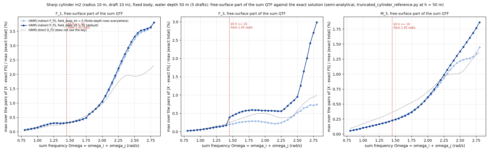

**Conclusion.** The default `field_deep_kh = 10` stays: k0 h = 5 passes on the cylinder but moves the OC4 QTF⁺_1 by 0.73 % at three pairs. In water shallower than 10 drafts the deep-water rows fail the gate at the default threshold, so they are now off there (`field_deep_draft = 10`).

## 7. Multi-body arrays

This case checks the multi-body solve, and the mean drift per body, against an exact solution. [linton_evans_reference.py](../pre_postprocessing_python/SecondOrder/linton_evans_reference.py) solves wave scattering by an array of bottom-mounted vertical circular cylinders without panels. It needs no HAMS run. All values in this section were measured with it in November 2026, on a laptop.

**Notation.** Modes 1 to 6 are surge, sway, heave, roll, pitch and yaw. X_i is the exciting force or moment in mode i, F̄_i the mean drift load in mode i (F̄_4 and F̄_5 are the roll and pitch moments), and a superscript (k) is cylinder k, numbered as in the HAMS case, or as in the paper where its figures are quoted. Without a superscript, F̄_i is the load on the whole array. Along the wave, X_β = X_1 cos β + X_2 sin β and F̄_β = F̄_1 cos β + F̄_2 sin β; "single" is one cylinder alone. "Exact" is the reference of this section.

**Method.** Every boundary is vertical and reaches the sea bed, so the potential separates exactly into cosh k(z + h)/cosh kh times a solution of the 2D Helmholtz equation. Only the propagating mode exists. The scattered wave of each cylinder is a series of Hankel functions. Graf's addition theorem moves the other cylinders' waves to each cylinder, and the no-flux condition then gives one linear system for all the coefficients (Spring & Monkmeyer 1974; Linton & Evans 1990). The script solves it in scaled unknowns, which keeps the condition number of the system below 10 for this layout. It also truncates at the order where every cylinder's series has converged on its neighbours. From the coefficients it computes:

- the exciting forces and moments per cylinder, in the normalisation and phase convention of `ExcForce.3`;
- the total elevation at any point, as the diffraction rows of `PressureElevation.6p` give it;
- the near-field mean drift per cylinder: the waterline term and the quadratic-velocity term, with the depth integrals in closed form (WAMIT v7.5 manual, eqs. 15.54 to 15.57; for a fixed body the other terms vanish). F̄_3^(k) and F̄_6^(k) are zero for a vertical circle;
- the far-field mean F̄_1 and F̄_2 of the array, from the Kochin function (Maruo 1960; Newman 1967);
- the mean drift on any vertical control circle, from the momentum balance (Chen 2007, eqs. 39 to 41, without the hull terms).

**Checks.** `check` runs 13 checks in about 4 minutes and exits with 1 if one fails. The two four-cylinder cases are the square of the HAMS case and an irregular array of three unequal cylinders off the origin, so that no symmetry hides an error.

| Check | Requirement | Measured |
| :--- | :--- | ---: |
| One cylinder: X_1, X_5 against MacCamy-Fuchs, heading 0 and 90 deg, 17 frequencies | 1e-13 | 4.5e-16 |
| One cylinder: near-field F̄_1 against the far-field of `drift_convergence.maccamy_fuchs_fx` (separate code) and of this script | 1e-10 | 3.9e-15 |
| Boundary condition on every cylinder, by summing all the Hankel series directly (no Graf) | 1e-11 | 2.1e-15 |
| Surface values from the Wronskian form against the direct sum | 1e-11 | 2.7e-15 |
| Loads at truncation M and M + 10 | 1e-12 | 9.5e-15 |
| Energy: the optical theorem on the Kochin function | 1e-12 | 1.4e-15 |
| Near-field F̄_1^(k), F̄_2^(k) summed over the cylinders against far-field F̄_1, F̄_2 | 1e-10 | 1.7e-15 |
| Control circle around each cylinder against its near-field load; around the array against far-field F̄_1, F̄_2 and the near-field F̄_6 | 1e-9 | 3.8e-15 |
| The square renumbered, and the square with the heading turned by 90 deg | 1e-11 | 6.0e-15 |
| Depth integrals in closed form against Gauss-Legendre | 1e-13 | 1.8e-15 |
| Published values: Linton & Evans (1990), Table 1 (below) | 1e-3 | 5.0e-4 |
| Published values: Linton & Evans (1990), Fig. 3, total drift outside the near-trapping band (below) | 0.15 | 0.112 |
| Published values: Kim (1993), Fig. 3 (below) | 1.5e-3 | 1.1e-3 |

The invariance check found one error while the script was written: the sign of the sway force and roll moment. Every other check had passed with that error in place, since it only enters the sin part of the force integral. The MacCamy-Fuchs check now also runs at heading 90 deg, so that it covers that part.

**What "exact" means in the figures.** In every figure of this section, "exact" is the multiple-scattering theory of Linton & Evans (1990) computed with `linton_evans_reference.py` (this repository), with truncation M = 16 for the loads and 35 to 36 for the wave field. It is independent of HAMS: it uses no panels and no HAMS code. It is checked against MacCamy & Fuchs (1954) for one cylinder (to 4.5e-16), the optical theorem (1.4e-15), near-field against far-field drift (1.7e-15) and Kim (1993), Fig. 3 (within 0.0011), as in the table above. Each figure says this in its legend and footnote.

**Published values.** Three published sources are compared. The values were read from the paper (Table 1) or digitised from the figures, and are stored in the script.

- **Linton & Evans (1990), Table 1** (check `linton_evans_table1`). Two equal cylinders with spacing R = a/λ and heading π/6, in the long-wave limit k a → 0 (taken at k a = 10⁻³): |X_1^(k)|/|F| and |X_2^(k)|/|F| (F the force on one cylinder alone) for λ = 0.1 to 0.4, eight values printed to three decimals. Seven round to the printed values. The eighth, λ = 0.3, |X_1^(k)|/|F| = 0.95350 against 0.953, sits on the rounding boundary. The largest difference is 5.0e-4.
- **Linton & Evans (1990), Figs. 2 and 3.** Four cylinders at the corners of a square with a/h = 1/2, h half the side, and heading π/4: the HAMS case scaled by 1/5. Fig. 2 gives the first-order force along the wave on each cylinder over that on one cylinder alone, |X_β^(k)|/|X_β^single| (the paper's |X/F|); Fig. 3 the mean drift along the wave over that on one cylinder alone, F̄_β^(k)/F̄_β^single (the paper's f/f_1), on each cylinder and in total. Every curve was digitised at k a steps of 0.05 (`linton_evans_digitised.csv`, 372 points; kept outside the repository, read through `LINTON_EVANS_DIGITISED`). Anchor points were read by eye from gridded zooms of the page and then snapped to the centre of the nearest line in each pixel column, so the values come from the figure, not from the reference. 106 points are left out, with the reason in the file: where two curves pass through the snap window, Fig. 3 below k a = 0.65, where the curves are tangled, and seven points checked to lie on another curve. Outside the near-trapping band 1.38 < k a < 2.07 the largest difference from the reference is 0.037, 0.042 and 0.115 on cylinders 1, 2 and 4 of Fig. 2, and 0.046, 0.066, 0.080 and 0.112 on cylinders 1, 2 and 4 and the total of Fig. 3. The largest differences are on steep parts of the curves, where a small shift in k a changes the value much. Check `linton_evans_fig3` keeps the total within 0.15.
- **The definition of Fig. 2 off the diagonal.** Cylinders 2 and 4 lie on the diagonal along the wave. For cylinder 1, off the diagonal, the paper's curve is not the modulus of the force component along the wave, |X_β^(1)|/|F|. It is (|X_1^(1)| cos β + |X_2^(1)| sin β)/|F|, the combination of the two moduli that their eq. 3.4 gives. The digitised points of cylinder 1 are compared with the reference in that form (the dashed line in the figure); on the diagonal the two forms are equal.
- **Kim (1993), Fig. 3** (check `kim_fig3`). |X_1^(n)| and |X_2^(n)| over π ρ g a h A on each cylinder n of 19 bottom-mounted cylinders in a row: centre spacing 4a, h = 12a, k a = 0.5, heading 45 deg. Kim computed them with the same exact method, and they agree in that figure with the full interaction method and hybrid finite elements of Kagemoto & Yue (1986). The largest difference over the 38 digitised values is 0.0011 (|X_2^(19)|: reference 0.1333, figure 0.1344), below the height of a marker, about 0.0015. The differences grow from cylinder 1 to 19 on both panels, consistent with a slight tilt of the scan.

**The near-trapping band.** At 1.4 < k a < 2.0 the paper's curves in Figs. 2 and 3 are smoother and lower than the reference. The reference has narrow peaks near k a = 1.68 (|X_β^(4)|/|X_β^single| = 2.27 and F̄_β^(2)/F̄_β^single = 4.0, the paper's numbering), where four cylinders at this spacing have a near-trapped mode. Where a published curve has a peak in this band, the reference passes through it: the paper's F̄_β^(2)/F̄_β^single peaks at 2.27 at k a = 1.80, and the reference gives 2.26 there. Truncation is not the cause: with the paper's M = 6 the reference gives the same values as with M = 34 (to three decimals at k a = 1.0 to 2.2). Its boundary-condition residual on this layout is 2e-15. HAMS settles it independently: on the finest mesh it gives the peak drift of the reference within 0.1% (below). A coarse k a step in the paper's computations would explain the smoothing, but the paper does not state its step, so this is not confirmed.

The figures below redraw Linton & Evans (1990), Figs. 2 and 3, with one panel per cylinder (numbered as in the paper) and the total. Lines: the exact reference, at k a steps of 0.01, and 0.002 in the near-trapping band. Red circles: data from Linton, C.M. & Evans, D.V. (1990), The interaction of waves with arrays of vertical circular cylinders, J. Fluid Mech. 215, 549-569, Figs. 2 and 3, digitised; grey circles: digitised points left out. Symbols: HAMS on the three meshes of the HAMS case (section below). The axes are those of the paper, extended to show the exact near-trapping extremes.

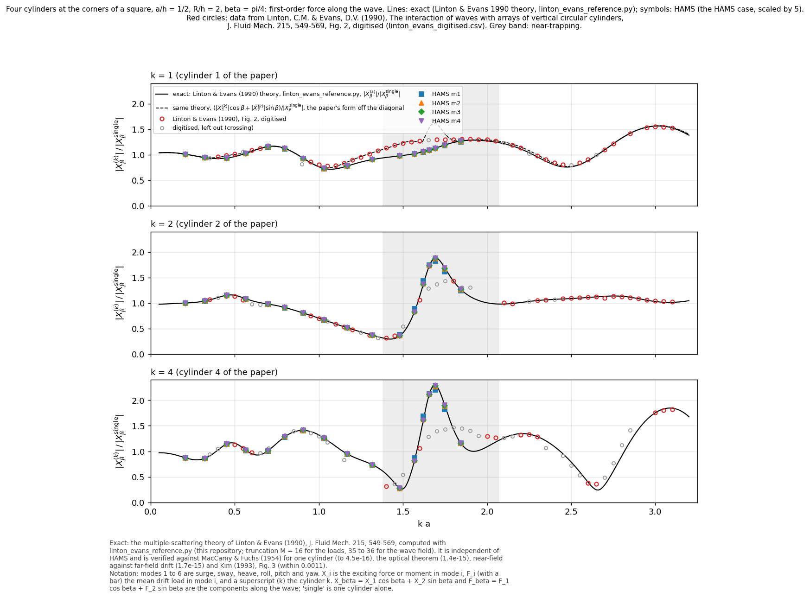

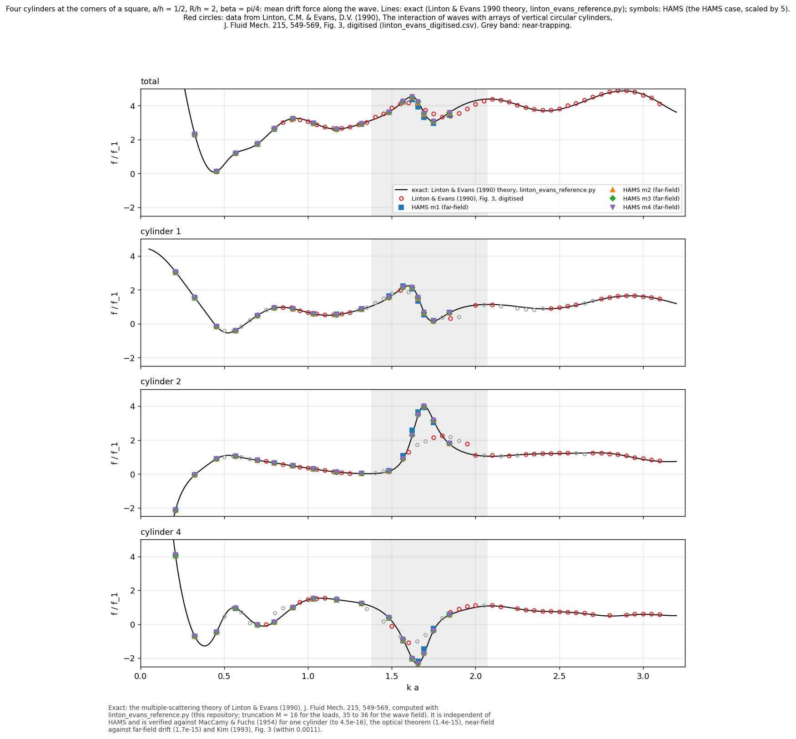

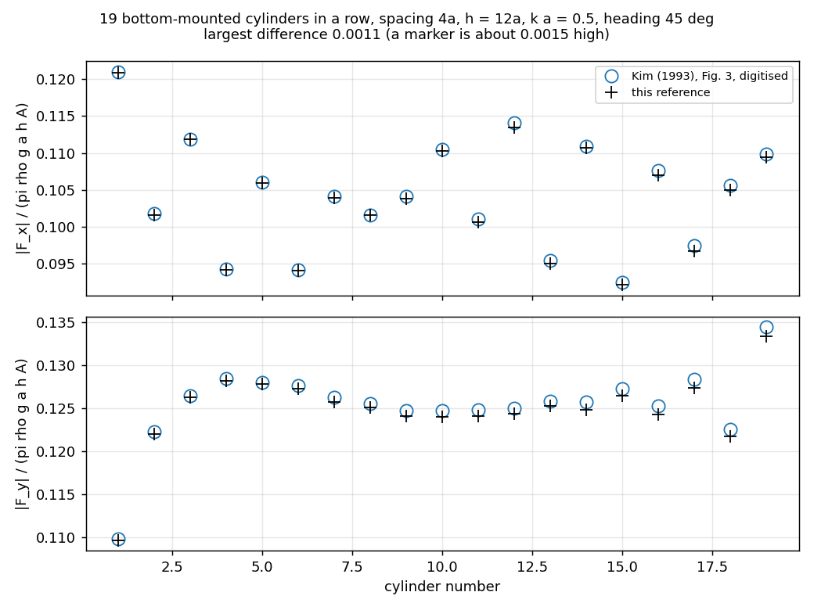

**The HAMS case.** Four cylinders of the bottom-mounted hull of the convergence study: radius 5 m, depth 10 m, centres (±10, ±10) m, so the centre spacing is 4 radii. Each cylinder is a wall from the waterline to the sea bed with no bottom panel, uniform rows, as in group B of the convergence study, where one such cylinder agreed with MacCamy-Fuchs within 0.12% at 4096 panels. The bodies are fixed. The mean drift is computed with `drift_methods = far near` and `velocity_method = differencing` (the closer method on that cylinder), at headings 0 and 45 deg and 17 frequencies from 0.40 to 1.90 rad/s, so k a runs from 0.19 to 1.84. That is below the first irregular frequency of a bottom-mounted circle, k a = 2.405 (2.17 rad/s here). The grid is dense at 1.75 to 1.85 rad/s, where heading 45 deg has a near-trapped mode between the cylinders: the exact F̄_1^(4) peaks at 10.6 ρ g A² at 1.79 rad/s, against 2.2 for one cylinder alone. There are 16 field points at z = 0, in the gaps and around the array. The meshes have 256, 1024, 2304 and 4096 panels per cylinder (1024, 4096, 9216 and 16384 in all). `drift_convergence.py --linton-evans` writes and runs the cases (`l_square_diff_m1` to `_m4`, and `l_square_field_m1` to `_m3` for the wave field on a grid, below), and `linton_evans_reference.py compare` and `plot` compare them.

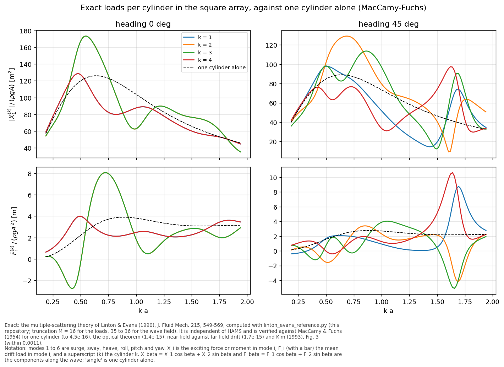

**Integration test.** `test/test_integration_array.f90` runs the case at test size, `drift_le_square`: 64 panels per cylinder, 0.95 and 1.60 rad/s, heading 45 deg. It compares the run with the exact rows in `test/data/drift_le_square/array_reference.txt`. At this mesh the differences are mesh errors (1.60 rad/s has 12 panels per wavelength around a cylinder), so the limits are about twice the measured values, not accuracy claims. The measured values [ifort 2022.1, Windows]:

- X_1^(k), X_2^(k): 0.108;
- X_4^(k), X_5^(k): 0.142;
- near-field F̄_1^(k), F̄_2^(k): 0.231, over the largest load of the array;
- near-field F̄_4^(k), F̄_5^(k): 0.079;
- far-field F̄_1, F̄_2: 0.018;
- elevation: 0.092 per unit amplitude;
- F̄_3^(k) and F̄_6^(k): 1.7e-11.

At 0.95 rad/s, X_i^(k) agrees within 1.9% for every body, with the right phase, body order and moment centre. A sign, conjugation or body-order error would give errors of order 1.

**HAMS against the reference on Snellius.** The four cases ran on Snellius (`fat_genoa`, 24 threads, ifx 2024a) in November 2026, built from the commit that added this case (the Fortran code is the same in the later commits). Wall time: 11 s, 103 s, 463 s and 1623 s; peak memory: 0.14, 1.2, 5.6 and 17.4 GB. The table gives the largest error of each quantity over the 17 frequencies, both headings and the four cylinders, with the error measures of `compare` (python_scripts.md):

| Mesh (panels in all) | X_1^(k), X_2^(k) | X_4^(k), X_5^(k) | near-field F̄_1^(k), F̄_2^(k) | near-field F̄_4^(k), F̄_5^(k) | far-field F̄_1, F̄_2 | η (complex) |
| :--- | ---: | ---: | ---: | ---: | ---: | ---: |
| m1 (1024) | 9.8e-2 | 1.09e-1 | 1.15e-1 | 1.18e-1 | 5.5e-2 | 3.6e-1 |
| m2 (4096) | 2.4e-2 | 2.6e-2 | 2.6e-2 | 3.2e-2 | 1.4e-2 | 9.1e-2 |
| m3 (9216) | 1.0e-2 | 1.1e-2 | 1.1e-2 | 1.4e-2 | 6.0e-3 | 3.9e-2 |
| m4 (16384) | 5.4e-3 | 6.1e-3 | 6.5e-3 | 8.0e-3 | 3.2e-3 | 2.1e-2 |

- **Convergence.** Every error falls by 3.7 to 4.4 times from m1 to m2 (twice the panels per side), by 2.2 to 2.4 times from m2 to m3 (1.5 times) and by 1.73 to 1.87 times from m3 to m4 (4/3 times, where second order gives 1.78), so HAMS converges to the exact solution at second order in the panel size. That covers the multi-body solve, the exciting loads per body, the elevation and the mean drift per body and of the array.
- **Largest errors at m4:** X_1^(k), X_2^(k) 0.54% (1.78 rad/s, heading 45 deg), near-field F̄_1^(k), F̄_2^(k) 0.65% (1.60 rad/s), far-field F̄_1, F̄_2 0.32% (1.82 rad/s), elevation η 0.021 per unit amplitude (1.80 rad/s). All are in or next to the near-trapping band, where the field between the cylinders is steepest. F̄_3^(k) and F̄_6^(k) near-field, zero for this hull, are under 1e-10 of the force, and far-field F̄_6 of the array, zero by symmetry at both headings, is under 3e-6 of |F| times 10 m.
- **Near-trapping peak.** F̄_1^(k) on each cylinder k at heading 45 deg, per ρ g A² (m1, m2, m3, m4, exact):

| rad/s | F̄_1^(1) | F̄_1^(3) | F̄_1^(4) |
| ---: | :--- | :--- | :--- |
| 1.75 | 2.332, 2.019, 1.957, 1.935, 1.906 | -2.150, -1.998, -1.967, -1.956, -1.943 | 8.218, 8.064, 8.022, 8.005, 7.983 |
| 1.78 | 5.602, 5.080, 4.961, 4.917, 4.859 | -4.499, -4.422, -4.396, -4.386, -4.373 | 10.284, 10.437, 10.435, 10.431, 10.420 |
| 1.80 | 7.995, 7.726, 7.633, 7.595, 7.540 | -4.753, -5.039, -5.077, -5.088, -5.099 | 9.259, 9.957, 10.059, 10.090, 10.120 |
| 1.82 | 8.575, 8.790, 8.788, 8.781, 8.761 | -3.221, -3.719, -3.807, -3.836, -3.868 | 6.122, 6.898, 7.035, 7.081, 7.129 |

  HAMS converges to the exact peak (F̄_1^(4) = 10.42 at 1.78 rad/s, five times the drift on one cylinder alone), not to the smoother published curves.

- **Wave elevation.** At the 16 field points, | |η_HAMS| − |η_exact| | / A is at most 0.276, 0.067, 0.027 and 0.017% at 1.10 rad/s and 4.41, 1.09, 0.49 and 0.28% at 1.70 rad/s (m1 to m4; medians 0.006 and 0.046% at m4). The error is given over the incident amplitude A because |η| is near zero in places, where a relative error has no meaning. The elevation error of the table above (0.021 at m4) is that of the complex elevation, phase included, and its largest value is at 1.80 rad/s.

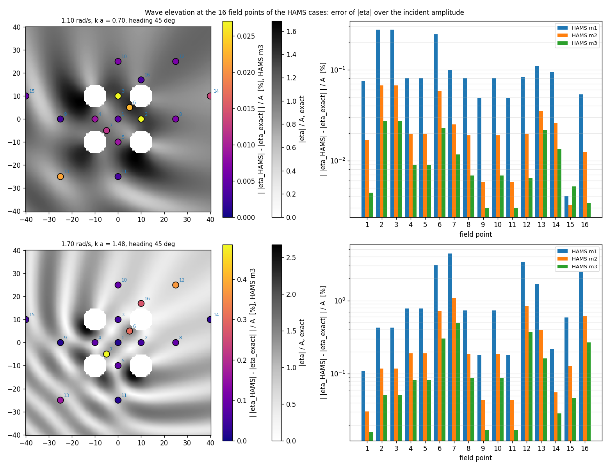

- **Wave elevation on a grid.** The cases `l_square_field_m1` to `_m3` repeat m1 to m3 at 1.10 and 1.70 rad/s, heading 45 deg, with 2746 field points on a 1.5 m grid over the 80 m by 80 m box around the array (0.5 m clear of each wall). The largest and median | |η_HAMS| − |η_exact| | / A are 1.06 and 0.08%, 0.26 and 0.02%, 0.11 and 0.01% at 1.10 rad/s, and 6.8 and 0.91%, 1.7 and 0.22%, 0.73 and 0.09% at 1.70 rad/s (m1, m2, m3). The error is largest next to the walls and in the lee of the array along the wave, and it falls with the mesh everywhere.

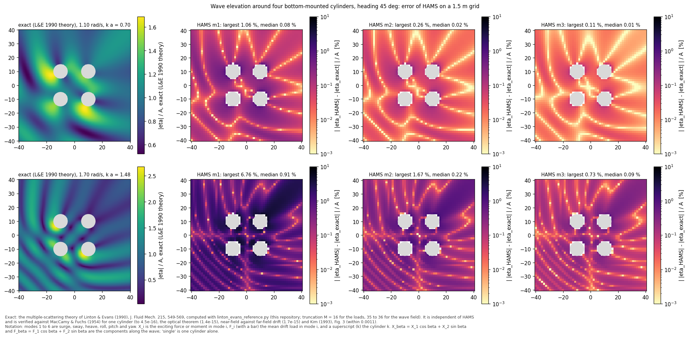

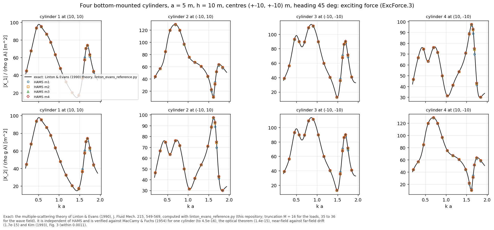

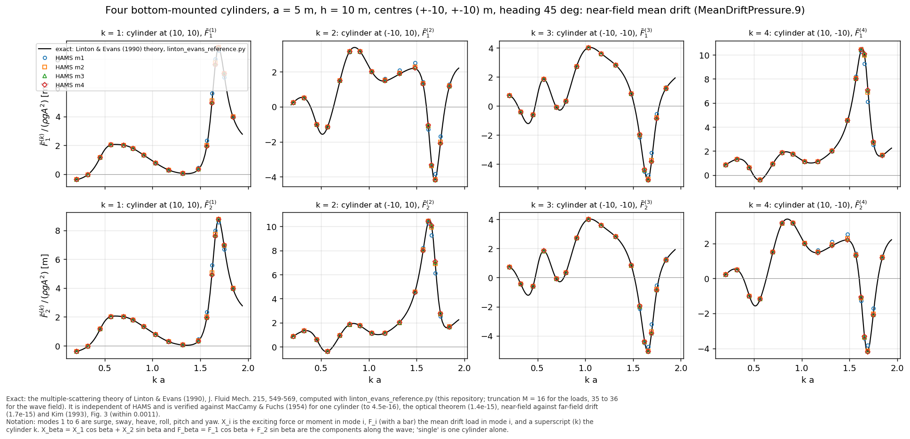

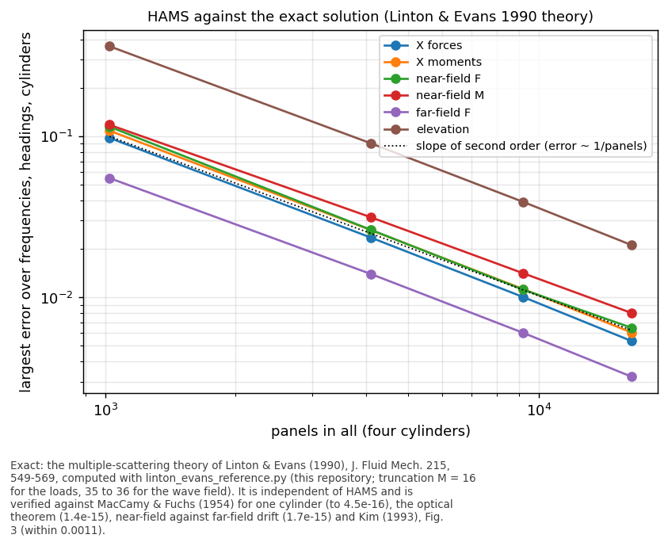

**Cost.** The model of `drift_convergence.py` estimated 2.0 job hours at 32 threads for m1 to m3. They took 0.16 job hours at 24 threads (9.6 min in all, plus a 1.7 min build), 12 times less; m4 took 27 min (10.9 core-hours) against 9.3 h in the model. The model was fitted to single hulls, and it overestimates these runs. The grid runs took 6.1 min in all (2.4 core-hours); the field points are not in the model.

**Limits of this check.** It covers fixed bodies only: the reference solves the diffraction problem, not the radiation problem. It also covers vertical walls only, so it tests nothing of a bottom or a bilge, and a single layout at two headings. The meshes go to 4096 panels per cylinder.

## 8. Benchmark against other codes

### OC4 against the solvers of Roland et al. (2026)

Roland et al. (2026) compare four boundary element solvers on the surge difference-frequency QTF of the OC4-DeepCwind semisubmersible: WAMIT, OrcaWave and HydroStar, each by pressure integration (near field, "PI") and by a control surface (middle field, "CS"), and Nemoh (near field only). The frequencies run from 0.30 to 2.50 rad/s in steps of 0.05, heading 0, with the mass, damping and stiffness of the WAMIT input files (their section 3.3). Their WAMIT result is the OpenFAST file `marin_semi.12d` of the section above. Their Fig. 5 gives the mean-drift diagonal and the diagonal of 0.05 rad/s, close to the surge natural frequency of about 0.059 rad/s (their section 4.2.1).

**Paper data.** The curves of Figs. 5 and 7 are vector paths in the PDF. `extract_roland_curves.py` reads them, calibrates the axes from the tick marks and snaps each point to the 0.05 rad/s grid. Nemoh of Fig. 5 is on its own grid (0.343, 0.390, ... rad/s), from Al-Ghuwaidi and Pribadi (2025), and is kept as read. `check_wamit_extraction.py` compares the WAMIT curves with the files they came from (|T| ρg, ρ = 1025 kg/m³, g = 9.80665 m/s²). The largest difference is 0.034% of the largest value for OC4 and 0.042% for VolturnUS-S, on both diagonals. The 0.05 rad/s diagonal is plotted at the higher frequency of each pair, (ω_1 − 0.05, ω_1). The other reading is 16% to 38% off the file. The scripts are in `validation-runs/roland-benchmark/`. The curves they write (`roland2026_fig5_fig7.csv`, derived from the paper under CC BY 4.0) are kept outside the repository; `extract_roland_curves.py` writes them again from the paper's PDF.

**HAMS model.** The full WAMIT hull, with the columns, pontoons and cross braces, meshed with gmsh at 5022 and 9208 panels, with symmetric brace waterlines (branch `diag/heave-flare`). It has the mass, centre of gravity, hydrostatic restoring and mooring of the WAMIT run. Free body, `qtf = 1`, `qtf_terms = body`, `qtf_b2 = control`, `velocity_method = source`, 34 frequencies from 0.25 to 1.90 rad/s, every pair. These runs were made on Snellius earlier (24 threads; 5 h 5 min and 12 h 43 min) and are reused here. HAMS has no frequencies above 1.90 rad/s: `velocity_method = source` keeps the irregular frequencies, the first near 1.98 rad/s ([OC4 against WAMIT](#oc4-against-wamit)). The free-surface part is left out, as in the paper and in the WAMIT file ([OC4 sum QTF against WAMIT](#oc4-sum-qtf-against-wamit)).

**Measure.** `compare_diagonals.py`: |X − WAMIT| / max |WAMIT| per diagonal over ω_1 from 0.30 to 1.90 rad/s, largest (with its ω_1) and median, in percent, X being each solver of the paper or HAMS's `QTF_Indirect.11d` times ρg. For Nemoh, WAMIT is interpolated linearly onto the Nemoh grid.

| Solver | Mean drift | Δω = 0.05 rad/s |
| :--- | ---: | ---: |
| OrcaWave CS | 6.48 (1.45) / 1.28 | 6.58 (1.45) / 1.42 |
| HydroStar CS | 5.92 (1.45) / 0.96 | 113.16 (0.30) / 1.20 |
| OrcaWave PI | 82.90 (1.90) / 12.57 | 77.83 (1.85) / 14.80 |
| HydroStar PI | 57.30 (1.40) / 14.65 | 60.92 (1.45) / 17.10 |
| Nemoh | 10.93 (1.88) / 2.10 | 11.59 (1.88) / 2.54 |
| HAMS, 5022 panels | 10.46 (1.80) / 1.49 | 15.77 (0.30) / 1.86 |
| HAMS, 9208 panels | 7.92 (1.80) / 0.73 | 16.34 (0.30) / 1.07 |

- HAMS integrates the pressure on the hull, a near-field method, yet its results fall in the group of the paper's middle-field solvers, not with the near-field ones. The paper's near-field results are 57% to 83% off WAMIT at the largest, with medians of 12.6% to 17.1%. Those of HAMS are 7.9% to 16.3%, with medians of 0.7% to 1.9%.
- The median falls with the mesh, from 1.49% to 0.73% on the mean drift and from 1.86% to 1.07% at 0.05 rad/s. At 9208 panels it is the lowest of all the solvers.
- The largest HAMS difference at 0.05 rad/s is at ω_1 = 0.30 rad/s, the pair (0.25, 0.30), next to the heave and pitch natural frequencies ([OC4 against WAMIT](#oc4-against-wamit)); it does not fall with the mesh. HydroStar CS has its largest difference at the same pair. Roland et al. call such points near the lowest frequency of the grid numerical artifacts (their section 4.2.1). From ω_1 = 0.35 rad/s up, the largest HAMS difference at 0.05 rad/s is 11.11% at 5022 panels and 8.55% at 9208, both at 1.85 rad/s, and it falls with the mesh.

The whole QTF, in the style of the paper's Fig. 4 (`compare_maps.py`, HAMS at 9208 panels against `marin_semi.12d`, both frequencies from 0.30 to 1.90 rad/s, |HAMS − WAMIT| over the largest |WAMIT| of the map, 3.03e5 N/m²), largest / median in percent:

| Pairs | All | Without 0.25 to 0.35 rad/s |
| :--- | ---: | ---: |
| all | 41.42 / 1.61 | 17.10 / 1.43 |
| 0 < Δω ≤ 0.30 rad/s | 4.66 / 0.87 | 4.66 / 0.80 |
| diagonal | 3.36 / 0.38 | 3.36 / 0.39 |

- Over the slow-drift range, 0 < Δω ≤ 0.30 rad/s, HAMS is within 4.66% of the largest WAMIT value (median 0.87%). The magnitude and phase maps show the same pattern.
- The largest differences are far from the diagonal, at pairs with a frequency in 0.25 to 0.35 rad/s (the heave and pitch natural frequencies) or close to 1.90 rad/s, as in [OC4 against WAMIT](#oc4-against-wamit).

What this does not show:

- Accuracy. As in the paper, WAMIT is the reference, not an exact answer.
- The paper's frequencies above 1.90 rad/s, where its solvers spread most.
- How HAMS's middle-field-like agreement comes about. Its near-field method uses the source velocity and the control-surface form of B2, and neither was switched off here.

### OC4 and VolturnUS-S over the full range of Roland et al. (2026)

Two further runs cover the full frequency range of the paper. Each is a full rerun, because a QTF pair needs the first-order states of both its frequencies in one run. Both ran on Snellius (`fat_genoa`, 24 threads) with the binary of the [OC4 runs above](#oc4-against-the-solvers-of-roland-et-al-2026) plus `qtf_fs_circle = panels`.

- **OC4** (`q_oc4wfull_sym_free_L1_ext`): the 9208-panel case with the same hull, C, F and matrices, 47 frequencies from 0.25 to 2.55 rad/s, and `qtf_terms = body`. The first irregular frequency of the offset columns is about 1.98 rad/s, so this run removes irregular frequencies (`If_remove_irr_freq = 1`, with a lid of 1674 panels on the seven waterplanes). `velocity_method = source` does not support that, so this run uses `differencing`. Wall time 6 h 13 min, 149 core-hours.
- **VolturnUS-S** (`q_volturnus_free_full_ext`): the IEA low-order mesh, mirrored, without the lid of the WAMIT run, 5076 panels. 46 frequencies from 0.25 to 2.50 rad/s; lid, `differencing`, `qtf_terms = full`, `qtf_direct = 1`. C has a radius of 70 m, and the inner free-surface mesh is a circle of 72 m with panels of 1.25 m. Mass, damping, mooring and restoring come from the WAMIT run (`make_volturnus_case.py --fmax 2.50 --fs-panel 1.25 --lid`). Wall time 7 h 36 min, 183 core-hours, 11.8 GB.

The WAMIT reference for VolturnUS-S is the second-order run of the IEA Wind Task 37 repository (IEA-15-240-RWT v1.1.18, Apache License 2.0). From its log and input files:

- WAMIT v6.107S, higher-order panel method, with the hull as 64 NURBS patches.
- Direct method for the second-order potential.
- Free-surface forcing out to RINNER = 200 m, with NAL = 0 (the run's comment says this avoids gross errors).
- External damping and mooring; depth 200 m; heading 0.

The low-order mesh is the one Roland et al. gave to every solver except Nemoh. Its volume is 0.37% and its waterplane area 0.82% below those of the NURBS hull. The mesh does not conform where the columns meet the pontoons; HAMS accepts this (`SurfaceGeometry.f90`). The WAMIT data are not in this repository.

**Caveat on `QTF_Indirect.11d`.** In both runs, the B2 control-surface fields use deep-water rows from k₀h ≥ 10, which is ω ≥ about 0.70 rad/s at h = 200 m. These rows leave out the seabed image term. Only B2 in `.11d` is affected. `.12d`, `.10d`, the mean drift and the first-order results are not. The 0.25–1.90 rad/s OC4 runs above predate that setting and don't carry the caveat. For VolturnUS-S, `.12d` (direct, as WAMIT) is the main comparison and `.11d` the secondary one.

Measure: |X − WAMIT| / max|WAMIT| over the plotted range, largest (at ω₁) / median, in %.

**Diagonals** (`compare_diagonals.py`, 0.30 to 2.55 rad/s for OC4 and 0.30 to 2.50 rad/s for VolturnUS-S):

| | OC4 F̄_1 | OC4 0.05 rad/s | VolturnUS-S F̄_1 | VolturnUS-S 0.05 rad/s |
| :--- | ---: | ---: | ---: | ---: |
| OrcaWave CS (paper) | 13.96 (2.45) / 1.63 | 11.62 (2.35) / 1.68 | 5.48 (2.35) / 1.11 | 11.81 (2.45) / 2.21 |
| HydroStar CS (paper) | 17.80 (2.45) / 1.19 | 84.70 (0.30) / 1.29 | 4.65 (2.35) / 1.08 | 12.23 (2.45) / 2.39 |
| OrcaWave PI (paper) | 96.88 (2.35) / 27.31 | 83.51 (2.35) / 29.91 | 69.64 (1.90) / 25.31 | 65.82 (1.75) / 24.87 |
| HydroStar PI (paper) | 41.17 (1.40) / 13.92 | 45.60 (1.45) / 15.76 | 8.96 (2.50) / 2.17 | 11.93 (1.75) / 2.93 |
| Nemoh (paper, own grid) | 30.68 (1.98) / 2.08 | 23.93 (1.98) / 2.44 | 50.17 (2.45) / 3.72 | 42.36 (2.45) / 1.92 |
| **HAMS-MREL `.11d`, OC4** | 22.76 (2.45) / 1.70 | 17.81 (2.55) / 2.04 | | |
| **HAMS-MREL `.12d`, with free surface** | | | 8.55 (2.50) / 0.62 | 8.14 (2.30) / 1.25 |
| **HAMS-MREL `.12d`, without free surface** | | | 8.55 (2.50) / 0.62 | 6.36 (1.80) / 2.28 |
| **HAMS-MREL `.11d`, with free surface** | | | 8.55 (2.50) / 0.62 | 8.14 (2.30) / 1.26 |

- **Mean drift.** Up to 1.90 rad/s, the full-range OC4 run is as close to WAMIT as the source run (largest 7.69 against 7.92%, over 0.30–1.90 rad/s). Above 1.90 rad/s, HAMS lies above WAMIT, by up to 23% at 2.45 rad/s. In that range the paper's middle-field solvers deviate by 14–18%, and Nemoh by 31%. For VolturnUS-S, HAMS has the lowest median of all set-ups (0.62%). Its largest difference, 8.55%, is at the last frequency.
- **Velocity method.** The far field (momentum) needs no body-surface velocity. Below 1.90 rad/s the near-field drift of the differencing runs stays as close to it as that of the source run: median 1.10% (OC4) and 1.40% (VolturnUS-S), against 0.81%, and largest 2.59% against 7.29%. Above 1.90 rad/s the gap grows to a median of 5% and at most 16% (OC4, 2.50 rad/s), next to the irregular frequencies of the columns. The HAMS excess there is thus mostly near-field error ([figure](figures/roland_full_range_diagnostics.png), left).
- **0.05 rad/s.** For VolturnUS-S, the free-surface terms bring HAMS closer to WAMIT: the median falls from 2.28% to 1.25% (`.12d`). `.11d` and `.12d` agree to 0.01 percentage points, so the B2 caveat does not show on this diagonal.

**Maps against WAMIT**, by mode (`compare_maps.py`, pairs with 0 < Δω ≤ 0.30 rad/s, both frequencies from 0.30 rad/s up to the top of the range). Here the scale is the largest WAMIT value of those pairs:

| Mode | OC4 `.11d` | VolturnUS-S `.12d` | VolturnUS-S `.12d` without free surface |
| :--- | ---: | ---: | ---: |
| QTF⁻_1 | 24.71 (2.20, 2.40) / 1.78 | 78.72 (2.05, 2.35) / 3.40 | 79.23 (2.15, 2.45) / 3.22 |
| QTF⁻_3 | 34.48 (2.50, 2.50) / 4.92 | 63.07 (2.15, 2.35) / 15.84 | 67.13 (2.00, 2.20) / 13.94 |
| QTF⁻_5 | 15.13 (0.35, 0.65) / 2.87 | 18.57 (2.20, 2.50) / 1.87 | 28.38 (1.70, 2.00) / 4.03 |

- **Away from the diagonal (VolturnUS-S).** WAMIT is much larger than HAMS once Δω exceeds about 0.3 rad/s. The median |QTF⁻_1| peaks at 7.3e5 N/m² near Δω = 1 rad/s, against 1.2e5 for HAMS. The WAMIT map also alternates from pair to pair there. Roland et al. ascribe these values to the free-surface discretisation of the WAMIT files (section 4.3.2). HAMS's free-surface part grows with Δω, to about 1.5e5 N/m² at Δω = 1.35 rad/s, but it stays well below the WAMIT excess. The cut-off check below looks at where the excess comes from. Near the diagonal, where the slow-drift loads come from, the two agree.
- **Heave** (QTF⁻_3) has the largest near-diagonal medians, at 4.9% (OC4) and 15.8% (VolturnUS-S). In both, the largest differences are above 2 rad/s.
- **`.11d` corner.** In `QTF_Indirect.11d` of VolturnUS-S, FS_outer diverges (up to 1e16 times the file scale) for pairs with one frequency of 0.30 rad/s or below and the other of 2.25 rad/s or above. These pairs have Δω ≥ 1.95 rad/s, far from the diagonals of interest. `.12d` is not affected. This is an open defect of the partial-wave sum of FS_outer.

**The 200 m cut-off check (VolturnUS-S, away from the diagonal).** Along every line of constant Δω, the residual WAMIT − HAMS follows a single phase law exp(−i (k₁ − k₂) X), with finite-depth wave numbers at h = 200 m. The fit gives X = 176–197 m for QTF⁻_1, QTF⁻_3 and QTF⁻_5 (coherence 0.97–1.00 for Δω of 0.2–1.2 rad/s). A truncation edge at radius R gives X ≈ R. The WAMIT run has its partition circle at RINNER = 200 m with NAL = 0. In the WAMIT manual (User Manual 6S, chapter 11, §11.4 and §11.8), this means that the panels stop at 200 m and the far field beyond is integrated with an asymptotic expansion of the integrand; the far field is not dropped. HAMS's own free-surface part fits X between −30 and +20 m, centred on the body.

To test whether a cut at 200 m explains the excess, a second VolturnUS-S run takes the inner free surface out to R = 200 m (`make_volturnus_r200.py`: 2640 triangles of 10 m, indirect only, `qtf_fs_circle = panels`). Its FS_outer is the free-surface integral beyond 200 m. Its partial waves come from the hull integral, so they do not depend on the inner mesh. The body terms of the two runs agree exactly (6210 rows). `.11d` of `q_volturnus_free_full_ext` minus this FS_outer is HAMS with the free surface cut at 200 m (`volturnus_cut200.py`).

![VolturnUS-S, difference-frequency QTF, heading 0, both frequencies 0.30–2.50 rad/s. (a) Median |WAMIT|/|HAMS| per band of ω₁ − ω₂ for QTF⁻_1, QTF⁻_3 and QTF⁻_5, with HAMS-MREL `QTF_Indirect.11d` taking the free surface to infinity and cut at 200 m. (b) |QTF⁻_3| along ω₁ − ω₂ = 0.70 rad/s. (c) X fitted to exp(−i (k₁ − k₂) X) for the HAMS free surface beyond 200 m and for WAMIT − HAMS. (d) Median |WAMIT − HAMS| against the HAMS free surface beyond 72 m and beyond 200 m. WAMIT: v6.107S, IEA-15-240-RWT-UMaineSemi.12d (IEA Wind Task 37, IEA-15-240-RWT v1.1.18). Pairs with the FS_outer defect are left out](figures/roland_volturnus_cut200.png)

- **The cut does not close the gap.** For Δω of 0.3–1.2 rad/s, the median |WAMIT|/|HAMS| changes from 2.3–5.0 to 2.5–4.6 (QTF⁻_1), from 1.4–26.7 to 1.4–17.6 (QTF⁻_3) and from 1.2–11.0 to 1.2–8.9 (QTF⁻_5). In every band, the median |WAMIT − HAMS cut| / |WAMIT − HAMS full| is 0.93–1.03.
- **Right phase, wrong size.** The HAMS free surface beyond 200 m has the phase of the WAMIT excess (X = 185–212 m), but its median size is only 4–12 % of that excess. Beyond 72 m it is about the same.
- **Defect pairs.** At R = 200 m the partial-wave sum has M = 138 modes, and the FS_outer defect spreads. The solver flags non-finite values at Δω = 0.05 and 0.10 rad/s. Left out are 124 (QTF⁻_1), 123 (QTF⁻_3) and 124 (QTF⁻_5) pairs, each with one frequency at the low end and one at the high end of the range. None lies in Δω 0.3–1.2 rad/s with both frequencies ≥ 0.30 rad/s.

So the excess is not a missing or dropped far field: removing everything HAMS finds beyond 200 m changes the gap by under 10 %. It is a term at the 200 m circle about an order of magnitude larger than the far-field contribution itself. The likely cause [inferred] is a mismatch at WAMIT's partition circle, between the panel integral inside and the asymptotic expansion outside. The manual (§11.8.1) asks for a partition radius of the order of the wavelength, "may have to be substantially larger than one" in ratio. Here the difference-frequency wavelength is 126–304 m for Δω of 0.45–0.70 rad/s, so the 200 m radius is only 0.7–1.6 wavelengths. WAMIT's inner and far-field parts are not available separately, and only a WAMIT rerun of this case with a larger RINNER, or with NAL > 0, can settle it. Near the diagonal (Δω ≤ 0.3 rad/s), where the slow-drift loads come from, the cut changes nothing and HAMS agrees with WAMIT.

Outputs, figures and scripts: `validation-runs/roland-benchmark` (scripts in the repository; outputs outside it). `without_free_surface.py` writes `.11d` or, with `--direct`, `.12d` without the free-surface terms. `full_range_diagnostics.py` makes the figure of the drift by velocity method and the off-diagonal medians; `volturnus_cut200.py` makes the cut-off figure.

### The cases of Kurnia and Ducrozet (2023) and the Nemoh v3.0.3 test cases

Kurnia and Ducrozet (2023, section 4) validate Nemoh v3 on four hulls: a truncated cylinder with a thin heave plate (first order), the SOFTWIND spar (first order, and the difference and sum QTF), and the OC4 semisubmersible (first order, and the bi-directional difference QTF). Their references are HydroStar for the QTFs and WAMIT, HydroStar and DIODORE for first order. HAMS-MREL was run on the same cases, plus the OC3 Hywind spar and the cylinder of the Nemoh test cases 11 and 8b, which ship with Nemoh v3.0.3 but are not in the paper.

**Reference.** For SOFTWIND, OC4, OC3 and the cylinder: the HydroStar result files that ship with the Nemoh v3.0.3 test cases (`TestCases/<case>/reference/hydrostar/`), computed on the same meshes ("HydroStar (Nemoh 3.0.3 test case N)" in the figures). HydroStar is a code comparison, not a truth. The files were read as data; no Nemoh source was used. Their layout, as read from the headers: one row per ω_1, then (Re, Im) per Δω = ω_2 − ω_1 ≥ 0, in N/m² per m² of amplitude; one block per heading pair. `MQTF*.rao` is the difference QTF without the free-surface integral, `QTF*.rao` in the `_FS_dir0` folder the difference QTF with it, and `SPG*.rao` the sum QTF with it (`#QTFMODE Sum`, ω up to 2.01 rad/s). For the heave plate, whose mesh does not ship with Nemoh: the curves of the paper's Fig. 8, read from the vector paths of the PDF (`extract_kurnia_fig8.py`; the five solvers' polylines and the WAMIT markers, the axes calibrated from the tick marks).

**Conventions** (checked on OC4, all four heading pairs; `readers.py`). The HAMS row (ω_i, ω_j, β_1, β_2) of `QTF_Indirect.11d` equals the HydroStar block "Heading1 = β_1, Heading2 = β_2", row ω_i, column ω_j − ω_i, with no conjugation: the four ways to pair them give median differences of 2.7 %, 19 %, 22 % and 28 % on QTF⁻_1 of (30°, 0°), only the first fits. HydroStar uses ρ = 1025 kg/m³ and g = 9.81 m/s², HAMS ρ = 1000 and g = 9.80665: the mass, inertia and stiffness of each case were scaled by 1000/1025 and (1000 × 9.80665)/(1025 × 9.81) (`make_cases.py`), so the non-dimensional problems are the same, and HydroStar is divided by its own ρg. The wave number differs by 3.4e-4 at a given ω [derived].

**Set-up** (`make_cases.py`). The Nemoh meshes as they ship, read and written with their vertex order (Nemoh's normal into the fluid is HAMS's into the body). Nemoh's lids put the lid centroids 0.07 to 0.18 waterline rows from the wall, against the 0.3 to 0.5 of the [lid rule](input_files.md#lid-mesh-requirements), so every case got a HAMS lid of rings on the waterline circle (0.39 to 0.57 rows), and `IRSP = 1`. Rotation centre, mass and stiffness as in the test case (`Mechanics/`); cases 8b and 11 have none, so Nemoh's `hydrosCal` computed them on Snellius (`mechanics_to_hydrostatic.py`). Frequencies: the HydroStar grid, step 2π/100 = 0.0628 rad/s. Free body, `qtf_terms = body` (`full` for the sum), `qtf_b2 = control`, `velocity_method = differencing`. All runs on Snellius (`fat_genoa`, 24 threads). First order, the heave plate, OC4 and the cylinder: HAMS-MREL at 8f27716 (`development_2`). The SOFTWIND QTF without the free-surface integral: 1515e89, the fix of `join_states`, which crashed the first runs after their last frequency. SOFTWIND with the free-surface integral, and OC3: the branch `fix/field-limes-lid-weight` at 62e46e2 and 50fc55e. That branch adds the direct eigenfunction sum for the field rows above ν h = 50 (below) and, at 50fc55e, `qtf_quad_terms`; it is not merged yet.

**Measure.** |HAMS − HydroStar| / max |HydroStar| over the pairs ω_1 ≤ ω_2 ≤ 3.14 rad/s (the paper's range) where both have a value, largest and median, in percent; also for Δω ≤ 0.6 rad/s. First order: the same over the frequencies, with HAMS made dimensional with ρ = 1025, g = 9.81. `compare_case.py`.

#### Truncated cylinder with a thin heave plate (first order)

**Set-up.** Column radius 10 m, draft 10 m, plate radius 15 m, 0.1 m thick, CG (0, 0, −7.5) m, deep water, heading 0, 20 frequencies 0.2 to 4.0 rad/s. The paper gives no plate position; its Fig. 3 shows the plate at the bottom, so the plate runs from −9.9 to −10 m. Its 3464-panel mesh (262 in the lid) is not available, so three meshes of ours: m1 3096, m2 5632 and m3 11400 hull panels; m3 has rows of 0.2 m and arcs of 0.29 m at the plate edge, 2 and 2.9 plate thicknesses. Nemoh v3.0.3 also ran on m1 (with its lid), as a same-mesh comparison.

**Result.** Median errors, percent of the largest reference value, 0.2 to 4.0 rad/s (`compare_heave_plate.py`):

| Quantity | Reference (paper, Fig. 8) | HAMS m1 | HAMS m2 | HAMS m3 | Nemoh v3.0.3 on m1 |
| :--- | :--- | ---: | ---: | ---: | ---: |
| A_11 | WAMIT | 2.39 | 1.76 | 0.31 | 0.66 |
| A_33 | WAMIT / HydroStar | 11.1 / 13.2 | 5.67 / 7.85 | 0.77 / 1.81 | 16.1 / 14.1 |
| A_55 | WAMIT / HydroStar | 3.94 / 9.23 | 2.10 / 7.31 | 1.48 / 6.64 | 11.5 / 6.67 |
| B_11 | WAMIT | 1.04 | 0.85 | 0.48 | 0.80 |
| B_33 | WAMIT / HydroStar | 4.72 / 8.51 | 1.88 / 6.64 | 0.70 / 6.21 | 11.5 / 7.63 |
| B_55 | WAMIT / HydroStar | 3.99 / 19.0 | 4.42 / 14.1 | 5.88 / 11.6 | 6.58 / 6.49 |
| \|X_1\| | WAMIT | 0.42 | 0.33 | 0.24 | 0.41 |
| \|X_3\| | WAMIT / HydroStar | 1.73 / 1.28 | 1.38 / 0.97 | 0.45 / 0.35 | 1.08 / 0.46 |
| \|X_5\| | WAMIT / HydroStar | 12.3 / 6.90 | 9.41 / 7.50 | 5.91 / 8.81 | 12.5 / 6.15 |

- The plate needs fine panels. At m1 HAMS's A_33 is 11 % above WAMIT and 13 % above HydroStar; at m3 0.8 % and 1.8 %. |X_3| near 1 rad/s and A_55 converge the same way. The plate panels of m1 are 5 to 7 thicknesses long.
- The paper's solvers form two groups on B_33, X_5 and A_55: WAMIT, and HydroStar, DIODORE and Nemoh. HAMS falls with WAMIT on B_33 (0.70 % at m3, against 6.2 % from HydroStar), and between the two on A_55.
- Nemoh v3.0.3 on our m1 mesh is 14 to 16 % off both groups in A_33, the other way from HAMS. The paper reports that Nemoh is sensitive to the panels near a thin plate (its section 4.2.3).
- m1 to m3 have graded rings on the plate, and the top and bottom panels of the plate do not lie over each other. That, not the panel count, is what fails (next paragraph).

**A mesh of the paper's coarseness.** The paper's mesh has 3202 hull panels of about 0.735 m (1731 m² over 3202 panels) and a lid of 262 panels of about 1.09 m. Our p0 copies that with rings of near-square 0.75 m panels (3233 hull and 262 lid panels), with the plate's top and bottom panels aligned (`mesh_study.py`). Each refinement then changes one part, and HAMS-MREL and Nemoh v3.0.3 run on each mesh. Against WAMIT over 0.2 to 3.2 rad/s, median (largest), percent of max |WAMIT|:

- HAMS-MREL on p0: A_33 1.0 (4.3), A_55 1.6 (2.9), A_11 0.4, B_33 0.6, |X_3| 0.4, |X_5| 5.4 (25). On m1 the same measure gives A_33 11.1 and |X_5| 10.6. |X_5| on p0 follows WAMIT's minimum near 1.1 rad/s; m3 does not.
- Top and bottom plate panels offset by half a panel: A_33 9.7 % (HAMS) and 15.6 % (Nemoh). A 0.1 m plate needs aligned panels on its two faces.
- Rows graded to 0.1 m at the plate edge: A_55 1.6 to 0.3 %. Halving the plate panels (9051 hull panels): A_55 1.0 %, B_55 1.7 %, |X_5| 1.5 %. Halving or grading the wall gains nothing below 3.2 rad/s.
- Nemoh v3.0.3 is 8 to 10 % below WAMIT in A_33 and 6 to 9 % in A_55 on every aligned mesh, and refinement does not move it.

**Above 3.3 rad/s: the lid.** HAMS-MREL falls off there on every mesh with a lid, and the fall-off grows with the number of lid panels. The mean of A_33 over 3.3 to 4.0 rad/s, over that of the paper's Nemoh v3, is 1.02 without a lid, 0.92 with a lid of 75 panels, 0.85 with 262 and 0.55 with 2265. Without a lid HAMS is flat to 4 rad/s; its only defect is the spike at the column's first irregular frequency, 1.55 rad/s (B_33). Nemoh gives the same curves with the 262- and the 2265-panel lid. On the plain cylinder of test case 8a the same HAMS lids remove the irregular frequency and follow HydroStar to 6.28 rad/s (medians 0.02 to 3.4 %), so the problem is specific to this body.
- Ruled out: the accuracy of the wave Green function, the one-point wave part in the lid rows (integrating it over every panel moves the fall-off by under 1 point), and the assembly of the lid rows (code review).
- Lid points within 1 to 2 m of the waterline cause the low-frequency B_55 failure of the finest lid, and part of the fall-off.
- An optional weight on the lid rows (`Lid_row_weight`, on the branch above, off by default) removes the dependence on the lid size below 3.2 rad/s (finest lid: B_55 median from 73 % to 2 to 3 %) and keeps the irregular frequency removed. It leaves the fall-off above 3.3 rad/s, which is open.

#### SOFTWIND spar (first order)

**Set-up.** Test case 10, mesh `softwind_half1872`: a half mesh (`ISY = 1`) of 1830 hull panels, draft 91.4 m, radii 5.6 and 9 m, CG (0, 0, −71.56) m, depth 200 m, no mooring, headings 0 and 30, 100 frequencies 0.0628 to 6.28 rad/s.

**Result.** Largest / median, percent: A_11 3.65 / 2.55, A_33 1.84 / 0.14, A_55 3.34 / 2.19; B_11 5.76 / 1.10, B_33 2.97 / 0.04, B_55 7.67 / 1.39; |X_1| 1.39 / 0.17, |X_3| 0.33 / 0.04, |X_5| 1.33 / 0.22; |ξ_1| 2.53 / 0.00, |ξ_3| 0.08 / 0.00, |ξ_5| 6.39 / 0.00.

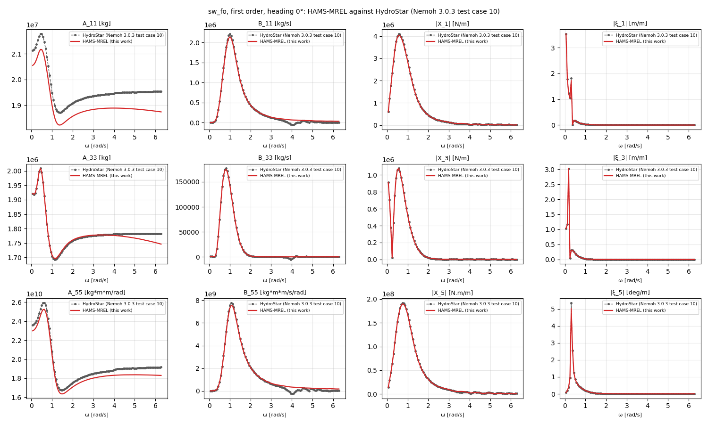

- A_11 and A_55 are 2.3 to 2.8 % below HydroStar at every frequency up to 1 rad/s, A_33 within 0.2 %. A run without a lid (`IRSP = 0`, 20 frequencies to 1.256 rad/s) changes A by at most 3.7e-4 and B by at most 3.3e-3 relative, and leaves A_11 2.5 to 2.8 % low. The full meshes show the same: A_11 is 2.7 to 2.9 % below HydroStar on the 8b cylinder and 3.3 to 4.2 % on OC4. So it is neither the lid nor the half mesh; it is the size of the difference of constant-panel solutions on meshes of 1000 to 2000 panels, which fell with the mesh in [1.7](#mean-drift-against-nemoh) (A within 1.5 to 4 % of Nemoh at 480 to 4320 panels).
- Above 3 rad/s A_11 and A_55 drift further down, and A_33 above 4.5 rad/s. The median panel is 1.17 m: λ/6 at 3 rad/s and λ/2.6 at 4.5 rad/s.

#### OC4 semisubmersible, bi-directional (30°, 0°)

**Set-up.** Test case 9, mesh `OC5_config_main_Dist50_NP2200`: columns only, 2068 hull panels, CG at the origin (as the test case: its pitch and roll stiffness are negative, −3.7e8 N m), no mooring, depth 200 m, headings 0 and 30 with every heading pair (`mean_drift = 2`), 50 frequencies 0.0628 to 3.14 rad/s; C and F from `make_mesh.py` (`cs_shape = file`). Bi-directional QTFs need no new code: `mean_drift = 2` computes every heading pair.

**Result.** QTF⁻ of (β_1, β_2) = (30°, 0°), the pair of the paper's Figs. 16 and 17, largest / median, percent:

| | All pairs to 3.14 rad/s | Without the band | The band (189 pairs), median | Diagonal |
| :--- | ---: | ---: | ---: | ---: |
| QTF⁻_1 | 1016 / 1.78 | 158 / 1.44 | 71.1 | 1.5 / 0.60 |
| QTF⁻_3 | 96.1 / 1.94 | 28.8 / 1.60 | 16.1 | 4.0 / 0.11 |
| QTF⁻_5 | 183 / 2.24 | 52.5 / 1.75 | 25.7 | 1.6 / 0.16 |

The band: one frequency at most 0.44 rad/s and the other at least 1.5 rad/s. (0°, 0°) is the same: medians 1.54 / 2.70 / 2.39 %, diagonals 0.44 / 0.15 / 0.28 %. First order: medians of A, B and X within 3.2 % (A_33 3.13 %, A_11 1.26 %), of the motions within 0.03 %.

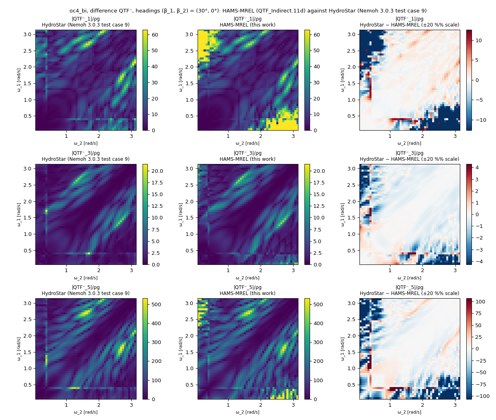

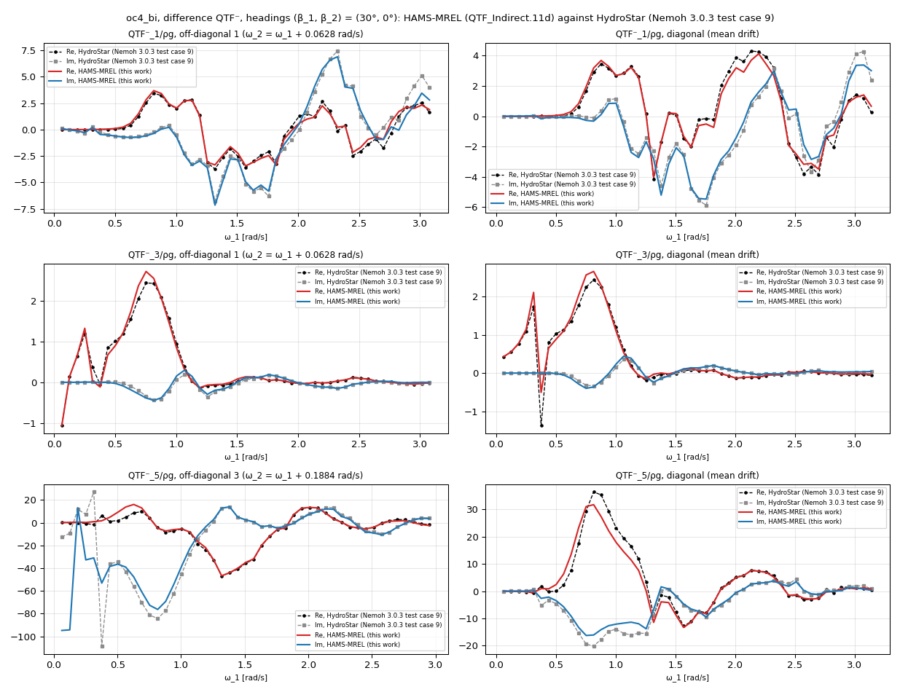

- Away from the band HAMS follows HydroStar over the whole map, with medians of 1.4 to 1.8 % and the off-diagonals of the paper's Fig. 17 on top of each other.
- The band is the B2 term of the body forcing: at (0.063, 3.14) rad/s it is 745 ρg against 35 for the next term, at (0.25, 2.57) 102 against 6. It starts where the finite-depth Green function on C changes to the series with the Limes acceleration (ν h > 50, ω > 1.57 rad/s at 200 m; the log warns 26 times), whose field values may scatter ([cs_velocity](input_files.md#secondorderin-optional)). B2 multiplies those fields by the first-order motion at the other frequency, which is large below 0.44 rad/s for this unmoored, statically unstable hull. `cs_velocity = source` avoids the series but cannot be used with `IRSP = 1`. The direct eigenfunction sum for these rows removes the same band on SOFTWIND and OC3 (below); OC4 has not been rerun with it.
- The pitch-moment drift peak, QTF⁻_5 on the diagonal at 0.8 rad/s, is 12 % below HydroStar's, while the pitch motion there is within 2 % (0.2977 against 0.2919 deg/m): the difference is in the near-field moment, the weaker method for M_y on hulls with sharp edges ([1.6](#vertical-force-and-roll-and-pitch-moments-f_z-m_x-and-m_y)). Im QTF⁻_5 on the third off-diagonal differs below 0.4 rad/s, at the heave resonance, where HydroStar's own diagonal spikes (0.38 rad/s).

#### Cylinder of test case 8b

**Set-up.** Mesh `OC5_cylinder634`: radius 6 m, draft 14 m, 502 hull panels, deep water, CG at the origin (mass from `hydrosCal`), heading 0, 50 frequencies 0.0628 to 3.14 rad/s.

**Result.** QTF⁻_1 / QTF⁻_3 / QTF⁻_5, medians 0.76 / 0.11 / 0.92 %; largest 90 / 63 / 79 %, at pairs with a frequency at 0.754 rad/s, the undamped heave resonance (|ξ_3| there differs by 5.2 % of its peak). First order within 3.2 % (largest), medians below 1.1 %.

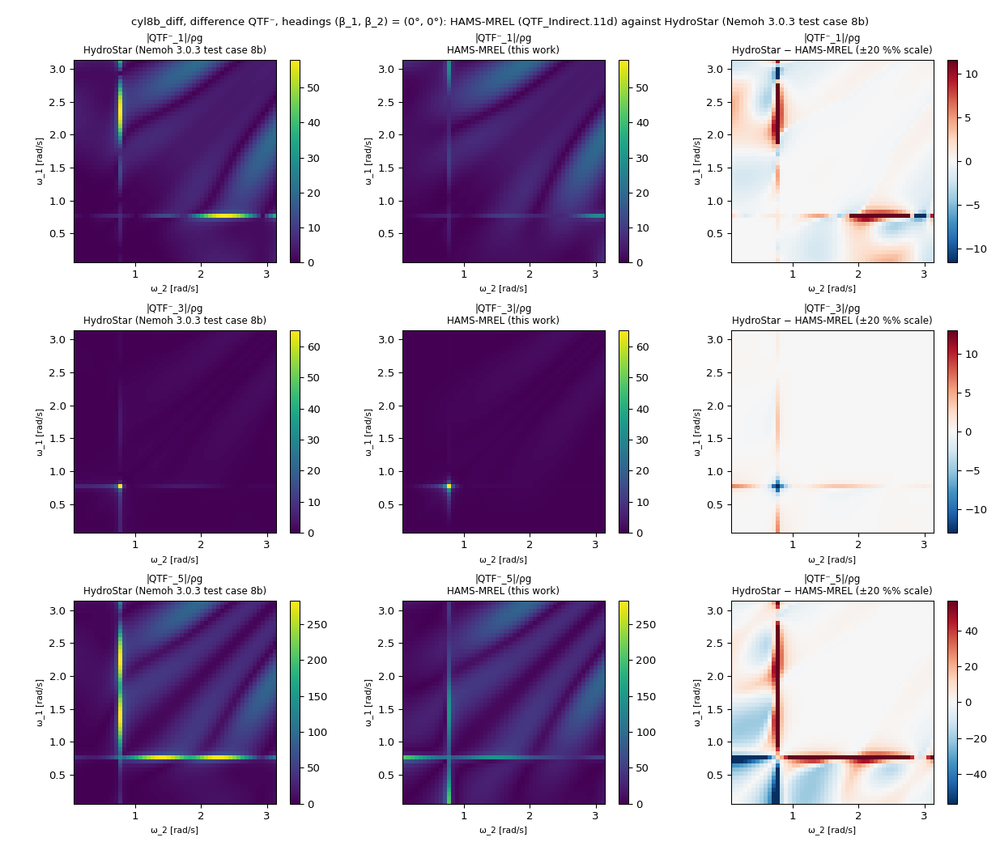

#### SOFTWIND spar, difference QTF without the free-surface integral

**Set-up.** As for first order; heading 0, 50 frequencies 0.0628 to 3.14 rad/s, `qtf_terms = body`. Reference: HydroStar `MQTF*.rao`.

**Result.** QTF⁻ (0°, 0°), 1275 pairs to 3.14 rad/s: medians 0.53 / 0.71 / 0.59 % (QTF⁻_1 / QTF⁻_3 / QTF⁻_5). Within Δω ≤ 0.6 rad/s the largest surge and pitch errors are 8.6 and 11.6 %. The diagonals agree within a few percent to 3 rad/s, with HAMS slightly low above 2.5 rad/s.

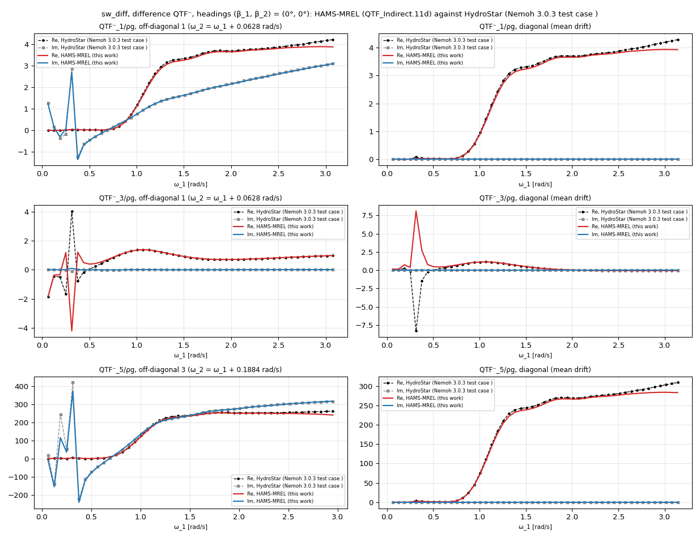

- The one outlier is heave at the pitch resonance, 0.314 rad/s: the diagonal is +8.0 ρg in HAMS and −8.3 ρg in HydroStar. The difference is the hydrostatic term of the near-field drift (term 6 of `MeanDriftTerms.txt`). Over all 50 frequencies HydroStar − HAMS = −1.14 × that term, with a largest residual of 0.39 of 16.4 ρg; the rotation term does not fit.
- HydroStar leaves that term out. The Nemoh v3.0.3 documentation (`doc/source/input-output.rst`, the QTF option for the hydrostatic terms of the quadratic first-order motion, −[K] ξ̃⁽²⁾ with ξ̃⁽²⁾_3 = z_G (θ_1² + θ_2²)/2) says that HydroStar does not include it, and the test case runs Nemoh with it off. For heave it equals HAMS's hydrostatic term, −¼ |ξ_5|² A_wp z_G, checked by hand: A_wp z_G = −7005 m³ (A_wp = 97.9 m², z_G = −71.56 m), residual 4e-7.
- HAMS without the hydrostatic term matches HydroStar: median |difference| 0.003 ρg, largest 3.0 ρg, at the resonance itself, where HydroStar's pitch RAO is 7 % above HAMS's (5.35 against 5.01 deg/m). The term is physical: pitch about the centre of gravity lowers the waterplane by α² |z_G| / 2 [derived]. Leave it out only to compare with a reference that omits it.

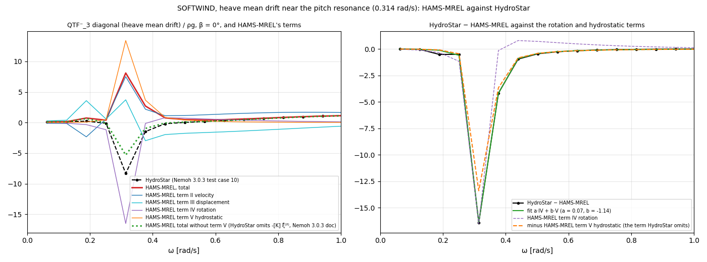

#### SOFTWIND spar, difference and sum QTF with the free-surface integral

**Set-up.** As above with `qtf = 3` and `qtf_terms = full`, 32 frequencies 0.0628 to 2.01 rad/s (HydroStar's `QTF*.rao` and `SPG*.rao` stop there). The depth of 200 m is 2.2 drafts, below `field_deep_draft` = 10, so the free-surface field rows keep the finite-depth Green function.

**Result.** The first run broke down for every pair with a frequency at or above 1.57 rad/s (100 to 600 % of max |HydroStar|). ν h = 50 there; above it the field rows of the finite-depth Green function used the series with the Limes acceleration, whose values scatter at small R/h. The direct eigenfunction sum for those rows (horizontal distances 0.0005 h to 0.05 h; 8.4 µs per pair against 26 µs for the series) removes the breakdown. Median / largest, percent of max |HydroStar|, pairs ω_1 ≤ ω_2:

| | max(ω_1, ω_2) ≤ 1.51 rad/s | 1.57 to 2.01 rad/s, direct sum | 1.57 to 2.01 rad/s, Limes |
| :--- | ---: | ---: | ---: |
| QTF⁻_1 | 0.97 / 35 | 1.6 / 23 | 106 / 529 |
| QTF⁻_3 | 3.1 / 197 | 5.4 / 37 | 192 / 666 |
| QTF⁻_5 | 3.0 / 40 | 4.5 / 32 | 125 / 646 |
| QTF⁺_1 | 4.0 / 41 | 8.8 / 35 | 138 / 522 |
| QTF⁺_3 | 1.6 / 69 | 1.4 / 11 | 29 / 112 |
| QTF⁺_5 | 4.6 / 46 | 10.5 / 41 | 161 / 622 |

- The largest heave values below 1.51 rad/s are the hydrostatic term at the pitch resonance, as without the free surface.
- The free-surface part adds error: without it the medians on the same grid are 0.27 / 1.8 / 0.31 %. The extra error grows from about 1 % at 0.6 rad/s to 5 to 10 % (QTF⁺_1, QTF⁺_5) at 2 rad/s. Not traced.

#### OC3 Hywind spar, difference QTF

**Set-up.** Test case 11, mesh `OC3_hywind-4842`: 4710 hull panels (the test case's 132-panel lid replaced by ours, 96 panels), radius 4.7 m (3.25 m at the waterline), draft 120 m, depth 320 m, CG at the origin (mass from `hydrosCal`), no mooring, heading 0, 50 frequencies 0.0628 to 3.14 rad/s, `qtf_terms = body`. Run at 50fc55e: direct sum above ν h = 50 (from 1.256 rad/s here), and `qtf_quad_terms = 1` for the split by term.

**Result.** First order: A_11 and A_55 3.3 % median (the offset seen on SOFTWIND), A_33 0.14 %, B within 0.8 %, X within 0.4 %, the motions within 0.07 %. QTF⁻ at (0°, 0°), percent of max |HydroStar|, pairs ω_1 < ω_2, median / 95th percentile / largest:

| | ω_1 ≥ 0.251, both below 1.256 rad/s | ω_1 ≥ 0.251, one at or above 1.256 | the same, with Limes | rows ω_1 ≤ 0.188 |
| :--- | ---: | ---: | ---: | ---: |
| QTF⁻_1 | 0.25 / 1.9 / 3.3 | 0.53 / 3.9 / 16 | 0.59 / 5.7 / 20 | 21 / 87 / 103 |
| QTF⁻_3 | 0.42 / 2.5 / 3.0 | 0.60 / 3.8 / 6.7 | 0.63 / 5.2 / 14 | 13 / 57 / 60 |
| QTF⁻_5 | 1.7 / 5.5 / 5.6 | 0.68 / 2.2 / 5.4 | 0.70 / 3.0 / 5.5 | 23 / 77 / 83 |

- From the fourth row on (ω_1 ≥ 0.251 rad/s), HAMS follows HydroStar to 3.14 rad/s. The direct sum removes the scatter above 1.256 rad/s. What is left grows smoothly towards ω_2 = 3.14 rad/s in the rows 0.25 to 0.38 rad/s.
- The rows ω_1 = 0.063, 0.126 and 0.188 rad/s differ by up to 103 % (surge). Below 1.256 rad/s they are the same to the last digit with and without the direct sum, so they are not a Limes effect. The motions there agree with HydroStar to 0.1 to 0.3 % (surge 2.74 m/m at 0.063 rad/s; heave resonance at 0.188 rad/s, |ξ_3| = 3.74 m/m). The largest error of each surge row follows 2.2 |ξ_1(ω_1)| + 4.5 |ξ_3(ω_1)| ρg within about 30 %: a term linear in the motion at the low frequency.
- The hydrostatic and rotation terms are not the cause: z_G = 0 makes the first zero, and the second is at most 0.11 ρg in surge. In the surge rows the error is as large as the largest terms (displacement, Froude–Krylov of φ_I2, incident diffraction and B2, 3 to 10 ρg each), which nearly cancel to a QTF of 0.1 to 2 ρg; no single term fits the error with a plausible factor. On the diagonal, the heave mean drift at 0.188 rad/s is 0.289 ρg in HAMS and 0.097 in HydroStar. HAMS's value is velocity −1.02 + displacement +1.54 + flare −0.20 ρg, so a 13 % change in the displacement term would close the gap.
- HydroStar gives no split by term. Two further runs, below, find the pitch error (the moment origin) and rule out the bottom edge. The surge and heave rows are traced, most likely to Nemoh's potential part, [further below](#surge-and-heave-rows-the-potential-part).

**Nemoh v3.0.3 on the same test case.** Test case 11 as it ships: mesh `OC3_hywind-4842_Nem.dat` with its own 132-panel lid, Nemoh's mass and hydrostatics (ρ = 1025 kg/m³), no mooring, heading 0, QTF on 20 frequencies 0.0628 to 1.256 rad/s, DUOK + HASBO (`Contrib = 2`, no free-surface integral). Nemoh writes a pair as (ω_big, ω_small), and the value it lists there is the HydroStar and HAMS-MREL value at (ω_small, ω_big). Read that way, its rows ω_1 ≥ 0.314 rad/s agree with HydroStar to medians of 0.25 / 2.0 / 0.08 %, and DUOK + HASBO equal its total to 1e-6. The first-order motions of the three codes agree within 1 % (heave 3.73 m/m at 0.188 rad/s in all three).

Rows ω_1 ≤ 0.188 rad/s, ω_2 ≤ 1.256 rad/s, largest difference in % of max |HydroStar|:

| | Nemoh against HydroStar | HAMS-MREL against HydroStar | Nemoh against HAMS-MREL |
| :--- | ---: | ---: | ---: |
| QTF⁻_1 | 39 | 89 | 50 |
| QTF⁻_3 | 110 | 33 | 102 |
| QTF⁻_5 | 20 | 83 | 69 |

- Pitch: Nemoh agrees with HydroStar, so the error is HAMS-MREL's. It sits in the quadratic part: Nemoh's DUOK minus HAMS-MREL's `.10d` follows c m (ω_2² − ω_1²) [ξ(ω_1) × ξ*(ω_2)]_y / ρg with a fitted c = 0.226 and a residual of 5.7 %. That is P(ξ × F⁽¹⁾) with F⁽¹⁾ = −ω² m ξ, c = 1/4: the change of the moment point from `XR` at its mean position to `XR` moving with the body (below).
- Surge and heave: the quadratic parts agree to 2.5 % and 11 % of max |HydroStar|; the potential parts (Nemoh's HASBO against HAMS-MREL's `.11d` minus `.10d`) differ by up to 52 % and 102 %. No code agrees with another in these rows.
- Heave mean drift at 0.188 rad/s: Nemoh 0.295 ρg, HAMS-MREL 0.289, HydroStar 0.097. Two codes agree from the same motions.

**Bottom-edge meshes.** The same hull on three structured meshes, made with `oc3_edge_study.py`: e0 uniform (5138 hull panels, first wall row 1.5 m), e1 with bottom-edge rows of 0.375 m (5306 panels) and e2 with rows of 0.094 m (5866 panels). 20 frequencies 0.0628 to 1.256 rad/s, otherwise the settings of the run on the Nemoh mesh; moments about the space-fixed `XR`.

- From e0 to e1 to e2 the rows ω_1 ≤ 0.188 rad/s change by at most 0.27 / 0.21 % (surge), 0.84 / 1.79 % (heave) and 2.94 / 2.24 % (pitch) of max |HydroStar|, while the gap to HydroStar stays 89 / 34 / 83 %. The bottom edge is not the cause.
- Check, rows ω_1 ≥ 0.314 rad/s against the Nemoh mesh: medians of 0.02 to 0.03 % (surge) and 0.09 to 0.12 % (pitch). Heave differs by 1.9 to 2.3 %, so in heave the structured meshes are not equivalent to the Nemoh mesh.
- Heave mean drift at 0.188 rad/s: 0.500 / 0.440 / 0.310 ρg on e0 / e1 / e2, against 0.289 on the Nemoh mesh. It moves with the edge, towards Nemoh and not towards HydroStar, and has not settled.

**Moment origin.** HAMS-MREL takes the second-order moments about `XR` at its mean, space-fixed position, as WAMIT writes i = 4, 5, 6. Nemoh and HydroStar take them about `XR` moving with the body, as WAMIT writes i = −4, −5, −6 (WAMIT v7.6 manual, sec. 5.2). The two differ by P(ξ × F⁽¹⁾), with F⁽¹⁾ the first-order fluid force. This is zero on the diagonal but not off it. The input key `moment_origin = fixed | moving` (default `fixed`) is on `development_2`.

The `moving` numbers below are an offline transfer applied to the output of the run on the Nemoh mesh: moving = fixed − P(ξ × F⁽¹⁾), with F⁽¹⁾ built from that run's exciting, radiation and hydrostatic forces and motions. It equals −ω² M ξ to 7e-7, as the body is free with its CG at `XR`. A solver run with `moment_origin = moving`, described after the table, gives the same values. In % of max |HydroStar|, median / largest:

| QTF⁻_5 | rows ω_1 ≤ 0.188 | rows ω_1 ≥ 0.314 |
| :--- | ---: | ---: |
| HAMS-MREL, `fixed` (as run) | 27.9 / 83.4 | 1.03 / 5.6 |
| HAMS-MREL, `moving` (offline transfer, confirmed by a solver run) | 5.7 / 44.7 | 0.61 / 1.95 |
| Nemoh 3.0.3 | 3.0 / 19.9 | 0.08 / 0.79 |

- The moving point removes most of the pitch error. What is left, up to 45 %, is in the rows 0.126 and 0.188 rad/s at high ω_2, the same pattern as the surge rows.
- Surge, heave and all mean drifts are the same for both settings. The largest error of the mean drift against HydroStar is 4.6 / 38 / 24 % in HAMS-MREL and 3.0 / 39 / 11 % in Nemoh (surge / heave / pitch), all at 0.188 rad/s.
- At 0.188 rad/s the pitch mean drift is −0.104 ρg in HydroStar, +0.114 in Nemoh and +0.374 in HAMS-MREL: HydroStar has the opposite sign to both.

**Solver run with `moment_origin = moving`.** The same case on the Nemoh mesh, run with the code of `development_2` at the merge of `moment_origin`. It has the inputs and control surface of the run on the Nemoh mesh, with three changes:
- `moment_origin = moving`;
- 20 frequencies from 0.0628 to 1.256 rad/s;
- no `qtf_quad_terms` key, which that code does not have.

At and above ν h = 50 (1.256 rad/s here) that code uses Limes for the field values, while the fixed run used the direct eigenfunction sum. The comparison therefore covers the pairs with both frequencies below 1.256 rad/s. Against the offline transfer (fixed − P(ξ × F⁽¹⁾)), in % of max |fixed|:
- The first-order motions, QTF⁻_1, QTF⁻_3 and their mean drifts are identical to the fixed run.
- QTF⁻_5 off the diagonal: largest 3.2e-3 % (row ω_1 = 0.063 rad/s) and median 2.7e-5 %, falling to 1e-5 % by row 1.1 rad/s. The transfer itself changes QTF⁻_5 by up to 91 %.
- The pitch mean drift differs from the fixed run by 2.2e-3 ρg at 0.063 rad/s, decaying to 7e-6 at 1.19 rad/s. This is 0.13 % of the largest mean drift, but 20 % of the small value at 0.063 rad/s (0.0115 → 0.0093 ρg). In absolute size it matches the off-diagonal residual of the same rows, and it is largest where the unmoored surge response is largest. The likely cause is the limited precision of the first-order output files used by the offline transfer; this is not proven.

**Surge and heave rows: the potential part.** In these rows the quadratic parts of Nemoh and HAMS-MREL agree, and the potential parts differ (above). Checks on the existing outputs narrow this down:
- **φ_I2.** The Froude–Krylov term of the second-order incident wave was computed independently. φ_I2 was derived from the second-order free-surface condition in finite depth and integrated on the run's hull mesh. It matches HAMS-MREL's term to 0.1 % in every row, including k_1 h = 0.37.
- **Nemoh's φ_I2.** No other form of φ_I2 accounts for the difference: deep water, part of the free-surface forcing, or k_1 + k_2. A fit of each leaves 60 to 100 % of it.
- **One term off by a factor.** No single body term (FK, incident diffraction, B1, B2, B3), scaled by a constant, fits the difference. The best leaves 48 %.
- **HAMS-MREL's mesh.** Across four meshes (the Nemoh mesh and e0, e1, e2), HAMS-MREL's potential part changes by at most 0.05 ρg in these rows. The gap to Nemoh is 2.4 to 4.8 ρg in surge and 0.14 to 0.90 ρg in heave.
- **The motions.** They agree within 0.3 % (|ξ_3| at 0.188 rad/s is 3.73 to 3.74 m/m in all three codes), so the resonance peak is not the cause.
- **What the gap looks like.** In surge the five body terms cancel three to five times over in these rows, against 1.5 times in the later rows. The difference grows with ω_2 to the size of the φ_I2 term.

**Low k_1 h against the semi-analytical reference.** The free sharp cylinder of the [potential-part study](#free-body-the-hull-and-control-surface-forms-of-b2):
- Hull: radius 10 m, draft 10 m, depth 100 m, 1792 panels, `velocity_method = source`.
- Frequencies: 9, from 0.10 to 0.90 rad/s, every pair, heading 0.
- k_1 h: 0.32 at 0.10 rad/s, against 0.37 to 1.33 in the OC3 rows. The earlier reference grids start at 0.40 rad/s (k h about 1.9).
- HAMS-MREL was run with `qtf_b2 = control` (as for OC3), and with `qtf_b2 = body` and `qtf_direct = 1`.
- Nemoh 3.0.3 HASBO is the run of that study on the same mesh (Contrib 2).
- The reference is `truncated_cylinder_reference.py qtf-potential` on this grid.
- Both codes' files are the complex conjugate of the reference convention, and are compared as such.
- The cylinder has its heave resonance and a coupled surge–pitch resonance at 0.7 to 0.8 rad/s.

Largest error, in % of |reference| for the pairs with ω_2 ≤ 0.6 rad/s and in % of max |reference| over all pairs:

| | QTF⁻_1, rows 0.10 / 0.20 / 0.30, ω_2 ≤ 0.6 | QTF⁻_1, all pairs | QTF⁻_3, ω_2 ≤ 0.6 | QTF⁻_3, all pairs |
| :--- | ---: | ---: | ---: | ---: |
| HAMS-MREL, `qtf_b2 = control` | 1.0 / 1.5 / 2.1 | 4.3 | ≤ 1.2 | 4.3 |
| HAMS-MREL, `qtf_b2 = body` | 8.9 / 18 / 33 | 51 | ≤ 5 | 35 |
| HAMS-MREL, direct method (`.12d`) | 8.0 / 8.6 / 11 | | ≤ 1.1 | |
| Nemoh 3.0.3 HASBO | 11 / 20 / 58 | 57 | ≤ 8 | 34 |

- With the control-surface form of B2, HAMS-MREL follows the reference at the k_1 h of the OC3 rows, also through the resonance.
- The hull form of B2 (`body`, which the direct method also uses) loses 8 to 33 % in surge at the sharp edge, as found at higher k h.
- Nemoh misses the reference by 10 to 60 % in surge in the same pairs.

**Nemoh's mesh on OC3.** Nemoh 3.0.3 was run on the coarser mesh of test case 11 (`mesh978_Floating`, 972 panels with its lid), otherwise as the 4842-panel run (20 frequencies 0.0628 to 1.256 rad/s, Contrib 2). Largest change of the potential part in each row, in ρg:

| Row ω_1 (rad/s) | QTF⁻_1: Nemoh, 972 against 4842 panels | QTF⁻_1: HAMS-MREL, four meshes | QTF⁻_1: Nemoh − HAMS-MREL | QTF⁻_3: Nemoh, 972 against 4842 panels | QTF⁻_3: HAMS-MREL, four meshes | QTF⁻_3: Nemoh − HAMS-MREL |
| ---: | ---: | ---: | ---: | ---: | ---: | ---: |
| 0.063 | 1.09 | 0.05 | 3.64 | 0.51 | 0.03 | 0.90 |
| 0.126 | 1.34 | 0.03 | 2.42 | 0.23 | 0.01 | 0.41 |
| 0.188 | 101 | 0.05 | 4.82 | 3.14 | 0.01 | 0.14 |
| 0.251 | 0.02 | 0.007 | 0.47 | 0.04 | 0.005 | 0.21 |

- In the rows 0.063 and 0.126 rad/s, Nemoh changes between its two meshes by 30 to 55 % of its gap to HAMS-MREL.
- At 0.188 rad/s the coarse mesh moves the heave resonance, and Nemoh's change is far larger than the gap.
- HAMS-MREL changes 20 to 100 times less.
- From 0.251 rad/s on, Nemoh changes by 0.02 to 0.1 ρg. The gap of 0.2 to 0.5 ρg there is not its mesh.

**Reading.** The surge and heave error of the OC3 rows ω_1 ≤ 0.188 rad/s is most likely Nemoh's, not HAMS-MREL's:
- HAMS-MREL's potential part (control-surface B2) matches the semi-analytical reference at the same k_1 h.
- It does not change with the mesh on OC3.
- Nemoh's misses the reference in that regime, and moves on OC3 by a large part of the gap.

Open: the cylinder reference does not cover OC3's deep draft (draft / depth = 0.37) or its taper.

HydroStar's heave and pitch mean drifts at 0.188 rad/s (above) are left as a stated difference; their cause was not traced.

## 9. Unit and integration tests

The measured values and limits of every test below are in [the fixture README](../test/data/drift_cyl/README.md#second-order-qtf-tests). The limits are measured values with a margin (mostly 1.3 times the measured value, rounded up) unless a test is an identity. Unit and integration tests run on the laptop (ifort 2022.1, Windows).

| Feature | Suites | What they check | Counts when added |
| :--- | :--- | :--- | :--- |
| Mean drift, control surface | `test/test_*.f90`, fixtures `test/data/drift_cyl` | near-field, far-field and control-surface drift on small meshes | see [the fixture README](../test/data/drift_cyl/README.md) |
| Direct method with the free-surface forcing | `partial_waves`, `qtf_free_surface`, `qtf_direct_fs`; four `qtf_directfs_*` fixtures | the partial waves of G, the outer moments, the inner Green matrix and right side, the whole path against the indirect free-surface terms | unit 334 (+1 expected failure), integration 209, at 8a3b1c8 (ifort 2022.1) |
| Direct method at the sum frequency | `qtf`, `qtf_potential`, `qtf_direct`, `qtf_direct_fs`, `qtf_free_surface`; seven `qtf_directsum_*` fixtures; 34 Python checks | the frequency list, the sum kernel of each piece, the whole path against the in-run indirect sum, the file layout, the field | unit 396 (+1 expected failure), integration 222, at fb4e255 (ifort 2022.1, 2026-11-16; the later commits change Python only) |
| Indirect method at the sum frequency | `qtf`, `second_order_input`, `second_order_output`; `qtf_indsum_*` fixtures | the route and its files: `.11s` = `.10s` + T⁺_pot, byte equality with the direct route, nothing else changes | unit 412, integration 234, at 22086da (43c75ad to 14cb8bc change docs only; 2026-11-19). After the merge into `second-order-drift` with the v2.3.4 fixes (c44cee8 plus the regenerated `qtf_directsum_irsp` expected files): 431 and 240, all passing (2026-11-19) |
| Second-order field | `second_order_incident`, `qtf_field`, `qtf_direct_field`; `qtf_field*` fixtures | listed in [4](#partial-second-order-field) | |
| Second-order motion | `qtf_motion`, `qtf`, `qtf_field`, `second_order_input`; `qtf_motion_round*`; 36 Python checks | A and B against `RFORCE` and the semi-analytical values, the solve against `SolveMotion`, the files, the radiated wave | unit 461 (+1 expected failure), integration 245, at 5816c95 (ifort 2022.1, 2026-11-19; the later commits change Python and docs only) |
| Field-pass speed-ups | new fixtures and the deep-rows pair | see [6](#field-pass-speed-ups) | after the last commit of that work: unit 456, 0 failed, 1 expected failure (`invalid2`); integration 251, 0 failed (laptop, ifort with OpenMP) |

The speed-up fixtures add about 4 minutes to the integration suite (the ψ-reuse cases, `qtf_psi_reuse_two` alone about 135 s) and the deep-rows pair about 3 minutes more.

## 10. Limits and open items

### Mean drift

- A free sharp body at low frequency has no good near-field result from HAMS. Far-field is the number to use for F̄_1, and the control-surface method for F̄_3. For the sharp cylinder, the [semi-analytical reference](#semi-analytical-reference-sharp-truncated-cylinder) gives near-field F̄_1, F̄_3 and F̄_5, with stated uncertainties.
- Free F̄_3 of the sharp cylinder at 0.70 and 0.80 rad/s: the reference's uncertainty there (3e-3 and 4e-3) is an estimate from an extrapolation, not a bound.
- Nemoh at 4320 panels: the cause is unknown, and testing it needs another Nemoh run.
- `velocity_method = source` on graded meshes: the sign of the F̄_3 error alternates with the mesh (above). Not explained.
- The control-surface F̄_3, F̄_4 and F̄_5 at 1.6 to 1.8 rad/s were run at m2 only.

### Difference-frequency QTF

- QTF potential part, `qtf_b2 = control`: run on the free cylinder at 448, 1792 and 4032 panels with the default C, and at 1792 and 4032 panels with C fixed; not at 7168 panels. The damped free body was run at 448 and 1792 panels.
- OC4 semisubmersible: HAMS against Nemoh at 1224 and 4608 panels, with no reference solution and without the pontoons and braces. The free QTF⁻_5 difference (4.08% and 4.15%) does not fall with the mesh, and the free QTF⁻_3 difference is still 10.12% at 4608 panels; neither was traced to a cause.
- OC4 against WAMIT: the pairs with a frequency in 0.25 to 0.35 rad/s differ by over 100% in the largest value at both meshes, and the largest values away from them (15.43 / 8.92 / 4.88% at 1224 panels, 24.11 / 18.13 / 5.51% at 4608) do not fall with the mesh. Whether this is the hull model (pontoons and braces), the restoring and damping, or the resonance was not separated.
- OC3 Hywind against HydroStar: the rows ω_1 ≤ 0.188 rad/s, near the heave resonance at 0.188 rad/s, differ by up to 103 / 60 / 83 % (QTF⁻_1 / QTF⁻_3 / QTF⁻_5), while the later rows agree to medians of 0.25 to 1.7 %. Not a Limes effect and not the bottom edge. Pitch is the moment origin: with `moving` (offline transfer, confirmed by a solver run) the largest pitch error falls to 45 %. Surge and heave are most likely Nemoh's potential part ([OC3](#surge-and-heave-rows-the-potential-part)). On a cylinder at the same k_1 h, HAMS-MREL is within 1–2 % of the semi-analytical reference and Nemoh is 10–60 % off; on OC3, Nemoh's low rows move with its mesh by 30–55 % of the gap. Open: whether OC3's deep draft (37 % of the depth) and taper, which the reference does not cover, change that. At 0.188 rad/s HydroStar's heave mean drift is a third of Nemoh's and HAMS-MREL's (0.097 against 0.29 ρg), and its pitch mean drift has the opposite sign ([OC3](#oc3-hywind-spar-difference-qtf)). This is left as a stated difference; its cause was not traced.
- SOFTWIND with the free-surface integral: the free-surface part adds 1 to 10 % against the run without it, growing with frequency. Not traced.
- The direct eigenfunction sum for the field rows above ν h = 50 is on the branch `fix/field-limes-lid-weight`, not merged; OC4 has not been rerun with it.
- First order, heave-plate cylinder: with a lid, A_33, A_55 and B_55 fall off above 3.3 rad/s, more with more lid panels; the cause is open ([heave plate](#truncated-cylinder-with-a-thin-heave-plate-first-order)).
- Nemoh's HASBO: whether it contains a term like B3 was not checked, and the sharp-cylinder Nemoh maps were made with the hull form of B2 only.
- The free-surface integral (`qtf_terms = full`) is validated on one hull, single body, heading 0, finite depth; deep water is not supported. At m1 its error is not monotone in the inner mesh, and the cause is not found ([QTF free-surface integral](#qtf-free-surface-integral)). The indirect sum-frequency potential part (`.11s`) is [validated here](#indirect-method-at-the-sum-frequency) on the sharp cylinder and against Nemoh on OC4; the direct sum is [validated here](#direct-method-at-the-sum-frequency).
- Direct method (`QTF_Direct.12d`): validated on a smooth hull to 0.23% / 0.35% (forces / moments) against the indirect method at 4320 panels, and on the sharp cylinder only against the semi-analytical potential part (13 / 13 / 28% at 4032 panels, resonance pairs included). The cause of its smaller QTF⁻_3 error than the hull-form indirect result is not tested, and the IRSP case ran at one mesh (448 panels).
- Direct method with the free-surface forcing (`qtf_terms = full`): checked on the laptop against the indirect free-surface terms (unit and integration tests, depth 20 m and 100 m), finite depth only. On Snellius it was checked on one rounded hull and one sharp cylinder, free body only ([Snellius validation](#snellius-validation)). No fixed, damped or multi-body case was run there.

- Two unit tests failed under ifx 2024a on Snellius (job of 2026-11-09, the build of the hull-form runs): `control_surface_mesh/separate_bodies_accepted` and `field_velocity/field_green_is_smooth_in_z`, in modules the potential part does not change. Both are fixed on the `second-order-drift` branch by commit 60a972e, which this branch does not contain yet. With ifort 2022.1 on Windows all tests pass ([Developer Documentation](developer_documentation.md#potential-part-body-forcing)).

*Direct method, body forcing:*

- On a sharp hull `.12d` and `.11d` (`qtf_b2 = body`) do not agree to a few percent, because both integrate B2 on the hull with different discretisations of an edge-singular integral; the check there is against the semi-analytical potential part.
- **The default indirect method is more accurate than the direct one on this sharp hull.** With `qtf_b2 = control` (fixed C and F, 4032 panels, the same 2666 pairs) the indirect potential part is 6.9 / 9.1 / 5.8% off the semi-analytical one in QTF⁻_1 / QTF⁻_3 / QTF⁻_5 ([the table above](#free-body-the-hull-and-control-surface-forms-of-b2), row "fixed C, 4032"), against 13 / 13 / 28% for the direct method. For accuracy on a sharp hull use `.11d` with the default `qtf_b2 = control`, and `.12d` as an independent check.
- Validated in finite depth only (depth 100 in every direct case). The 0.46% inconsistency between G and ∇G in deep water (developer documentation) enters the B2 right side there and was not checked end-to-end.
- This section covers the direct method with the body forcing only (`qtf_terms = body`). With `qtf_terms = full` it also has the free-surface forcing, checked in [Direct method with the free-surface forcing](#direct-method-with-the-free-surface-forcing).
- One IRSP mesh (448 panels with the lid) was run, with heading 0 and a free body.

*Direct method with the free-surface forcing:*

- The unit tests of the pieces are semi-analytical references (the eigenfunction sum, quadrature); the whole path is checked against the indirect free-surface terms, which have their own error against the semi-analytical reference ([QTF free-surface integral](#qtf-free-surface-integral)). Equality with them shows the direct path is consistent, not that it is the semi-analytical answer.
- Finite depth only (`qtf_terms = full` stops in deep water). The integration fixtures are at 20 m; 100 m is covered by `direct_fs_equals_indirect_full` only, on one hull.
- The two-body case is checked through the mirror symmetry and the free-surface part alone; its total gap is the coarse-hull body-forcing error.
- The depth-20 fixtures change the first-order physics of the long waves (Ω = 0.15 rad/s is shallow-water-like in 20 m) relative to `qtf_round_body`.
- The stored body-forcing files of `direct_fs_off_unchanged` have to be regenerated if the body-forcing direct output is ever changed on purpose.
- VolturnUS-S away from the diagonal (Δω 0.3–1.2 rad/s): WAMIT is 2–27 times HAMS. The excess has the phase of WAMIT's 200 m partition circle, and cutting HAMS at 200 m does not reproduce it ([section 8](#benchmark-against-other-codes)). The inferred cause, the asymptotic far field of WAMIT starting at 200 m, needs a WAMIT rerun with a larger RINNER or NAL > 0.
- Not compared with a WAMIT run: `.12d` with `qtf_terms = full` has the content of a WAMIT `.12d` [derived], but this was not tested.
- The runs above are from before the near-waterline fit (47d5911). The fit changes the inner fields of both methods alike, so the direct-against-indirect gaps stand; the stored `.12d` fixtures moved by up to 4.9e-3 of their largest value and were re-pinned. The distance to the semi-analytical answer was not re-run.

### Sum-frequency QTF

*Direct method:*

- **The in-run indirect sum shares code with the direct one.** Both use `incident2_pair`, `pair_cross` and the same ψ, so a fault in the sum form of those would not show in the gap between them. The absolute check is the semi-analytical reference of the sharp cylinder ([Snellius validation](#snellius-validation-of-the-sum-frequency)): both methods approach it with the mesh, away from the resonance. The free-surface part shows why: before the near-waterline fit D_FS and P_FS agreed while both were 4–9% (median) off the semi-analytical part, a fault in the fields that both share. The reference's own free-body sum free-surface term is checked only by `fs_sum_radius_invariance` (R = 15 against 20 m) and, for the fixed body, by `fs_sum_bvp` at the pairs up to 0.95 rad/s; no independent check covers the free body or ω above 0.95 rad/s, which is where the error lies. Nemoh at the sum frequency is compared in [the indirect method at the sum frequency](#indirect-method-at-the-sum-frequency): on the sharp cylinder against the semi-analytical sum QTF, on OC4 against HAMS (open).
- **The rounded-hull gap of 12.7% is mesh error** (1.2% at m3 on Snellius). The sharp-cylinder gap is in the body forcing at the sharp edge and falls with the mesh (QTF⁺_5 14.2 → 7.1% at m1 to m3, without the resonance), as for the difference kernel.
- **The sum free-surface part** is within 2.0 / 0.5% (max / median, QTF⁺_1) of the semi-analytical part on the sharp m2 cylinder with the near-waterline fit (47d5911), fixed and free; before the fit it was 8–9% off (median, up to 27%). The fit was run on Snellius at one mesh (m2) and one hull; m1, m3 and the rounded hull were not re-run. It assumes the field is smooth along the line from the waterline over three segment lengths. A point whose samples come within one segment of another waterplane, or lie inside one, keeps the stencil (counted in the log); no test has met that case. The reference's free-body sum free-surface term has no independent identity check above 0.95 rad/s; the agreement after the fix makes a shared fault unlikely but does not replace that check.
- Finite depth only for `qtf_terms = full`; the integration fixtures are at 20 m, and 100 m is covered by `direct_fs_sum_equals_indirect` and `direct_sum_cutoff_rows` (body forcing only) on one hull each.
- `FINGREEN3D` is about 2e-4 off the exact series at ν h ≈ 50 with small R/h (measured up to ν h = 59): the gate of `fs_green_matrix_large_kh` is 2e-4, not 1e-6. The sharp runs reach ν h ≈ 80 at Ω⁺ = 2.8 rad/s, above the switch of the field series at ν h = 50 (Limes), where no bound was measured; the log warns once.
- The lid hull was run at one mesh (480 panels with 192 lid points), half and lid together were not tried, and no damped or multi-body sum case was run; the fixed body was run once (sharp m2, the free-surface check above).
- `qtf_terms = body` with the sum has no free-surface integral and is not usable as a sum QTF; the checks of `body` use the in-run indirect body terms only.
- The cutoff estimate of the irregular frequency is a lower bound for a wall-sided hull only (`direct_sum_cutoff_rows`: 1.5382 rad/s for the rounded hull; the sharp cylinder's exact value is 1.548).

*Indirect method:*

- **The exact reference is one hull.** The absolute check is the sharp cylinder at two meshes (m1, m2), free body, one heading, one depth (100 m). The rounded hull, other headings, fixed and damped bodies and several bodies have no sum-frequency reference run. Two hulls are tested by the byte-for-byte check against the direct route only.
- **The maxima stay.** `.11s` is within 8% at m1 and 6% at m2 (max, QTF⁺_1), away from the resonance. The largest errors are in the body part, not in the free-surface part (table of the body and free-surface parts above); that the body error comes from the sharp edge is derived from the direct sum, where the body forcing at the sharp edge dominates the gap ([Snellius validation](#snellius-validation-of-the-sum-frequency)), and was not tested here. Only m1 and m2 were run (`findings.md`).
- **The pairs at 0.75 to 0.80 rad/s are left out**, as in the other sections.
- **The Nemoh mesh test is at the sharp cylinder only.** Nemoh's body error in QTF⁺_3 (17%) does not fall with the mesh, and its cause is not found.
- **OC4 is open.** There is no reference solution, the WAMIT file appears not to hold the free-surface part (inferred from the numbers) and is another model, the free-surface meshes and circles differ, and the first-order motions differ at the heave resonance (0.40 to 0.45 rad/s). It is one mesh (m1, 1224 panels).
- **The OC4 cut** at Ω⁺ ≥ 1.995 rad/s (81 of 231 pairs) is HAMS's estimate of the lowest irregular frequency; it is not a measured value for this hull.
- **The unit and integration tests pin the route** (files, lists, byte equality with the direct route), not the physics. 
- The code of the Snellius runs is a0b974c; the later commits change the B2 form for `qtf = 2`, the docs and one test, not the `qtf = 3` route that was run.

- Direct method at the sum frequency (`QTF_Direct.12s`): checked against the in-run indirect sum (unit and integration tests, rounded hull on Snellius to 1.2% at m3) and against the semi-analytical sum QTF of the sharp cylinder on Snellius (`.12s` within 5–15% max and 0.3–1.1% median at m3, away from the resonance); the free-surface part is within 2.0 / 0.5% (max / median, QTF⁺_1, sharp m2) with the near-waterline fit (47d5911), 8–9% (median) before it; and `FINGREEN3D` is about 2e-4 off the exact series at ν h ≈ 50 with small R/h ([direct method at the sum frequency](#direct-method-at-the-sum-frequency)).

- Indirect method at the sum frequency (`QTF_Indirect.11s`): the sharp cylinder is checked against the semi-analytical sum QTF at two meshes (7.8 / 6.0 / 3.0% at m1 and 6.1 / 4.1 / 2.1% at m2, max, QTF⁺_1 / QTF⁺_3 / QTF⁺_5). For the OC4 semisubmersible HAMS and Nemoh differ by 82 / 33 / 27% (max) and the cause is open; the WAMIT sum file appears to hold no free-surface part ([indirect method at the sum frequency](#indirect-method-at-the-sum-frequency)).

### Second-order motion

- **One hull.** The absolute check is the sharp cylinder at two meshes, heading 0, depth 100 m, with springs in surge, sway and yaw. Several bodies, half meshes and an unmoored body are tested on the laptop only.
- **The slow-drift peak is checked at m1 only.** m2 has no 1.013 rad/s pair. The error scale includes those pairs, so m2's difference-surge percentages read about 8% lower than on its own grid (`findings.md`, caveat 1).
- **The reference has no first-order springs.** Its T uses the first-order motion of the free body without them, while HAMS's first-order solve has them. By the impedance ratio they move the first-order surge by under 1% for ω ≥ 0.85 rad/s and 2.5% at 0.40 rad/s, so they do not explain the 30–40% excess of the drift force; they add to the error near the undamped band.
- **The reference keeps the exact circle's M and C**, about 0.6% above those of the m1 polygon. This shifts the response near the 100 s resonance by about 0.3% [derived: ω_n = √(K/(M + A)), so a 0.6% change of M moves ω_n by about half of it].
- **The radiated wave in the field** is checked through ψ at the points (near-panel and Kochin far field) and through the driver chain (`field_radiated_pipeline`), not against an independent second-order field, and not on Snellius.
- **Not checked:** `BQDR` in the second-order motion (by design: it has no second-order form, see [usage](input_files.md#second-order-motion)); WAMIT's names and scaling of the second-order motion files (option 16 of WAMIT; not compared with its manual); the end message of `ReportCompletion` does not name the `QTF_Motion` files when a force has NaN or Inf.

- Second-order motion (`QTF_Motion.*`): checked against the semi-analytical motion of one hull, the sharp cylinder with springs in surge, sway and yaw, at two meshes, with the slow-drift peak at m1 only. The motion error there is the force error of the sharp hull (`.12d` surge 39.5% at m1 and 27.5% at m2, max, out of band), so the motion converges as the difference force does. The radiated wave in `QTF_Field.txt` has no independent reference ([second-order motion](#second-order-motion)).

### Multi-body arrays

- Linton & Evans array: in the near-trapping band (k a 1.4 to 2.0) the paper's Figs. 2 and 3 are smoother and lower than the exact reference, which HAMS confirms; why the paper's curves differ there is not confirmed ([Linton & Evans array](#multi-body-arrays)).

### Output conventions and speed-ups

- WAMIT: the OC4 comparison with the public WAMIT run of OpenFAST now exists ([OC4 against WAMIT](#oc4-against-wamit)). A WAMIT licence would still be needed to settle the conjugation and axes of the WAMIT-format output on a hull with a known answer, since the diagonal of that comparison is real. The semi-analytical reference covers the signs of the mean drift values (210 values agree at 7168 panels), not the phases of the complex outputs.
- Field-pass speed-ups, OC4: the run with the new defaults took deep-water rows on C and F, which are 2e-3 to 9e-3 off per row below z = 0. A re-run with the control-surface passes on finite-depth rows is pending; until then the cause of the OC4 change (from 1.35 rad/s, and the B2 jump above 1.6 rad/s) is open, and it has no reference solution ([OC4 with the new defaults](#oc4-with-the-new-defaults)).
- Deep-water rows below z = 0: on the OC4-like cases of `field_row_deep_seabed` the seabed images explain only part of the gap above k0 h = 10; the rest, which grows with k0 h, is not explained.
- `qtf_fs_inner = source` (off by default): it failed the gate on semi-analytical data (sum integral 3.58 % against 2.05 %, ∇φ at 0.1 m 5.84 % against 4.92 %) and moves with the hull mesh (16 to 25 % between 220 and 960 panels, against 0.3 to 1 % for the stencil). Whether a better treatment of the hull error would pass was not tried.
- Depth guard of the deep-water rows (`field_deep_draft = 10`): 5 drafts fails and 10 drafts passes on one hull, the sharp cylinder; 5 to 10 drafts and other hulls are not measured ([6.7](#threshold-and-depth-of-the-deep-water-rows)).
- `qtf_fs_circle = panels` ignores `field_deep_kh` for the partial waves (finite-depth field); at a small `field_deep_kh` this moves a result by 1.2e-2 of the largest value (`qtf_psi_reuse`). At the default 10 the OC4 `FS_outer` moves by at most 2e-4. The panels route was gated on the sharp and round cylinder at m2 only (126 rows), not on OC4 against the semi-analytical reference.

## 11. Run details

The run logs, test counts and measurements behind the implementation, moved here from the developer documentation so that the developer documentation describes the code only.

### Test counts and suite times

With the QTF potential part and the partial second-order field (`qtf_field`), the unit tester has 250 tests and 1 expected failure, and the integration tester 183, all passing with ifort 2022.1 on Windows (clean build of the merge, 2026-11-11). Before the merge, with the potential part alone, they were 226 and 169 (see [QTF potential part](developer_documentation.md#potential-part-body-forcing)). With the quadratic QTFs, the unit tester had 185 tests and the integration tester 147, all passing with ifort 2022.1 on Windows. With the control-surface method, before them, it was 177 and 141. At commit dff7a32, before the control-surface method, they had 133 and 118, all passing with ifort 2022.1 on Windows and with ifx 2024.2 on Linux; the times below are from then. Measured run time: the integration tests take 148 s with ifort on a laptop with 8 logical cores and 177 s with ifx at 32 threads on Snellius; the unit tests take 19 s with ifx. All cases stay in CI. The time on the GitHub runners is not measured here; GitHub's default job limit is 6 hours.

- Potential part: the unit tester had 226 tests and 1 expected failure, and the integration tester 169 [measured at 4436f34, ifort 2022.1, Windows].
- Free-surface integral: the unit tester had 293 tests and 1 expected failure, and the integration tester 190, all passing with ifort 2022.1 on Windows (2026-11-13).
- Direct method: the unit tester had 271 tests and the integration tester 196, all passing [measured at 493674a plus its docs, ifort 2022.1, Windows, 2026-11-12].
- Direct method with the free-surface forcing: 334 unit tests (plus 1 expected failure) and 209 integration tests, all passing [measured at 8a3b1c8, ifort 2022.1, Windows].
- Direct sum: 396 unit tests (plus 1 expected failure) and 222 integration tests, all passing [measured at fb4e255, ifort 2022.1, Windows, 2026-11-16; the later commits change Python only]. The integration suite takes about 65 minutes, since its runs contend for threads; 34 Python checks in `truncated_cylinder_reference.py check`.
- Indirect sum: 412 unit tests and 234 integration tests (with `indirect_sum_log_lines`), all passing, 0 failed [measured at 22086da source; 43c75ad to 14cb8bc change docs only; ifort, Windows, 2026-11-19]. After the merge into `second-order-drift` with the v2.3.4 fixes (c44cee8 plus the regenerated `qtf_directsum_irsp` expected files): 431 and 240, all passing, 0 failed [measured, ifort, Windows, 2026-11-19].
- Second-order motion: 461 unit tests and 1 expected failure, 245 integration tests, all passing, and 36 Python reference checks, 0 failed [measured at 5816c95, ifort 2022.1, Windows, 2026-11-19; the later commits cd69395, 41ba0ae and f7e45da change Python and docs only].
- Field-pass speed-ups (ifort with OpenMP, laptop): the unit suite passed 456 tests, 0 failed, with 1 expected failure (`invalid2`); the integration suite passed 251 tests, 0 failed. The deep-water rows add about 3 minutes to the integration suite (the pair `qtf_deep_kh` and `qtf_deep_kh_off`), the ψ reuse about 4 minutes (the fixtures `qtf_psi_reuse*`, `qtf_psi_reuse_two` alone about 135 s).
- With ifx 2024.2 and `-heap-arrays 0` on Linux (Snellius), after the fix of the array constructors: 133 unit and 118 integration tests passed.

### Measurements behind the implementation

**Tests and build.** Thin margins: `source_two_body_total` measures 4.69% against 5% on both compilers, and `source_near_far_low_frequency` 4.10% (ifx) and 4.11% (ifort) against 5%.

**Potential part.**
- `fields_green` timing on the 448-panel fixture with 686 points on C and F, one pass: about 150 s on 1 thread, 45 s on 4 threads (55 s before the point loop was threaded) and 28 s on 8; the outputs did not change.
- Centroids: on a sphere of 2048 panels, the Stokes form of the B2 integral differed from the direct form by 1.9e-2 (relative) with vertex-average centroids, against 5.5e-4 with area centroids.
- `waterline_velocity`: B2 converges at O(h²) (5.42e-3, 1.48e-3, 3.87e-4, ratios 3.66 and 3.83).

**Free-surface integral.** Validated on the sharp cylinder against the exact reference: the default converges with the hull mesh (free body 12 / 4.5 / 2.2% in QTF⁻_1 at m1 / m2 / m3) and was kept (user decision, 2026-11-13). At m1 the error is not monotone in the inner mesh (more rows alone worse; λ/30 worse than λ/20). The first ring of points lies within one hull panel of the hull there, where the constant-panel first-order field and the shrunken Laplacian stencil are least accurate; a comparison of those fields with the exact first-order field at the inner points would settle it.

**Near-waterline fit.**
- Without the fit, with exact panel data on the sharp m1 hull, ∇φ is 3–105% and φ_zz 20–450% off within 1 m of the waterline, φ itself within 2.5% (`fs_fields_exact_inner`). At high Ω⁺ that strip carries a third of the free-surface term, which made the sum 8–24% off the semi-analytical one before the fit.
- The extrapolation gain of the weights is about 40 as s tends to 0, so the stencil error of about 1% at the samples sets the 3.5–4.9% left next to the waterline.
- `fs_fields_exact_inner`: worst 4.9e-2 with the fit, 4.51 without. `fs_fields_exact_integral` and `fs_fields_exact_integral_diff`: 42.7% → 2.05% at the sum pair (1.4, 1.0) and 24.0% → 2.28% at the difference.
- The re-pinned fixtures `qtf_directfs_{round,irsp,two}` moved by at most 4.9e-3 of the largest value, and the gate of `directfs_irsp_limit` went from 1.9e-3 to 2.5e-3.

**Direct method.**
- One point per panel for the B2 density on the 1/ρ² kernel converged only as h^0.65 at collocation points on S (0.186, 0.116, 0.075 at 128, 512 and 2048 panels on a sphere).
- `rhs_b2_stored_matches_direct`: the stored and fresh integrals agree to 1.6e-8 (relative).
- `rhs_b2_stokes_vs_direct_smooth`: finite depth h = 50 m on the 2048-panel sphere gives B2 Stokes against direct within 1.2e-3, observed order 1.7 over 128, 512 and 2048 panels. In deep water the Green function and its gradient are inconsistent at 0.46%.

**Direct method with the free-surface forcing.**
- The sign s_D: with s_D = +1 the difference to the indirect free-surface terms is 2.8e-3 of max |T_pot|, with −1 it is 0.78.
- The inner rule: one point (the rule of `CALGREEN`) misses by 1.7e-3 of r_in on the 448-panel cylinder; the Gauss rule gives 6.5e-8 to 2.9e-7.
- The Graf amplitudes against the direct eigenfunction sum to 6.6e-10, and against `FINGREEN3D` to 4.3e-7, which is its own accuracy there (the region uses `EIGENE` with `Limes`).
- The bound of the dropped Graf tail: 3.4e-3 for R = 1.05 r_x at Ω = 0.01 rad/s in 15 m of water (from the review of the code).
- The outer moments: the contraction against the ψ path to 2.0e-15 and against G from `pw_green_modes` to 3.3e-15; the strong form against a direct quadrature at three hull rows 5.5e-8, 7.1e-7 and 2.2e-8 (pairing a(−m) with mom(m) gives 0.67). The one-pass moments cost 3.3 times the ψ integral of the same pair.
- Set-up per Ω: 1.3 s (448 rows), 6 s (1792) and 17 s (4032 rows, 360 inner panels, 809 MB) on 24 threads [measured on Snellius]. Per pair the moments take 0.44 s on average on the Snellius sharp cylinder, 24 threads; 1.9 and 2.5 s for two pairs on 480 panels in 100 m of water, N_ev 129, 8 threads; the contraction takes 0.02 s.

**Direct sum.**
- The sign: the opposite sign is off by 1.5, the right one by 6.0e-3 of max |T⁺_pot| (`direct_fs_sum_equals_indirect`).
- `fs_sum_ring_sampled` 2.2e-15 at 3 R; `fs_sum_tail_contour` 5.9e-17 and 3.9e-16; `fs_sum_classes_positive`: the least class 3.67e-2 1/m, and the sum r_far − R up to 1.065 times the difference one, gated at 1.39 (1.3 × measured).
- The irregular-frequency estimate: `irregular_estimate_cylinder` 1e-12 against the polygon, within 0.5% of 1.536 rad/s (the exact value of the sharp cylinder is 1.548); `irregular_estimate_two_loops` 1.983 rad/s for a 6 m loop.
- `fs_inner_steps_scale`: 288 finer points, offset step × λ(1.1)/10, residual 1.1e-3 to 2.3e-3 against a gate of 3.1e-3 (1.3 × 2.32e-3; the free-surface-integral work measured 2.4e-3 at an offset of 0.2 m). With an inner mesh built for 1.1 rad/s the sum at Ω⁺ = 1.40 differs from the indirect sum by 1.54e-2 of max |T⁺_pot| (100 points), with one built for 1.40 by 6.0e-3 (180 points) and for 2.0 by 4.5e-3 (648 points); the body-part gap is 2.6e-3 to 2.9e-3.

*Cost growth of the sum.* These are estimates from the measured times of the free-surface-integral and free-surface-forcing runs (24 threads, Snellius) [estimate]. The sum runs measured part of them: 2600 / 2496 / 2880 inner points at sharp m1 / m2 / m3 (estimate 2400), and 252.5 core-h for the first six runs against about 210 planned (78.5 for the finer-mesh run, 331.0 in all); sharp m3 took 6 h 9 min. The rest of the table is not re-measured. See [3.1](#snellius-validation-of-the-sum-frequency) for the times and the memory (peak 3.7 GB):

| Quantity | Difference | Sum |
| :--- | :--- | :--- |
| Ω solves on a uniform N-point grid | N − 1 differences | 2N − 1 sums (101 points: 201) |
| Pairs per heading pair | N(N − 1)/2 within `qtf_max_dw` | N(N + 1)/2 (5151 at N = 101), each about 2 times a difference pair (faster oscillation) |
| Inner free-surface points, sharp cylinder m1 | about 186 | about 2400 (from the outer-row ratio (2.86/0.79)² ≈ 13) |
| Free-surface fields per frequency | 4 s (m1) to 43 s (m3) | about 2.4 to 3.6 times more |
| ψ per Ω | 4.5 s (m1) to 29 s (m3) | about 1.3 to 1.6 times more |
| Inner Green matrix per Ω | | 17 MB at sharp m1 and about 0.46 GB at m3 |

`direct_fs_estimate` and `qtf_stored_mb` print the sizes before the frequency loop. The in-run indirect sum adds one pair loop of the cost of the indirect method. On the 101-point grid a sum run costs about 3 to 4 times a 21-point run, which is why the Snellius cases use 21 frequencies.

*FINGREEN3D at large ν h.* At the Ω⁺ of the sum a hull in 100 m of water reaches ν h = 80 (the Snellius cases, Ω⁺ = 2.8 rad/s); ν h passes 50 at Ω⁺ = 2.21 rad/s, where the field series of `FINGREEN3D` changes regime (above ν h = 50, R/h < 0.05 goes to `PIDCOCK`, which keeps the Limes acceleration) and the log warns once (`QTF second-order free surface warning`). Up to ν h = 59 `FINGREEN3D` is about 2e-4 off the exact eigenfunction series on the panels with the smallest R/h (3.7 to 5.3 m in 100 m): 1.40e-4 of the Green matrix at the worst panel, with its own integral not smooth on the scale of a panel and 2.2e-4 off the series when converged. The panel rule `fs_remainder_order` is not the cause: on the exact series its order resolves the rest to 1.2e-7 (test `fs_green_matrix_large_kh`, gates 1.6e-7 for the rule and 2e-4 for the matrix). The error grows with ν h at fixed R/h (3.4e-7, 8.5e-6, 1.9e-5 and 3.4e-5 at ν h = 1.6, 26, 41 and 59). The 2e-4 was measured only up to ν h = 59; above 50 the field series is another one, which the Limes study measured at up to 9% of first-order loads on small panels at k h ≥ 50, and the sharp runs reached ν h ≈ 80, so for the top of the Ω⁺ range there is no error bound. Up to ν h = 59 it is small next to the 6e-3 mesh error of the sum and is a matter of `FINGREEN3D`, which was not changed. `INFGREEN3D` is not a substitute: it is 7e-4 to 9e-4 off `FINGREEN3D` at K h = 11 to 47.

**Second-order motion.**
- `motion_first_order_limit` pins ξ = conj(DSPL) to 4.2e-16 relative; with the sign of the damping term flipped it fails with 4.3e-1.
- `radiation_coefficients` equals `RFORCE` to 7.9e-16, `RFORCE_MULTI` for two bodies to 8.9e-16, and on a half mesh 1.1e-15.
- On the moored cylinder of the unit tests rcond is 2.3e-2 to 8.7e-2 [measured at Ω = 0, 0.1, 0.9 and 1.0 rad/s; equilibrated, rcond would be 0.21 to 1.0]. One `ZGETRS` on all columns differs from one call per column by 2.3e-15 relative.
- The reference keeps the M and C of the exact circle; the HAMS m1 polygon has M and C about 0.6% lower.

**Field-pass speed-ups.**
- Deep-water rows: `field_row_deep_within_tol` measures the deep row against the finite-depth row on a cylinder (5.7e-4, 8.8e-4 and 3.4e-3 of the row maximum at k0 h = 10, 20 and 40). At k0 h = 40 the finite-depth mode is the one that is off (3.3e-3 from the direct sum, the deep row 8e-5), so the test requires the deep row to be within 1.3e-3 of the direct sum wherever it differs from the finite-depth row by more than that. Below z = 0 (`field_row_deep_seabed`, control-surface bottom points under a truncated cylinder, k0 h = 10, 20 and 40): on an OC4-like case (h = 10 drafts, C bottom 5 and 8 m under the hull) the deep row is 2.3e-3 to 9.3e-3 of the row maximum off the direct sum, above the 1.3e-3 tolerance at every k0 h; with 1 m of clearance in h = 2 drafts it is 0.15 to 0.19 off; the finite-depth row is within 7.2e-5 in every case. The image series alone gives 0.17 to 0.18 for the second case, but only 0.8e-3 to 2.0e-3 for the first, where the rest grows with k0 h; that part is not explained. An earlier version also used deep rows on C and F (with B2 on C/F), and the OC4 run of [6.6](#oc4-with-the-new-defaults) was made with it. `field_deep_beats_limes`: at ν h = 52.21 the field mode is 2.6e4 and the deep row 1.7 from the direct sum, in units of h. With the deep-water rows also on C and F, `qtf_irsp_control` moved against the build before (`QTF_Indirect.11d` 3.8e-6, `QTF_PotentialTerms.txt` 1.8e-4); with the rows on the free surface only it takes none. Moving C and F back to the finite-depth rows changed one stored reference, `qtf_psi_reuse` (`field_deep_kh = 0.25`: `QTF_Indirect.11d` 8.6e-3, `QTF_PotentialTerms.txt` 3.2e-4 of the largest value), which was stored again; `qtf_deep_kh_within_limits` now measures 1.2e-6, 7.7e-4, 7.1e-5 and 1.07e-3 (`.11d`, `.11s` and the two terms files).
- ψ reuse: on OC4 the ψ passes fall from 24 to 11. Four of the six byte-identity cases, `qtf_fs_main`, `qtf_psi_reuse_half`, `qtf_psi_reuse_src` and `qtf_psi_reuse_two`, were stored again when `qtf_fs_circle = panels` became the default, and `qtf_psi_reuse` again when C and F went back to the finite-depth rows, so only `qtf_b2c_main` still compares against the files from before the change.
- Mode check: `fs_mode_miss_threads` gives a nonzero miss of 1.12e-2 for a sample 5 percent off. At unit-test size the loop is too short to time.
- Circle from the hull integral: `graf_matches_direct_sum` 7.0e-15 to 1.0e-9 (the wrong source angle or an extra (−1)^m misses by 0.12 to 0.51); `pw_from_panels_matches_samples` 3.6e-9 from the exact direct sum against 1.7e-6 for the samples (part of the samples' error is that FINGREEN3D mixes g = 9.80665 and 9.807, which are 3.4e-5 apart), half mesh against full mesh 1.7e-15, `fs_circle_modes` 7.4 s on the samples route and 1.35 s on the panels route (laptop, 4 threads); `fs_circle_panels_close` 4.7e-6 of the largest value. Making `panels` the default changed the stored references of some fixtures, all of the largest value in the file: `QTF_Indirect.11d` of `qtf_fs_main` by 1.33e-6, `qtf_directfs_*` (`QTF_Direct.12d` at most 4.4e-6, `QTF_DirectTerms.txt` at most 8.8e-7) and `qtf_directsum_irsp` (`QTF_Direct.12s` 3.5e-5, `QTF_DirectTermsSum.txt` 1.6e-5; the cause of this move, larger than the 1e-6 of the others, was not confirmed, the lid of the irregular-frequency removal is a guess). `qtf_psi_reuse` would move by 1.2e-2 with the panels route.
- Source route: it failed the gate (sum integral 3.58 % against 2.05 %, ∇φ at 0.1 m 5.84 % against 4.92 %, and 16 to 25 % against 0.3 to 1 % between the 220- and 960-panel hulls). `inner_ibp_identity` 1.15e-14 and 7.1e-15; `fs_inner_source_matches_exact` prints the table that is stored in `validation-runs/fs-speedups/gate/fs_inner_source_exact.txt`.

### Validation runs

Where and how the runs were made, their cost, and the checks of their logs. Unless stated otherwise the runs are on Snellius, partition `fat_genoa`, which bills at least 24 CPUs per job. The run folders (`validation-runs/...`) are in the working folder, outside the repository.

#### Runs: Mean drift study

**Build.** November 2026, 32 threads, ifx 2024.2. HAMS was built without `-heap-arrays`, because of the crash described in [Mean drift tests](developer_documentation.md#second-order-tests), with `OMP_STACKSIZE=1G` and `ulimit -s unlimited`. Commit dff7a32 makes the documented flag `-heap-arrays 0` work; it was tested on ifx 2024.2 with the unit and integration tests.

**Runs.** 80 HAMS runs and 12 Nemoh runs, from [drift_convergence.py](../pre_postprocessing_python/SecondOrder/drift_convergence.py). The per-frequency tables are not in the repository.

**Wall time per run** (32 threads, 11 frequencies):

| Hull, panels | `differencing` | `source` |
| :--- | ---: | ---: |
| Sharp, 7168 | 884 to 885 s | 1750 s |
| Rounded, 7680 | 1031 s | 2042 to 2045 s |

The largest run, the rounded box with `source` at 8000 panels, used 8.40 GB.

#### Runs: Difference QTF: potential part

**Wall time per run** (32 threads, 101 frequencies and 30 radiation-only solves):

| Panels | Hull form | Control, default C | Control, fixed C |
| ---: | ---: | ---: | ---: |
| 448 | 93 s | 15 min 34 s | |
| 1792 | 23 min | 2 h 49 min | 1 h 18 min |
| 4032 | 1 h 44 min | 11 h 52 min | 3 h 58 min |
| 7168 | 5 h 23 min | not run | |

- With the control-surface form, the time goes into the field passes over C and F. With the default C this is 6.5 s per frequency at 448 panels (1416 points), 69 s at 1792 (3212 points) and 288 s at 4032 (5648 points). With the fixed C it is 25 s at 1792 panels. The default C is refined with the hull, so its pass grows faster than the hull solve.
- A first 4032-panel run with the default C was stopped after 31 of 101 frequencies: it would not have finished within its 7 h limit. The rerun (2026-11-11, 32 threads) took 11 h 52 min. With C fixed at its 448-panel size, the 4032-panel run took 3 h 58 min, about a third of that.
- The 7168-panel free run with the hull form took 6.95 GB.

#### Runs: Difference QTF: free-surface integral

At m1 a full run took 1 h on 24 CPUs:
- the fields at the 186 inner points, 0.22 h (3.9 s per frequency, with 6840 samples on the circle);
- ψ there, 0.04 h;
- the pair loop, 0.5 h (0.35 s per pair, serial).

Peak memory was 148 MB. m2 took 2 h 45 min and m3 7 h 10 min. The 11 runs of the study cost 673 core-hours.

#### Runs: Difference QTF: direct method, body forcing

The direct solves add the right sides and one block solve per Ω. The matrix is that of the radiation-only solve at Ω, which the potential part already makes.
- **Laptop** (8 threads), 448-panel sharp case: 36.8 s of 746 s in the direct solves, for 30 Ω and 5130 pairs, so 7.2 ms per pair. Of this, the B2 right side took 32.9 s, the pair forcing 3.3 s and the block solve 0.4 s.
- The cost per pair grows with the square of the number of panels.
- **Snellius**: the 4032-panel sharp case took 2 h 26 min (24 CPUs, about 58 core-hours).

#### Runs: Difference QTF: direct method with the free-surface forcing

**Runs.** Six free-body cases at 97dd419, 24 CPUs:
- the rounded hull of the direct-method cases at m1, m2 and m3 (480, 1920 and 4320 panels; `q_round_directfs_free_*`), with `qtf_b2 = body`;
- the sharp cylinder of the free-surface-integral cases at m1, m2 and m3 (448, 1792 and 4032 panels; `q_sharp_directfs_free_*`), with the default `qtf_b2 = control` on the indirect side.

The cases come from `drift_convergence.py` (`qtf_directfs_cases`). They are compared with `qtf_compare.py --direct` and `--potential`. The results, the scripts and a figure are in `validation-runs/snellius-qtf-directfs` (`findings.md`, `split_gap.py`).

**Cost, sharp cylinder:**

| Mesh | Wall time | Peak memory | Indirect full run |
| --- | --- | --- | --- |
| m1 | 1.54 h | 0.38 GB | 0.99 h, 0.15 GB |
| m2 | 3.36 h | 1.25 GB | 2.74 h, 0.64 GB |
| m3 | 7.95 h | 3.54 GB | 7.17 h, 2.37 GB |

The direct free-surface forcing adds 2000–2800 s to the indirect full run: 56 % at m1, 23 % at m2 and 11 % at m3. The free-surface set-up that both methods share dominates the cost. The rounded hull took 32 s, 150 s and 553 s. All six cases took about 313 core-hours.

**Cost per Ω** (24 threads). The `QTF direct free surface:` lines of the HAMS logs give, per difference frequency Ω, the set-up (the inner Green matrix and the Graf amplitudes of every row) and the pair work (Q_D with the outer moments, then the contraction):

| Case | Rows | Inner panels | Set-up per Ω | Memory per Ω | Pairs per Ω | Q_D and outer moments per Ω | Contraction per Ω |
| --- | --- | --- | --- | --- | --- | --- | --- |
| sharp m1 | 448 | 186 | 1.3–1.4 s | 82 MB | 142–200 | 50–220 s | 0.03–0.04 s |
| sharp m2 | 1792 | 276 | 6.0–6.4 s | 357 MB | 142–200 | 51–219 s | 0.06–0.10 s |
| sharp m3 | 4032 | 360 | 16.7–17.9 s | 809 MB | 142–200 | 51–219 s | 0.15–0.20 s |
| rounded m1 | 480 | 100 | 1.0 s | 92 MB | 4 | 1.0–1.1 s | 0.00 s |
| rounded m2 | 1920 | 164 | 5.3 s | 379 MB | 4 | 1.0–1.1 s | 0.01 s |
| rounded m3 | 4320 | 228 | 15.5 s | 858 MB | 4 | 1.0–1.1 s | 0.02 s |

- The set-up grows with the rows: 4 to 5 s per 1000 rows at 360 inner panels, under 20 s even at 4032 rows.
- The memory is 16 bytes × rows × (inner panels + (2M + 1)(N_ev + 1)), with M = 44–46 and N_ev = 125–130 here.
- The pair work does not depend on the hull mesh. The outer moments of Q_D take 0.44 s per pair on average (50–220 s for the 142–200 pairs of one Ω, 24 threads); the contraction with the rows adds under 0.2 s.
- So at 4032 rows the set-up is about 10 % of the cost of one Ω, and the moments are the rest. An earlier estimate of minutes per Ω for the set-up (from the near-panel rule) was an order of magnitude too high.

**Log checks.** None of the six logs has a `QTF direct FS: warning` line: no cut of the evanescent modes or of the Graf orders, and every Ω ran with the orders and mode counts of the rule (`orders M (cut at M)`). The only warning-class line is the note about the generated inner mesh (2 or 3 radial rows), which asks for a finer hull mesh.

#### Runs: Sum QTF: direct method

**Runs.** Code at ed27bd3, 24 CPUs. Free bodies with IRSP = 1, `qtf = 3`, `qtf_terms = full`:
- the sharp cylinder at m1 to m3 (448, 1792 and 4032 panels plus the lid, heading 0);
- the rounded hull of the free-surface-forcing cases at m1 to m3 (480, 1920 and 4320 panels, headings 0 and 30°).

The reference is `truncated_cylinder_reference.py qtf-potential --kernel sum --free-surface`, fixed and free, on the 21-frequency grid 0.40 to 1.40 rad/s (231 pairs). Three follow-up runs, all sharp m2, located the free-surface error (see [How the cause was found](#how-the-cause-was-found)). The folder is `validation-runs/snellius-qtf-directsum` (`findings_stage1.md`, `findings.md`, the job logs and the compare files).

| Run | Wall | Core-h |
| :--- | :--- | :--- |
| build, reference | 1 min 33 s, 7 min 21 s | 3.5 |
| sharp m1 / m2 / m3 | 54 min / 2 h 28 min / 6 h 9 min | 21.5 / 59.4 / 147.4 |
| rounded m1 / m2 / m3 | 3.6 / 13 / 35 min | 1.4 / 5.2 / 14.0 |
| **Total of the runs above** | | **252.5** (planned about 210) |
| finer inner mesh, sharp m2 | 3 h 16 min | 78.5 |
| **Total with the finer-mesh run** | | **331.0** |
| fixed body, sharp m2 | 2 h 28 min | 59.3 |
| near-waterline fit, sharp m2 fixed and free (code at 47d5911) | 3 h 12 min each | 153.4 |
| **Total of all sum runs** | | **543.7** |

Peak memory 3.7 GB (sharp m3). The tables of the validation page come from `qtf_compare.py results --direct-sum qtfdirectsum_reference.csv` [measured, 2026-11-17].

#### Runs: Sum QTF: indirect method

24 CPUs (`findings.md`, cost tables). The first block ran first, to check the set-up at m1:

| Run | Wall | Core-h |
| :--- | :--- | ---: |
| build | 1 min 34 s | 0.63 |
| HAMS sharp m1 | 50 min 7 s | 20.05 |
| Nemoh sharp m1, default mesh | 5 min 59 s | 2.39 |
| Nemoh sharp m1, first try (failed on a path) | 19 s | 0.13 |
| **First block** | | **23.2** |
| HAMS sharp m2 | 2 h 29 min | 59.76 |
| HAMS OC4 m1 | 1 h 23 min | 33.37 |
| Nemoh sharp m2, default mesh | 57 min 33 s | 23.02 |
| Nemoh OC4 m1 | 23 min 5 s | 9.23 |
| Nemoh sharp m1, matched mesh | 9 min 46 s | 3.91 |
| Nemoh sharp m2, matched mesh | 1 h 3 min | 25.21 |
| **Second block** | | **154.5** |
| **Both blocks** | | **177.7** |

- HAMS without the direct solve took 50 minutes at m1, against 54 minutes for the direct-sum run with it. Most of the time is the free-surface fields (63 s per frequency, 21 frequencies).
- Nemoh took 6 minutes at m1, not the 2 h that was estimated.
- The two matched-mesh runs added 29.1 core-h to the planned second block.

#### Runs: Second-order motion

**Runs.** `q_sharp_motion_free_m1` (m1 mesh, 22 frequencies) and `q_sharp_motion_free_m2` (m2 mesh, 21 frequencies), with the settings and springs of the validation page, and the reference run of `truncated_cylinder_reference.py qtf-motion` on the 22 frequencies. Sources in `validation-runs/snellius-qtf-motion`: `findings.md`, `compare_motion.txt`, `compare_motion_excl.txt`, `force_baseline.txt` and `motion_summary.json` (from `scripts/analyse_motion.py`) [measured, 2026-11-20]. The figure `motion_summary.png` (|ξ_1|, |ξ_3| and |ξ_5| along the sum diagonal, and along ω_j = 0.95 + Δω for the difference) is kept there and not copied into the repository.

**Cost** (24 CPUs, wall times from sacct):

| Run | Wall | Core-h |
| :--- | :--- | ---: |
| build | 1 min 29 s | 0.6 |
| m1 (22 frequencies) | 1 h 28 min 30 s | 35.4 |
| m2 (21 frequencies) | 3 h 9 min 59 s | 76.0 |
| reference, difference and sum | 9 min 34 s | 3.8 |
| **Total** | | **115.8** |

The estimate was 96.3 core-h. It came from runs made before the near-waterline fit (47d5911), which doubles the cost of the free-surface fields at every frequency (m2: 2291 s then, 4769 s now). The motion itself adds one small solve per Ω; the ψ solves, the direct solve and the pair loops took the same time as before.

**Log checks.** All four files of both cases have `Left out: none`, and the logs have no line that leaves an Ω out. The smallest rcond is 2.6e-5 (m1) and 9.6e-5 (m2).

### How the sum free-surface error was found

The sum runs of the sharp cylinder showed the direct D_FS and the indirect P_FS agreeing (≤ 0.3% median) while both were off the semi-analytical free-surface part, by an error that did not fall with the hull mesh. Four checks then narrowed it down, all on sharp m2 unless stated.

1. **Not the inner mesh.** A run with `qtf_fs_panel` = 0.55 m (5168 inner points, against 2496 at the default 0.786 m; 78.5 core-h) also has φ_zz offsets 5.7 times smaller (step × 0.55 m against step × 3.14 m). The QTF⁺_1 median stays at 9.2 → 8.8% and the QTF⁺_5 median at 8.7 → 8.8%.
2. **Set by the first-order frequency.** Pairs with both ω below 0.75 rad/s are within 2%. Once one ω is above the surge–pitch resonance the error appears and grows with it, then with Ω⁺, with a phase error whose sign changes with the hull mesh. At Ω⁺ = 2.8 rad/s the median is 11, 17 and 11% at m1, m2 and m3; the largest error over all pairs is 27% (m2, QTF⁺_1). The free-body complex motions match the semi-analytical ones to 2% (ξ_1, ξ_3, ξ_5, all three meshes; the complex ratio, not only the modulus). So the suspect was the first-order field of the free body on z = 0 above about 0.8 rad/s (kh > 6.5 at h = 100 m).
3. **Not the radiated waves.** A fixed-body run against the fixed reference (59.3 core-h) is off by a median of 8.0% in QTF⁺_1 (24.5% max), against 9.2% for the free body; direct and indirect again agree to 0.09%. By Ω⁺ the fixed error is 1–5% up to 1.7 rad/s, rises steeply to 24% at 2.4 rad/s and falls to 16% at 2.8 rad/s. On the (ω_i, ω_j) map it grows smoothly with both frequencies, with no resonance stripe. The rise starts at Ω⁺ ≈ 1.8 rad/s, below νh = 50 (2.21 rad/s at h = 100 m), so the regime of the finite-depth Green function does not explain it [inferred]. That left the scattered first-order field on z = 0, ψ at Ω⁺, or the reference's sum free-surface term.
4. **Not the reference, ψ or the assembly.** The sum assembly with exact fields matches the reference formula to 1e-15 (inner) and 4e-8 (outer) (`fs_sum_exact_inner`, `fs_sum_exact_outer`). HAMS's φ on z = 0 and ψ at Ω⁺ match the exact series away from the hull (a field check on Snellius, 0.6 core-h), and the partial waves on the circle are within 2.6% (`fs_fields_exact_circle`).

**Cause.** The inner fields next to the waterline, as described at the top of this section. With exact panel data on the sharp m1 hull, ∇φ is 3–105% and φ_zz 20–450% off within 1 m of the waterline, while φ is within 2.5% [measured, `fs_fields_exact_inner` without the fit]. At Ω⁺ = 2.4 rad/s that metre carries 37% of the semi-analytical QTF⁺_1 free-surface term [reference quadrature], which is why the error grew with Ω⁺.

**Check of the fix.** The full solve with the fit (sharp m2, fixed and free, 153.4 core-h) fitted 832 inner points from 4992 samples and left none on the stencil. Its before/after table is in [Second-order validation](#the-free-surface-part-and-the-near-waterline-fit).

## Sources

Garrett (1971), Yeung (1981), MacCamy and Fuchs (1954), Maruo (1960), Newman (1967) and the WAMIT v7.5 manual are the sources of the semi-analytical reference.

- Garrett, C.J.R. (1971). Wave forces on a circular dock. J. Fluid Mech. 46(1), 129-139. doi:10.1017/S0022112071000430
- Yeung, R.W. (1981). Added mass and damping of a vertical cylinder in finite-depth waters. Appl. Ocean Res. 3(3), 119-133. doi:10.1016/0141-1187(81)90101-2
- MacCamy, R.C. and Fuchs, R.A. (1954). Wave forces on piles: a diffraction theory. Technical Memorandum 69, Beach Erosion Board.
- Maruo, H. (1960). The drift of a body floating on waves. J. Ship Res. 4, 1-10.
- Newman, J.N. (1967). The drift force and moment on ships in waves. J. Ship Res. 11(1), 51-60. doi:10.5957/jsr.1967.11.1.51
- WAMIT User Manual, Version 7.5, section 15.8, eqs. 15.54 to 15.57.

- Chen, X.-B. (2007). Middle-field formulation for the computation of wave-drift loads. J. Eng. Math. 59, 61-82.
- Molin, B. (1979). Second-order diffraction loads upon three-dimensional bodies. Applied Ocean Research 1(4), 197-202.
- Ogilvie, T. F. (1983). Second-order hydrodynamic effects on ocean platforms. International Workshop on Ship and Platform Motions, Berkeley.
- Cong, P., Teng, B., Chen, L., Gou, Y. (2020). A novel solution to the second-order wave radiation force on an oscillating truncated cylinder based on the application of control surfaces. Ocean Engineering 204, 107278.
- Robertson, A., Jonkman, J., Masciola, M., Song, H., Goupee, A., Coulling, A., Luan, C. (2014). Definition of the Semisubmersible Floating System for Phase II of OC4. NREL/TP-5000-60601, National Renewable Energy Laboratory.
- Al-Ghuwaidi (2025). Reproduction of the WAMIT run of the OpenFAST r-test for the OC4-DeepCwind semisubmersible (`marin_semi.12d`). Zenodo, doi:10.5281/zenodo.16940342, CC BY 4.0.
- Roland, S., Pribadi, A., Al-Ghuwaidi, A., Lataire, E. (2026). A benchmark of boundary element method solvers for predicting second-order hydrodynamic loads on floating offshore wind turbines. J. Phys.: Conf. Ser. 3346, 012006, doi:10.1088/1742-6596/3346/1/012006. Open access, CC BY 4.0; the curves of its Figs. 5 and 7 are read by `validation-runs/roland-benchmark/extract_roland_curves.py`.
- Al-Ghuwaidi, A., Pribadi, A. B. K. (2025). Benchmark study of NEMOH vs WAMIT for the OC4-DeepCwind semi-submersible FOWT (the Nemoh results of Roland et al. 2026, Fig. 5).
- Barter, G. et al. (2026). IEAWindSystems/IEA-15-240-RWT, release v1.1.18, Apache License 2.0: `OpenFAST/IEA-15-240-RWT-UMaineSemi/HydroData` (the VolturnUS-S WAMIT files and inputs).
- Allen, C., Viscelli, A., Dagher, H., Goupee, A., Gaertner, E., Abbas, N., Hall, M., Barter, G. (2020). Definition of the UMaine VolturnUS-S reference platform developed for the IEA Wind 15-megawatt offshore reference wind turbine. NREL/TP-5000-76773, National Renewable Energy Laboratory.
- Zhang, Y., Tosdevin, T., Tang, T., Stansby, P. (2026). Second-order difference-frequency effects on floating wind turbine responses: full-QTF modelling and experimental comparison. arXiv:2610.27940.
- Kurnia, R., Ducrozet, G. (2023). NEMOH: open-source boundary element solver for first- and second-order hydrodynamic loads. Computer Physics Communications 292, 108885.
- Abramowitz, M., Stegun, I. A. (1964). Handbook of Mathematical Functions. National Bureau of Standards, Applied Mathematics Series 55 (9.1.79, 9.6.3, 9.6.4: the addition theorem used for the circle from the hull integral).
- Field-pass speed-ups: `validation-runs/fs-speedups/gate/G1_table.md`, `validation-runs/fs-speedups/results/` and `validation-runs/fs-speedups/results/gbench/gbench_summary.txt`.

- Dean, R. G., Dalrymple, R. A. (1991). Water Wave Mechanics for Engineers and Scientists. World Scientific.
- Linton, C. M., Evans, D. V. (1990). The interaction of waves with arrays of vertical circular cylinders. J. Fluid Mech. 215, 549-569.
- Spring, B. H., Monkmeyer, P. L. (1974). Interaction of plane waves with vertical cylinders. Proc. 14th Int. Conf. Coastal Eng., 1828-1847.
- Kim, M. H. (1993). Interaction of waves with N vertical circular cylinders. J. Waterway, Port, Coastal, Ocean Eng. 119(6), 671-689.
- Kagemoto, H., Yue, D. K. P. (1986). Wave forces on a platform supported on a large number of floating legs. Proc. 5th Int. Offshore Mech. and Arctic Eng. Symp., ASME.
