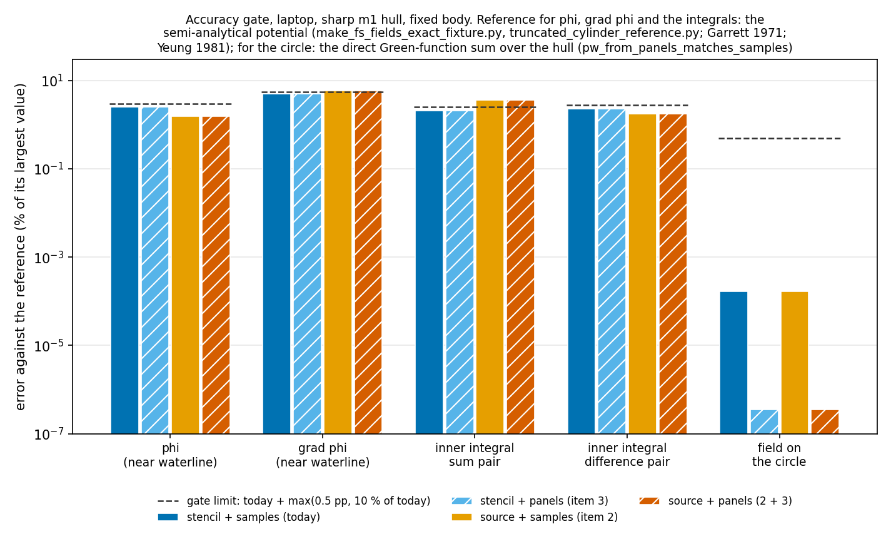

# Accuracy gate G1, laptop part (unit-test scale, exact references)

Errors in % of the largest exact value (fields: of the ring; integral: of the three psi_k; circle: of the
largest sample). Exact data: the sharp m1 hull (448 panels), fixed body, the exact potential on the panels
(fs_inner_source_matches_exact, fs_inner_source_exact.txt in this folder) and the 448-panel cylinder for the
circle (pw_from_panels_matches_samples). G1 margin = max(0.5 percentage points, 10 % of today's error); a route
passes a quantity when its error is at most today's + margin. Made by make_g1_table.py; figure G1_errors.png.

| Quantity | stencil + samples (today) | stencil + panels (item 3) | source + samples (item 2) | source + panels (2 + 3) | G1 margin | Item 3 (panels) | Item 2 (source) | Items 2 + 3 |
|---|---|---|---|---|---|---|---|---|
| phi, inner points 0.1-3.5 m from the waterline (worst ring) | 2.5 | 2.5 (= today, no circle) | 1.55 | 1.55 (= item 2, no circle) | 0.5 pp | pass (+0 pp) | pass (-0.949 pp) | pass (-0.949 pp) |
| grad phi, same rings (worst: 0.1 m) | 4.92 | 4.92 (= today, no circle) | 5.84 | 5.84 (= item 2, no circle) | 0.5 pp | pass (+0 pp) | **FAIL** (+0.92 pp) | **FAIL** (+0.92 pp) |
| inner integral, sum pair (1.4, 1.0) rad/s, max over psi_1,3,5 | 2.05 | 2.05 (= today, no circle) | 3.58 | 3.58 | 0.5 pp | pass (+0 pp) | **FAIL** (+1.53 pp) | **FAIL** (+1.53 pp) |
| inner integral, difference pair, max over psi_1,3,5 | 2.28 | 2.28 (= today, no circle) | 1.78 | 1.78 | 0.5 pp | pass (+0 pp) | pass (-0.502 pp) | pass (-0.502 pp) |
| field on the circle against the exact direct sum | 0.000168 | 3.59e-07 | 0.000168 (= today, no inner route) | 3.59e-07 (= item 3, no inner route) | 0.5 pp | pass (-0.000168 pp) | pass (+0 pp) | pass (-0.000168 pp) |

G1_errors.png: error of each quantity against its exact value, per route (log axis); the dashed line is the G1 limit of each quantity. The panels circle (hatched) changes only the circle field, which it puts on the exact series; the source route (orange) passes phi and the difference integral but fails grad phi at 0.1 m and the sum integral. Bars marked "=" in the table are equal by construction, not separate runs.

Verdict on the laptop numbers: item 3 (qtf_fs_circle = panels) passes; item 2 (qtf_fs_inner = source) fails; both together fails.

## Without an exact laptop reference

| Quantity | Measure | Value | Reading for G1 |
|---|---|---|---|
| FS_inner + FS_outer, qtf_fs_main (integration) | panels against samples, of max abs FS | 4.7e-6 | the panels error is within 4.7e-4 pp of the samples error (triangle inequality): far inside the 0.5 pp margin |
| non-FS files, qtf_fs_main | panels against samples | line for line | unchanged |
| FS_inner + FS_outer, qtf_fs_main (integration) | source against stencil, of max abs FS | 0.559 (free), 0.067-0.268 per mode (fixed) | not an error against an exact value, but 13-112 times the 0.5 pp G1 margin |
| hull refinement 220 -> 960 panels, fixed body (Task 6 review) | change of FS_inner + FS_outer, of max abs FS | stencil 0.2-1.1 % (heave 4.9 %), source 1.5-24.9 % | the source route is not hull-converged; the stencil route is |
| .11s/.12s FS part and totals, sharp m2 fixed and free, round m2 | against the 7c-2 exact references | Snellius | prepared in ../snellius (G1 item 3 job set), not run |

## Decision

- Item 2 (qtf_fs_inner = source) stays off (ruling 1, decided on these numbers): grad phi next to the waterline (5.84 % against 4.92 %, margin 0.5 pp) and the sum inner integral (3.58 % against 2.05 %) fail, and the route moves 16-25 % with the hull mesh where the stencil route moves 0.3-1 %. It is also blocked with qtf_direct = 1, IRSP = 1 and ISOLV = 2. No Snellius case for it.
- Item 3 (qtf_fs_circle = panels) passes every laptop quantity: it changes only the partial waves, which it puts on the exact series (3.6e-9 against 1.7e-6 for the samples), and the end-to-end FS terms move by 4.7e-6. It becomes the default only after the Snellius part (sharp m2 fixed and free, round m2, sum and difference, against the 7c-2 exact references; ../snellius/README.md).
- Items 2 + 3 together: the panels circle does not change the source route's inner integral (3.581e-2 and 1.782e-2 with either circle, measured), so the combination fails where item 2 fails.
- The defaults are not changed here (stencil and samples stay); the defaults commit waits for the Snellius results.
